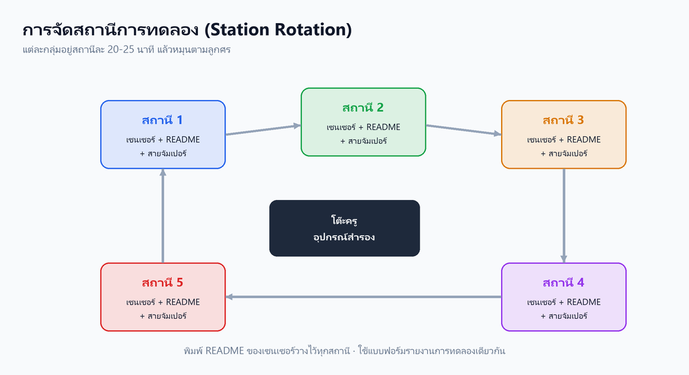

# คู่มือครู

## 1. การเตรียมก่อนสอน

### ซอฟต์แวร์ (ติดตั้งล่วงหน้าทุกเครื่อง)

- [ ] Arduino IDE 2.x
- [ ] ไดรเวอร์ USB **CH340** (บอร์ด Nano ส่วนใหญ่ใช้ชิปนี้)
- [ ] ไลบรารี: `Adafruit SSD1306`, `Adafruit GFX`, `DHT sensor library`, `Adafruit Unified Sensor`, `OneWire`, `DallasTemperature`, `IRremote`
- [ ] (หน่วยที่ 8) แพ็กเกจบอร์ด **esp32 by Espressif**
- [ ] ทดสอบอัปโหลด Blink ทุกเครื่องก่อนคาบแรก

### อุปกรณ์ต่อกลุ่ม (3-4 คน)

| รายการ | จำนวน |
|-------|------|
| Lotus Nano Bot + สาย USB | 1 |
| แบตเตอรี่ LiPo 7.4V + ที่ชาร์จ (หน่วยที่ 7-8) | 1 |
| สายจัมเปอร์ Female-Female | 10 |
| ชุดเซนเซอร์ 37-in-1 (แบ่งตามสถานี) | 1 ชุด/ห้อง หรือตามสถานี |
| แม่เหล็ก, ไฟฉาย, เทปดำ, กระดาษขาว A3 | อย่างละ 1 |
| ESP32 DevKit (หน่วยที่ 8) | 1 |

### การจัดสถานี (Station Rotation)

ชุด 37-in-1 มีเซนเซอร์แต่ละชนิดเพียงชิ้นเดียว จึงแนะนำให้จัด "สถานี" โดยวางเซนเซอร์ + README ที่พิมพ์ไว้ + สายจัมเปอร์ที่โต๊ะ แล้วให้กลุ่มนักเรียนหมุนเวียน ถ้ามีหลายชุดให้ทำสถานีซ้ำเพื่อลดเวลารอ

## 2. ความปลอดภัย (อธิบายในคาบแรก และติดไว้ในห้อง)

1. ถอดสาย USB/แบตเตอรี่ก่อนเปลี่ยนการต่อสายทุกครั้ง
2. ตรวจขั้ว VCC/GND ก่อนเสียบ — ต่อกลับขั้วอาจทำให้เซนเซอร์เสีย
3. **เลเซอร์ (KY-008):** ห้ามส่องเข้าตาคน/สัตว์ ห้ามส่องกระจก
4. **รีเลย์ (KY-019):** ใช้กับไฟ ≤ 12V DC เท่านั้นในห้องเรียน ห้ามต่อไฟบ้าน 220V
5. **เปลวไฟ (KY-026):** ครูเป็นผู้จุดไฟ วางบนถาดกันไฟ มีน้ำ/ผ้าชุบน้ำสำรอง
6. **แบตเตอรี่ LiPo:** ห้ามลัดวงจร ห้ามใช้ก้อนที่บวม ชาร์จภายใต้การดูแล ถอดเมื่อเลิกใช้
7. ยกล้อหุ่นยนต์ให้ลอยก่อนอัปโหลดโค้ดมอเตอร์
8. **Mercury Switch (KY-017):** ถ้าเป็นรุ่นปรอทจริงและหลอดแตก ห้ามจับ แจ้งครูทันที (ชุดใหม่ส่วนใหญ่เป็นลูกบอลโลหะ)

## 3. ปัญหาที่พบบ่อยในห้องเรียน

| อาการ | สาเหตุที่พบบ่อย | วิธีแก้ |
|------|--------------|-------|
| อัปโหลดไม่ได้ (`not in sync`) | Processor ผิด / Bluetooth ค้างที่ D0-D1 | เลือก **ATmega328P (Old Bootloader)**, ถอด Bluetooth |
| ไม่มีพอร์ต COM | ไม่มีไดรเวอร์ / สาย USB ชาร์จอย่างเดียว | ติดตั้ง CH340, เปลี่ยนสาย |
| บัซเซอร์ดังเองตลอด | ต่อเซนเซอร์ที่ D3 และเซนเซอร์ส่ง HIGH/LOW สลับ | ย้ายเซนเซอร์ไป A0-A3 |
| มอเตอร์กระตุก/หมุนเอง | ต่อเซนเซอร์ไว้ที่ D4-D9 | ย้ายพอร์ต (ดู[ชีตสรุป](cheatsheet.md)) |
| อ่านค่าจาก D3 ไม่เปลี่ยนเลย | วงจรบัซเซอร์บนบอร์ดดึงแรงดันขา D3 (ขึ้นกับรุ่นบอร์ด) | ย้ายเซนเซอร์ไป A0-A3 (14-17) ซึ่งไม่มีอุปกรณ์อื่นต่ออยู่ |
| ค่า Analog กระโดด | GND ไม่ต่อ / สายหลวม / ไม่ได้เฉลี่ยค่า | ตรวจสาย, ใช้ค่าเฉลี่ย |
| `digitalRead(A6)` ได้ค่าแปลก | A6/A7 เป็น Analog-only | ใช้ `analogRead(A6) > 512` แทน |
| โมดูล DO ไม่เปลี่ยน | Trimpot ตั้งไว้สุดทาง | ปรับ Trimpot จนไฟ LED บนโมดูลเพิ่งดับ/เพิ่งติด |
| `xxx.h: No such file` | ยังไม่ติดตั้งไลบรารี | Library Manager |

## 4. การวัดและประเมินผล

### เกณฑ์ประเมินใบงาน/รายงานการทดลอง (คะแนนเต็ม 10)

| เกณฑ์ | 2.5 | 1.5 | 0.5 |
|------|-----|-----|-----|
| การต่อวงจรและพอร์ต | ถูกต้อง ไม่ชนกับบอร์ด | ถูกแต่ต้องช่วยแก้ | ต่อผิด |
| ตารางบันทึกผล | ครบ ค่าตามจริง มีหน่วย | ครบบางส่วน | ไม่ครบ |
| คำถามท้ายการทดลอง | ถูกต้อง อธิบายด้วยผลการทดลอง | ถูกบางข้อ | ไม่ถูก |
| ภารกิจท้าทาย/ดัดแปลงโค้ด | ทำสำเร็จ | ทำได้บางส่วน | ไม่ได้ทำ |

### เกณฑ์ประเมินพฤติกรรม (เจตคติ)

| พฤติกรรม | 3 | 2 | 1 |
|---------|---|---|---|
| ความปลอดภัยและการดูแลอุปกรณ์ | ปฏิบัติเสมอ คืนอุปกรณ์ครบ | ต้องเตือนบ้าง | ต้องเตือนบ่อย |
| การทำงานเป็นทีม | ทุกคนมีบทบาท | บางคนมีบทบาท | ทำคนเดียว |
| ความรับผิดชอบ | ส่งงานครบตรงเวลา | ส่งช้า | ไม่ส่ง |

## 5. ข้อเสนอแนะการจัดการเรียนรู้

- **บทบาทในกลุ่ม:** หมุนเวียน ผู้ต่อวงจร / ผู้เขียนโค้ด / ผู้บันทึกผล / ผู้นำเสนอ ทุกหน่วย
- **"ทำนายก่อนทดลอง" (Predict-Observe-Explain):** ให้นักเรียนเขียนคาดการณ์ค่าที่จะอ่านได้ก่อนทดลองจริง แล้วเปรียบเทียบ
- **ไม่ให้คัดลอกอย่างเดียว:** ทุกการทดลองให้ดัดแปลงอย่างน้อย 1 จุด (เปลี่ยนเงื่อนไข, เพิ่มเอาต์พุต)
- **นักเรียนที่ทำเสร็จเร็ว:** ให้ทำภารกิจท้าทาย หรือเป็นผู้ช่วยครูที่สถานีอื่น
- **นักเรียนที่ต้องการความช่วยเหลือ:** ให้เริ่มจากโค้ดตัวอย่างแรกใน README และเน้นตารางบันทึกผล
