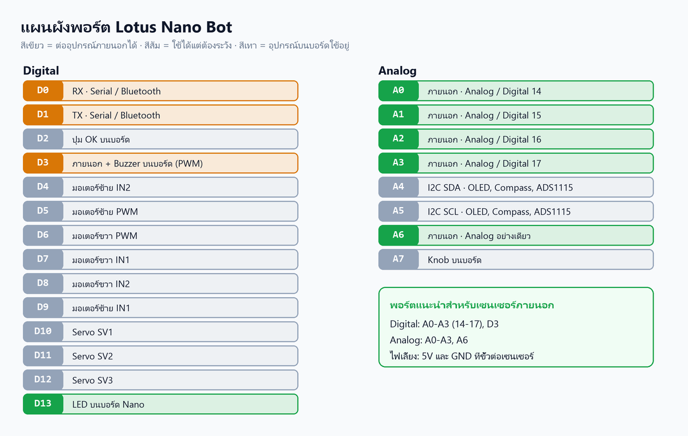
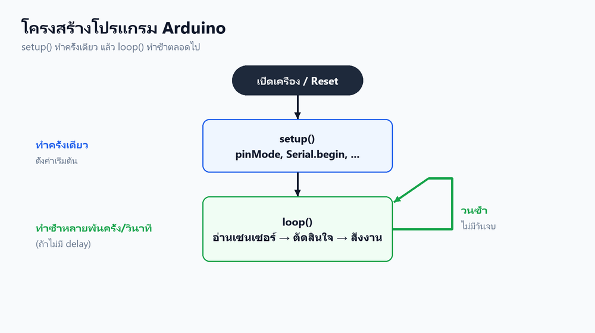

# หน่วยที่ 1: รู้จัก Lotus Nano Bot และ Arduino IDE

| รายการ | รายละเอียด |
|-------|----------|
| เวลา | 3 ชั่วโมง |
| ระดับ | เริ่มต้น |
| อุปกรณ์ | Lotus Nano Bot, สาย USB Mini-B, คอมพิวเตอร์ติดตั้ง Arduino IDE |
| ความรู้เดิม | ไม่ต้องมี |



## จุดประสงค์การเรียนรู้

- **ด้านความรู้ (K):** บอกหน้าที่ของ Microcontroller, พอร์ต Digital/Analog และอุปกรณ์ในตัวของ Lotus Nano Bot ได้
- **ด้านทักษะ (P):** ติดตั้งโปรแกรม เลือกบอร์ด/พอร์ต และอัปโหลดโค้ดได้สำเร็จ, อ่านค่าปุ่มและ Knob แสดงผลบน Serial Monitor และ OLED ได้
- **ด้านเจตคติ (A):** ใช้อุปกรณ์อย่างระมัดระวัง ทำงานร่วมกับเพื่อนในกลุ่ม

## สาระสำคัญ

Arduino Nano ใช้ไมโครคอนโทรลเลอร์ ATmega328P ทำงานตามโปรแกรมที่เราเขียนในฟังก์ชัน `setup()` (ทำครั้งเดียวตอนเริ่ม) และ `loop()` (ทำซ้ำตลอดเวลา) Lotus Nano Bot นำ Nano มาต่อกับอุปกรณ์ในตัว ได้แก่ ปุ่ม (D2), บัซเซอร์ (D3), Knob (A7), มอเตอร์ 2 ตัว, เซอร์โว 3 ช่อง และจอ OLED ผ่าน I2C (A4/A5) จึงต้องรู้ว่าพอร์ตไหน "ว่าง" ก่อนต่อเซนเซอร์ภายนอก



## เนื้อหา

### 1. โครงสร้างโปรแกรม

```cpp
void setup() {
  // ทำงานครั้งเดียวเมื่อเปิดเครื่อง/กด Reset
}

void loop() {
  // ทำงานวนซ้ำไปเรื่อยๆ
}
```

### 2. การทดลองที่ 1.1 — Blink (LED บนบอร์ด Nano ขา D13)

```cpp
void setup() {
  pinMode(13, OUTPUT);
}

void loop() {
  digitalWrite(13, HIGH);  // LED ติด
  delay(500);
  digitalWrite(13, LOW);   // LED ดับ
  delay(500);
}
```

### 3. การทดลองที่ 1.2 — ปุ่ม D2 และ Knob A7 ผ่าน Serial Monitor

```cpp
void setup() {
  Serial.begin(9600);
  pinMode(2, INPUT);
}

void loop() {
  int sw  = digitalRead(2);   // ปุ่มบนบอร์ด
  int nob = analogRead(A7);   // Knob 0 - 1023
  Serial.print("Button: ");
  Serial.print(sw);
  Serial.print("  Knob: ");
  Serial.println(nob);
  delay(200);
}
```

> เปิด **Tools > Serial Monitor** ตั้ง Baud Rate = 9600 หรือ **Serial Plotter** เพื่อดูเป็นกราฟ

### 4. การทดลองที่ 1.3 — เสียงจากบัซเซอร์ D3 ปรับด้วย Knob

```cpp
void setup() {
  pinMode(2, INPUT);
}

void loop() {
  int nob = analogRead(A7);
  int freq = map(nob, 0, 1023, 200, 2000);   // แปลงเป็นความถี่ 200 - 2000 Hz
  if (digitalRead(2) == LOW) {               // กดปุ่ม (ตรวจสอบ: บางบอร์ดกด = HIGH)
    tone(3, freq);
  } else {
    noTone(3);
  }
}
```

> **ครูสังเกต:** ให้นักเรียนเปิด Serial Monitor จากการทดลอง 1.2 ก่อน เพื่อดูว่าปุ่มบนบอร์ดของตนกดแล้วได้ 0 หรือ 1 แล้วแก้เงื่อนไขให้ตรง — เป็นการฝึก "ตรวจสอบก่อนเชื่อ"

### 5. การทดลองที่ 1.4 — แสดงผลบนจอ OLED

ติดตั้งไลบรารี **Adafruit SSD1306** และ **Adafruit GFX** (Sketch > Include Library > Manage Libraries)

```cpp
#include <Wire.h>
#include <Adafruit_GFX.h>
#include <Adafruit_SSD1306.h>

Adafruit_SSD1306 OLED(128, 64, &Wire, -1);   // ถ้าเป็นจอ 0.91" ให้เปลี่ยน 64 เป็น 32

void setup() {
  OLED.begin(SSD1306_SWITCHCAPVCC, 0x3C);
  pinMode(2, INPUT);
}

void loop() {
  OLED.clearDisplay();
  OLED.setTextColor(WHITE);
  OLED.setTextSize(1);
  OLED.setCursor(0, 0);
  OLED.println("LOTUS NANO BOT");
  OLED.print("Button: "); OLED.println(digitalRead(2));
  OLED.print("Knob  : "); OLED.println(analogRead(A7));
  OLED.display();
  delay(100);
}
```

## กิจกรรมการเรียนการสอน

| ขั้น | กิจกรรม | เวลา |
|-----|--------|-----|
| นำเข้าสู่บทเรียน | ทำแบบทดสอบก่อนเรียน, ให้ดูหุ่นยนต์ที่ตั้งโปรแกรมไว้ (เดิน+เสียง) แล้วถามว่า "หุ่นยนต์รู้ได้อย่างไรว่าต้องทำอะไร" | 25 นาที |
| สอน | อธิบายส่วนประกอบบอร์ดด้วยแผนผังพอร์ต, ติดตั้ง IDE, เลือกบอร์ด/พอร์ต, โครงสร้าง setup/loop | 35 นาที |
| ปฏิบัติ | การทดลอง 1.1 - 1.4 เป็นคู่ บันทึกผลในตาราง | 80 นาที |
| ภารกิจท้าทาย | ทำ "เครื่องวัดระดับ Knob" แสดงเป็นแถบบน OLED และส่งเสียงเตือนเมื่อเกิน 900 | 30 นาที |
| สรุป | ทบทวนพอร์ตที่ใช้ได้/ห้ามใช้ ด้วย [ชีตสรุป](cheatsheet.md) | 10 นาที |

## ตารางบันทึกผล

| ตำแหน่ง Knob | ค่า analogRead(A7) | ความถี่ที่ได้ (Hz) | สังเกตเสียง |
|-------------|------------------|-----------------|-----------|
| หมุนสุดซ้าย | | | |
| กึ่งกลาง | | | |
| หมุนสุดขวา | | | |

## แบบฝึกหัด

1. ฟังก์ชัน `setup()` และ `loop()` ต่างกันอย่างไร
2. ถ้าต้องการต่อเซนเซอร์ภายนอกแบบ Digital 2 ตัว ควรใช้พอร์ตใด เพราะอะไร
3. `analogRead(A7)` ได้ค่า 512 แรงดันที่ขา A7 ประมาณกี่โวลต์
4. ทำไมการใช้ `tone()` ที่ขา 3 จึงได้ยินเสียงทั้งที่ไม่ได้ต่อลำโพงเพิ่ม

<details>
<summary>เฉลย</summary>

1. `setup()` ทำงานครั้งเดียวตอนเริ่มต้น ใช้กำหนดค่าเริ่มต้น เช่น `pinMode`, `Serial.begin` ส่วน `loop()` ทำงานวนซ้ำตลอดเวลา ใช้เขียนการทำงานหลัก
2. ใช้ A0-A3 ในโหมด Digital (14-17) เพราะไม่ชนกับอุปกรณ์บนบอร์ด (D3 มีบนหัวต่อแต่ใช้ร่วมกับบัซเซอร์, D0/D1 ใช้กับ Serial, D2 เป็นปุ่ม, D4-D9 เป็นมอเตอร์) โดยเสียบสายสัญญาณที่ช่องขาว 5V ที่ช่องแดง และ GND ที่ช่องดำ
3. 512 × 5 / 1023 ≈ 2.5 V
4. เพราะบัซเซอร์บนบอร์ดต่ออยู่กับขา D3 อยู่แล้ว

</details>

## การวัดและประเมินผล

| สิ่งที่ประเมิน | วิธีการ | เกณฑ์ผ่าน |
|-------------|-------|---------|
| อัปโหลดโค้ดสำเร็จ | สังเกต | ทำได้ทั้ง 4 การทดลอง |
| ตารางบันทึกผล | ตรวจใบงาน | บันทึกครบและถูกต้อง |
| แบบฝึกหัด | ตรวจคำตอบ | ถูก 3 ใน 4 ข้อ |

## การแก้ปัญหาที่พบบ่อย

| อาการ | สาเหตุ / วิธีแก้ |
|------|----------------|
| `avrdude: stk500_getsync() not in sync` | เลือก Processor เป็น **ATmega328P (Old Bootloader)**, ตรวจพอร์ต, ถอด Bluetooth ที่ D0/D1 |
| ไม่เห็นพอร์ต COM | ติดตั้งไดรเวอร์ **CH340**, เปลี่ยนสาย USB (บางเส้นชาร์จได้อย่างเดียว) |
| Serial Monitor เป็นตัวอักษรแปลกๆ | Baud Rate ไม่ตรงกับ `Serial.begin()` |
| OLED ไม่ติด | ตรวจ Address (0x3C หรือ 0x3D), ขนาดจอ 128x64 / 128x32 |

---
[⬅ กลับหน้าหลักสูตร](README.md) | [หน่วยที่ 2 ➡](unit-02-digital-input.md)
