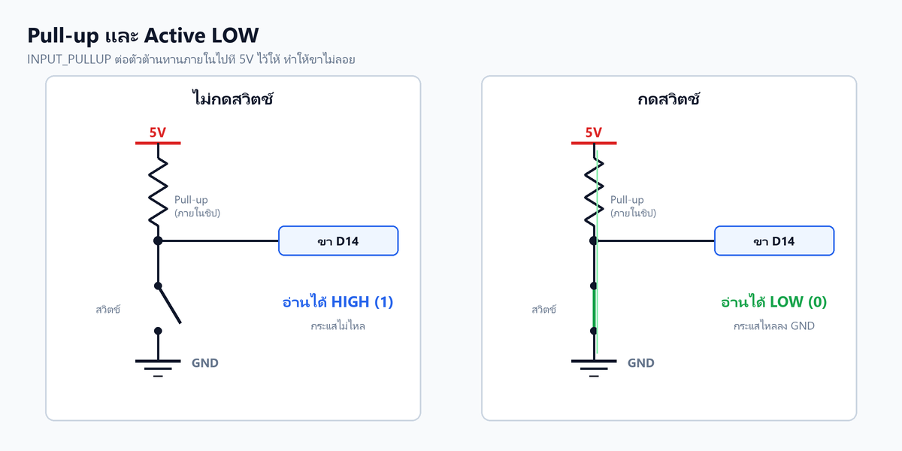
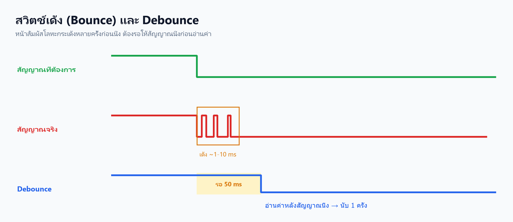

# หน่วยที่ 2: Digital Input — สวิตช์และเซนเซอร์เปิด/ปิด

| รายการ | รายละเอียด |
|-------|----------|
| เวลา | 3 ชั่วโมง |
| อุปกรณ์ | Lotus Nano Bot, สายจัมเปอร์ Female-Female, แม่เหล็ก, เซนเซอร์ตามตารางสถานี |
| ความรู้เดิม | หน่วยที่ 1 |

## จุดประสงค์การเรียนรู้

- **K:** อธิบายความหมายของสัญญาณ Digital (HIGH/LOW), Pull-up/Pull-down และ Active LOW ได้
- **P:** ต่อเซนเซอร์แบบสวิตช์เข้าพอร์ตที่ถูกต้อง เขียนโปรแกรมตรวจจับสถานะ และกันการเด้งของสวิตช์ (Debounce) ได้
- **A:** บันทึกผลการทดลองตามจริงและทำงานเป็นทีม

## สาระสำคัญ

สัญญาณ Digital มีเพียง 2 สถานะ คือ HIGH (≈5V, ค่า 1) และ LOW (≈0V, ค่า 0) เซนเซอร์ในหน่วยนี้ทำหน้าที่เหมือน "สวิตช์" ที่เปลี่ยนสถานะเมื่อเกิดเหตุการณ์ เช่น กด เอียง ใกล้แม่เหล็ก หรือสัมผัส ขาอินพุตที่ไม่ได้ต่ออะไรจะ "ลอย" (Floating) อ่านค่าสุ่ม จึงต้องมีตัวต้านทาน Pull-up หรือใช้ `INPUT_PULLUP` ภายในชิป



## เนื้อหา

### 1. Pull-up ภายในและ Active LOW

```cpp
#define SENSOR_PIN 14   // A0 ในโหมด Digital

void setup() {
  Serial.begin(9600);
  pinMode(SENSOR_PIN, INPUT_PULLUP);  // ไม่กด = HIGH, กด/ทำงาน = LOW
  pinMode(13, OUTPUT);
}

void loop() {
  bool active = (digitalRead(SENSOR_PIN) == LOW);
  digitalWrite(13, active);
  Serial.println(active ? "ACTIVE" : "-");
  delay(50);
}
```

### 2. Debounce — กันสวิตช์เด้ง

หน้าสัมผัสโลหะจะ "เด้ง" หลายครั้งในเวลาไม่กี่มิลลิวินาที โปรแกรมจึงอาจนับการกด 1 ครั้งเป็นหลายครั้ง



```cpp
#define BTN 14
int count = 0;
int lastState = HIGH;
unsigned long lastChange = 0;

void setup() {
  Serial.begin(9600);
  pinMode(BTN, INPUT_PULLUP);
}

void loop() {
  int state = digitalRead(BTN);
  if (state != lastState && millis() - lastChange > 50) {  // รอให้นิ่ง 50 ms
    lastChange = millis();
    if (state == LOW) {          // นับเฉพาะตอนเริ่มกด (ขอบขาลง)
      count++;
      Serial.print("Count = ");
      Serial.println(count);
    }
    lastState = state;
  }
}
```

### 3. ตรวจจับ "ขอบ" (Edge) แทน "ระดับ" (Level)

- **Level:** ทำงานตลอดที่สวิตช์ถูกกด (เช่น LED ติดค้าง)
- **Edge:** ทำงานครั้งเดียวตอนเปลี่ยนสถานะ (เช่น นับครั้ง, Toggle)

## สถานีการทดลอง (Station Rotation)

แบ่งกลุ่ม 3-4 คน หมุนเวียนสถานีละ 20 นาที ทำ "กิจกรรมการเรียนรู้" ท้าย README ของแต่ละเซนเซอร์

| สถานี | เซนเซอร์ | สิ่งที่ทำให้ทำงาน | เอกสาร |
|------|---------|----------------|-------|
| 1 | KY-004 Button Module | กดปุ่ม | [README](../modules/button-module/README.md) |
| 2 | KY-020 Ball Tilt / KY-017 Mercury Tilt / KY-027 Magic Light Cup | เอียงบอร์ด | [Ball](../sensors/tilt-switch/README.md) / [Mercury](../sensors/mercury-switch/README.md) / [Light Cup](../sensors/light-cup-module/README.md) |
| 3 | KY-021 Mini Reed / KY-025 Reed Switch | นำแม่เหล็กเข้าใกล้ | [Mini Reed](../sensors/magnetic-spring-sensor/README.md) / [Reed](../sensors/reed-switch/README.md) |
| 4 | KY-036 Touch Sensor | แตะด้วยนิ้ว | [README](../sensors/touch-sensor/README.md) |
| 5 | KY-031 Tap / KY-002 Vibration | เคาะ / สั่น | [Tap](../sensors/tap-module/README.md) / [Vibration](../sensors/vibration-sensor/README.md) |

## กิจกรรมการเรียนการสอน

| ขั้น | กิจกรรม | เวลา |
|-----|--------|-----|
| นำเข้า | สาธิตปุ่มที่ไม่ใส่ Pull-up ให้ค่ากระโดดบน Serial Plotter แล้วถามว่าเกิดอะไรขึ้น | 15 นาที |
| สอน | HIGH/LOW, INPUT_PULLUP, Active LOW, Debounce, Edge vs Level | 30 นาที |
| ปฏิบัติ | Station Rotation 5 สถานี | 100 นาที |
| สรุป | แต่ละกลุ่มนำเสนอ "เซนเซอร์ไหนเด้งมากที่สุด" พร้อมหลักฐานจากตารางบันทึก | 20 นาที |
| ภารกิจท้าทาย | **กล่องสมบัติกันขโมย:** Reed Switch ตรวจฝากล่อง + Tilt ตรวจการยก → บัซเซอร์ D3 ดัง, ปุ่ม D2 ปิดเสียง | 15 นาที (ต่อเป็นการบ้าน) |

## แบบฝึกหัด

1. ถ้าใช้ `pinMode(pin, INPUT)` กับปุ่มที่ไม่มีตัวต้านทาน แล้วไม่ได้กดปุ่ม จะอ่านค่าได้อย่างไร
2. เมื่อใช้ `INPUT_PULLUP` ปุ่มถูกกดจะอ่านค่าได้เท่าใด
3. ทำไมกดปุ่ม 1 ครั้ง แต่ตัวนับเพิ่มขึ้น 3 ครั้ง และแก้อย่างไร
4. Reed Switch ต่างจาก Hall Sensor อย่างไร (เทียบกับหน่วยที่ 4)

<details>
<summary>เฉลย</summary>

1. ค่าลอย (Floating) อาจเป็น 0 หรือ 1 สุ่มไปมา ไวต่อสัญญาณรบกวนหรือการเอามือเข้าใกล้
2. LOW (0)
3. เกิดสวิตช์เด้ง (Bounce) แก้โดยใช้ Debounce ด้วย `millis()` รอให้สัญญาณนิ่ง และนับเฉพาะขอบสัญญาณ
4. Reed Switch เป็นหน้าสัมผัสโลหะทางกล (ไม่ต้องใช้ไฟเลี้ยง สึกหรอได้) ส่วน Hall Sensor เป็นสารกึ่งตัวนำ ไม่มีชิ้นส่วนเคลื่อนที่ ตอบสนองเร็ว และให้ค่า Analog ตามความแรงสนามแม่เหล็กได้

</details>

## การวัดและประเมินผล

| สิ่งที่ประเมิน | วิธีการ | เกณฑ์ผ่าน |
|-------------|-------|---------|
| ต่อวงจรถูกพอร์ต | ตรวจที่สถานี | ไม่มีขาชนกับอุปกรณ์บนบอร์ด |
| ตารางบันทึกผลทุกสถานี | ตรวจใบงาน | ครบ ≥ 4 สถานี |
| โค้ด Debounce | ทดสอบจริง | นับถูก 10 ครั้งจาก 10 การกด |

---
[⬅ หน่วยที่ 1](unit-01-getting-started.md) | [หลักสูตร](README.md) | [หน่วยที่ 3 ➡](unit-03-digital-output.md)
