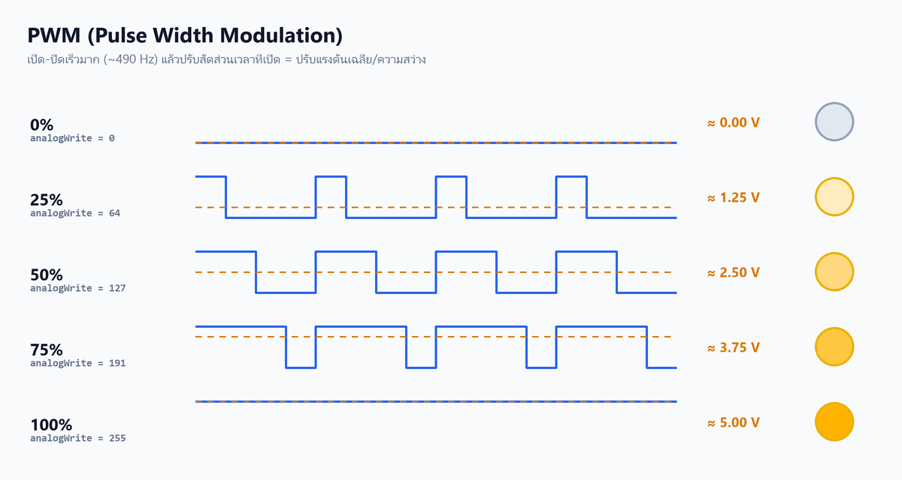
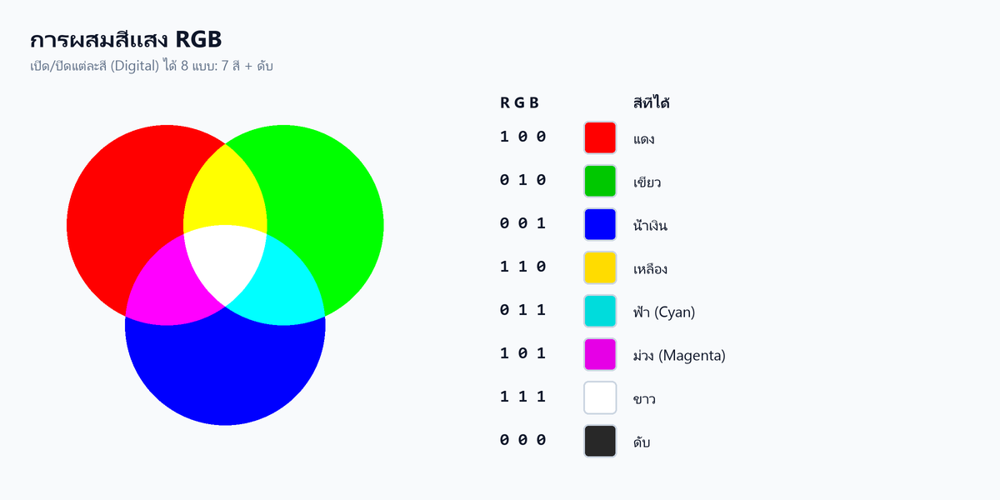
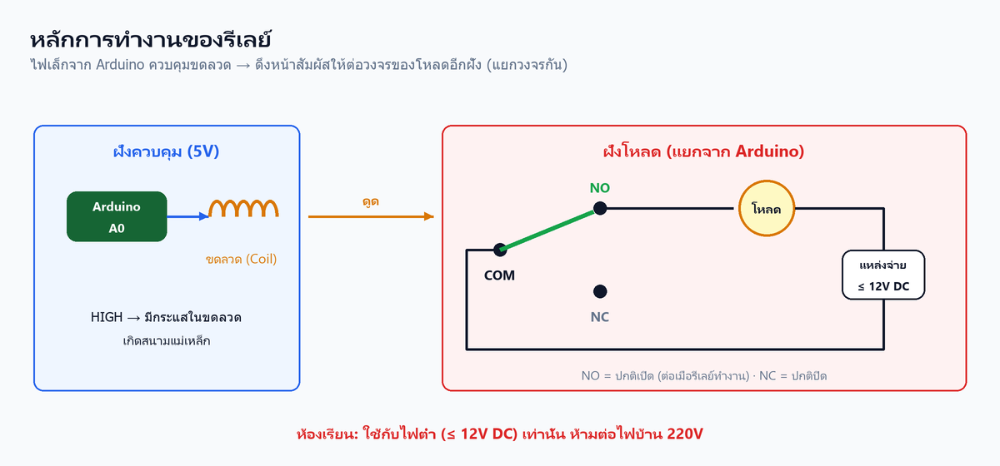

# หน่วยที่ 3: Digital Output — LED, Buzzer, Relay

| รายการ | รายละเอียด |
|-------|----------|
| เวลา | 3 ชั่วโมง |
| อุปกรณ์ | Lotus Nano Bot, LED Module ต่างๆ, Laser, Active Buzzer, Relay, สายจัมเปอร์ |
| ความรู้เดิม | หน่วยที่ 1-2 |

## จุดประสงค์การเรียนรู้

- **K:** อธิบายการทำงานของ `digitalWrite()` และ PWM (`analogWrite()`), ความต่างของ Common Cathode/Common Anode และ Active/Passive Buzzer ได้
- **P:** ควบคุม LED หลายสี บัซเซอร์ และรีเลย์ตามเงื่อนไขจากอินพุตได้ ผสมสีได้ 7 สีด้วย Digital Output
- **A:** ตระหนักถึงความปลอดภัยของแสงเลเซอร์และไฟฟ้าที่ต่อผ่านรีเลย์

## สาระสำคัญ

ขาเอาต์พุตจ่ายแรงดันได้ 2 ระดับคือ 5V (HIGH) หรือ 0V (LOW) และจ่ายกระแสได้ไม่เกินประมาณ 20 mA ต่อขา หากต้องการ "ความสว่างครึ่งหนึ่ง" ต้องใช้ PWM คือการเปิด-ปิดเร็วๆ แล้วปรับสัดส่วนเวลาที่เปิด (Duty Cycle)



> **ข้อจำกัดของ Lotus Nano Bot:** ขา PWM ของ Nano คือ D3, D5, D6, D9, D10, D11 แต่ D5/D6/D9 ใช้กับมอเตอร์ ขา PWM ที่เสียบได้จากหัวต่อจึงเหลือ **D10 (SV1), D11 (SV2)** เมื่อไม่ได้ต่อเซอร์โว และ **D3** (ใช้ร่วมกับบัซเซอร์บนบอร์ด จะมีเสียงหวีด) ดังนั้น LED ที่ต่อกับ A0-A3 จึงทำได้แค่ **เปิด/ปิด** → ผสมสีได้ 7 สี (+ดับ) ถ้าต้องการหรี่ไฟจริงให้ย้ายไปหัวต่อ SV1/SV2

## เนื้อหา

### 1. ผสมสี RGB แบบ Digital (7 สี)



```cpp
#define R_PIN 14   // A0
#define G_PIN 15   // A1
#define B_PIN 16   // A2

void setColor(bool r, bool g, bool b) {
  digitalWrite(R_PIN, r);
  digitalWrite(G_PIN, g);
  digitalWrite(B_PIN, b);
}

void setup() {
  pinMode(R_PIN, OUTPUT);
  pinMode(G_PIN, OUTPUT);
  pinMode(B_PIN, OUTPUT);
}

void loop() {
  setColor(1, 0, 0); delay(500);  // แดง
  setColor(0, 1, 0); delay(500);  // เขียว
  setColor(0, 0, 1); delay(500);  // น้ำเงิน
  setColor(1, 1, 0); delay(500);  // เหลือง
  setColor(0, 1, 1); delay(500);  // ฟ้า (Cyan)
  setColor(1, 0, 1); delay(500);  // ม่วง (Magenta)
  setColor(1, 1, 1); delay(500);  // ขาว
  setColor(0, 0, 0); delay(500);  // ดับ
}
```

### 2. ไม่ใช้ delay() — ทำหลายอย่างพร้อมกันด้วย millis()

```cpp
unsigned long lastBlink = 0;
bool ledState = false;

void setup() {
  pinMode(13, OUTPUT);
}

void loop() {
  if (millis() - lastBlink >= 300) {   // กระพริบทุก 300 ms
    lastBlink = millis();
    ledState = !ledState;
    digitalWrite(13, ledState);
  }
  // ตรงนี้ยังอ่านเซนเซอร์อื่นได้ทันที ไม่ต้องรอ delay
}
```

### 3. Active vs Passive Buzzer

| | Active Buzzer (KY-012) | Passive Buzzer (KY-006) |
|-|----------------------|------------------------|
| วงจรสั่นในตัว | มี | ไม่มี |
| คำสั่ง | `digitalWrite(pin, HIGH)` | `tone(pin, freq)` |
| เปลี่ยนโน้ตได้ | ไม่ได้ (เสียงเดียว) | ได้ |

### 4. Relay — สวิตช์ที่ควบคุมด้วยไฟฟ้า



> **⚠️ ความปลอดภัย:** ในห้องเรียนให้ใช้รีเลย์กับโหลดไฟต่ำ (เช่น LED + ถ่าน, พัดลม 5V) เท่านั้น **ห้ามนักเรียนต่อไฟบ้าน 220V** โดยไม่มีครูควบคุม

## สถานีการทดลอง

| สถานี | โมดูล | เอกสาร |
|------|-------|-------|
| 1 | KY-016 RGB LED / KY-009 SMD RGB | [RGB](../modules/rgb-led/README.md) / [SMD](../modules/smd-rgb-led/README.md) |
| 2 | KY-011 / KY-029 Two-color LED | [Two-color](../modules/two-color-led/README.md) / [Mini](../modules/mini-two-color-led/README.md) |
| 3 | KY-034 7 Color Flash / KY-008 Laser | [7 Color](../modules/7-color-flash-led/README.md) / [Laser](../modules/laser-module/README.md) |
| 4 | KY-012 Active Buzzer | [README](../modules/active-buzzer/README.md) |
| 5 | KY-019 Relay | [README](../modules/relay-module/README.md) |

> **⚠️ เลเซอร์:** ห้ามส่องเข้าตาหรือสะท้อนกระจก แม้เป็นเลเซอร์กำลังต่ำ

## กิจกรรมการเรียนการสอน

| ขั้น | กิจกรรม | เวลา |
|-----|--------|-----|
| นำเข้า | ถามว่า "จอทีวีแสดงสีเหลืองได้อย่างไรทั้งที่มีแค่แดง เขียว น้ำเงิน" สาธิตด้วย RGB LED | 15 นาที |
| สอน | digitalWrite, PWM และข้อจำกัดพอร์ต, การผสมสี, millis(), Active/Passive Buzzer, ความปลอดภัยรีเลย์/เลเซอร์ | 35 นาที |
| ปฏิบัติ | Station Rotation 5 สถานี | 100 นาที |
| ภารกิจท้าทาย | **ไฟจราจรจำลอง:** RGB LED แดง→เขียว→เหลือง, กดปุ่ม D2 = คนข้ามถนน (บัซเซอร์ D3 ดังเป็นจังหวะ) โดยใช้ millis() ไม่ใช้ delay() | 20 นาที |
| สรุป | ทบทวนตารางสีและข้อจำกัด PWM | 10 นาที |

## แบบฝึกหัด

1. ต้องการสีเหลืองจาก RGB LED แบบ Common Cathode ต้องสั่งขาใดเป็น HIGH
2. `analogWrite(3, 64)` ได้ Duty Cycle ประมาณกี่เปอร์เซ็นต์
3. ทำไมต่อ RGB LED ที่ A0-A2 แล้ว `analogWrite(A0, 128)` จึงไม่ได้ความสว่างครึ่งหนึ่ง
4. Common Anode ต่างจาก Common Cathode อย่างไร และต้องเขียนโค้ดต่างกันอย่างไร

<details>
<summary>เฉลย</summary>

1. R และ G เป็น HIGH, B เป็น LOW
2. 64 / 255 × 100 ≈ 25%
3. A0-A2 ไม่ใช่ขา PWM คำสั่ง `analogWrite()` บนขาที่ไม่รองรับจะให้ผลเป็น LOW (ค่า < 128) หรือ HIGH (ค่า ≥ 128) เท่านั้น
4. Common Cathode ขาร่วมต่อ GND สั่ง HIGH = ติด ส่วน Common Anode ขาร่วมต่อ 5V สั่ง LOW = ติด (ตรรกะกลับกัน)

</details>

## การวัดและประเมินผล

| สิ่งที่ประเมิน | วิธีการ | เกณฑ์ผ่าน |
|-------------|-------|---------|
| ผสมสีครบ 7 สี | ทดสอบจริง | ถูกต้องทุกสี |
| ปฏิบัติตามกฎความปลอดภัย | สังเกต | ไม่ส่องเลเซอร์ใส่ผู้อื่น, ไม่ต่อไฟบ้าน |
| ภารกิจไฟจราจร | ทดสอบจริง | ทำงานครบลำดับ ปุ่มตอบสนองทันที |

---
[⬅ หน่วยที่ 2](unit-02-digital-input.md) | [หลักสูตร](README.md) | [หน่วยที่ 4 ➡](unit-04-analog-input.md)
