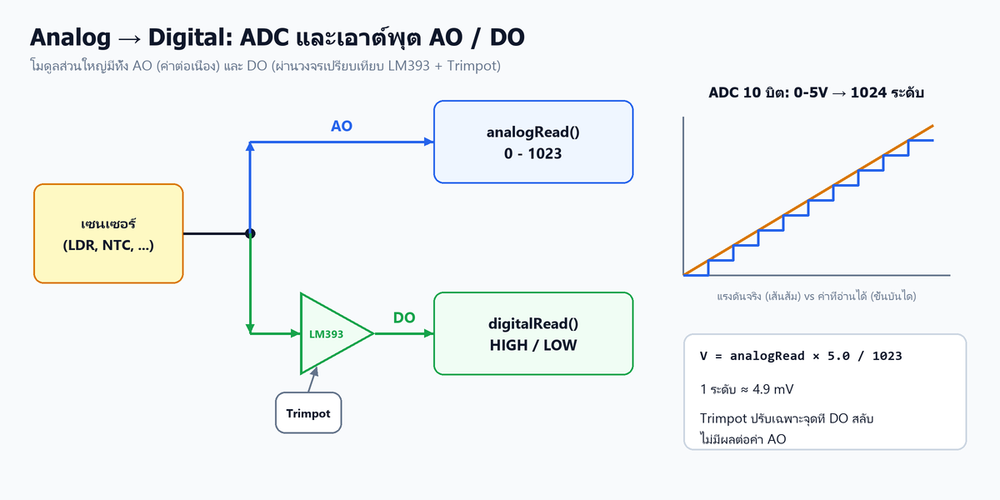
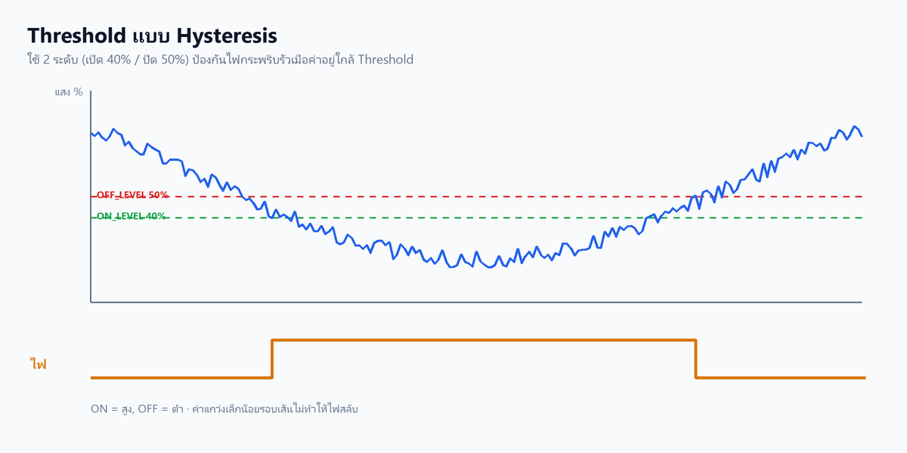

# หน่วยที่ 4: Analog Input — แสง อุณหภูมิ แม่เหล็ก เสียง

| รายการ | รายละเอียด |
|-------|----------|
| เวลา | 4 ชั่วโมง |
| อุปกรณ์ | Lotus Nano Bot, เซนเซอร์ตามตารางสถานี, ไฟฉาย, แม่เหล็ก, ไฟแช็ก/เทียน (ครูควบคุม) |
| ความรู้เดิม | หน่วยที่ 1-3 |

## จุดประสงค์การเรียนรู้

- **K:** อธิบายการแปลงสัญญาณ Analog เป็น Digital (ADC 10 บิต) และความต่างของเอาต์พุต AO กับ DO บนโมดูลได้
- **P:** อ่านค่า `analogRead()` แปลงเป็นแรงดัน/หน่วยที่ต้องการด้วย `map()` หรือสูตร ปรับเทียบ (Calibrate) และกำหนดค่า Threshold ได้
- **A:** ใช้หลักฐานจากข้อมูลที่วัดได้ในการตัดสินใจ

## สาระสำคัญ

สัญญาณ Analog มีค่าต่อเนื่อง เช่น ความสว่างหรืออุณหภูมิ Arduino Nano ใช้ ADC 10 บิต แปลงแรงดัน 0-5V เป็นตัวเลข 0-1023 โมดูลในชุด 37-in-1 ส่วนใหญ่มี 2 เอาต์พุต:

- **AO (Analog Out):** ค่าต่อเนื่อง อ่านด้วย `analogRead()`
- **DO (Digital Out):** ผ่านวงจรเปรียบเทียบ (LM393) กับค่าที่ตั้งด้วย **ตัวต้านทานปรับค่า (Trimpot)** บนโมดูล ได้ HIGH/LOW



## เนื้อหา

### 1. อ่านค่าและแปลงเป็นแรงดัน

```cpp
void setup() {
  Serial.begin(9600);
}

void loop() {
  int raw = analogRead(A0);             // 0 - 1023
  float volt = raw * 5.0 / 1023.0;      // 0 - 5 V
  int percent = map(raw, 0, 1023, 0, 100);
  Serial.print(raw);   Serial.print(",");
  Serial.print(volt);  Serial.print(",");
  Serial.println(percent);              // เปิด Serial Plotter ดูกราฟ
  delay(100);
}
```

### 2. การปรับเทียบ (Calibration) และ Threshold แบบ Hysteresis

ค่าจริงของเซนเซอร์มักไม่ได้อยู่ที่ 0-1023 เต็มช่วง ต้องวัดค่าต่ำสุด/สูงสุดจริงก่อน และใช้ 2 ระดับ (Hysteresis) เพื่อกันการกระพริบเมื่อค่าอยู่ใกล้ Threshold



```cpp
const int DARK_MIN  = 120;   // ค่าที่วัดได้ตอนปิดเซนเซอร์ด้วยมือ
const int LIGHT_MAX = 880;   // ค่าที่วัดได้ตอนส่องไฟฉาย
const int ON_LEVEL  = 40;    // % ต่ำกว่านี้ = มืด → เปิดไฟ
const int OFF_LEVEL = 50;    // % สูงกว่านี้ = สว่าง → ปิดไฟ
bool lampOn = false;

void setup() {
  Serial.begin(9600);
  pinMode(13, OUTPUT);
}

void loop() {
  int raw = analogRead(A0);
  int light = constrain(map(raw, DARK_MIN, LIGHT_MAX, 0, 100), 0, 100);
  if (!lampOn && light < ON_LEVEL)  lampOn = true;
  if (lampOn  && light > OFF_LEVEL) lampOn = false;
  digitalWrite(13, lampOn);
  Serial.println(light);
  delay(100);
}
```

> **หมายเหตุ:** โมดูล LDR บางรุ่นค่าจะ **ลดลง** เมื่อสว่างขึ้น (ขึ้นกับการต่อวงจรแบ่งแรงดัน) ให้นักเรียนตรวจสอบจากการทดลองจริงแล้วสลับ `DARK_MIN` / `LIGHT_MAX`

### 3. ค่าเฉลี่ยเพื่อลดสัญญาณรบกวน

```cpp
int readAverage(int pin, int n) {
  long sum = 0;
  for (int i = 0; i < n; i++) {
    sum += analogRead(pin);
    delay(2);
  }
  return sum / n;
}
```

## สถานีการทดลอง

| สถานี | กลุ่ม | เซนเซอร์ | เอกสาร |
|------|------|---------|-------|
| 1 | แสง | KY-018 Photoresistor | [README](../sensors/photoresistor/README.md) |
| 2 | อุณหภูมิ | KY-013 Analog Temp, KY-028 Digital Temp | [KY-013](../sensors/analog-temperature-sensor/README.md) / [KY-028](../sensors/digital-temperature-sensor/README.md) |
| 3 | แม่เหล็ก | KY-003 Hall (Digital อย่างเดียว — ใช้เปรียบเทียบ), KY-024 Linear Hall, KY-035 Analog Hall | [KY-003](../sensors/hall-magnetic-sensor/README.md) / [KY-024](../sensors/linear-hall-sensor/README.md) / [KY-035](../sensors/analog-hall-sensor/README.md) |
| 4 | เปลวไฟ | KY-026 Flame Sensor | [README](../sensors/flame-sensor/README.md) |
| 5 | เสียง | KY-037 Big Sound, KY-038 Small Sound | [KY-037](../sensors/big-sound-sensor/README.md) / [KY-038](../sensors/small-sound-sensor/README.md) |

> **⚠️ สถานีเปลวไฟ:** ครูเป็นผู้จุดไฟเท่านั้น วางบนถาดกันไฟ ห่างจากเซนเซอร์ ≥ 20 ซม. หรือใช้รีโมททีวี (อินฟราเรด) ทดสอบแทน

## กิจกรรมการเรียนการสอน

| ขั้น | กิจกรรม | เวลา |
|-----|--------|-----|
| นำเข้า | หมุน Knob A7 ดูกราฟใน Serial Plotter เทียบกับปุ่ม D2 → "ต่อเนื่อง" vs "สองสถานะ" | 15 นาที |
| สอน | ADC, สูตรแรงดัน, map/constrain, AO vs DO และการปรับ Trimpot, Calibration, Hysteresis, ค่าเฉลี่ย | 40 นาที |
| ปฏิบัติ | Station Rotation 5 สถานี (สถานีละ 25 นาที) | 125 นาที |
| วิเคราะห์ | แต่ละกลุ่มเขียนกราฟค่าที่ได้จากตารางบันทึก และเลือก Threshold พร้อมเหตุผล | 30 นาที |
| ภารกิจท้าทาย | **ไฟถนนอัตโนมัติ + แสดงผล OLED:** LDR ควบคุม LED แบบ Hysteresis แสดง % แสงและสถานะไฟบน OLED | 30 นาที |

## แบบฝึกหัด

1. ADC 10 บิต แบ่งระดับได้กี่ระดับ ความละเอียดต่อระดับประมาณเท่าใด (ที่ 5V)
2. `analogRead(A1)` ได้ 307 แรงดันประมาณกี่โวลต์
3. ปรับ Trimpot บนโมดูลแล้วค่า AO เปลี่ยนหรือไม่ อธิบาย
4. ทำไมต้องใช้ Hysteresis ในระบบเปิดไฟอัตโนมัติ
5. ทำไมห้ามใช้ `digitalRead(A6)`

<details>
<summary>เฉลย</summary>

1. 2^10 = 1024 ระดับ, 5 / 1024 ≈ 4.9 mV ต่อระดับ
2. 307 × 5 / 1023 ≈ 1.5 V
3. ไม่เปลี่ยน Trimpot ปรับเฉพาะค่าอ้างอิงของวงจรเปรียบเทียบที่ส่งไป DO ค่า AO มาจากเซนเซอร์โดยตรง
4. เมื่อค่าแสงอยู่ใกล้ Threshold สัญญาณรบกวนเล็กน้อยจะทำให้ไฟเปิด-ปิดสลับรัวๆ การใช้ 2 ระดับ (เปิดที่ 40% ปิดที่ 50%) ทำให้ต้องเปลี่ยนแปลงชัดเจนก่อนสลับสถานะ
5. A6 และ A7 ของ ATmega328P (แพ็กเกจ Nano) ต่อกับ ADC อย่างเดียว ไม่มีวงจร Digital I/O

</details>

---
[⬅ หน่วยที่ 3](unit-03-digital-output.md) | [หลักสูตร](README.md) | [หน่วยที่ 5 ➡](unit-05-libraries-protocols.md)
