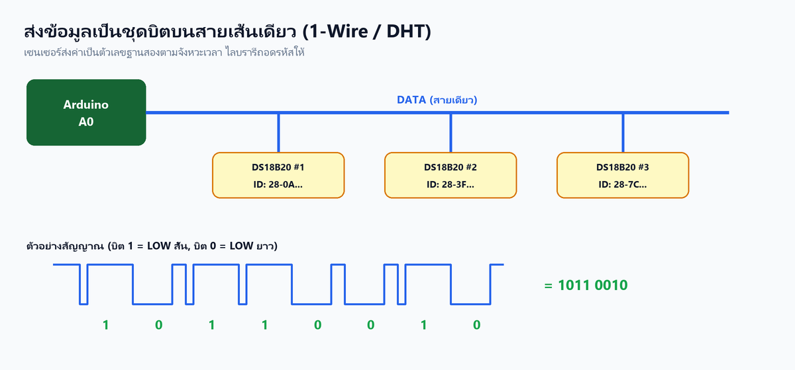
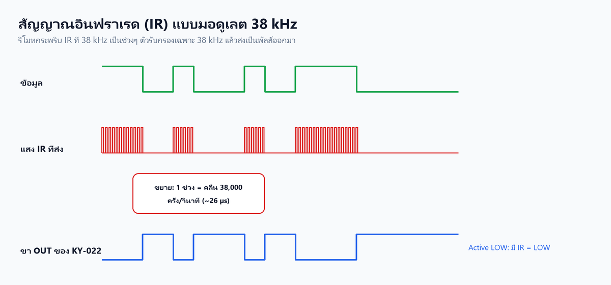

# หน่วยที่ 5: เซนเซอร์ที่ใช้ไลบรารีและโปรโตคอล

| รายการ | รายละเอียด |
|-------|----------|
| เวลา | 3 ชั่วโมง |
| อุปกรณ์ | Lotus Nano Bot, KY-015 DHT11, KY-001 DS18B20, KY-022 IR Receiver, KY-005 IR Emitter, KY-039 Heartbeat, รีโมททีวี |
| ความรู้เดิม | หน่วยที่ 1-4 |

## จุดประสงค์การเรียนรู้

- **K:** อธิบายความหมายของ "ไลบรารี" และ "โปรโตคอลสื่อสาร" (One-Wire, สัญญาณ IR แบบมอดูเลต 38 kHz) ได้
- **P:** ติดตั้งไลบรารีผ่าน Library Manager อ่านค่าอุณหภูมิ/ความชื้น และถอดรหัสปุ่มรีโมท IR ได้
- **A:** อ่านเอกสารและตัวอย่างโค้ดของไลบรารีด้วยตนเอง

## สาระสำคัญ

เซนเซอร์บางชนิดไม่ได้ส่งแค่ HIGH/LOW หรือแรงดัน แต่ส่ง "ข้อมูลเป็นชุดบิต" ตามจังหวะเวลาที่กำหนด (โปรโตคอล) การเขียนโค้ดอ่านเองซับซ้อน จึงใช้ **ไลบรารี** ซึ่งเป็นโค้ดสำเร็จรูปที่ผู้อื่นเขียนไว้



| เซนเซอร์ | โปรโตคอล | ไลบรารี |
|---------|---------|--------|
| KY-015 DHT11 | Single-bus เฉพาะของ DHT | `DHT sensor library` (Adafruit) + `Adafruit Unified Sensor` |
| KY-001 DS18B20 | 1-Wire (Dallas) ต่อหลายตัวบนสายเดียวได้ | `OneWire` + `DallasTemperature` |
| KY-022 / KY-005 IR | IR มอดูเลต 38 kHz (เช่น NEC) | `IRremote` |
| KY-039 Heartbeat | Analog (ไม่ใช้ไลบรารี) แต่ต้องประมวลผลสัญญาณ | - |

## เนื้อหา

### 1. ติดตั้งไลบรารี

**Sketch > Include Library > Manage Libraries...** → ค้นหาชื่อ → **Install** (ถ้ามีถามติดตั้ง Dependencies ให้กด Install All)

### 2. ใช้ไลบรารี: รูปแบบที่พบเสมอ

```cpp
#include <ชื่อไลบรารี.h>      // 1. ผนวกไลบรารี
ClassName sensor(pin);         // 2. สร้างอ็อบเจกต์ (Object)

void setup() {
  sensor.begin();              // 3. เริ่มต้น
}

void loop() {
  float v = sensor.readSomething();   // 4. เรียกใช้เมธอด (Method)
}
```

### 3. ตัวอย่าง: DHT11 แสดงผลบน OLED

```cpp
#include <Wire.h>
#include <Adafruit_GFX.h>
#include <Adafruit_SSD1306.h>
#include <DHT.h>

#define DHTPIN 14          // A0
#define DHTTYPE DHT11
DHT dht(DHTPIN, DHTTYPE);
Adafruit_SSD1306 OLED(128, 64, &Wire, -1);

void setup() {
  dht.begin();
  OLED.begin(SSD1306_SWITCHCAPVCC, 0x3C);
}

void loop() {
  float h = dht.readHumidity();
  float t = dht.readTemperature();
  OLED.clearDisplay();
  OLED.setTextColor(WHITE);
  OLED.setTextSize(2);
  OLED.setCursor(0, 0);
  if (isnan(h) || isnan(t)) {
    OLED.println("Error");
  } else {
    OLED.print(t, 1); OLED.println(" C");
    OLED.print(h, 0); OLED.println(" %");
  }
  OLED.display();
  delay(2000);             // DHT11 อ่านได้ไม่เร็วกว่า 1 ครั้ง/วินาที
}
```

### 4. IR: สัญญาณมอดูเลต 38 kHz

รีโมทไม่ได้เปิดไฟ IR ค้าง แต่กระพริบที่ 38 kHz เป็นช่วงๆ ตัวรับ (VS1838B) จะกรองเฉพาะ 38 kHz ทำให้ไม่ถูกรบกวนจากแสงแดดหรือหลอดไฟ



ดูโค้ดเต็มที่ [IR Receiver](../sensors/ir-receiver/README.md) และ [IR Emitter](../modules/ir-emission-module/README.md)

## สถานีการทดลอง

| สถานี | เซนเซอร์ | กิจกรรมหลัก | เอกสาร |
|------|---------|-----------|-------|
| 1 | KY-015 DHT11 | เป่าลมหายใจ ดูความชื้นเปลี่ยน | [README](../sensors/temperature-humidity-sensor/README.md) |
| 2 | KY-001 DS18B20 | จุ่มในน้ำเย็น/น้ำอุ่น (เฉพาะรุ่นกันน้ำ) หรือกำด้วยมือ | [README](../sensors/ds18b20-temperature-sensor/README.md) |
| 3 | KY-022 IR Receiver | ถอดรหัสปุ่มรีโมททีวี จดตารางรหัส | [README](../sensors/ir-receiver/README.md) |
| 4 | KY-005 IR Emitter | ส่งรหัสไปยังบอร์ดของกลุ่มข้างๆ | [README](../modules/ir-emission-module/README.md) |
| 5 | KY-039 Heartbeat | ดูชีพจรบน Serial Plotter | [README](../sensors/heartbeat-sensor/README.md) |

## กิจกรรมการเรียนการสอน

| ขั้น | กิจกรรม | เวลา |
|-----|--------|-----|
| นำเข้า | ส่องกล้องมือถือที่หัวรีโมทแล้วกดปุ่ม → เห็นแสง IR ที่ตามองไม่เห็น | 10 นาที |
| สอน | ไลบรารีคืออะไร, ติดตั้ง, Object/Method, โปรโตคอล One-Wire และ IR | 30 นาที |
| ปฏิบัติ | Station Rotation 5 สถานี | 100 นาที |
| ภารกิจท้าทาย | **รีโมทควบคุมหุ่นยนต์:** ใช้ปุ่มรีโมททีวีสั่ง LED / เซอร์โว SV1 / มอเตอร์ (หมายเหตุ: ไลบรารี IRremote ใช้ Timer ร่วมกับ `tone()` ถ้าจะให้บัซเซอร์ D3 ดังให้ใช้ `digitalWrite` สลับเอง หรือหยุดรับ IR ชั่วคราว) | 30 นาที |
| สรุป | เปรียบเทียบ DHT11 กับ DS18B20 (ความแม่นยำ, ช่วงวัด, ความเร็ว) | 10 นาที |

## แบบฝึกหัด

1. ไลบรารีช่วยผู้เขียนโปรแกรมอย่างไร
2. ถ้า `dht.readTemperature()` คืนค่า `nan` ควรตรวจสอบอะไรบ้าง
3. ข้อดีของโปรโตคอล 1-Wire ของ DS18B20 คืออะไร
4. ทำไมตัวรับ IR จึงไม่ทำงานผิดพลาดเมื่ออยู่กลางแดด (ในระดับหนึ่ง)

<details>
<summary>เฉลย</summary>

1. ไม่ต้องเขียนโค้ดจัดการจังหวะเวลาของโปรโตคอลเอง เรียกใช้ฟังก์ชันสำเร็จรูปได้ทันที ลดข้อผิดพลาดและเวลาพัฒนา
2. การต่อสาย (ขา Data/VCC/GND), ขาที่ประกาศใน `#define DHTPIN`, ชนิด `DHT11`/`DHT22` ถูกต้องหรือไม่, อ่านถี่เกินไป (ต้อง ≥ 1-2 วินาที), ติดตั้งไลบรารีครบ
3. ใช้สายข้อมูลเส้นเดียว และต่อเซนเซอร์หลายตัวบนสายเดียวกันได้ เพราะแต่ละตัวมีรหัสประจำตัว 64 บิต
4. ตัวรับกรองเฉพาะสัญญาณที่กระพริบที่ 38 kHz แสงแดดเป็นแสง IR คงที่จึงถูกกรองออก

</details>

---
[⬅ หน่วยที่ 4](unit-04-analog-input.md) | [หลักสูตร](README.md) | [หน่วยที่ 6 ➡](unit-06-control-and-sound.md)
