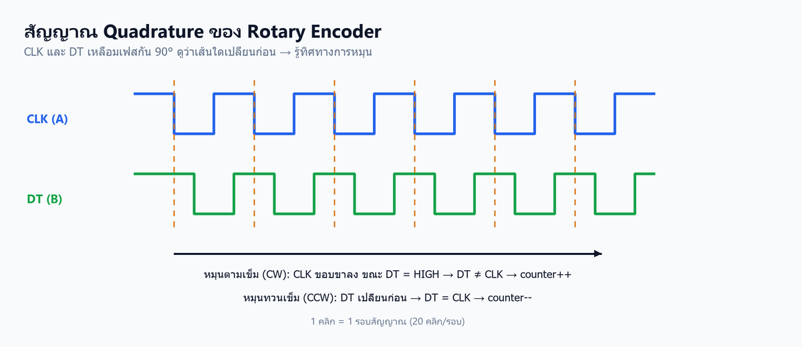
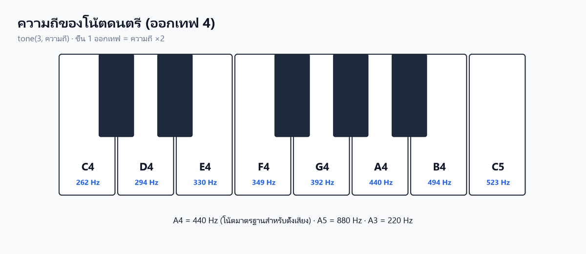

# หน่วยที่ 6: อุปกรณ์ควบคุมและเสียงดนตรี

| รายการ | รายละเอียด |
|-------|----------|
| เวลา | 3 ชั่วโมง |
| อุปกรณ์ | Lotus Nano Bot, KY-023 Joystick, KY-040 Rotary Encoder, KY-006 Passive Buzzer (หรือบัซเซอร์บนบอร์ด D3), เซอร์โว |
| ความรู้เดิม | หน่วยที่ 1-5 |

## จุดประสงค์การเรียนรู้

- **K:** อธิบายหลักการของจอยสติก (ตัวต้านทานปรับค่า 2 แกน), Rotary Encoder (สัญญาณ Quadrature) และความถี่ของโน้ตดนตรีได้
- **P:** ใช้จอยสติกควบคุมเซอร์โว ใช้ Encoder ปรับค่าเมนู และเขียนโปรแกรมเล่นเพลงด้วย Array ได้
- **A:** สร้างสรรค์ชิ้นงานที่ผู้ใช้โต้ตอบได้

## สาระสำคัญ

- **Joystick** = Potentiometer 2 ตัว (แกน X, Y) ค่ากลางประมาณ 512 + ปุ่มกดเมื่อกดคันโยกลง
- **Rotary Encoder** ส่งสัญญาณ 2 เส้น (CLK, DT) ที่เหลื่อมเฟสกัน 90° ดูว่าเส้นใดเปลี่ยนก่อนจะรู้ทิศการหมุน
- **เสียงดนตรี** คือการสั่นที่ความถี่ต่างกัน เช่น โน้ต A4 = 440 Hz คำสั่ง `tone()` สร้างคลื่นสี่เหลี่ยมที่ความถี่นั้น



## เนื้อหา

### 1. Joystick ควบคุมเซอร์โว SV1

```cpp
#include <Servo.h>

#define JOY_X A0
#define JOY_SW 16     // A2 ในโหมด Digital
Servo sv1;

void setup() {
  sv1.attach(10);               // SV1 บนบอร์ด
  pinMode(JOY_SW, INPUT_PULLUP);
}

void loop() {
  int x = analogRead(JOY_X);
  int angle = map(x, 0, 1023, 0, 180);
  if (digitalRead(JOY_SW) == LOW) angle = 90;   // กดคันโยก = กลับกึ่งกลาง
  sv1.write(angle);
  delay(15);
}
```

> **Dead Zone:** จอยสติกตอนปล่อยมือมักไม่ได้ 512 พอดี (เช่น 498-530) ควรถือว่าค่าในช่วง 512 ± 40 คือ "อยู่กลาง" เพื่อไม่ให้หุ่นยนต์ขยับเอง

### 2. เล่นเพลงด้วย Array



```cpp
#define BUZZER 3   // บัซเซอร์บนบอร์ด

// โน้ตเพลง "Twinkle Twinkle Little Star" (บรรทัดแรก)
int melody[]   = {262, 262, 392, 392, 440, 440, 392,
                  349, 349, 330, 330, 294, 294, 262};
int duration[] = {4, 4, 4, 4, 4, 4, 2,
                  4, 4, 4, 4, 4, 4, 2};   // 4 = โน้ตตัวดำ, 2 = ตัวขาว

void setup() {
  int notes = sizeof(melody) / sizeof(melody[0]);
  for (int i = 0; i < notes; i++) {
    int ms = 1000 / duration[i];
    tone(BUZZER, melody[i], ms);
    delay(ms * 1.3);                       // เว้นช่วงระหว่างโน้ต
  }
  noTone(BUZZER);
}

void loop() {}
```

| โน้ต | C4 | D4 | E4 | F4 | G4 | A4 | B4 | C5 |
|-----|----|----|----|----|----|----|----|----|
| ความถี่ (Hz) | 262 | 294 | 330 | 349 | 392 | 440 | 494 | 523 |

### 3. Rotary Encoder ปรับความดัง/ความถี่

ดูโค้ดเต็มที่ [Rotary Encoder](../sensors/rotary-encoder/README.md) แล้วนำค่า `counter` ไปใช้ เช่น `tone(3, 200 + counter * 20)`

## สถานีการทดลอง

| สถานี | อุปกรณ์ | เอกสาร |
|------|--------|-------|
| 1 | KY-023 Joystick | [README](../modules/joystick-module/README.md) |
| 2 | KY-040 Rotary Encoder | [README](../sensors/rotary-encoder/README.md) |
| 3 | KY-006 Passive Buzzer | [README](../sensors/passive-buzzer/README.md) |

## กิจกรรมการเรียนการสอน

| ขั้น | กิจกรรม | เวลา |
|-----|--------|-----|
| นำเข้า | ให้ฟังเพลงจากบัซเซอร์ แล้วถาม "บัซเซอร์ตัวเดียวเล่นได้หลายโน้ตได้อย่างไร" | 10 นาที |
| สอน | Joystick 2 แกน + Dead Zone, Quadrature, ความถี่โน้ต, Array และ `sizeof` | 30 นาที |
| ปฏิบัติ | 3 สถานี สถานีละ 30 นาที | 90 นาที |
| ภารกิจท้าทาย | **เปียโนจอยสติก:** แกน X เลือกโน้ต 8 ตัว (C4-C5) แสดงชื่อโน้ตบน OLED กดคันโยกเพื่อเล่น / หรือ **ตู้เพลง:** Encoder เลือกเพลง กดปุ่มเพื่อเล่น | 40 นาที |
| สรุป | นำเสนอผลงานเสียงของแต่ละกลุ่ม | 10 นาที |

## แบบฝึกหัด

1. ปล่อยจอยสติกไว้ตรงกลาง ค่า `analogRead` ควรเป็นประมาณเท่าใด และทำไมต้องมี Dead Zone
2. Rotary Encoder รู้ทิศทางการหมุนได้อย่างไร
3. โน้ต A5 มีความถี่เท่าใด ถ้า A4 = 440 Hz (สูงขึ้น 1 ออกเทฟ)
4. Active Buzzer เล่นเพลงด้วย `tone()` ได้ดีหรือไม่ เพราะอะไร

<details>
<summary>เฉลย</summary>

1. ประมาณ 512 แต่ด้วยความคลาดเคลื่อนของตัวต้านทานจึงไม่ตรงพอดี Dead Zone ทำให้ค่าที่ต่างเล็กน้อยไม่ถูกตีความว่าผู้ใช้โยกคันบังคับ
2. ดูลำดับการเปลี่ยนของ CLK และ DT ซึ่งเหลื่อมเฟสกัน 90° เมื่อ CLK เปลี่ยน ถ้า DT ต่างจาก CLK = หมุนตามเข็ม ถ้าเท่ากัน = ทวนเข็ม (หรือกลับกันตามการต่อ)
3. 880 Hz (ออกเทฟสูงขึ้น ความถี่เพิ่มเป็น 2 เท่า)
4. ไม่ดี เพราะ Active Buzzer มีวงจรสั่นความถี่คงที่ในตัว เสียงจะผิดเพี้ยน/ไม่เปลี่ยนโน้ตตามที่ต้องการ

</details>

---
[⬅ หน่วยที่ 5](unit-05-libraries-protocols.md) | [หลักสูตร](README.md) | [หน่วยที่ 7 ➡](unit-07-robotics.md)
