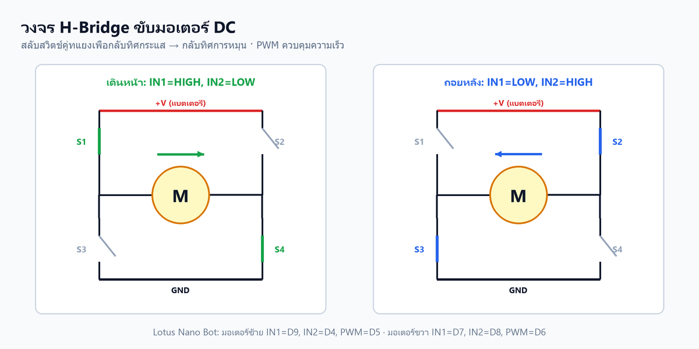
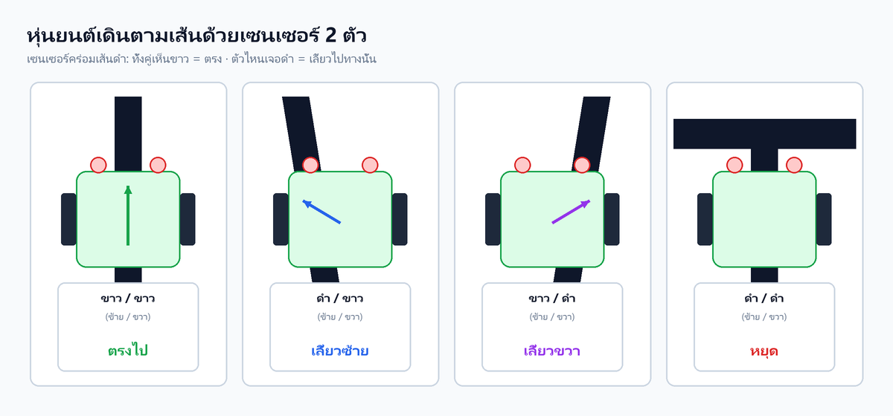

# หน่วยที่ 7: หุ่นยนต์ — มอเตอร์ หลบสิ่งกีดขวาง เดินตามเส้น

| รายการ | รายละเอียด |
|-------|----------|
| เวลา | 5 ชั่วโมง |
| อุปกรณ์ | Lotus Nano Bot พร้อมล้อและแบตเตอรี่ LiPo 7.4V, KY-032 Avoidance ×1-2, KY-033 Tracking ×2, KY-010 Light Blocking, เทปดำ, กระดาษขาว/สนามเส้น |
| ความรู้เดิม | หน่วยที่ 1-6 |

## จุดประสงค์การเรียนรู้

- **K:** อธิบายการควบคุมทิศทางและความเร็วมอเตอร์ DC ด้วย H-Bridge (IN1/IN2 + PWM) และหลักการเซนเซอร์อินฟราเรดสะท้อนได้
- **P:** เขียนฟังก์ชันเคลื่อนที่ (เดินหน้า ถอย เลี้ยว หยุด) สร้างหุ่นยนต์หลบสิ่งกีดขวางและหุ่นยนต์เดินตามเส้นได้
- **A:** ทดสอบ-ปรับปรุงซ้ำ (Iterate) อย่างเป็นระบบ และทำงานเป็นทีม

## สาระสำคัญ

มอเตอร์ DC บน Lotus Nano Bot ถูกขับผ่านวงจร H-Bridge แต่ละข้างใช้ 3 ขา: **IN1, IN2** กำหนดทิศ และ **PWM** กำหนดความเร็ว (0-255)



| IN1 | IN2 | PWM | ผล |
|-----|-----|-----|---|
| HIGH | LOW | 0-255 | หมุนไปข้างหน้า |
| LOW | HIGH | 0-255 | หมุนถอยหลัง |
| ใดๆ | ใดๆ | 0 | หยุด |

| มอเตอร์ | IN1 | IN2 | PWM |
|--------|-----|-----|-----|
| ซ้าย (ML) | D9 | D4 | D5 |
| ขวา (MR) | D7 | D8 | D6 |

> ถ้าล้อข้างใดหมุนกลับทิศ ให้สลับ HIGH/LOW ของข้างนั้นในโค้ด (หรือสลับสายมอเตอร์)

## เนื้อหา

### 1. ฟังก์ชันขับเคลื่อนพื้นฐาน

```cpp
#define DL1 9
#define DL2 4
#define PWML 5
#define DR1 7
#define DR2 8
#define PWMR 6

// speed: -255 (ถอย) ถึง 255 (เดินหน้า)
void motorL(int speed) {
  digitalWrite(DL1, speed >= 0);
  digitalWrite(DL2, speed < 0);
  analogWrite(PWML, constrain(abs(speed), 0, 255));
}

void motorR(int speed) {
  digitalWrite(DR1, speed >= 0);
  digitalWrite(DR2, speed < 0);
  analogWrite(PWMR, constrain(abs(speed), 0, 255));
}

void drive(int left, int right) { motorL(left); motorR(right); }
void stopBot() { drive(0, 0); }

void setup() {
  int pins[] = {DL1, DL2, PWML, DR1, DR2, PWMR};
  for (int i = 0; i < 6; i++) pinMode(pins[i], OUTPUT);
  pinMode(2, INPUT);
}

void loop() {
  drive(150, 150);   delay(1000);   // เดินหน้า
  drive(-150, 150);  delay(400);    // หมุนซ้ายอยู่กับที่
  drive(150, -150);  delay(400);    // หมุนขวาอยู่กับที่
  drive(-150, -150); delay(1000);   // ถอยหลัง
  stopBot();         delay(2000);
}
```

> **⚠️ ความปลอดภัย:** ยกล้อให้ลอยก่อนอัปโหลดโค้ดมอเตอร์ทุกครั้ง, ถอดแบตเตอรี่ LiPo เมื่อเลิกใช้, ห้ามแบตลัดวงจรหรือบวม

### 2. หุ่นยนต์หลบสิ่งกีดขวาง (KY-032)

```cpp
// คัดลอก #define ขามอเตอร์ และฟังก์ชัน motorL/motorR/drive/stopBot จากข้อ 1 มาวางไว้ตรงนี้
#define OBSTACLE 14   // A0: KY-032 OUT (LOW = เจอสิ่งกีดขวาง)

void setup() {
  int pins[] = {DL1, DL2, PWML, DR1, DR2, PWMR};
  for (int i = 0; i < 6; i++) pinMode(pins[i], OUTPUT);
  pinMode(OBSTACLE, INPUT);
}

void loop() {
  if (digitalRead(OBSTACLE) == LOW) {
    stopBot();          delay(100);
    drive(-150, -150);  delay(300);   // ถอย
    drive(150, -150);   delay(350);   // หมุนขวา
  } else {
    drive(160, 160);                  // เดินหน้า
  }
}
```

### 3. หุ่นยนต์เดินตามเส้น (KY-033 × 2)



| เซนเซอร์ซ้าย | เซนเซอร์ขวา | ความหมาย | การกระทำ |
|------------|-----------|---------|---------|
| ขาว | ขาว | เส้นอยู่ตรงกลาง | เดินหน้า |
| ดำ | ขาว | เส้นเบี่ยงไปซ้าย | เลี้ยวซ้าย |
| ขาว | ดำ | เส้นเบี่ยงไปขวา | เลี้ยวขวา |
| ดำ | ดำ | ทางแยก / เส้นหยุด | หยุด |

```cpp
// คัดลอก #define ขามอเตอร์ และฟังก์ชัน motorL/motorR/drive/stopBot จากข้อ 1 มาวางไว้ตรงนี้
#define LINE_L 14   // A0
#define LINE_R 15   // A1
// ตรวจสอบก่อน: KY-033 ส่วนใหญ่ให้ HIGH เมื่ออยู่บนเส้นดำ
const int BLACK = HIGH;

void setup() {
  int pins[] = {DL1, DL2, PWML, DR1, DR2, PWMR};
  for (int i = 0; i < 6; i++) pinMode(pins[i], OUTPUT);
  pinMode(LINE_L, INPUT);
  pinMode(LINE_R, INPUT);
}

void loop() {
  bool L = digitalRead(LINE_L) == BLACK;
  bool R = digitalRead(LINE_R) == BLACK;
  if (!L && !R)     drive(140, 140);
  else if (L && !R) drive(-60, 160);
  else if (!L && R) drive(160, -60);
  else              stopBot();
}
```

ดูรายละเอียดเพิ่มเติมที่ [Tracking Sensor](../sensors/tracking-sensor/README.md), [Avoidance Sensor](../sensors/avoidance-sensor/README.md) และ [Light Blocking Sensor](../sensors/light-blocking-sensor/README.md) (ใช้นับรอบล้อแบบ Encoder)

## กิจกรรมการเรียนการสอน

| ชั่วโมง | กิจกรรม |
|--------|--------|
| 1 | H-Bridge, ตารางความจริง, ทดสอบ `drive()` ยกล้อลอย → วิ่งบนพื้น วัดเวลาที่ใช้หมุน 90° |
| 2 | ทดลอง KY-032 (ปรับระยะด้วย Trimpot) → หุ่นยนต์หลบสิ่งกีดขวาง |
| 3 | ทดลอง KY-033 บนพื้นขาว/เทปดำ บันทึกค่า → หุ่นยนต์เดินตามเส้น |
| 4 | ปรับจูนความเร็ว/การเลี้ยวให้ผ่านโค้งได้ (Iterate) บันทึกเวลาต่อรอบ |
| 5 | **การแข่งขันในชั้นเรียน:** วิ่งตามเส้นจับเวลา + ด่านหลบสิ่งกีดขวาง |

### ตารางบันทึกการจูนหุ่นยนต์

| ครั้งที่ | ความเร็วตรง | ความเร็วเลี้ยว (ใน/นอก) | เวลาต่อรอบ (วินาที) | หลุดเส้น (ครั้ง) | สิ่งที่ปรับครั้งต่อไป |
|--------|-----------|-------------------|------------------|---------------|-----------------|
| 1 | | | | | |
| 2 | | | | | |
| 3 | | | | | |

### ภารกิจท้าทาย

- ใช้ Knob A7 ปรับความเร็วหุ่นยนต์ขณะวิ่ง และแสดงความเร็วบน OLED
- กดปุ่ม D2 เพื่อเริ่มวิ่ง (หุ่นยนต์รออยู่จนกว่าจะกด) และส่งเสียงบัซเซอร์เมื่อเจอเส้นหยุด
- ใช้เซอร์โว SV1 หมุนเซนเซอร์ KY-032 ซ้าย-ขวาเพื่อเลือกทิศที่ว่าง

## แบบฝึกหัด

1. ถ้าต้องการให้หุ่นยนต์หมุนอยู่กับที่ไปทางซ้าย ต้องสั่งมอเตอร์ทั้งสองข้างอย่างไร
2. ทำไม PWM ของมอเตอร์ต่ำเกินไป (เช่น 40) หุ่นยนต์จึงไม่ขยับ
3. หุ่นยนต์เดินตามเส้นส่ายไปมาและหลุดโค้ง ควรปรับอะไร
4. ทำไมไม่ควรต่อเซนเซอร์ที่ขา D4-D9 บน Lotus Nano Bot

<details>
<summary>เฉลย</summary>

1. มอเตอร์ซ้ายถอยหลัง มอเตอร์ขวาเดินหน้า ด้วยความเร็วเท่ากัน เช่น `drive(-150, 150)`
2. แรงดันเฉลี่ยต่ำเกินกว่าจะเอาชนะแรงเสียดทานสถิตและน้ำหนักหุ่นยนต์ มอเตอร์จึงไม่เริ่มหมุน (เกิดเสียงหวีดแทน)
3. ลดความเร็วเดินตรง, ลดความแรงของการเลี้ยว (ใช้ล้อในหมุนช้าแทนหมุนกลับ), ปรับระยะเซนเซอร์ให้ห่างกันพอดีกับความกว้างเส้น, ปรับ Trimpot ของเซนเซอร์
4. ขา D4-D9 ต่อกับวงจรขับมอเตอร์ หากใช้ร่วมกันจะทำให้มอเตอร์หมุนเองหรืออ่านค่าเซนเซอร์ผิด

</details>

---
[⬅ หน่วยที่ 6](unit-06-control-and-sound.md) | [หลักสูตร](README.md) | [หน่วยที่ 8 ➡](unit-08-final-project.md)
