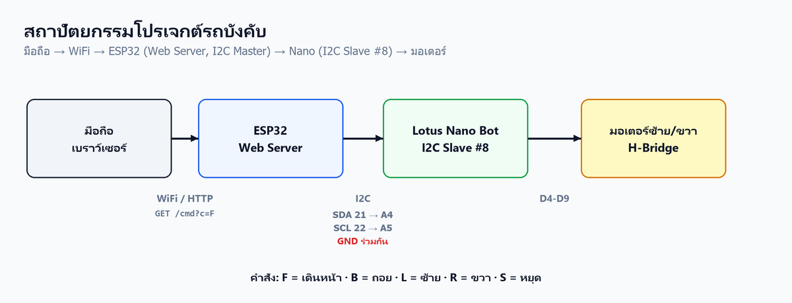
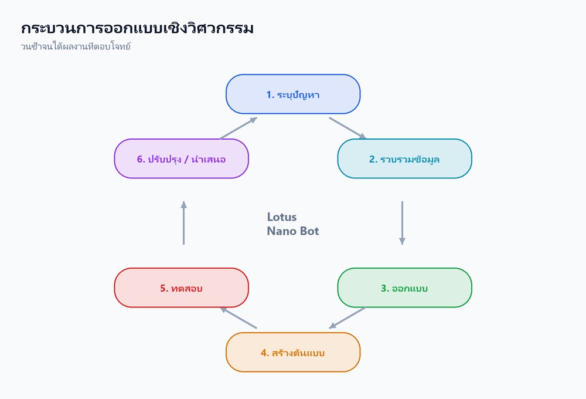

# หน่วยที่ 8: โปรเจกต์รถบังคับและโปรเจกต์ปลายภาค

| รายการ | รายละเอียด |
|-------|----------|
| เวลา | 6 ชั่วโมง (รถบังคับ 2 ชม. + โปรเจกต์ปลายภาค 4 ชม.) |
| อุปกรณ์ | Lotus Nano Bot, ESP32 DevKit, สายจัมเปอร์ 4 เส้น, มือถือ/คอมพิวเตอร์ที่ต่อ WiFi เดียวกัน, เซนเซอร์ตามที่ทีมเลือก |
| ความรู้เดิม | หน่วยที่ 1-7 |

## จุดประสงค์การเรียนรู้

- **K:** อธิบายการสื่อสารแบบ I2C (Master/Slave, Address) และการทำงานของ Web Server บน ESP32 ได้
- **P:** สร้างรถบังคับผ่านหน้าเว็บ และออกแบบ-สร้าง-ทดสอบโปรเจกต์ที่ใช้เซนเซอร์อย่างน้อย 2 ชนิดได้
- **A:** วางแผนงานเป็นทีม นำเสนอและรับฟังข้อเสนอแนะ

## ตอนที่ 1: รถบังคับผ่าน WiFi (2 ชั่วโมง)

ทำตามเอกสาร [โปรเจกต์ RC Car](../projects/robot-rc-car/README.md)

1. อัปโหลด `nano_driver.ino` ลง Lotus Nano Bot (ทดสอบก่อนว่ามอเตอร์หมุนถูกทิศด้วยโค้ดหน่วยที่ 7)
2. ติดตั้งบอร์ด ESP32 ใน Arduino IDE (**Boards Manager → esp32 by Espressif**) แก้ `ssid`/`password` แล้วอัปโหลด `esp32_controller.ino`
3. ต่อสาย SDA, SCL, **GND ร่วมกัน**, และไฟเลี้ยง
4. เปิด IP ของ ESP32 จาก Serial Monitor ในเบราว์เซอร์มือถือ แล้วขับรถ

### คำถามระหว่างทำ

1. ใครเป็น Master ใครเป็น Slave และ Address ของ Nano คือเท่าใด
2. ทำไมต้องต่อ GND ของ ESP32 กับ Nano ร่วมกัน
3. ถ้าจะเพิ่มคำสั่ง `H` (บีบแตร) ต้องแก้ไฟล์ใดบ้าง

เฉลย

1. ESP32 เป็น Master (ส่งคำสั่ง), Nano เป็น Slave ที่ Address 8 (`Wire.begin(8)`)
2. สัญญาณ SDA/SCL วัดแรงดันเทียบกับ GND ถ้าไม่มีกราวด์ร่วม ระดับ HIGH/LOW ของสองบอร์ดจะไม่ได้อ้างอิงจุดเดียวกัน การสื่อสารจะผิดพลาด
3. `esp32_controller.ino` (เพิ่มปุ่มบนหน้าเว็บที่ส่ง `H`) และ `nano_driver.ino` (เพิ่ม `case 'H': tone(3, 1000, 300); break;`)

## ตอนที่ 2: โปรเจกต์ปลายภาค (4 ชั่วโมง)

ใช้ [ใบงานโปรเจกต์ปลายภาค](worksheets/final-project-worksheet.md) ทีมละ 3-4 คน

### ขั้นตอน (Engineering Design Process)

| ชั่วโมง | ขั้นตอน | ผลงานที่ต้องส่ง |
|--------|-------|--------------|
| 1 | ระบุปัญหา → ระดมความคิด → เลือกแนวทาง | ใบงานส่วนที่ 1-2 (ปัญหา, ร่างแนวคิด, ตารางพอร์ต) |
| 2 | สร้างต้นแบบ ทดสอบเซนเซอร์ทีละตัว | โค้ดทดสอบแต่ละเซนเซอร์ทำงาน |
| 3 | รวมระบบ ทดสอบ ปรับปรุง | ตารางบันทึกการทดสอบ |
| 4 | นำเสนอ 5 นาที/ทีม + สาธิต | ชิ้นงาน + สไลด์/โปสเตอร์ |

### ตัวอย่างหัวข้อโปรเจกต์

| โปรเจกต์ | เซนเซอร์/โมดูลที่ใช้ |
|---------|-------------------|
| สถานีตรวจอากาศในห้องเรียน | DHT11, LDR, OLED, บัซเซอร์เตือนอุณหภูมิสูง |
| ระบบรดน้ำต้นไม้ + แจ้งเตือน | Analog Temp, LDR, Relay (ปั๊มน้ำ 5V) |
| หุ่นยนต์ดับเพลิงจำลอง | Flame Sensor, มอเตอร์, เซอร์โว (พัดลมเล็ก) |
| กล่องรหัสลับ | Tap Module (รหัสเคาะ), Reed Switch, เซอร์โว (กลอน), RGB LED |
| หุ่นยนต์ตามเส้น + หลบสิ่งกีดขวาง | KY-033 ×2, KY-032, บัซเซอร์ |
| เกมจับเวลาตอบสนอง | Button, Touch Sensor, RGB LED, OLED |
| รถบังคับด้วยรีโมททีวี | IR Receiver, มอเตอร์, LED ไฟหน้า |

### เงื่อนไขขั้นต่ำ

- ใช้เซนเซอร์อย่างน้อย **2 ชนิด** และอุปกรณ์เอาต์พุตอย่างน้อย **1 ชนิด**
- ไม่มีขาชนกับอุปกรณ์บนบอร์ด (แนบตารางพอร์ต)
- โค้ดมีคอมเมนต์อธิบาย และไม่ใช้ `delay()` ยาวจนระบบไม่ตอบสนอง

### เกณฑ์การประเมินโปรเจกต์ (Rubric)

| เกณฑ์ | 4 ดีมาก | 3 ดี | 2 พอใช้ | 1 ปรับปรุง |
|------|--------|-----|--------|----------|
| การทำงานของระบบ | ทำงานครบทุกฟังก์ชัน เสถียร | ทำงานครบ มีผิดพลาดเล็กน้อย | ทำงานบางส่วน | ไม่ทำงาน |
| การใช้เซนเซอร์/พอร์ต | ≥ 3 ชนิด ใช้พอร์ตถูกต้อง มีการปรับเทียบ | 2 ชนิด ถูกต้อง | 2 ชนิด มีขาชน/ค่าไม่เหมาะ | < 2 ชนิด |
| คุณภาพโค้ด | แบ่งฟังก์ชัน คอมเมนต์ชัด ใช้ millis() | มีคอมเมนต์ อ่านง่าย | ทำงานได้แต่อ่านยาก | คัดลอกมาไม่ดัดแปลง |
| กระบวนการออกแบบ | ใบงานครบ มีบันทึกการทดสอบและปรับปรุง ≥ 2 รอบ | ใบงานครบ ทดสอบ 1 รอบ | ใบงานไม่ครบ | ไม่มีใบงาน |
| การนำเสนอ/ทีมเวิร์ก | ชัดเจน ทุกคนมีส่วนร่วม ตอบคำถามได้ | ชัดเจน | พอใช้ | ไม่ชัดเจน |

คะแนนเต็ม 20 → คิดเป็น 30% ของรายวิชา

---
[⬅ หน่วยที่ 7](unit-07-robotics.md) | [หลักสูตร](README.md)
