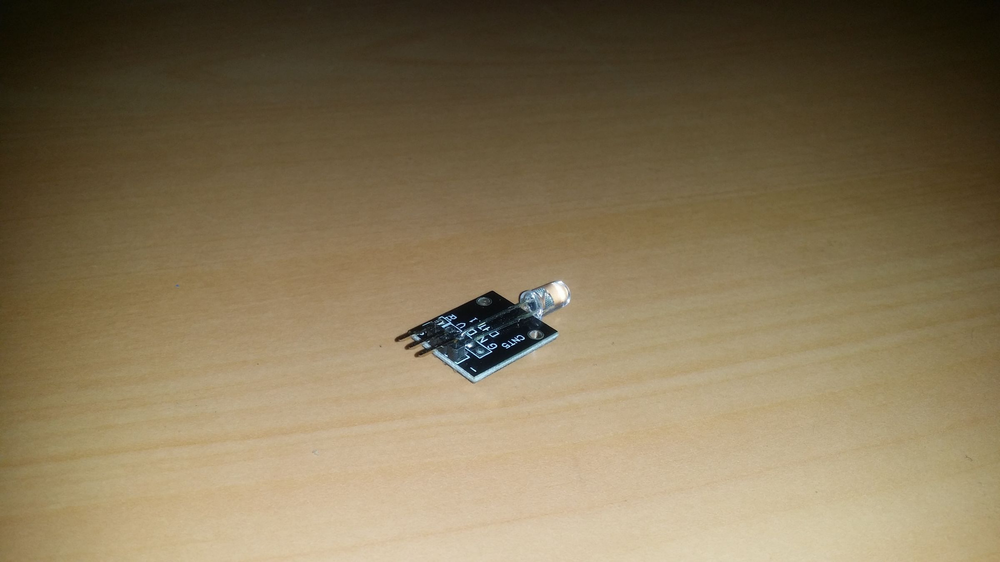
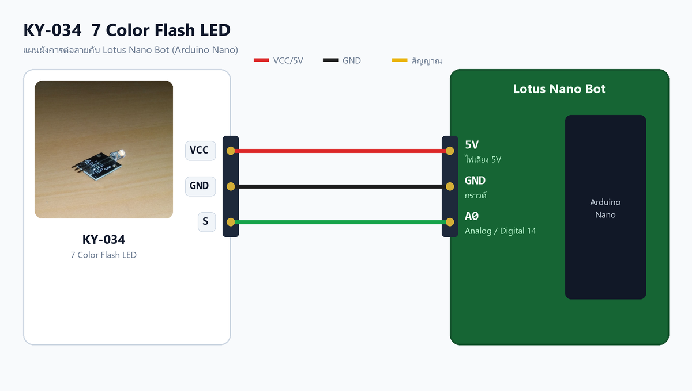

# KY-034 --- 7 Color Flash LED

## รายละเอียด

7 Color Flash LED เป็นโมดูล LED ที่มี LED 7 สีในตัวเดียว (Red, Green, Blue, Yellow, Cyan, Purple, White) มี IC ควบคุมในตัว เมื่อจ่ายไฟจะกระพริบเปลี่ยนสีเองอัตโนมัติ Arduino ควบคุมได้เพียงเปิด/ปิด (Digital)

## คุณสมบัติ

- แรงดันไฟฟ้า: 3.3V - 5V DC
- สี: Red, Green, Blue, Yellow, Cyan, Purple, White
- ควบคุมด้วย Digital (ON/OFF) ลำดับสีถูกกำหนดโดย IC ในตัว
- มีตัวต้านทานจำกัดกระแสในตัว

## ขาของโมดูล

| ขา (Module) | สีสาย | เชื่อมต่อกับ (Lotus Nano Bot) |
|-------------|-------|------------------------------|
| VCC (+)     | แดง   | 5V                           |
| GND (-)     | ดำ/น้ำตาล | GND                       |
| S (Signal)  | เหลือง | D3 หรือ A0-A3 (D14-D17)    |

## การต่อสายไฟ

```
7 Color Flash LED        Lotus Nano Bot
━━━━━━━━━━━━━━━━━━━━━━━━━━━━━━━━━━━━━━━━
VCC (+) ───────────────► 5V
GND (-) ───────────────► GND
S     ────────────────► D3
```

### ภาพการต่อสาย (Text Diagram)

```
        +------------------+
        | 7 Color Flash    |
        |    LED           |
        |     [*]          |
        |                  |
   +----+----+   +----+----+   +----+----+
   |  VCC    |   |  GND    |   |    S    |
   |   (+)   |   |   (-)   |   | (Sig)   |
   +----+----+   +----+----+   +----+----+
        |             |             |
        |             |             |
   +----+----+   +----+----+   +----+----+
   |   5V    |   |  GND    |   |   D3    |
   |         |   |         |   |         |
   |  Lotus  |   |  Nano   |   |  Bot    |
   +---------+   +---------+   +---------+
```


## โค้ดตัวอย่าง

```cpp
// 7 Color Flash LED Example for Lotus Nano Bot
// S -> D3

#define LED_PIN 3

void setup() {
  Serial.begin(9600);
  pinMode(LED_PIN, OUTPUT);
  Serial.println("7 Color Flash LED Test Started");
}

void loop() {
  // เปิด LED (กระพริบอัตโนมัติภายในตัวโมดูล)
  digitalWrite(LED_PIN, HIGH);
  delay(2000);
  
  // ปิด
  digitalWrite(LED_PIN, LOW);
  delay(2000);
}
```

## โค้ดตัวอย่างกระพริบตามจังหวะ

```cpp
#define LED_PIN 3

void setup() {
  pinMode(LED_PIN, OUTPUT);
}

void loop() {
  // เปิด-ปิดเป็นจังหวะ (การตัดไฟจะทำให้ IC ในตัวเริ่มลำดับสีใหม่)
  for (int i = 0; i < 10; i++) {
    digitalWrite(LED_PIN, HIGH);
    delay(500);
    digitalWrite(LED_PIN, LOW);
    delay(100);
  }
  
  delay(2000);
}
```

## หมายเหตุ

- บางรุ่นมี IC ควบคุมในตัว เปิดปุ๊บก็จะกระพริบเปลี่ยนสีเอง
- โมดูลนี้ไม่ต้องใช้ PWM เพราะเลือกสีเองไม่ได้ ใช้เพียง `digitalWrite()` เปิด/ปิด
- D3 บน Lotus Nano Bot ต่อกับบัซเซอร์ในตัว อาจมีเสียงคลิก/รบกวนเมื่อสั่งเปิดปิด หากไม่ต้องการให้ย้ายไป A0 (`#define LED_PIN 14`)
- ห้ามใช้ D5, D6, D9 (มอเตอร์) และ D10-D12 (เซอร์โว) เพราะเป็นขาที่บอร์ดใช้งานอยู่แล้ว

## กิจกรรมการเรียนรู้

### จุดประสงค์การเรียนรู้
1. นักเรียนต่อวงจร 7 Color Flash LED เข้ากับพอร์ต D3 หรือ A0 ของ Lotus Nano Bot ได้ถูกต้อง
2. นักเรียนเขียนโค้ด `digitalWrite()` เปิด/ปิด LED ตามเวลาที่กำหนดได้
3. นักเรียนบันทึกลำดับสีและอธิบายความแตกต่างระหว่าง LED ที่มี IC ในตัวกับ RGB LED ได้

### ขั้นตอนการทดลอง
1. ต่อสาย VCC→5V, GND→GND, S→D3 แล้วอัปโหลดโค้ดตัวอย่างแรก
2. สังเกตและจดลำดับสีที่เกิดขึ้นในช่วงที่ LED เปิด 2 วินาที
3. อัปโหลดโค้ดกระพริบตามจังหวะ แล้วสังเกตว่าสีเริ่มต้นใหม่ทุกครั้งที่เปิดหรือไม่
4. ย้ายสาย S ไปที่ A0 แก้ `#define LED_PIN 14` แล้วเปรียบเทียบเสียงจากบัซเซอร์ในตัว

### ตารางบันทึกผล
| ครั้งที่ | สภาวะ/การกระทำ | ค่าที่อ่านได้ | ผลที่สังเกตได้ |
|---|---|---|---|
| 1 | S→D3 เปิดค้าง 2 วินาที | | |
| 2 | S→D3 เปิด 500 ms / ปิด 100 ms | | |
| 3 | S→A0 (D14) เปิดค้าง 2 วินาที | | |

### คำถามท้ายการทดลอง
1. ทำไมโมดูลนี้จึงเปลี่ยนสีได้เองโดยที่ Arduino ส่งเพียงสัญญาณ HIGH/LOW
2. เมื่อลดเวลาปิดให้สั้นลงมาก ลำดับสีที่เห็นเปลี่ยนไปอย่างไร เพราะเหตุใด
3. หากต้องการไฟสถานะที่บอกได้ว่าหุ่นยนต์ "กำลังทำงาน" ควรใช้โมดูลนี้หรือ RGB LED เพราะอะไร

<details>
<summary>แนวคำตอบ (สำหรับครู)</summary>

1. ภายในโมดูลมี IC ควบคุมลำดับสี สัญญาณ S ทำหน้าที่เพียงจ่ายไฟ/ตัดไฟให้วงจรภายใน
2. ทุกครั้งที่ตัดไฟ IC จะรีเซ็ตและเริ่มลำดับสีใหม่ ถ้าเปิดสั้น ๆ จะเห็นเพียงสีแรก ๆ ของลำดับ
3. ใช้โมดูลนี้ได้หากต้องการแค่บอกว่าเปิด/ปิด (สะดุดตา) แต่ถ้าต้องการสื่อหลายสถานะด้วยสีเฉพาะควรใช้ RGB LED ที่เลือกสีได้

</details>

### ภารกิจท้าทาย
- ใช้ปุ่ม OK ในตัว (D2) กดหนึ่งครั้งเพื่อเปิด และกดอีกครั้งเพื่อปิด 7 Color Flash LED (Toggle) โดยต่อ LED ที่ A0

## รูปภาพ





