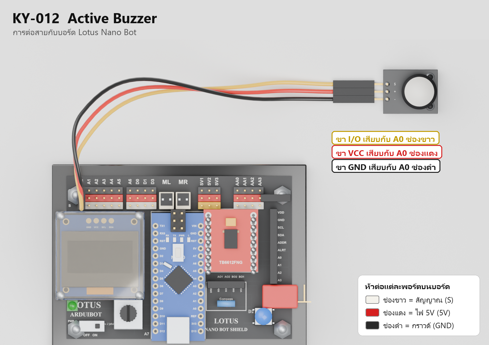
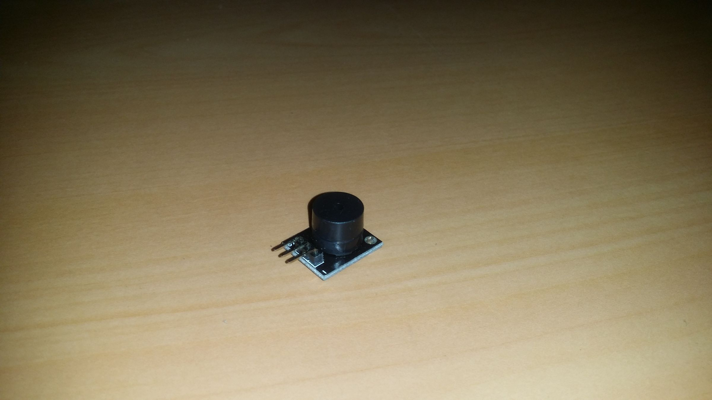
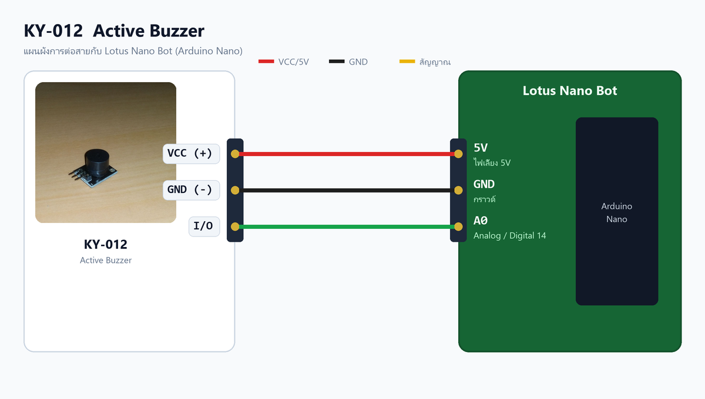

# KY-012 --- Active Buzzer

## รายละเอียด

Active Buzzer เป็นบัซเซอร์แบบมีวงจรสั่นในตัว เมื่อใส่แรงดันไฟฟ้า 5V จะส่งเสียงทันทีโดยไม่ต้องใส่สัญญาณ PWM ใช้งานง่ายกว่า Passive Buzzer แต่ปรับความถี่ไม่ได้

> **สำคัญ:** Lotus Nano Bot มีบัซเซอร์ในตัวเชื่อมต่อที่ D3 แล้ว หากต้องการใช้บัซเซอร์ภายนอกควรใช้ A0-A3 (ตัวอย่างนี้ใช้ A0 = D14)

## คุณสมบัติ

- แรงดันไฟฟ้า: 3.3V - 5V DC
- ความถี่คงที่ (มักเป็น 2 kHz)
- ใช้งานง่าย (ใส่ไฟแล้วส่งเสียงเลย)
- มีขา I/O (Signal), VCC, GND

## ขาของ Active Buzzer

| ขา (Buzzer) | สีสาย | เชื่อมต่อกับ (Lotus Nano Bot) |
|-------------|-------|------------------------------|
| VCC (+)     | แดง   | 5V                           |
| GND (-)     | ดำ   | GND                           |
| I/O (Signal)| ขาว   | A0 (D14) หรือ A1-A3       |

> ต่อที่หัวต่อพอร์ต A0 บนบอร์ด: ช่องขาว = S, ช่องแดง = 5V, ช่องดำ = GND

## การต่อสายไฟ

```
Active Buzzer            Lotus Nano Bot
━━━━━━━━━━━━━━━━━━━━━━━━━━━━━━━━━━━━━━━━
VCC ──────────────────► 5V
GND ──────────────────► GND
I/O ──────────────────► A0 (D14)
```

### ภาพการต่อสายกับบอร์ด




## โค้ดตัวอย่าง

```cpp
// Active Buzzer Example for Lotus Nano Bot
// I/O -> A0 (D14) เพราะ D3 มีบัซเซอร์ในตัวอยู่แล้ว

#define BUZZER_PIN 14  // A0 ใช้เป็น Digital Output ได้

void setup() {
  Serial.begin(9600);
  pinMode(BUZZER_PIN, OUTPUT);
  Serial.println("Active Buzzer Test Started");
}

void loop() {
  Serial.println("🔊 Buzzer ON");
  digitalWrite(BUZZER_PIN, HIGH);
  delay(1000);
  
  Serial.println("🔇 Buzzer OFF");
  digitalWrite(BUZZER_PIN, LOW);
  delay(1000);
}
```

## โค้ดตัวอย่างสัญญาณเตือน

```cpp
#define BUZZER_PIN 14  // A0 เป็น Digital

void setup() {
  pinMode(BUZZER_PIN, OUTPUT);
}

void loop() {
  // สัญญาณเตือน 3 ครั้ง
  for (int i = 0; i < 3; i++) {
    digitalWrite(BUZZER_PIN, HIGH);
    delay(200);
    digitalWrite(BUZZER_PIN, LOW);
    delay(200);
  }
  
  delay(2000);
}
```

## หมายเหตุ

- **Lotus Nano Bot มีบัซเซอร์ในตัวที่ D3** ใช้ `tone(3, freq, duration)` ได้เลย
- Active Buzzer ต่างจาก Passive Buzzer: ใส่ไฟแล้วส่งเสียงทันที
- ไม่สามารถปรับความถี่หรือเล่นเพลงได้ (เสียงคงที่)
- หากต้องการใช้บัซเซอร์ภายนอก ใช้ A0-A3 (เป็น Digital Output) ได้ ไม่ควรต่อที่ D3 เพราะจะดังพร้อมบัซเซอร์ในตัว
- ห้ามใช้ A6/A7 เพราะเป็น Analog Input อย่างเดียว ใช้ `digitalWrite()` ไม่ได้

## กิจกรรมการเรียนรู้

### จุดประสงค์การเรียนรู้
1. นักเรียนต่อ Active Buzzer เข้ากับพอร์ต A0 (D14) และสั่งให้ดัง/เงียบด้วย `digitalWrite()` ได้
2. นักเรียนเปรียบเทียบเสียงของ Active Buzzer ภายนอกกับบัซเซอร์ในตัว (D3) ที่ใช้ `tone()` ได้
3. นักเรียนออกแบบรูปแบบสัญญาณเตือน (จำนวนครั้ง/ระยะเวลา) ได้อย่างน้อย 2 แบบ

### ขั้นตอนการทดลอง
1. ต่อสาย VCC→5V, GND→GND, I/O→A0 แล้วอัปโหลดโค้ดตัวอย่างแรก
2. เปิด Serial Monitor (9600) ตรวจว่าข้อความ ON/OFF ตรงกับเสียงที่ได้ยิน
3. อัปโหลดโค้ดสัญญาณเตือน แล้วเปลี่ยน `delay(200)` เป็น 50 และ 500 สังเกตความต่าง
4. ทดลองสั่ง `tone(BUZZER_PIN, 500)` กับ Active Buzzer แล้วเปรียบเทียบกับ `tone(3, 500)` ของบัซเซอร์ในตัว

### ตารางบันทึกผล
| ครั้งที่ | สภาวะ/การกระทำ | ค่าที่อ่านได้ | ผลที่สังเกตได้ |
|---|---|---|---|
| 1 | `digitalWrite(14, HIGH)` 1 วินาที | | |
| 2 | เตือน 3 ครั้ง delay 50 / 200 / 500 ms | | |
| 3 | `tone()` 500 Hz ที่ A0 เทียบกับบัซเซอร์ในตัว (D3) | | |

### คำถามท้ายการทดลอง
1. Active Buzzer ต่างจาก Passive Buzzer อย่างไรในด้านสัญญาณที่ต้องป้อน
2. ทำไมการเปลี่ยนความถี่ด้วย `tone()` จึงแทบไม่ทำให้เสียงของ Active Buzzer เปลี่ยน
3. ในหุ่นยนต์จริง ควรใช้รูปแบบเสียงเตือนอย่างไรเพื่อแยก "แบตเตอรี่ต่ำ" กับ "เจอสิ่งกีดขวาง"

<details>
<summary>แนวคำตอบ (สำหรับครู)</summary>

1. Active Buzzer มีวงจรกำเนิดความถี่ในตัว ป้อนแค่ HIGH ก็ดัง ส่วน Passive ต้องป้อนสัญญาณสลับ (PWM/tone) จึงดัง
2. ความถี่เสียงถูกกำหนดโดยวงจรสั่นภายใน `tone()` เพียงตัด-ต่อไฟเร็ว ๆ จึงได้เสียงเดิมปนเสียงหยาบ
3. ใช้จังหวะต่างกัน เช่น แบตต่ำ = ดังยาว 1 ครั้งทุก 5 วินาที, เจอสิ่งกีดขวาง = ดังสั้นถี่ ๆ ต่อเนื่อง

</details>

### ภารกิจท้าทาย
- เขียนโปรแกรมให้กดปุ่ม OK ในตัว (D2) แล้ว Active Buzzer (A0) ดังสั้น 1 ครั้ง ส่วนบัซเซอร์ในตัว (D3) เล่นโน้ต 3 ตัวตอบกลับ

## รูปภาพ





