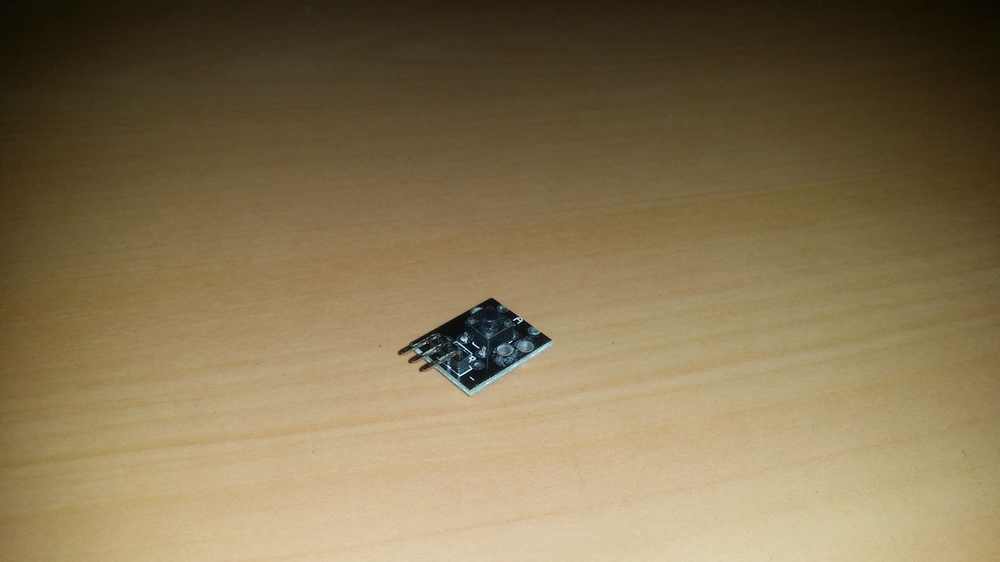
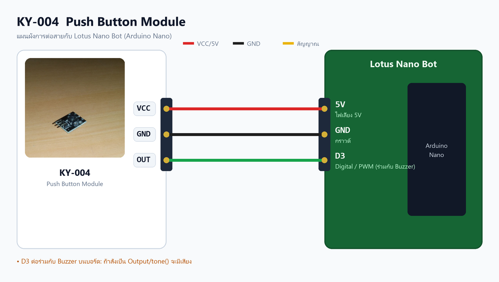

# KY-004 --- Push Button Module

## รายละเอียด

Button Module เป็นโมดูลปุ่มกดพร้อม Pull-up/Pull-down resistor ในตัว และมี LED แสดงสถานะ ใช้งานง่ายกว่าการต่อปุ่มธรรมดา

## คุณสมบัติ

- แรงดันไฟฟ้า: 3.3V - 5V DC
- เอาต์พุต: Digital (Active High หรือ Low)
- มี Pull-up/Pull-down ในตัว
- มี LED แสดงสถานะ

## ขาของโมดูล

| ขา (Module) | สีสาย | เชื่อมต่อกับ (Lotus Nano Bot) |
|-------------|-------|------------------------------|
| VCC         | แดง   | 5V                           |
| GND         | ดำ/น้ำตาล | GND                       |
| OUT (Signal)| เหลือง | D3 หรือ A0 (D14)          |

> **หมายเหตุ:** Lotus Nano Bot มีปุ่มกดในตัวอยู่แล้วที่ D2 หากต้องการใช้ปุ่มเพิ่มเติมให้ต่อที่ D3 หรือ A0-A3 (ห้ามต่อที่ D2 เพราะจะชนกับปุ่มในตัว)

## การต่อสายไฟ

```
Button Module            Lotus Nano Bot
━━━━━━━━━━━━━━━━━━━━━━━━━━━━━━━━━━━━━━━━
VCC  ──────────────────► 5V
GND  ──────────────────► GND
OUT  ──────────────────► D3
```

### ภาพการต่อสาย (Text Diagram)

```
        +------------------+
        |  Button Module   |
        |   [====]         |
        |   (Push)         |
   +----+----+   +----+----+   +----+----+
   |  VCC    |   |  GND    |   |  OUT    |
   |   (+)   |   |   (-)   |   | (Sig)   |
   +----+----+   +----+----+   +----+----+
        |             |             |
        |             |             |
   +----+----+   +----+----+   +----+----+
   |   5V    |   |  GND    |   |   D3    |
   |         |   |         |   |         |
   |  Lotus  |   |  Nano   |   |  Bot    |
   +---------+   +---------+   +---------+
```


## โค้ดตัวอย่าง

```cpp
// Button Module Example for Lotus Nano Bot
// OUT -> D3

#define BUTTON_PIN 3
#define LED_PIN 13

void setup() {
  Serial.begin(9600);
  pinMode(BUTTON_PIN, INPUT);
  pinMode(LED_PIN, OUTPUT);
  Serial.println("Button Module Test Started");
}

void loop() {
  int buttonState = digitalRead(BUTTON_PIN);
  
  if (buttonState == HIGH) {  // กดปุ่ม (ถ้าโมดูลเป็น Active Low ให้เปลี่ยนเป็น LOW)
    Serial.println("🔘 Button Pressed!");
    digitalWrite(LED_PIN, HIGH);
  } else {
    digitalWrite(LED_PIN, LOW);
  }
  
  delay(100);
}
```

## โค้ดตัวอย่าง Toggle LED

```cpp
#define BUTTON_PIN 15  // ตัวอย่างนี้ต่อ OUT ที่ A1 (= D15) แทน D3
#define LED_PIN 13

bool ledState = false;
int lastButton = LOW;

void setup() {
  Serial.begin(9600);
  pinMode(BUTTON_PIN, INPUT);
  pinMode(LED_PIN, OUTPUT);
}

void loop() {
  int button = digitalRead(BUTTON_PIN);
  
  if (button == HIGH && lastButton == LOW) {
    ledState = !ledState;
    digitalWrite(LED_PIN, ledState);
    Serial.println(ledState ? "💡 LED ON" : "🌑 LED OFF");
    delay(200);  // หน่วงเวลากันปุ่มเด้ง (Debounce)
  }
  
  lastButton = button;
}
```

## หมายเหตุ

- Lotus Nano Bot มีปุ่มกดในตัวที่ D2 (`digitalRead(2)`)
- Button Module นี้เหมาะสำหรับการใช้ปุ่มเพิ่มเติมนอกบอร์ด
- บน Lotus Nano Bot ใช้ D3 หรือ A0-A3 (เป็น Digital Input) ได้ (A6 ใช้ `digitalRead()` ไม่ได้)
- หากต่อที่ D3 สัญญาณจะผ่านบัซเซอร์ในตัวด้วย ถ้าอ่านค่าไม่นิ่งหรือมีเสียงคลิก ให้ย้ายไป A0-A3

## กิจกรรมการเรียนรู้

### จุดประสงค์การเรียนรู้
1. นักเรียนต่อ Button Module และอ่านสถานะปุ่มด้วย `digitalRead()` ได้ถูกต้อง
2. นักเรียนระบุได้ว่าโมดูลของตนเป็นแบบ Active High หรือ Active Low จากผลการทดลอง
3. นักเรียนเขียนโปรแกรม Toggle ที่ตรวจจับขอบสัญญาณ (Edge Detection) และกันปุ่มเด้งได้

### ขั้นตอนการทดลอง
1. ต่อสาย VCC→5V, GND→GND, OUT→D3 แล้วอัปโหลดโค้ดตัวอย่างแรก
2. เปิด Serial Monitor สังเกตค่าเมื่อไม่กดและเมื่อกดค้าง แล้วตรวจว่า LED D13 ติดตามที่คาดหรือไม่
3. ย้ายสาย OUT ไปที่ A1 แล้วอัปโหลดโค้ด Toggle LED
4. ลบ `delay(200)` ออก กดปุ่มหลาย ๆ ครั้ง แล้วนับว่า LED สลับผิดพลาดกี่ครั้ง

### ตารางบันทึกผล
| ครั้งที่ | สภาวะ/การกระทำ | ค่าที่อ่านได้ | ผลที่สังเกตได้ |
|---|---|---|---|
| 1 | ไม่กดปุ่ม | | |
| 2 | กดปุ่มค้าง | | |
| 3 | กด 10 ครั้ง (ไม่มี delay กันเด้ง) | | |

### คำถามท้ายการทดลอง
1. ตัวต้านทาน Pull-up/Pull-down ในโมดูลมีหน้าที่อะไร
2. ทำไมโค้ด Toggle ต้องเปรียบเทียบ `button` กับ `lastButton` แทนการเช็คแค่ `button == HIGH`
3. ถ้าต้องการใช้ปุ่มนี้เป็นปุ่ม "เริ่ม" ให้หุ่นยนต์ออกวิ่ง ควรเขียนโปรแกรมอย่างไร

<details>
<summary>แนวคำตอบ (สำหรับครู)</summary>

1. กำหนดสถานะขาให้แน่นอน (HIGH หรือ LOW) ขณะไม่กดปุ่ม ป้องกันขาลอย (Floating) ที่อ่านค่าสุ่ม
2. เพื่อให้สลับเพียงครั้งเดียวต่อการกดหนึ่งครั้ง (ขอบขาขึ้น) ถ้าเช็คแค่ HIGH จะสลับซ้ำตลอดเวลาที่กดค้าง
3. ใน `setup()` วนรอ `while (digitalRead(BUTTON_PIN) == LOW) {}` จนกว่าจะกด แล้วจึงเริ่มสั่งมอเตอร์ใน `loop()`

</details>

### ภารกิจท้าทาย
- ใช้ Button Module (A1) และปุ่ม OK ในตัว (D2) เป็นปุ่ม "เพิ่ม" และ "ลด" ตัวนับ แล้วให้บัซเซอร์ในตัว (D3) ดังตามจำนวนที่นับได้

## รูปภาพ





