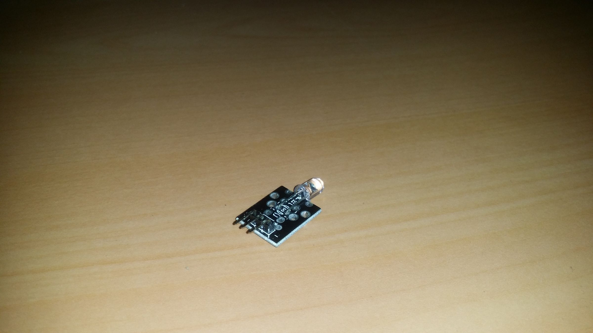
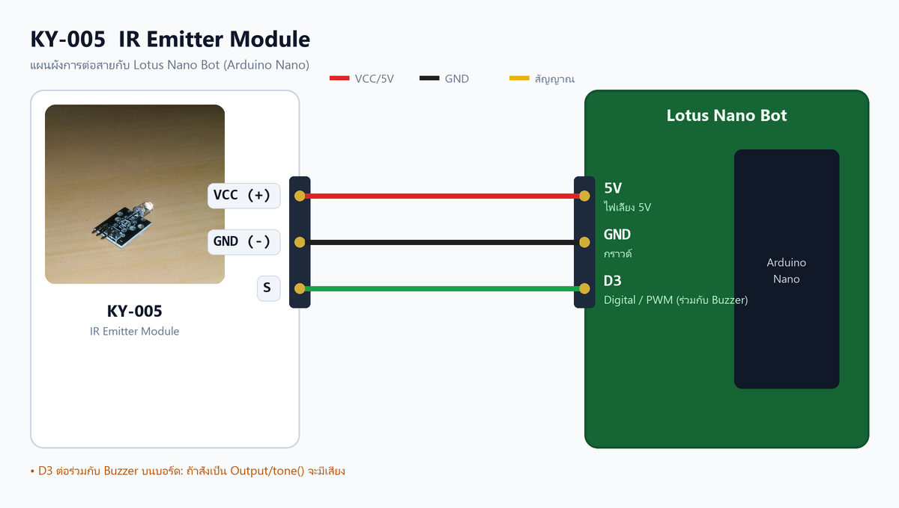

# KY-005 --- IR Emitter Module

## รายละเอียด

IR Emission Module เป็นโมดูลส่งสัญญาณอินฟราเรด ใช้ IR LED ส่งสัญญาณความถี่ 38 kHz สำหรับควบคุมอุปกรณ์ต่างๆ เช่น ทีวี, แอร์ หรือใช้คู่กับ IR Receiver

## คุณสมบัติ

- แรงดันไฟฟ้า: 3.3V - 5V DC
- ใช้ IR LED ส่งสัญญาณ 940 nm
- ควบคุมด้วย Digital
- มีตัวต้านทานจำกัดกระแสในตัว

## ขาของโมดูล

| ขา (Module) | สีสาย | เชื่อมต่อกับ (Lotus Nano Bot) |
|-------------|-------|------------------------------|
| VCC (+)     | แดง   | 5V                           |
| GND (-)     | ดำ/น้ำตาล | GND                       |
| S (Signal)  | เหลือง | D3 (แนะนำ, รองรับ IRremote) หรือ A0-A3 |

## การต่อสายไฟ

```
IR Emission Module       Lotus Nano Bot
━━━━━━━━━━━━━━━━━━━━━━━━━━━━━━━━━━━━━━━━
VCC (+) ───────────────► 5V
GND (-) ───────────────► GND
S     ────────────────► D3
```

### ภาพการต่อสาย (Text Diagram)

```
        +------------------+
        |  IR Emission     |
        |  Module          |
        |    ◉ (IR LED)    |
        |                  |
   +----+----+   +----+----+   +----+----+
   |  VCC    |   |  GND    |   |    S    |
   |   (+)   |   |   (-)   |   | (Sig)   |
   +----+----+   +----+----+   +----+----+
        |             |             |
        |             |             |
   +----+----+   +----+----+   +----+----+
   |   5V    |   |  GND    |   |   D3    |
   |         |   |         |   |         |
   |  Lotus  |   |  Nano   |   |  Bot    |
   +---------+   +---------+   +---------+
```


## โค้ดตัวอย่าง

```cpp
// IR Emission Module Example for Lotus Nano Bot
// S -> D3

#define IR_LED_PIN 3

void setup() {
  Serial.begin(9600);
  pinMode(IR_LED_PIN, OUTPUT);
  Serial.println("IR Emission Module Test Started");
}

void loop() {
  // ส่งสัญญาณ IR (ตัวอย่างพื้นฐาน)
  Serial.println("📡 Sending IR Signal");
  
  // ส่งพัลส์ประมาณ 38 kHz จำนวน 100 รอบ (~2.6 ms)
  // คาบ 38 kHz = 26 µs (HIGH 13 + LOW 13) แต่ digitalWrite() ใช้เวลาเองราว 4 µs จึงลด delay เหลือ 9
  for (int i = 0; i < 100; i++) {
    digitalWrite(IR_LED_PIN, HIGH);
    delayMicroseconds(9);
    digitalWrite(IR_LED_PIN, LOW);
    delayMicroseconds(9);
  }
  
  delay(1000);
}
```

## โค้ดตัวอย่างใช้ IRremote library

```cpp
// ใช้ IRremote เวอร์ชัน 4.x (ติดตั้งจาก Library Manager)
#define IR_SEND_PIN 3  // ต้องกำหนดก่อน include (Nano ส่ง 38 kHz ด้วย Timer2 ที่ D3)
#include <IRremote.hpp>

void setup() {
  Serial.begin(9600);
  IrSender.begin(IR_SEND_PIN);
  Serial.println("IR Transmitter Ready");
}

void loop() {
  // NEC: Address 0x00, Command 0x45 (เท่ากับรหัสดิบ 0xFFA25D ของรีโมททั่วไป)
  Serial.println("Sending NEC: addr 0x00, cmd 0x45");
  IrSender.sendNEC(0x00, 0x45, 0);
  delay(5000);
}
```

## หมายเหตุ

- IR LED ส่งแสงที่มองไม่เห็น (Infrared)
- ต้องส่งสัญญาณที่ความถี่ 38 kHz สำหรับรีโมททั่วไป
- ใช้ IRremote library เพื่อความสะดวกในการส่งสัญญาณต่างๆ
- บน Lotus Nano Bot ใช้ D3 (แนะนำ เพราะ IRremote บน Nano ส่งสัญญาณจาก Timer2 ที่ขา D3) หรือ A0-A3 สำหรับโค้ดแบบ bit-bang
- ห้ามใช้ D2 (ปุ่ม OK), D5/D6/D9 (มอเตอร์) และ D10-D12 (เซอร์โว)

## กิจกรรมการเรียนรู้

### จุดประสงค์การเรียนรู้
1. นักเรียนต่อ IR Emission Module และตรวจสอบได้ว่า IR LED กำลังส่งแสง (ด้วยกล้องมือถือ)
2. นักเรียนอธิบายความสัมพันธ์ระหว่างความถี่ 38 kHz กับคาบเวลา 26 µs ได้
3. นักเรียนส่งรหัส NEC ด้วย IRremote และตรวจรับด้วย IR Receiver ได้

### ขั้นตอนการทดลอง
1. ต่อสาย VCC→5V, GND→GND, S→D3 แล้วอัปโหลดโค้ดตัวอย่างแรก
2. ส่อง IR LED ผ่านกล้องมือถือ (กล้องหน้ามักเห็นได้ชัดกว่า) สังเกตแสงม่วงกะพริบ
3. ติดตั้ง IRremote 4.x แล้วอัปโหลดโค้ดตัวอย่างที่สอง
4. นำ IR Receiver (บอร์ดอีกชุด) มารับสัญญาณ บันทึกรหัสที่อ่านได้ที่ระยะ 10, 50, 100 cm

### ตารางบันทึกผล
| ครั้งที่ | สภาวะ/การกระทำ | ค่าที่อ่านได้ | ผลที่สังเกตได้ |
|---|---|---|---|
| 1 | ส่องผ่านกล้องมือถือ ระยะ 10 cm | | |
| 2 | ส่ง NEC 0x45 ระยะ 50 cm | | |
| 3 | ส่ง NEC 0x45 ระยะ 100 cm / เอียง 45° | | |

### คำถามท้ายการทดลอง
1. ทำไมตาคนมองไม่เห็นแสงจาก IR LED แต่กล้องมือถือมองเห็น
2. ถ้าความถี่ที่ส่งเพี้ยนจาก 38 kHz มาก ผลการรับที่ Receiver จะเป็นอย่างไร
3. จะนำ IR Emitter ไปใช้กับหุ่นยนต์ Lotus Nano Bot ในงานใดได้บ้าง

<details>
<summary>แนวคำตอบ (สำหรับครู)</summary>

1. IR ยาวคลื่น ~940 nm เกินช่วงที่ตามองเห็น (~400-700 nm) แต่เซนเซอร์ภาพของกล้องยังไวต่อช่วงนี้
2. Receiver มีวงจรกรองความถี่ 38 kHz ถ้าเพี้ยนมากจะรับได้ระยะสั้นลงหรือรับไม่ได้เลย
3. เช่น ส่งคำสั่งสื่อสารระหว่างหุ่นยนต์สองตัว, ทำประตูลำแสงนับรอบ, หรือเป็นรีโมทควบคุมทีวี/แอร์

</details>

### ภารกิจท้าทาย
- เขียนโปรแกรมให้กดปุ่ม OK ในตัว (D2) แล้วส่งรหัส NEC หนึ่งครั้ง พร้อมให้ข้อความ "Sent!" แสดงบนจอ OLED ในตัว (I2C A4/A5)

## รูปภาพ





