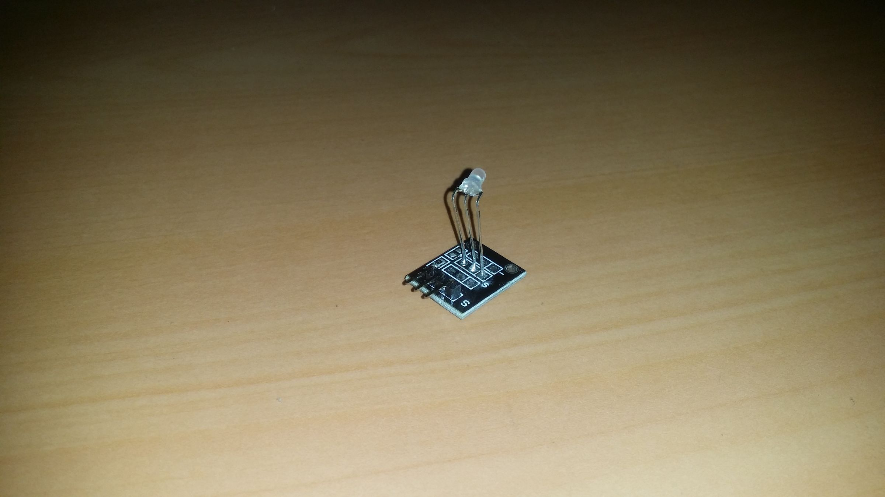

# KY-029 --- Mini Two-color LED Module

## รายละเอียด

Mini Two-color LED Module เป็นโมดูล LED 2 สีขนาดเล็ก (มักเป็น Red และ Green) ทำงานเหมือน Two-color LED ทั่วไปแต่ขนาดกะทัดรัด

## คุณสมบัติ

- แรงดันไฟฟ้า: 3.3V - 5V DC
- สี: Red และ Green
- ควบคุมด้วย Digital (บน Lotus Nano Bot ใช้ A0-A3) หรือ PWM (ขาว่างที่รองรับมีเพียง D3)
- ขนาดเล็ก

## ขาของโมดูล

| ขา (Module) | สีสาย | เชื่อมต่อกับ (Lotus Nano Bot) |
|-------------|-------|------------------------------|
| - (Common)  | ดำ    | GND (Common Cathode) หรือ 5V (Common Anode) |
| R (Red)     | เหลือง | A0 (D14)                    |
| G (Green)   | เขียว | A1 (D15)                    |

## การต่อสายไฟ (Common Cathode)

```
Mini Two-color LED       Lotus Nano Bot
━━━━━━━━━━━━━━━━━━━━━━━━━━━━━━━━━━━━━━━━
- (Common) ─────────────► GND
R ─────────────────────► A0 (D14)
G ─────────────────────► A1 (D15)
```

### ภาพการต่อสาย (Text Diagram)

```
        +------------------+
        | Mini Two-color   |
        |    LED           |
        |    [*] (Mini)    |
        |                  |
   +----+----+   +----+----+   +----+----+
   |  VCC    |   |   R     |   |   G     |
   |   (-)   |   |  (Dig)  |   |  (Dig)  |
   +----+----+   +----+----+   +----+----+
        |             |             |
        |             |             |
   +----+----+   +----+----+   +----+----+
   |  GND    |   |   A0    |   |   A1    |
   |         |   |         |   |         |
   |  Lotus  |   |  Nano   |   |  Bot    |
   +---------+   +---------+   +---------+
```

## โค้ดตัวอย่าง

```cpp
// Mini Two-color LED Example for Lotus Nano Bot
// R->A0 (D14), G->A1 (D15)

#define RED_PIN 14    // A0
#define GREEN_PIN 15  // A1

void setup() {
  Serial.begin(9600);
  pinMode(RED_PIN, OUTPUT);
  pinMode(GREEN_PIN, OUTPUT);
  Serial.println("Mini Two-color LED Test Started");
}

void loop() {
  // Red
  digitalWrite(RED_PIN, HIGH);
  digitalWrite(GREEN_PIN, LOW);
  delay(1000);
  
  // Green
  digitalWrite(RED_PIN, LOW);
  digitalWrite(GREEN_PIN, HIGH);
  delay(1000);
  
  // Orange
  digitalWrite(RED_PIN, HIGH);
  digitalWrite(GREEN_PIN, HIGH);
  delay(1000);
  
  // Off
  digitalWrite(RED_PIN, LOW);
  digitalWrite(GREEN_PIN, LOW);
  delay(1000);
}
```

## หมายเหตุ

- ทำงานเหมือน Two-color LED ทั่วไปแต่ขนาดเล็กกว่า
- ตรวจสอบว่าเป็น Common Cathode หรือ Common Anode
- **เรื่อง PWM:** Arduino Nano มีขา PWM เพียง D3, D5, D6, D9, D10, D11 แต่บน Lotus Nano Bot ขา D5/D6/D9 ใช้กับมอเตอร์ และ D10/D11 ใช้กับเซอร์โว (Servo library ยังปิด PWM ของ D9/D10 ด้วย) จึงเหลือ D3 เพียงขาเดียวที่ว่าง (ซึ่งต่อกับบัซเซอร์ในตัว อาจมีเสียงหวีดเมื่อใช้ PWM)
- ขา A0-A3 ไม่ใช่ขา PWM ถ้าใช้ `analogWrite()` จะได้แค่ดับ (ค่า < 128) หรือติดเต็ม (ค่า ≥ 128) เท่านั้น จึงควรใช้ `digitalWrite()` หรือ Software PWM (ดูตัวอย่างใน Two-color LED)
- ห้ามต่อ LED ที่ D2 (ปุ่ม), D4-D9 (มอเตอร์) หรือ D10-D12 (เซอร์โว)

## กิจกรรมการเรียนรู้

### จุดประสงค์การเรียนรู้
1. นักเรียนต่อ Mini Two-color LED เข้ากับขา A0, A1 และสั่งแสดงสีแดง เขียว ส้มได้
2. นักเรียนตรวจสอบได้ว่าโมดูลเป็น Common Cathode หรือ Common Anode จากผลการทดลอง
3. นักเรียนอธิบายได้ว่าทำไม `analogWrite()` บนขา A0-A3 จึงปรับความสว่างไม่ได้

### ขั้นตอนการทดลอง
1. ต่อสาย -→GND, R→A0, G→A1 แล้วอัปโหลดโค้ดตัวอย่าง
2. บันทึกสีที่เห็นในแต่ละช่วง 1 วินาที เทียบกับคอมเมนต์ในโค้ด
3. ถ้าสีกลับกัน (สั่งติดแต่ดับ) ให้ย้ายขา - ไป 5V แล้วทดสอบใหม่ เพื่อหาชนิดของโมดูล
4. ทดลองแก้เป็น `analogWrite(RED_PIN, 100)` และ `analogWrite(RED_PIN, 200)` แล้วเปรียบเทียบความสว่าง

### ตารางบันทึกผล
| ครั้งที่ | สภาวะ/การกระทำ | ค่าที่อ่านได้ | ผลที่สังเกตได้ |
|---|---|---|---|
| 1 | R = HIGH, G = LOW | | |
| 2 | R = HIGH, G = HIGH | | |
| 3 | `analogWrite(14, 100)` และ `analogWrite(14, 200)` | | |

### คำถามท้ายการทดลอง
1. Common Cathode กับ Common Anode ต่างกันอย่างไร
2. ทำไม `analogWrite(14, 100)` ทำให้ LED ดับ แต่ `analogWrite(14, 200)` ทำให้ติดเต็มที่
3. ถ้าจะใช้ LED นี้เป็นไฟสถานะแบตเตอรี่ของหุ่นยนต์ ควรกำหนดสีอย่างไร

<details>
<summary>แนวคำตอบ (สำหรับครู)</summary>

1. Common Cathode ขาร่วมต่อ GND สั่ง HIGH เพื่อติด ส่วน Common Anode ขาร่วมต่อ 5V สั่ง LOW เพื่อติด
2. A0 ไม่ใช่ขา PWM ฟังก์ชัน `analogWrite()` จึงทำงานแบบ Digital ค่า < 128 = LOW, ≥ 128 = HIGH
3. เช่น เขียว = แบตเต็ม, ส้ม (แดง+เขียว) = ปานกลาง, แดง = ต่ำ ควรชาร์จ

</details>

### ภารกิจท้าทาย
- อ่านค่า Knob ในตัว (A7) แล้วแสดงสีตามช่วงค่า: 0-340 = เขียว, 341-680 = ส้ม, 681-1023 = แดง และให้บัซเซอร์ในตัว (D3) ดังเตือนเมื่อเป็นสีแดง

## รูปภาพ




