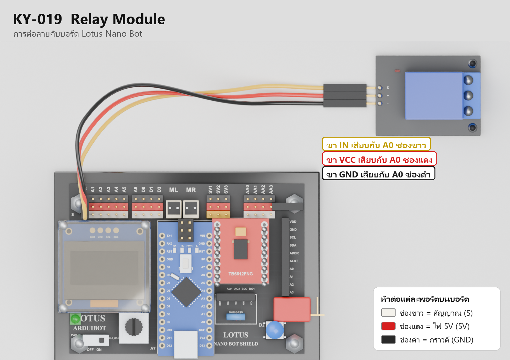
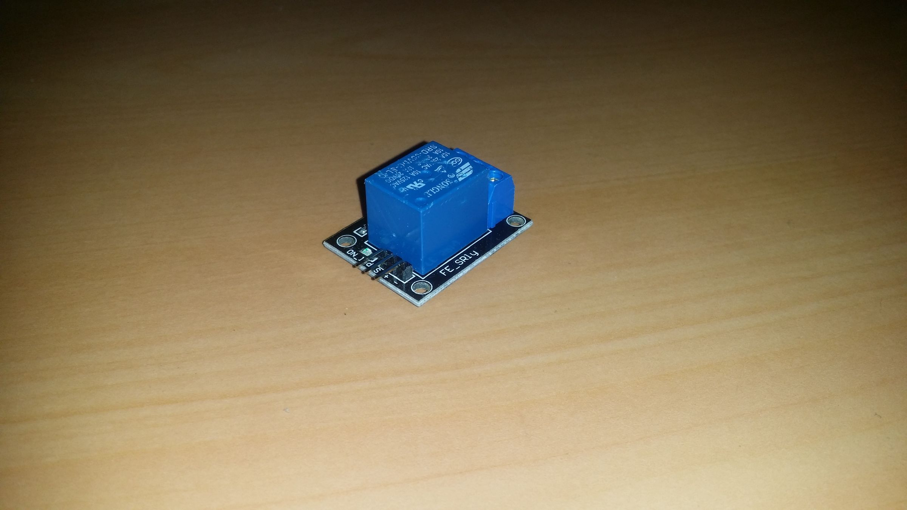
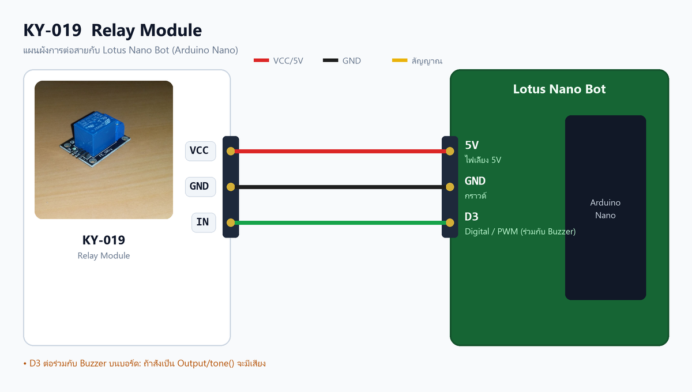

# KY-019 --- Relay Module

## รายละเอียด

Relay Module เป็นโมดูลสวิตช์ควบคุมด้วยไฟฟ้า ใช้เปิด/ปิดวงจรไฟฟ้ากระแสสูง (220V AC) ด้วยสัญญาณจาก Arduino (5V DC) บางรุ่นมี Optocoupler แยกวงจรควบคุมและวงจรกำลัง

> **⚠️ ความปลอดภัยสำหรับนักเรียน:** การทดลองในห้องเรียนให้ใช้โหลดไฟ DC แรงดันต่ำเท่านั้น (เช่น LED + ถ่าน 3-9V หรือมอเตอร์เล็ก) ห้ามต่อไฟบ้าน 220V AC เองเด็ดขาด งานที่ใช้ไฟบ้านต้องทำโดยครูหรือผู้มีความรู้ด้านไฟฟ้า และต้องไม่จับบอร์ดขณะมีไฟ

## คุณสมบัติ

- แรงดันไฟฟ้าควบคุม: 5V DC
- แรงดันไฟฟ้ารีเลย์: 10A 250V AC / 10A 30V DC
- บางรุ่นมี Optocoupler แยกวงจร (KY-019 ส่วนใหญ่ใช้ทรานซิสเตอร์ขับ)
- มี LED แสดงสถานะ
- แบบ 1 Channel, 2 Channel, 4 Channel, 8 Channel

## ขาของโมดูล (1 Channel)

| ขา (Module) | สีสาย | เชื่อมต่อกับ (Lotus Nano Bot) |
|-------------|-------|------------------------------|
| VCC         | แดง   | 5V                           |
| GND         | ดำ/น้ำตาล | GND                       |
| IN (Signal) | ขาว   | A0 (D14) หรือ A1-A3       |
| NC          | -     | โหลด (Normally Closed)      |
| NO          | -     | โหลด (Normally Open)         |
| COM         | -     | แหล่งจ่ายไฟ AC/DC             |

> ต่อที่หัวต่อพอร์ต A0 บนบอร์ด: ช่องขาว = S, ช่องแดง = 5V, ช่องดำ = GND

## การต่อสายไฟ

```
Relay Module             Lotus Nano Bot
━━━━━━━━━━━━━━━━━━━━━━━━━━━━━━━━━━━━━━━━
VCC ──────────────────► 5V
GND ──────────────────► GND
IN ──────────────────► A0 (D14)
```

### ภาพการต่อสายกับบอร์ด



## โค้ดตัวอย่าง

```cpp
// Relay Module Example for Lotus Nano Bot
// IN -> A0 (D14)

#define RELAY_PIN 14  // A0

// KY-019 ขับคอยล์ผ่านทรานซิสเตอร์ NPN จึงเป็นแบบ Active High: ON = HIGH, OFF = LOW
// (ถ้าใช้โมดูลรีเลย์แบบมี Optocoupler/ขา JD-VCC ซึ่งเป็น Active Low ให้สลับค่า)
#define RELAY_ON  HIGH
#define RELAY_OFF LOW

void setup() {
  Serial.begin(9600);
  pinMode(RELAY_PIN, OUTPUT);
  digitalWrite(RELAY_PIN, RELAY_OFF);  // เริ่มต้นปิดรีเลย์
  Serial.println("Relay Module Test Started");
}

void loop() {
  Serial.println("🔌 Relay ON");
  digitalWrite(RELAY_PIN, RELAY_ON);
  delay(3000);

  Serial.println("🔌 Relay OFF");
  digitalWrite(RELAY_PIN, RELAY_OFF);
  delay(3000);
}
```

## โค้ดตัวอย่างควบคุมหลอดไฟด้วยเวลา

```cpp
#define RELAY_PIN 14  // A0
#define RELAY_ON  HIGH  // KY-019 = Active High
#define RELAY_OFF LOW

void setup() {
  pinMode(RELAY_PIN, OUTPUT);
  digitalWrite(RELAY_PIN, RELAY_OFF);  // ปิด
}

void loop() {
  // Arduino ไม่มีนาฬิกาจริง ค่านี้คือ "จำนวนชั่วโมงนับจากเปิดเครื่อง" (0-23 วนรอบวัน)
  // ถ้าเปิดเครื่องตอน 00:00 พอดี จะเปิดไฟช่วง 18:00 - 06:00 (ต้องการเวลาจริงให้ใช้โมดูล RTC)
  unsigned long hour = (millis() / 1000UL / 60 / 60) % 24;

  if (hour >= 18 || hour < 6) {
    digitalWrite(RELAY_PIN, RELAY_ON);
  } else {
    digitalWrite(RELAY_PIN, RELAY_OFF);
  }
  
  delay(60000);  // ตรวจสอบทุกนาที
}
```

## หมายเหตุสำคัญ

- **⚠️ อันตรายจากไฟฟ้า:** 220V AC อันตรายถึงชีวิต! ต้องระมัดระวังเมื่อต่อไฟ AC
- KY-019 เป็นแบบ **Active High** (HIGH = รีเลย์ทำงาน ได้ยินเสียงคลิก ไฟ LED บนโมดูลติด)
- โมดูลรีเลย์แบบมี Optocoupler (มีขา JD-VCC) มักเป็น Active Low ให้ทดสอบก่อนใช้งานจริง
- **ขั้วสกรู:** COM = ขาร่วม · NO (Normally Open) = ต่อกับ COM เมื่อรีเลย์ทำงาน · NC (Normally Closed) = ต่อกับ COM เมื่อรีเลย์ไม่ทำงาน
- รุ่นที่มี Optocoupler จะแยกวงจรควบคุมออกจากวงจรกำลัง
- บน Lotus Nano Bot ใช้ A0-A3 (เป็น Digital Output) ได้ ไม่ต่อที่ D3 เพราะต่อร่วมกับบัซเซอร์ในตัว
- คอยล์รีเลย์กินไฟราว 70-90 mA จากขา 5V ควรใช้แบตเตอรี่ที่ชาร์จเต็ม

## กิจกรรมการเรียนรู้

### จุดประสงค์การเรียนรู้
1. นักเรียนต่อ Relay Module และสั่งเปิด/ปิดด้วย Arduino ได้ โดยใช้โหลด DC แรงดันต่ำอย่างปลอดภัย
2. นักเรียนระบุได้ว่าโมดูลเป็นแบบ Active Low หรือ Active High จากผลการทดลอง
3. นักเรียนอธิบายความแตกต่างของขา COM, NO และ NC ได้

### ขั้นตอนการทดลอง
1. ต่อสาย VCC→5V, GND→GND, IN→A0 (ยังไม่ต่อโหลด) แล้วอัปโหลดโค้ดตัวอย่างแรก
2. ฟังเสียงคลิกและดู LED บนโมดูล เทียบกับข้อความ ON/OFF ใน Serial Monitor
3. ต่อโหลดแรงดันต่ำ (ถ่าน 3V + LED + ตัวต้านทาน 220Ω) ผ่าน COM และ NO ทดสอบอีกครั้ง
4. ย้ายสายโหลดจาก NO ไป NC แล้วเปรียบเทียบผล

### ตารางบันทึกผล
| ครั้งที่ | สภาวะ/การกระทำ | ค่าที่อ่านได้ | ผลที่สังเกตได้ |
|---|---|---|---|
| 1 | IN = LOW (ยังไม่ต่อโหลด) | LED โมดูล: | |
| 2 | IN = HIGH (ยังไม่ต่อโหลด) | LED โมดูล: | |
| 3 | ต่อโหลดที่ COM-NO แล้วสลับเป็น COM-NC | | |

### คำถามท้ายการทดลอง
1. รีเลย์ทำงานด้วยหลักการใด จึงใช้สัญญาณ 5V ควบคุมวงจรอื่นได้
2. ถ้าสั่ง ON แล้ว LED บนโมดูลดับ แต่สั่ง OFF แล้วติด แสดงว่าโมดูลเป็นแบบใด ต้องแก้โค้ดอย่างไร
3. ถ้าต้องการให้ปั๊มน้ำทำงานเมื่อดินแห้ง ควรต่อโหลดที่ขา NO หรือ NC เพราะอะไร

<details>
<summary>แนวคำตอบ (สำหรับครู)</summary>

1. กระแสผ่านขดลวดสร้างสนามแม่เหล็กดึงหน้าสัมผัสให้ต่อ/ตัดวงจร วงจรควบคุมกับวงจรโหลดจึงแยกจากกันทางไฟฟ้า
2. KY-019 เป็นแบบ Active High: สั่ง HIGH แล้วรีเลย์ทำงาน (ถ้าเป็นโมดูลแบบ Active Low ให้แก้ `#define RELAY_ON LOW` และ `#define RELAY_OFF HIGH`)
3. ขา NO เพราะปกติปั๊มจะปิด และทำงานเฉพาะเมื่อสั่งรีเลย์ หากไฟ Arduino ดับปั๊มจะหยุดเอง (ปลอดภัยกว่า)

</details>

### ภารกิจท้าทาย
- ใช้ปุ่ม OK ในตัว (D2) สั่ง Toggle รีเลย์ (ต่อ IN ที่ A0) และให้บัซเซอร์ในตัว (D3) ดังสั้น ๆ ทุกครั้งที่สถานะรีเลย์เปลี่ยน (ใช้โหลด DC แรงดันต่ำเท่านั้น)

## รูปภาพ





