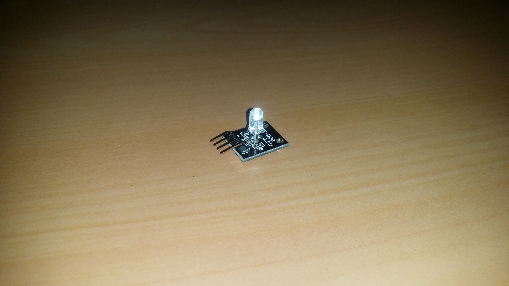
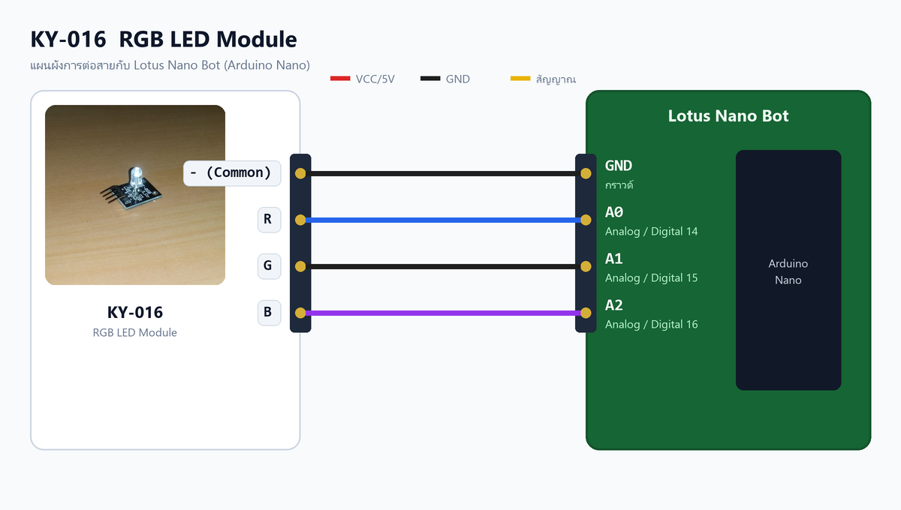

# KY-016 --- RGB LED Module

## รายละเอียด

RGB LED Module เป็นโมดูล LED ที่มี LED สีแดง (Red), เขียว (Green), น้ำเงิน (Blue) รวมในหลอดเดียว สามารถผสมสีได้โดยใช้ PWM (Pulse Width Modulation) ควบคุมความสว่างของแต่ละสี บน Lotus Nano Bot ใช้ขา Digital A0-A2 แสดงได้ 7 สี และไล่สีได้ด้วย Software PWM

## คุณสมบัติ

- แรงดันไฟฟ้า: 5V DC
- ควบคุมด้วย PWM หรือ Digital (3 ขา: R, G, B)
- มีตัวต้านทานจำกัดกระแสในตัว
- สร้างได้หลายล้านสีเมื่อใช้ PWM / 7 สีเมื่อใช้ Digital (เปิด/ปิด)

## ขาของโมดูล

| ขา (Module) | สีสาย | เชื่อมต่อกับ (Lotus Nano Bot) |
|-------------|-------|------------------------------|
| - (Common)  | ดำ    | GND (Common Cathode) หรือ 5V (Common Anode) |
| R (Red)     | เหลือง | A0 (D14)                    |
| G (Green)   | เขียว | A1 (D15)                    |
| B (Blue)    | น้ำเงิน | A2 (D16)                   |

> **หมายเหตุ:** บางรุ่นเป็น Common Cathode (ขาร่วมต่อ GND, R/G/B = HIGH ติด) บางรุ่นเป็น Common Anode (ขาร่วมต่อ 5V, R/G/B = LOW ติด)

## การต่อสายไฟ (Common Cathode)

```
RGB LED Module           Lotus Nano Bot
━━━━━━━━━━━━━━━━━━━━━━━━━━━━━━━━━━━━━━━━
- (Common) ─────────────► GND
R ─────────────────────► A0 (D14)
G ─────────────────────► A1 (D15)
B ─────────────────────► A2 (D16)
```

### ภาพการต่อสาย (Text Diagram)

```
        +------------------+
        |   RGB LED        |
        |   Module         |
        |    [*]           |
        |                  |
   +----+----+   +----+----+   +----+----+   +----+----+
   |  VCC    |   |   R     |   |   G     |   |   B     |
   |   (-)   |   |  (Dig)  |   |  (Dig)  |   |  (Dig)  |
   +----+----+   +----+----+   +----+----+   +----+----+
        |             |             |             |
        |             |             |             |
   +----+----+   +----+----+   +----+----+   +----+----+
   |  GND    |   |   A0    |   |   A1    |   |   A2    |
   |         |   |         |   |         |   |         |
   |  Lotus  |   |  Nano   |   |  Bot    |   |         |
   +---------+   +---------+   +---------+   +---------+
```

## โค้ดตัวอย่าง

```cpp
// RGB LED Example for Lotus Nano Bot
// Common Cathode: R->A0 (D14), G->A1 (D15), B->A2 (D16)
// A0-A2 ไม่ใช่ขา PWM จึงเปิด/ปิดแต่ละสีแบบ Digital ได้ 7 สี

#define RED_PIN 14    // A0
#define GREEN_PIN 15  // A1
#define BLUE_PIN 16   // A2

void setup() {
  Serial.begin(9600);
  pinMode(RED_PIN, OUTPUT);
  pinMode(GREEN_PIN, OUTPUT);
  pinMode(BLUE_PIN, OUTPUT);
  Serial.println("RGB LED Test Started");
}

void loop() {
  // Red
  setColor(255, 0, 0);
  delay(1000);
  
  // Green
  setColor(0, 255, 0);
  delay(1000);
  
  // Blue
  setColor(0, 0, 255);
  delay(1000);
  
  // Yellow
  setColor(255, 255, 0);
  delay(1000);
  
  // Cyan
  setColor(0, 255, 255);
  delay(1000);
  
  // Purple
  setColor(255, 0, 255);
  delay(1000);
  
  // White
  setColor(255, 255, 255);
  delay(1000);
}

void setColor(int red, int green, int blue) {
  // ค่า > 0 = ติด, 0 = ดับ (ถ้าเป็น Common Anode ให้กลับ HIGH/LOW)
  digitalWrite(RED_PIN, red > 0 ? HIGH : LOW);
  digitalWrite(GREEN_PIN, green > 0 ? HIGH : LOW);
  digitalWrite(BLUE_PIN, blue > 0 ? HIGH : LOW);
}
```

## โค้ดตัวอย่างไล่สี Rainbow (Software PWM)

ขา A0-A2 ไม่มี PWM ฮาร์ดแวร์ จึงใช้ Software PWM (สลับขาเร็ว ๆ ในโค้ด) เพื่อไล่ระดับความสว่าง

```cpp
#define RED_PIN 14    // A0
#define GREEN_PIN 15  // A1
#define BLUE_PIN 16   // A2

void setup() {
  pinMode(RED_PIN, OUTPUT);
  pinMode(GREEN_PIN, OUTPUT);
  pinMode(BLUE_PIN, OUTPUT);
}

void loop() {
  // ไล่สีแบบ Rainbow (เพิ่มทีละ 5 ระดับ)
  for (int i = 0; i <= 255; i += 5) {
    softPWM(255 - i, i, 0, 20);    // Red -> Green
  }

  for (int i = 0; i <= 255; i += 5) {
    softPWM(0, 255 - i, i, 20);    // Green -> Blue
  }

  for (int i = 0; i <= 255; i += 5) {
    softPWM(i, 0, 255 - i, 20);    // Blue -> Red
  }
}

// Software PWM: สลับขา Digital เร็ว ๆ เพื่อจำลองความสว่าง 0-255
// หนึ่งรอบใช้เวลาราว 3 ms (~300 Hz) จึงไม่เห็นการกระพริบ
void softPWM(int red, int green, int blue, int durationMs) {
  unsigned long start = millis();
  while (millis() - start < (unsigned long)durationMs) {
    for (int t = 0; t < 255; t++) {
      digitalWrite(RED_PIN, t < red);
      digitalWrite(GREEN_PIN, t < green);
      digitalWrite(BLUE_PIN, t < blue);
    }
  }
}
```

## หมายเหตุ

- ตรวจสอบว่าเป็น Common Cathode หรือ Common Anode ก่อนใช้งาน
- Common Anode: ขาร่วม -> 5V, R/G/B (LOW = สว่าง)
- Common Cathode: ขาร่วม -> GND, R/G/B (HIGH = สว่าง)
- **เรื่อง PWM:** Arduino Nano มีขา PWM เพียง D3, D5, D6, D9, D10, D11 แต่บน Lotus Nano Bot ขา D5/D6/D9 ใช้กับมอเตอร์ และ D10/D11 ใช้กับเซอร์โว (Servo library ยังปิด PWM ของ D9/D10 ด้วย) จึงเหลือ D3 เพียงขาเดียวที่ว่าง (ซึ่งต่อกับบัซเซอร์ในตัว อาจมีเสียงหวีดเมื่อใช้ PWM)
- ขา A0-A3 ไม่ใช่ขา PWM ถ้าใช้ `analogWrite()` จะได้แค่ดับ (ค่า < 128) หรือติดเต็ม (ค่า ≥ 128) เท่านั้น จึงควรใช้ `digitalWrite()` หรือ Software PWM ตามตัวอย่าง
- ห้ามต่อ LED ที่ D2 (ปุ่ม), D4-D9 (มอเตอร์) หรือ D10-D12 (เซอร์โว)

## กิจกรรมการเรียนรู้

### จุดประสงค์การเรียนรู้
1. นักเรียนต่อ RGB LED Module เข้ากับขา A0-A2 และแสดงสีพื้นฐาน 7 สีด้วย `digitalWrite()` ได้
2. นักเรียนอธิบายหลักการผสมแสงสีแบบบวก (R+G+B) และบันทึกสีที่ได้จากการผสมได้
3. นักเรียนอธิบายได้ว่าทำไมบน Lotus Nano Bot จึงต้องใช้ Software PWM แทน `analogWrite()` เพื่อไล่สี

### ขั้นตอนการทดลอง
1. ต่อสาย -→GND, R→A0, G→A1, B→A2 แล้วอัปโหลดโค้ดตัวอย่าง
2. บันทึกสีที่เห็นเมื่อสั่งแต่ละชุดค่า (R, G, B) เทียบกับคอมเมนต์ในโค้ด
3. ทดลองแก้ `setColor()` ให้ใช้ `analogWrite(RED_PIN, 100)` แล้วสังเกตว่าความสว่างลดลงหรือไม่
4. เขียนฟังก์ชัน `softPWM()` (ดูตัวอย่างใน RGB LED Module) ปรับแดงที่ 30, 128, 255 แล้วเปรียบเทียบความสว่าง

### ตารางบันทึกผล
| ครั้งที่ | สภาวะ/การกระทำ | ค่าที่อ่านได้ | ผลที่สังเกตได้ |
|---|---|---|---|
| 1 | setColor(255, 255, 0) | | |
| 2 | setColor(0, 255, 255) | | |
| 3 | softPWM แดง = 30 / 128 / 255 | | |

### คำถามท้ายการทดลอง
1. การผสมแสงสีแดง + เขียว + น้ำเงินเต็มที่ ได้สีอะไร เพราะเหตุใด
2. ทำไม `analogWrite()` ที่ขา A0 จึงให้ผลได้แค่ติดหรือดับ
3. ถ้าต้องการใช้ไฟ RGB แสดงทิศทางการเลี้ยวของหุ่นยนต์ ควรกำหนดสีอย่างไร

<details>
<summary>แนวคำตอบ (สำหรับครู)</summary>

1. ได้สีขาว เพราะเป็นการผสมแสงแบบบวก (Additive) แม่สีของแสงครบทั้งสามรวมกันเป็นแสงขาว
2. A0 ไม่มีวงจร PWM ฮาร์ดแวร์ `analogWrite()` จึงทำงานแบบ Digital ค่า < 128 = LOW, ≥ 128 = HIGH
3. เช่น เขียว = เดินหน้า, แดง = หยุด/ถอยหลัง, น้ำเงิน = เลี้ยวซ้าย, เหลือง = เลี้ยวขวา (เลือกสีที่แยกกันชัดเจน)

</details>

### ภารกิจท้าทาย
- ใช้ Knob ในตัว (A7) เลือกสี 1 ใน 7 สี (`map(analogRead(A7), 0, 1023, 0, 6)`) และกดปุ่ม OK (D2) เพื่อ "ยืนยัน" ให้บัซเซอร์ในตัว (D3) ดังตามลำดับสีที่เลือก

## รูปภาพ





