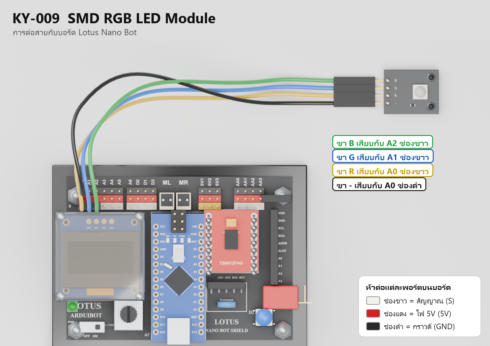
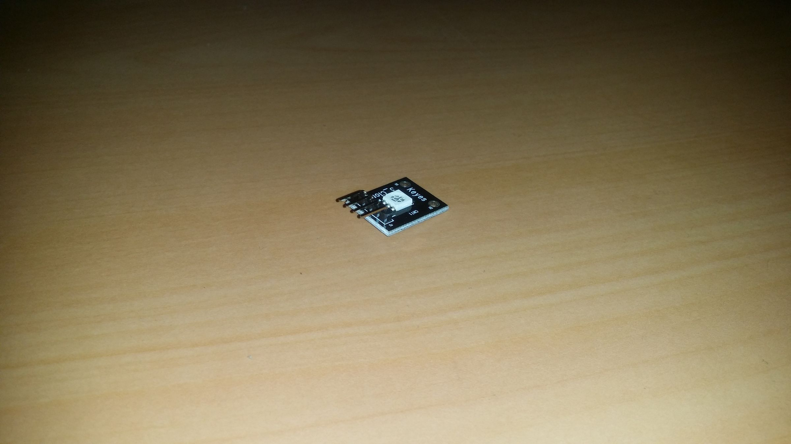
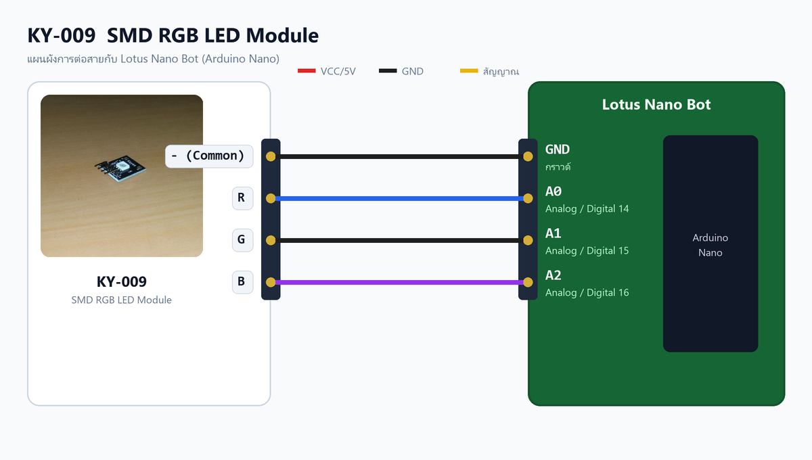

# KY-009 --- SMD RGB LED Module

## รายละเอียด

SMD RGB LED Module เป็นโมดูล LED RGB แบบ SMD (Surface Mount Device) ขนาดเล็ก มี LED Red, Green, Blue ในหลอดเดียว ควบคุมด้วย PWM หรือ Digital (บน Lotus Nano Bot ใช้ A0-A2 แบบ Digital ได้ 7 สี)

## คุณสมบัติ

- แรงดันไฟฟ้า: 3.3V - 5V DC
- ควบคุมด้วย PWM หรือ Digital (3 ขา: R, G, B)
- มีตัวต้านทานจำกัดกระแสในตัว
- ขนาดเล็กกว่า RGB LED ทั่วไป

## ขาของโมดูล

| ขา (Module) | สีสาย | เชื่อมต่อกับ (Lotus Nano Bot) |
|-------------|-------|------------------------------|
| - (Common)  | ดำ    | GND (Common Cathode) หรือ 5V (Common Anode) |
| R (Red)     | เหลือง | A0 (D14)                    |
| G (Green)   | เขียว | A1 (D15)                    |
| B (Blue)    | น้ำเงิน | A2 (D16)                   |

> ต่อที่หัวต่อพอร์ต A0, A1, A2 บนบอร์ด: ช่องขาวของ A0 = R, A1 = G, A2 = B, ขา - (Common) ต่อช่องดำ = GND (Common Anode ต่อช่องแดง = 5V)

## การต่อสายไฟ (Common Cathode)

```
SMD RGB LED              Lotus Nano Bot
━━━━━━━━━━━━━━━━━━━━━━━━━━━━━━━━━━━━━━━━
- ──────────────────► GND
R ──────────────────► A0 (D14)
G ──────────────────► A1 (D15)
B ──────────────────► A2 (D16)
```

### ภาพการต่อสายกับบอร์ด



## โค้ดตัวอย่าง

```cpp
// SMD RGB LED Example for Lotus Nano Bot
// Common Cathode: R->A0 (D14), G->A1 (D15), B->A2 (D16)
// A0-A2 ไม่ใช่ขา PWM จึงเปิด/ปิดแต่ละสีแบบ Digital ได้ 7 สี

#define RED_PIN 14    // A0
#define GREEN_PIN 15  // A1
#define BLUE_PIN 16   // A2

void setup() {
  Serial.begin(9600);
  pinMode(RED_PIN, OUTPUT);
  pinMode(GREEN_PIN, OUTPUT);
  pinMode(BLUE_PIN, OUTPUT);
  Serial.println("SMD RGB LED Test Started");
}

void loop() {
  // Red
  setColor(255, 0, 0);
  delay(1000);
  
  // Green
  setColor(0, 255, 0);
  delay(1000);
  
  // Blue
  setColor(0, 0, 255);
  delay(1000);
}

void setColor(int red, int green, int blue) {
  // ค่า > 0 = ติด, 0 = ดับ (ถ้าเป็น Common Anode ให้กลับ HIGH/LOW)
  digitalWrite(RED_PIN, red > 0 ? HIGH : LOW);
  digitalWrite(GREEN_PIN, green > 0 ? HIGH : LOW);
  digitalWrite(BLUE_PIN, blue > 0 ? HIGH : LOW);
}
```

## หมายเหตุ

- SMD RGB LED ทำงานเหมือน RGB LED ทั่วไปแต่ขนาดเล็กกว่า
- ตรวจสอบว่าเป็น Common Cathode หรือ Common Anode
- **เรื่อง PWM:** ขา PWM ฮาร์ดแวร์ที่เข้าถึงได้จากหัวต่อของ Lotus Nano Bot คือ D10 (ช่อง SV1) และ D11 (ช่อง SV2) ใช้ได้เมื่อไม่ได้เสียบเซอร์โวที่ช่องนั้น (Servo library ปิด PWM ของ D9/D10 จึงห้ามใช้ `analogWrite()` ร่วมกับเซอร์โว) ส่วน D3 แม้เป็นขา PWM แต่ต่อร่วมกับบัซเซอร์ในตัว (จะมีเสียงหวีด) จึงไม่ต่อโมดูลที่ D3 หากต้องการไล่ความสว่างด้วย `analogWrite()` ให้ย้ายขาสีไปที่ D10/D11 ไม่เช่นนั้นใช้ Software PWM บน A0-A3
- ขา A0-A3 ไม่ใช่ขา PWM ถ้าใช้ `analogWrite()` จะได้แค่ดับ (ค่า < 128) หรือติดเต็ม (ค่า ≥ 128) เท่านั้น จึงควรใช้ `digitalWrite()` หรือ Software PWM (ดูตัวอย่างใน RGB LED Module)
- ห้ามต่อ LED ที่ D3 (บัซเซอร์ในตัว) และ D4-D9 (มอเตอร์ ไม่ได้อยู่บนหัวต่อ) ส่วน D10-D12 ใช้ได้เฉพาะเมื่อไม่ได้เสียบเซอร์โวที่ช่องนั้น

## กิจกรรมการเรียนรู้

### จุดประสงค์การเรียนรู้
1. นักเรียนต่อ SMD RGB LED Module เข้ากับขา A0-A2 และแสดงสีพื้นฐาน 7 สีด้วย `digitalWrite()` ได้
2. นักเรียนอธิบายหลักการผสมแสงสีแบบบวก (R+G+B) และบันทึกสีที่ได้จากการผสมได้
3. นักเรียนอธิบายได้ว่าทำไมบน Lotus Nano Bot จึงต้องใช้ Software PWM แทน `analogWrite()` เพื่อไล่สี

### ขั้นตอนการทดลอง
1. ต่อสาย -→GND, R→A0, G→A1, B→A2 แล้วอัปโหลดโค้ดตัวอย่าง
2. บันทึกสีที่เห็นเมื่อสั่งแต่ละชุดค่า (R, G, B) เทียบกับคอมเมนต์ในโค้ด
3. ทดลองแก้ `setColor()` ให้ใช้ `analogWrite(RED_PIN, 100)` แล้วสังเกตว่าความสว่างลดลงหรือไม่
4. เขียนฟังก์ชัน `softPWM()` (ดูตัวอย่างใน RGB LED Module) ปรับแดงที่ 30, 128, 255 แล้วเปรียบเทียบความสว่าง

### ตารางบันทึกผล
| ครั้งที่ | สภาวะ/การกระทำ | ค่าที่อ่านได้ | ผลที่สังเกตได้ |
|---|---|---|---|
| 1 | setColor(255, 255, 0) | | |
| 2 | setColor(0, 255, 255) | | |
| 3 | softPWM แดง = 30 / 128 / 255 | | |

### คำถามท้ายการทดลอง
1. การผสมแสงสีแดง + เขียว + น้ำเงินเต็มที่ ได้สีอะไร เพราะเหตุใด
2. ทำไม `analogWrite()` ที่ขา A0 จึงให้ผลได้แค่ติดหรือดับ
3. ถ้าต้องการใช้ไฟ RGB แสดงทิศทางการเลี้ยวของหุ่นยนต์ ควรกำหนดสีอย่างไร

<details>
<summary>แนวคำตอบ (สำหรับครู)</summary>

1. ได้สีขาว เพราะเป็นการผสมแสงแบบบวก (Additive) แม่สีของแสงครบทั้งสามรวมกันเป็นแสงขาว
2. A0 ไม่มีวงจร PWM ฮาร์ดแวร์ `analogWrite()` จึงทำงานแบบ Digital ค่า < 128 = LOW, ≥ 128 = HIGH
3. เช่น เขียว = เดินหน้า, แดง = หยุด/ถอยหลัง, น้ำเงิน = เลี้ยวซ้าย, เหลือง = เลี้ยวขวา (เลือกสีที่แยกกันชัดเจน)

</details>

### ภารกิจท้าทาย
- ใช้ Knob ในตัว (A7) เลือกสี 1 ใน 7 สี (`map(analogRead(A7), 0, 1023, 0, 6)`) และกดปุ่ม OK (D2) เพื่อ "ยืนยัน" ให้บัซเซอร์ในตัว (D3) ดังตามลำดับสีที่เลือก

## รูปภาพ





