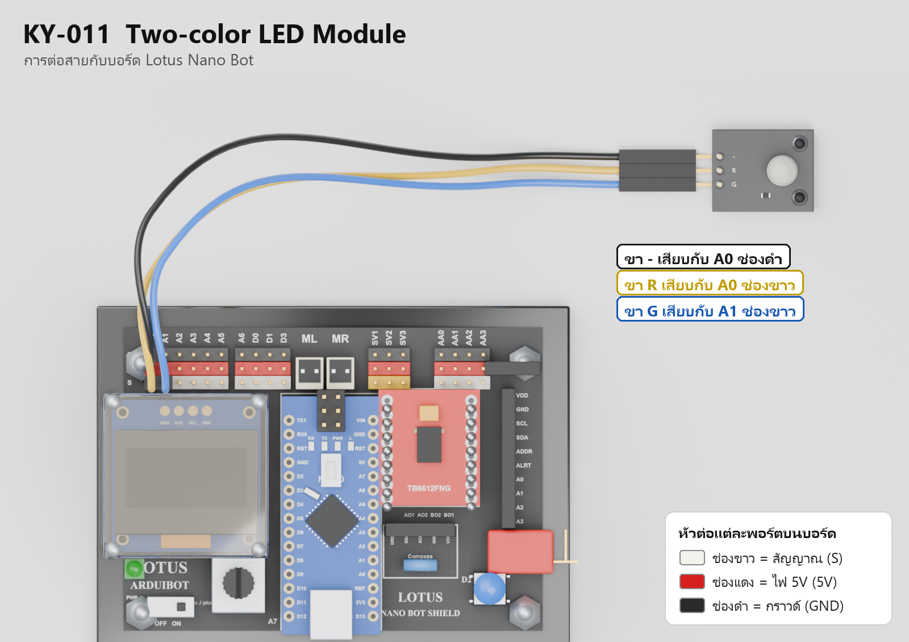
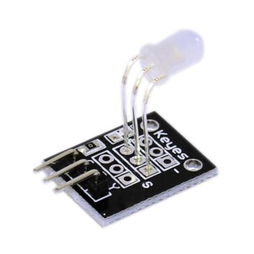
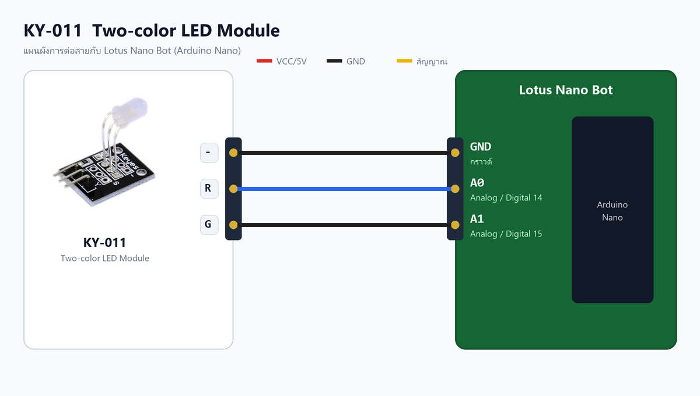

# KY-011 --- Two-color LED Module

## รายละเอียด

Two-color LED Module เป็นโมดูล LED 2 สี (มักเป็น Red และ Green) มีขา 3 ขา (Common Cathode หรือ Common Anode) สามารถแสดงสีแดง เขียว และส้ม (ผสม) ได้

## คุณสมบัติ

- แรงดันไฟฟ้า: 3.3V - 5V DC
- สี: Red และ Green (ผสมได้ Orange)
- ควบคุมด้วย Digital (บน Lotus Nano Bot ใช้ A0-A3) หรือ Software PWM (PWM ฮาร์ดแวร์บนหัวต่อใช้ D10/D11 ได้เมื่อไม่ได้เสียบเซอร์โว)
- มีตัวต้านทานจำกัดกระแสในตัว

## ขาของโมดูล

| ขา (Module) | สีสาย | เชื่อมต่อกับ (Lotus Nano Bot) |
|-------------|-------|------------------------------|
| - (Common)  | ดำ    | GND (Common Cathode) หรือ 5V (Common Anode) |
| R (Red)     | เหลือง | A0 (D14)                    |
| G (Green)   | เขียว | A1 (D15)                    |

> ต่อที่หัวต่อพอร์ต A0, A1 บนบอร์ด: ช่องขาวของ A0 = R, ช่องขาวของ A1 = G, ขา - (Common) ต่อช่องดำ = GND (Common Anode ต่อช่องแดง = 5V)

## การต่อสายไฟ (Common Cathode)

```
Two-color LED            Lotus Nano Bot
━━━━━━━━━━━━━━━━━━━━━━━━━━━━━━━━━━━━━━━━
- ──────────────────► GND
R ──────────────────► A0 (D14)
G ──────────────────► A1 (D15)
```

### ภาพการต่อสายกับบอร์ด



## โค้ดตัวอย่าง

```cpp
// Two-color LED Example for Lotus Nano Bot
// R->A0 (D14), G->A1 (D15)

#define RED_PIN 14    // A0
#define GREEN_PIN 15  // A1

void setup() {
  Serial.begin(9600);
  pinMode(RED_PIN, OUTPUT);
  pinMode(GREEN_PIN, OUTPUT);
  Serial.println("Two-color LED Test Started");
}

void loop() {
  // Red
  digitalWrite(RED_PIN, HIGH);
  digitalWrite(GREEN_PIN, LOW);
  delay(1000);
  
  // Green
  digitalWrite(RED_PIN, LOW);
  digitalWrite(GREEN_PIN, HIGH);
  delay(1000);
  
  // Orange (Red + Green)
  digitalWrite(RED_PIN, HIGH);
  digitalWrite(GREEN_PIN, HIGH);
  delay(1000);
  
  // Off
  digitalWrite(RED_PIN, LOW);
  digitalWrite(GREEN_PIN, LOW);
  delay(1000);
}
```

## โค้ดตัวอย่าง Software PWM (ปรับความสว่าง)

ขา A0/A1 ไม่ใช่ขา PWM (`analogWrite()` จะได้แค่ติด/ดับ) จึงใช้ Software PWM สลับขาเร็ว ๆ ในโค้ดแทน

```cpp
#define RED_PIN 14    // A0
#define GREEN_PIN 15  // A1

void setup() {
  pinMode(RED_PIN, OUTPUT);
  pinMode(GREEN_PIN, OUTPUT);
}

void loop() {
  // ไล่สีจากแดงไปเขียว
  for (int i = 0; i <= 255; i += 5) {
    softPWM(255 - i, i, 20);
  }

  // ไล่สีจากเขียวไปแดง
  for (int i = 0; i <= 255; i += 5) {
    softPWM(i, 255 - i, 20);
  }
}

// สลับขาเร็ว ๆ เพื่อจำลองความสว่าง 0-255 (~400 Hz)
void softPWM(int red, int green, int durationMs) {
  unsigned long start = millis();
  while (millis() - start < (unsigned long)durationMs) {
    for (int t = 0; t < 255; t++) {
      digitalWrite(RED_PIN, t < red);
      digitalWrite(GREEN_PIN, t < green);
    }
  }
}
```

## หมายเหตุ

- ตรวจสอบว่าเป็น Common Cathode หรือ Common Anode
- Common Cathode: ขาร่วม -> GND, R/G = HIGH ติด
- Common Anode: ขาร่วม -> 5V, R/G = LOW ติด
- **เรื่อง PWM:** ขา PWM ฮาร์ดแวร์ที่เข้าถึงได้จากหัวต่อของ Lotus Nano Bot คือ D10 (ช่อง SV1) และ D11 (ช่อง SV2) ใช้ได้เมื่อไม่ได้เสียบเซอร์โวที่ช่องนั้น (Servo library ปิด PWM ของ D9/D10 จึงห้ามใช้ `analogWrite()` ร่วมกับเซอร์โว) ส่วน D3 แม้เป็นขา PWM แต่ต่อร่วมกับบัซเซอร์ในตัว (จะมีเสียงหวีด) จึงไม่ต่อโมดูลที่ D3 หากต้องการไล่ความสว่างด้วย `analogWrite()` ให้ย้ายขาสีไปที่ D10/D11 ไม่เช่นนั้นใช้ Software PWM บน A0-A3
- ขา A0-A3 ไม่ใช่ขา PWM ถ้าใช้ `analogWrite()` จะได้แค่ดับ (ค่า < 128) หรือติดเต็ม (ค่า ≥ 128) เท่านั้น จึงควรใช้ `digitalWrite()` หรือ Software PWM ตามตัวอย่าง
- ห้ามต่อ LED ที่ D3 (บัซเซอร์ในตัว) และ D4-D9 (มอเตอร์ ไม่ได้อยู่บนหัวต่อ) ส่วน D10-D12 ใช้ได้เฉพาะเมื่อไม่ได้เสียบเซอร์โวที่ช่องนั้น

## กิจกรรมการเรียนรู้

### จุดประสงค์การเรียนรู้
1. นักเรียนต่อ Two-color LED เข้ากับ A0, A1 และแสดงสีแดง เขียว ส้มด้วย `digitalWrite()` ได้
2. นักเรียนใช้ Software PWM ปรับสัดส่วนแดง/เขียว เพื่อไล่สีจากแดงไปเขียวได้
3. นักเรียนเปรียบเทียบผลของ `analogWrite()` บนขาที่ไม่ใช่ PWM กับ Software PWM ได้

### ขั้นตอนการทดลอง
1. ต่อสาย -→GND, R→A0, G→A1 แล้วอัปโหลดโค้ดตัวอย่างแรก บันทึกสีแต่ละช่วง
2. อัปโหลดโค้ด Software PWM แล้วสังเกตการไล่สี
3. แก้ `softPWM()` ให้ใช้ `analogWrite()` แทน `digitalWrite()` แล้วเปรียบเทียบผล
4. ทดลองค่าสัดส่วน (R, G) = (255, 60), (255, 128), (128, 255) แล้วบันทึกสีที่ได้

### ตารางบันทึกผล
| ครั้งที่ | สภาวะ/การกระทำ | ค่าที่อ่านได้ | ผลที่สังเกตได้ |
|---|---|---|---|
| 1 | softPWM(255, 60) | | |
| 2 | softPWM(255, 128) | | |
| 3 | softPWM(128, 255) | | |

### คำถามท้ายการทดลอง
1. สีส้มเกิดขึ้นได้อย่างไรจาก LED เพียง 2 สี
2. ทำไมการใช้ `analogWrite()` บน A0/A1 จึงไล่สีไม่ได้ แต่ Software PWM ทำได้
3. ข้อเสียของ Software PWM เมื่อหุ่นยนต์ต้องทำงานอื่นพร้อมกัน เช่น อ่านเซนเซอร์ คืออะไร

<details>
<summary>แนวคำตอบ (สำหรับครู)</summary>

1. แสงแดงและเขียวสว่างพร้อมกัน ตาคนรับรู้เป็นสีผสม (ส้ม/เหลือง) ขึ้นกับสัดส่วนความสว่างของแต่ละสี
2. A0/A1 ไม่มีวงจร PWM ฮาร์ดแวร์ `analogWrite()` จึงได้แค่ 0/255 ส่วน Software PWM ให้ CPU สลับขาเองตามสัดส่วนเวลา
3. CPU ต้องวนสลับขาตลอดเวลา (Blocking) ทำงานอื่นได้ช้าลงหรือไม่ทันเวลา

</details>

### ภารกิจท้าทาย
- ใช้ Knob ในตัว (A7) ปรับสัดส่วนสีจากแดงไปเขียวแบบต่อเนื่อง (`int g = map(analogRead(A7), 0, 1023, 0, 255)`) และกดปุ่ม OK (D2) เพื่อให้บัซเซอร์ในตัว (D3) ดังบอกค่าที่เลือก

## รูปภาพ





