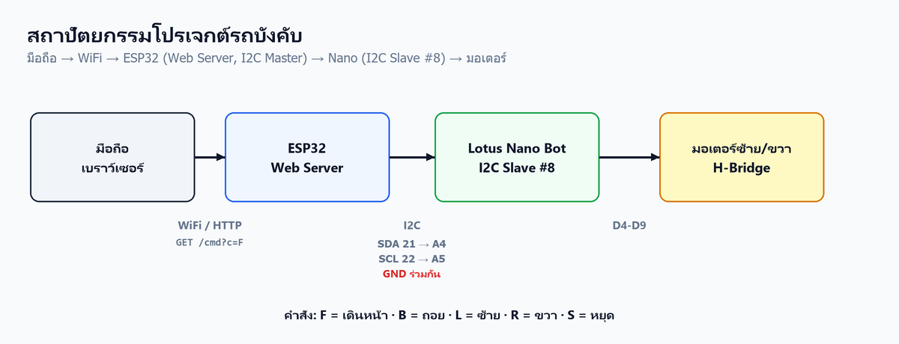

# โปรเจกต์: รถบังคับ Lotus Nano Bot (RC Car)

รถบังคับผ่านเว็บ โดยใช้ **ESP32** คุมผ่าน WiFi และ **Lotus Nano Bot** (Arduino Nano + Lotus Nano Shield) ขับมอเตอร์

---

## สถาปัตยกรรม



```
+------------------+        I2C         +-----------------------------+
|      ESP32       |<------------------>|   Lotus Nano Bot (Slave 8) |
|   (Web Server)   |   SDA=21, SCL=22   |  - มอเตอร์ซ้าย (D9/D4/D5)   |
|   - D-Pad UI     |                    |  - มอเตอร์ขวา (D7/D8/D6)   |
|   - WiFi         |                    |  - รับคำสั่งผ่าน I2C        |
+------------------+                    +-----------------------------+
```

---

## การต่อสาย (ESP32 -> Nano)

| ESP32 | Lotus Nano | สาย |
|-------|-----------|-----|
| GPIO 21 | A4 (SDA) | ขาว |
| GPIO 22 | A5 (SCL) | เหลือง |
| GND | GND | ดำ |
| 5V (VIN) | 5V | แดง |

> **หมายเหตุ:** ต่อสาย 5V เฉพาะเมื่อให้ Lotus Nano Bot จ่ายไฟให้ ESP32 ถ้า ESP32 เสียบ USB อยู่แล้วให้ต่อแค่ SDA, SCL และ GND (ห้ามจ่ายไฟสองแหล่งชนกัน)

---

## คำสั่งควบคุม (I2C)

| คำสั่ง | ทิศทาง |
|--------|--------|
| `F` | เดินหน้า |
| `B` | ถอยหลัง |
| `L` | เลี้ยวซ้าย |
| `R` | เลี้ยวขวา |
| `S` | หยุด |

---

## ไฟล์โค้ด

| ไฟล์ | บอร์ด |
|------|-------|
| `nano_driver/nano_driver.ino` | Lotus Nano Bot |
| `esp32_controller/esp32_controller.ino` | ESP32 |

---

## วิธีใช้งาน

1. อัปโหลด `nano_driver.ino` ไปยัง Lotus Nano Bot
2. แก้ไข `ssid` และ `password` ใน `esp32_controller.ino`
3. อัปโหลด `esp32_controller.ino` ไปยัง ESP32
4. เปิด Serial Monitor ของ ESP32 ดู IP Address
5. เปิด Browser ที่มือถือ/คอม แล้วเข้า IP นั้น
6. ใช้ D-Pad บนหน้าเว็บบังคับรถ (กดค้าง = วิ่ง, ปล่อย = หยุด)

> **ระบบความปลอดภัย (Failsafe):** ขณะกดปุ่มค้าง หน้าเว็บจะส่งคำสั่งซ้ำทุก 200 ms หาก Nano ไม่ได้รับคำสั่งเกิน 500 ms (WiFi หลุด, ปิดหน้าเว็บ, สาย I2C หลวม) รถจะหยุดเองอัตโนมัติ และถ้า I2C ผิดพลาด ESP32 จะแสดง `I2C error` ใน Serial Monitor

---

## หลักการทำงาน

ระบบแบ่งเป็น 2 บอร์ดที่คุยกันด้วยบัส **I2C** (สาย SDA = ข้อมูล, SCL = สัญญาณนาฬิกา และต้องมี GND ร่วมกัน)

- **ESP32 = I2C Master** เป็นฝ่ายเริ่มส่งข้อมูลเสมอ (`Wire.begin()` ไม่ระบุแอดเดรส)
- **Lotus Nano Bot = I2C Slave แอดเดรส 8** (`Wire.begin(8)`) รอรับข้อมูลในฟังก์ชัน `receiveEvent()`
- แอดเดรส 8 ไม่ชนกับอุปกรณ์ I2C ในตัวบอร์ด (OLED 0x3C, HMC5883 0x1E, ADS1115 0x48) จึงใช้บัสเดียวกันได้

ลำดับการทำงานเมื่อกดปุ่มบนหน้าเว็บ:

```
มือถือ/คอม (กดปุ่ม ▲)
   │  HTTP GET /cmd?c=F  (ผ่าน WiFi)
   ▼
ESP32 (Web Server)
   │  Wire.beginTransmission(8) → Wire.print("F") → Wire.endTransmission()
   ▼
Arduino Nano (Slave 8) → receiveEvent() เก็บคำสั่ง → loop() เรียก forward()
   │  digitalWrite ทิศทาง (D9/D4, D7/D8) + analogWrite ความเร็ว (D5, D6)
   ▼
วงจรขับมอเตอร์ → มอเตอร์ซ้าย/ขวาหมุน
```

เมื่อปล่อยปุ่ม หน้าเว็บจะส่ง `S` ทำให้ Nano เรียก `stopCar()` หยุดรถ

---

## การแก้ปัญหาเบื้องต้น

| อาการ | สาเหตุที่เป็นไปได้ | วิธีแก้ |
|-------|------------------|--------|
| Serial Monitor ขึ้น `Connecting WiFi.....` ไม่หยุด | SSID/รหัสผ่านผิด, WiFi เป็น 5 GHz, สัญญาณอ่อน | ตรวจ `ssid`/`password`, ใช้ WiFi 2.4 GHz (หรือ Hotspot มือถือ), วาง ESP32 ใกล้เราเตอร์ |
| เปิดหน้าเว็บไม่ขึ้น | มือถือไม่ได้อยู่ในวงเครือข่ายเดียวกับ ESP32, พิมพ์ IP ผิด | เชื่อมมือถือกับ WiFi เดียวกัน พิมพ์ `http://<IP>` ตามที่ Serial Monitor แสดง |
| หน้าเว็บขึ้น Serial ขึ้น `CMD: F` แต่รถไม่วิ่ง | สาย SDA/SCL สลับกัน, ไม่ได้ต่อ GND ร่วม, Nano ยังไม่ได้อัปโหลด `nano_driver.ino` | ต่อ GPIO21→A4, GPIO22→A5, **GND ต้องต่อร่วมกันเสมอ** และอัปโหลดโค้ดฝั่ง Nano ใหม่ |
| ไฟบอร์ดติดแต่มอเตอร์ไม่หมุน/หมุนอ่อน | แบตเตอรี่อ่อนหรือยังไม่เปิดสวิตช์แบต (USB จ่ายไฟมอเตอร์ไม่พอ) | ชาร์จแบต LiPo 7.4V ให้เต็ม เปิดสวิตช์ไฟบอร์ด |
| บอร์ดรีเซ็ตเองตอนรถออกตัว | แบตตก กระแสกระชากตอนมอเตอร์เริ่มหมุน | ชาร์จแบต ใช้แบตที่จ่ายกระแสได้สูงพอ |
| กดเดินหน้าแต่รถถอยหรือหมุนอยู่กับที่ | สายมอเตอร์ข้างใดข้างหนึ่งกลับขั้ว | สลับสายมอเตอร์ข้างนั้น หรือสลับ HIGH/LOW ของ ML1/ML2 (MR1/MR2) ในโค้ด Nano |
| สั่งงานได้บ้างไม่ได้บ้าง / I2C ค้าง | สายยาวเกินไป, ระดับแรงดัน I2C ไม่ตรงกัน | ใช้สายสั้น (< 30 cm) และดูหมายเหตุเรื่องระดับแรงดันด้านล่าง |

> **⚠️ ระดับแรงดัน I2C:** ESP32 ทำงานที่ 3.3V และขาไม่ทนแรงดัน 5V ส่วน Arduino Nano ทำงานที่ 5V และ `Wire.begin(8)` จะเปิด Pull-up ภายในขึ้น 5V บนสาย SDA/SCL ส่วนใหญ่ใช้งานได้เพราะ Pull-up มีค่าสูง แต่เพื่อความปลอดภัยของ ESP32 ควรใช้ **โมดูลแปลงระดับแรงดัน I2C (Logic Level Shifter 3.3V ↔ 5V)** คั่นระหว่างสองบอร์ด

---

## กิจกรรมการเรียนรู้

### จุดประสงค์การเรียนรู้
1. นักเรียนอธิบายการสื่อสารแบบ I2C Master/Slave ระหว่าง ESP32 กับ Arduino Nano ได้
2. นักเรียนต่อสายและอัปโหลดโค้ดทั้งสองบอร์ด จนบังคับรถผ่านหน้าเว็บได้ครบ 5 คำสั่ง
3. นักเรียนวิเคราะห์และแก้ปัญหาเมื่อรถไม่ตอบสนองโดยใช้ตารางการแก้ปัญหาได้

### ขั้นตอนการทดลอง
1. อัปโหลด `nano_driver.ino` ไปยัง Lotus Nano Bot แล้วถอดสาย USB ออก
2. แก้ `ssid`/`password` แล้วอัปโหลด `esp32_controller.ino` เปิด Serial Monitor (115200) จด IP Address
3. ต่อสาย GPIO21→A4, GPIO22→A5, GND→GND แล้วเปิดสวิตช์แบตของรถ (ยกล้อให้ลอยก่อนทดสอบ)
4. เปิดหน้าเว็บจากมือถือ ทดสอบปุ่มทั้ง 5 และตรวจข้อความ `CMD:` ใน Serial Monitor
5. วางรถบนพื้น วัดเวลาที่รถเดินหน้าได้ระยะ 1 เมตร

### ตารางบันทึกผล
| ครั้งที่ | สภาวะ/การกระทำ | ค่าที่อ่านได้ | ผลที่สังเกตได้ |
|---|---|---|---|
| 1 | กดปุ่ม ▲ ค้าง (ล้อลอย) | Serial: CMD = | |
| 2 | กดปุ่ม ◀ และ ▶ | Serial: CMD = | |
| 3 | เดินหน้าระยะ 1 เมตรบนพื้น | เวลา = วินาที | |

### คำถามท้ายการทดลอง
1. ในระบบนี้บอร์ดใดเป็น Master และบอร์ดใดเป็น Slave เพราะเหตุใดจึงออกแบบเช่นนั้น
2. ถ้าไม่ได้ต่อสาย GND ร่วมกันระหว่าง ESP32 กับ Nano จะเกิดอะไรขึ้น เพราะอะไร
3. ถ้า WiFi หลุดขณะกดปุ่มเดินหน้าค้างไว้ รถจะหยุดหรือไม่ ควรปรับปรุงโค้ดอย่างไรให้ปลอดภัย

<details>
<summary>แนวคำตอบ (สำหรับครู)</summary>

1. ESP32 เป็น Master เพราะเป็นฝ่ายรับคำสั่งจากผู้ใช้และเริ่มส่งข้อมูล ส่วน Nano เป็น Slave แอดเดรส 8 ทำหน้าที่รับคำสั่งและขับมอเตอร์ แบ่งงาน WiFi กับงานควบคุมมอเตอร์ออกจากกัน
2. สัญญาณ I2C ไม่มีแรงดันอ้างอิงร่วมกัน Nano จะอ่านระดับ HIGH/LOW ผิด ทำให้รับคำสั่งไม่ได้หรือได้ข้อมูลเพี้ยน
3. ไม่หยุด เพราะ Nano จะทำคำสั่งล่าสุดไปเรื่อย ๆ จนกว่าจะได้ `S` ควรเพิ่ม Timeout ใน Nano เช่น ถ้าไม่ได้รับคำสั่งเกิน 500 ms ให้เรียก `stopCar()` และให้หน้าเว็บส่งคำสั่งซ้ำทุก 200 ms ขณะกดค้าง

</details>

### ภารกิจท้าทาย
- เพิ่มคำสั่ง `H` (แตร) ให้ Nano เล่นเสียง `tone(3, 1000, 200)` ที่บัซเซอร์ในตัว (D3) และเพิ่มปุ่ม "HORN" บนหน้าเว็บ หรือเพิ่มคำสั่งปรับความเร็ว เช่น `V150` ให้ Nano ตั้งค่า PWM ของมอเตอร์เป็น 150
