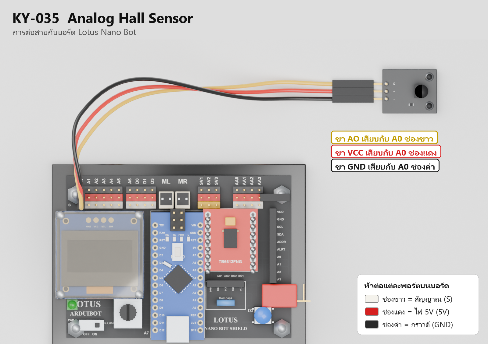
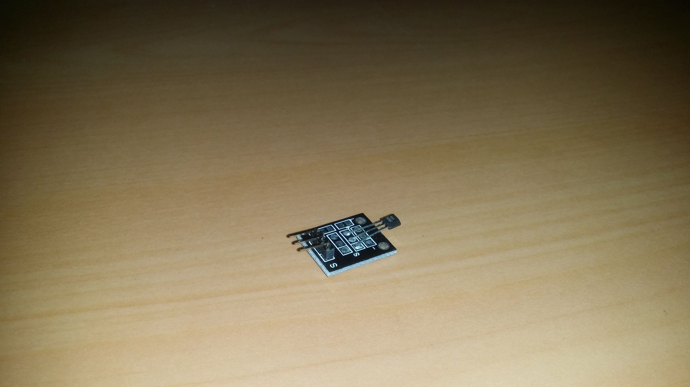
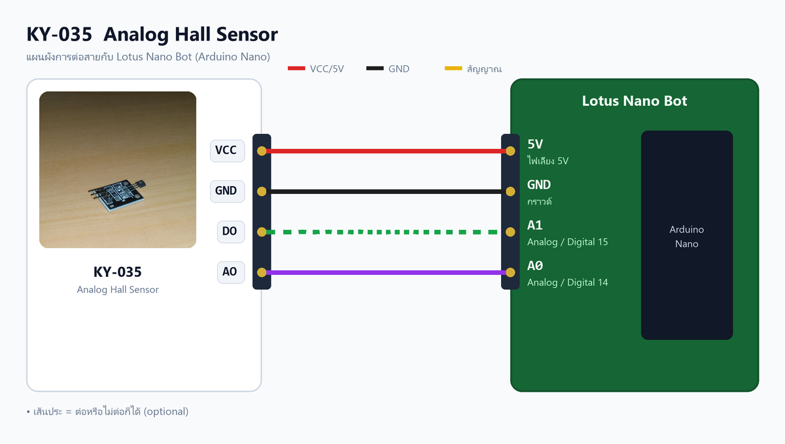

# KY-035 --- Analog Hall Sensor

## รายละเอียด

Analog Hall Sensor เป็นเซนเซอร์แม่เหล็กแบบอนาลอก ให้ค่าแรงดันเปลี่ยนไปตามความเข้มของสนามแม่เหล็ก สามารถวัดทิศทางและความแรงของแม่เหล็กได้

## คุณสมบัติ

- แรงดันไฟฟ้า: 3.3V - 5V DC
- เอาต์พุต: Digital (DO) และ Analog (AO)
- มี LED แสดงสถานะ
- มีตัวปรับค่า (Potentiometer)

> **หมายเหตุ:** KY-035 รุ่นดั้งเดิมมี 3 ขา (S, +, -) ให้เฉพาะเอาต์พุต Analog ส่วนโมดูลแบบ 4 ขา (เช่น KY-024 Linear Hall) จะมี DO และตัวปรับค่าเพิ่ม เอกสารนี้อธิบายแบบ 4 ขา หากใช้แบบ 3 ขาให้ต่อเฉพาะ AO

## ขาของเซนเซอร์

| ขา (Sensor) | สีสาย | เชื่อมต่อกับ (Lotus Nano Bot) |
|-------------|-------|------------------------------|
| VCC         | แดง   | 5V                           |
| GND         | ดำ/น้ำตาล | GND                       |
| DO (Digital)| เหลือง | A1 (D15)                     |
| AO (Analog) | ขาว   | A0                           |

> ต่อที่หัวต่อพอร์ต A0 และ A1 บนบอร์ด: ช่องขาว = S (AO เข้า A0, DO เข้า A1), ช่องแดง = 5V, ช่องดำ = GND

## การต่อสายไฟ

```
Analog Hall Sensor       Lotus Nano Bot
━━━━━━━━━━━━━━━━━━━━━━━━━━━━━━━━━━━━━━━━
VCC  ──────────────────► 5V
GND  ──────────────────► GND
DO   ──────────────────► A1 (optional)
AO   ──────────────────► A0
```

### ภาพการต่อสายกับบอร์ด



## โค้ดตัวอย่าง

```cpp
// Analog Hall Sensor Example for Lotus Nano Bot
// AO -> A0, DO -> A1 (D15) (optional)

#define HALL_ANALOG_PIN A0
#define HALL_DIGITAL_PIN 15 // A1
#define LED_PIN 13

void setup() {
  Serial.begin(9600);
  pinMode(HALL_DIGITAL_PIN, INPUT);
  pinMode(LED_PIN, OUTPUT);
  Serial.println("Analog Hall Sensor Test Started");
}

void loop() {
  int analogValue = analogRead(HALL_ANALOG_PIN);
  float voltage = analogValue * (5.0 / 1023.0);
  int digitalValue = digitalRead(HALL_DIGITAL_PIN);
  
  Serial.print("Analog: ");
  Serial.print(analogValue);
  Serial.print(" (");
  Serial.print(voltage);
  Serial.print(" V) | Digital: ");
  Serial.println(digitalValue);
  
  // ค่าปกติประมาณ 2.5V (512)
  // แม่เหล็ก N เข้าใกล้: ค่าสูงขึ้น
  // แม่เหล็ก S เข้าใกล้: ค่าต่ำลง
  if (analogValue > 600 || analogValue < 400) {
    digitalWrite(LED_PIN, HIGH);
    Serial.println("🧲 Strong Magnetic Field!");
  } else {
    digitalWrite(LED_PIN, LOW);
  }
  
  delay(200);
}
```

## โค้ดตัวอย่างนับรอบมอเตอร์

```cpp
#define HALL_PIN A0
#define THRESHOLD 600  // สูงกว่าค่าปกติ (~512) เพื่อกันสัญญาณรบกวน

int count = 0;
int lastState = LOW;

void setup() {
  Serial.begin(9600);
}

void loop() {
  int value = analogRead(HALL_PIN);
  int state = value > THRESHOLD ? HIGH : LOW;
  
  // นับเฉพาะขอบขาขึ้น (แม่เหล็กเข้าใกล้) 1 ครั้งต่อการผ่าน 1 ครั้ง
  if (state == HIGH && lastState == LOW) {
    count++;
    Serial.print("Count: ");
    Serial.println(count);
  }
  
  lastState = state;
  delay(10);
}
```

## หมายเหตุ

- ค่า Analog ปกติประมาณ 2.5V (512 ใน 10-bit ADC)
- เมื่อมีแม่เหล็กขั้ว N เข้าใกล้ ค่าอาจสูงขึ้น
- เมื่อมีแม่เหล็กขั้ว S เข้าใกล้ ค่าอาจต่ำลง
- ใช้ได้กับการนับรอบของมอเตอร์ที่มีแม่เหล็กติดอยู่
- บน Lotus Nano Bot ใช้ A0-A3, A6 สำหรับอ่านค่าอนาลอก

## กิจกรรมการเรียนรู้

### จุดประสงค์การเรียนรู้
1. อธิบายหลักการของปรากฏการณ์ฮอลล์ (Hall Effect) และความสัมพันธ์ระหว่างขั้วแม่เหล็กกับค่าแรงดันเอาต์พุตได้
2. ต่อวงจร Analog Hall Sensor เข้ากับ A0 และอ่านค่า Analog ผ่าน Serial Monitor ได้
3. ระบุขั้วของแม่เหล็ก (N/S) จากการเปลี่ยนแปลงของค่าที่อ่านได้

### ขั้นตอนการทดลอง
1. ต่อสาย VCC → 5V, GND → GND, AO → A0 (และ DO → A1 ถ้ามี) แล้วอัปโหลดโค้ดตัวอย่างแรก
2. เปิด Serial Monitor (9600 baud) บันทึกค่า Analog ขณะไม่มีแม่เหล็กอยู่ใกล้
3. นำแม่เหล็กด้านหนึ่งเข้าใกล้เซนเซอร์ที่ระยะประมาณ 1 cm บันทึกค่า แล้วกลับด้านแม่เหล็กและบันทึกอีกครั้ง
4. เลื่อนแม่เหล็กออกห่างทีละ 1 cm สังเกตว่าค่าเปลี่ยนไปอย่างไร และ LED D13 ติดที่ระยะใด

### ตารางบันทึกผล
| ครั้งที่ | สภาวะ/การกระทำ | ค่าที่อ่านได้ | ผลที่สังเกตได้ |
|---|---|---|---|
| 1 | ไม่มีแม่เหล็ก | | |
| 2 | หันแม่เหล็กด้านที่ 1 เข้าหาเซนเซอร์ ระยะ 1 cm | | |
| 3 | หันแม่เหล็กด้านที่ 2 เข้าหาเซนเซอร์ ระยะ 1 cm | | |

### คำถามท้ายการทดลอง
1. เหตุใดค่าที่อ่านได้ขณะไม่มีแม่เหล็กจึงอยู่ประมาณ 512 (2.5V)
2. เมื่อกลับด้านแม่เหล็ก ค่าที่อ่านได้เปลี่ยนไปอย่างไร และบอกอะไรเกี่ยวกับขั้วแม่เหล็ก
3. จะนำเซนเซอร์นี้ไปใช้วัดความเร็วรอบของล้อหุ่นยนต์ได้อย่างไร

<details>
<summary>แนวคำตอบ (สำหรับครู)</summary>

1. เซนเซอร์ Linear Hall ให้แรงดันกึ่งกลางประมาณครึ่งหนึ่งของ VCC เมื่อไม่มีสนามแม่เหล็ก ซึ่งเท่ากับประมาณ 512 ใน ADC 10 บิต
2. ด้านหนึ่งทำให้ค่าสูงขึ้น อีกด้านทำให้ค่าต่ำลง แสดงว่าเซนเซอร์แยกขั้ว N และ S ได้ และค่ายิ่งห่างจาก 512 มาก สนามยิ่งแรง
3. ติดแม่เหล็กเล็กที่ล้อ ให้ผ่านหน้าเซนเซอร์ทุกรอบ แล้วนับจำนวนครั้งที่ค่าเกินเกณฑ์ในช่วงเวลาหนึ่ง (เช่นโค้ดนับรอบด้านบน) แปลงเป็นรอบต่อนาที

</details>

### ภารกิจท้าทาย
- แสดงค่า Analog และขั้วแม่เหล็กที่ตรวจพบ ("N" / "S" / "-") บนจอ OLED (I2C A4/A5) และให้บัซเซอร์ D3 ดังเสียงสูงเมื่อพบขั้วหนึ่ง เสียงต่ำเมื่อพบอีกขั้ว

## รูปภาพ





