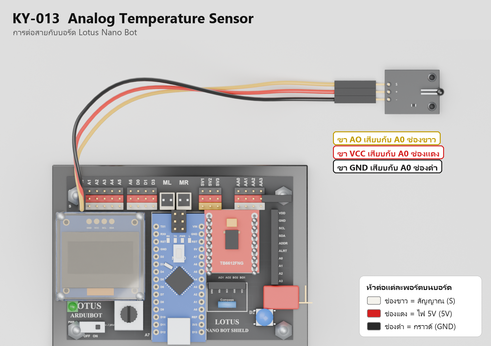
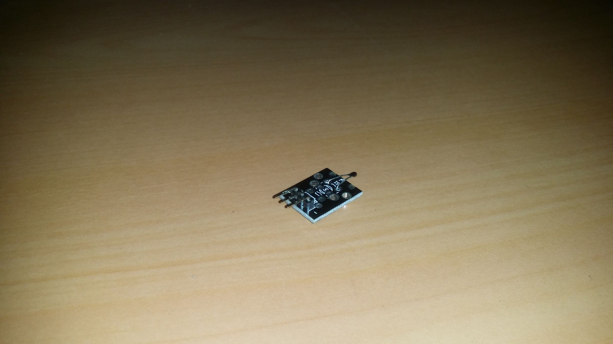
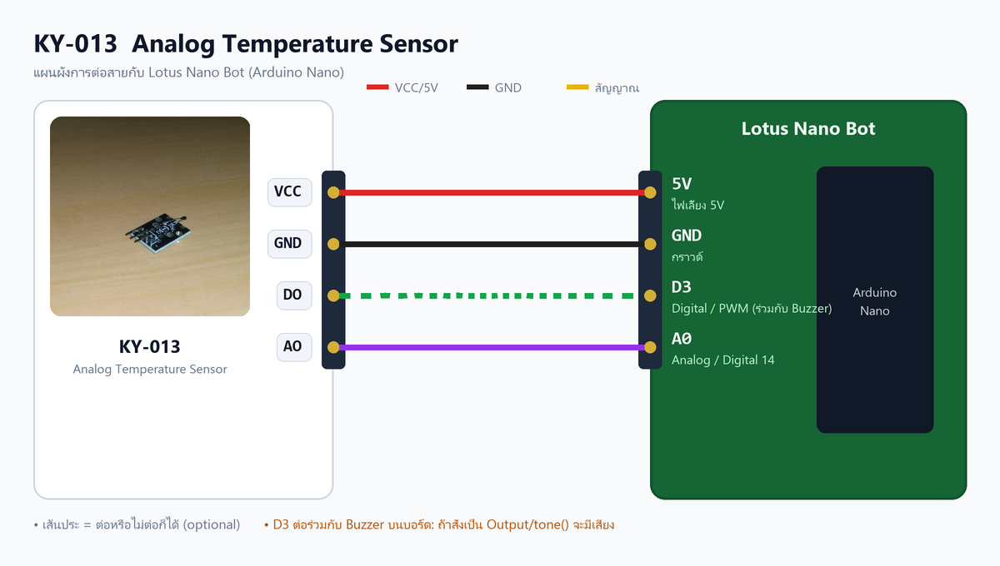

# KY-013 --- Analog Temperature Sensor

## รายละเอียด

Analog Temperature Sensor เป็นโมดูลที่ใช้ Thermistor (NTC) วัดอุณหภูมิ ให้เอาต์พุตเป็นสัญญาณอนาลอก มีทั้งเอาต์พุต Digital (DO) และ Analog (AO) พร้อมตัวปรับค่าความไว

## คุณสมบัติ

- แรงดันไฟฟ้า: 3.3V - 5V DC
- เอาต์พุต: Digital (DO) และ Analog (AO)
- ช่วงวัดอุณหภูมิ: -55°C ถึง +125°C (ขึ้นอยู่กับ Thermistor)
- มีตัวปรับค่า (Potentiometer)

> **หมายเหตุ:** KY-013 รุ่นดั้งเดิมมี 3 ขา (S, +, -) ให้เฉพาะเอาต์พุต Analog ส่วนโมดูลแบบ 4 ขาที่มี DO และตัวปรับค่า คือ KY-028 (ดู Digital Temperature Sensor) หากใช้แบบ 3 ขาให้ต่อเฉพาะ AO

## ขาของเซนเซอร์

| ขา (Sensor) | สีสาย | เชื่อมต่อกับ (Lotus Nano Bot) |
|-------------|-------|------------------------------|
| VCC         | แดง   | 5V                           |
| GND         | ดำ/น้ำตาล | GND                       |
| DO (Digital)| เหลือง | A1 (D15)                     |
| AO (Analog) | ขาว   | A0                           |

> ต่อที่หัวต่อพอร์ต A0 และ A1 บนบอร์ด: ช่องขาว = S (AO เข้า A0, DO เข้า A1), ช่องแดง = 5V, ช่องดำ = GND

## การต่อสายไฟ

```
Analog Temp Sensor       Lotus Nano Bot
━━━━━━━━━━━━━━━━━━━━━━━━━━━━━━━━━━━━━━━━
VCC  ──────────────────► 5V
GND  ──────────────────► GND
DO   ──────────────────► A1 (optional)
AO   ──────────────────► A0
```

### ภาพการต่อสายกับบอร์ด



## โค้ดตัวอย่าง

```cpp
// Analog Temperature Sensor Example
// สำหรับ Lotus Nano Bot
// AO -> A0

#define TEMP_ANALOG_PIN A0
#define LED_PIN 13

void setup() {
  Serial.begin(9600);
  pinMode(LED_PIN, OUTPUT);
  Serial.println("Analog Temperature Sensor Test Started");
}

void loop() {
  int rawValue = analogRead(TEMP_ANALOG_PIN);
  
  // แปลงค่า Analog เป็นอุณหภูมิ (สำหรับ Thermistor ทั่วไป)
  // สูตรนี้เป็นค่าประมาณ อาจต้องปรับตามค่า B-coefficient ของ Thermistor
  // สมมติ Thermistor อยู่ฝั่ง VCC และตัวต้านทาน 10K อยู่ฝั่ง GND (ค่า Raw สูงขึ้นเมื่อร้อน)
  // ถ้าอุณหภูมิที่ได้กลับทาง ให้ใช้: resistance = 10000.0 / (1023.0 / rawValue - 1.0);
  if (rawValue <= 0 || rawValue >= 1023) {  // ป้องกันการหารด้วยศูนย์ (สายหลุด/ช็อต)
    Serial.println("Sensor error!");
    delay(1000);
    return;
  }
  float voltage = rawValue * (5.0 / 1023.0);
  float resistance = 10000.0 * (1023.0 / rawValue - 1.0);
  float logR = log(resistance);  // Steinhart-Hart ใช้ ln(R) ของค่าความต้านทานจริง (โอห์ม)
  float temperature = 1.0 / (0.001129148 + (0.000234125 * logR) + (0.0000000876741 * logR * logR * logR));
  temperature = temperature - 273.15;  // Kelvin to Celsius
  
  Serial.print("Raw: ");
  Serial.print(rawValue);
  Serial.print(" | Voltage: ");
  Serial.print(voltage);
  Serial.print(" V | Temp: ");
  Serial.print(temperature);
  Serial.println(" °C");
  
  if (temperature > 30.0) {
    digitalWrite(LED_PIN, HIGH);
  } else {
    digitalWrite(LED_PIN, LOW);
  }
  
  delay(1000);
}
```

## โค้ดตัวอย่างแบบง่าย (ไม่ต้องคำนวณ)

```cpp
// อ่านค่าอนาลอกพื้นฐาน
#define TEMP_PIN A0

void setup() {
  Serial.begin(9600);
}

void loop() {
  int rawValue = analogRead(TEMP_PIN);
  float voltage = rawValue * (5.0 / 1023.0);
  
  Serial.print("Raw Value: ");
  Serial.print(rawValue);
  Serial.print(" | Voltage: ");
  Serial.print(voltage);
  Serial.println(" V");
  
  // NTC Thermistor: ร้อนขึ้น → ความต้านทานลดลง
  // ค่า Raw จะขึ้นหรือลงเมื่อร้อน ขึ้นกับตำแหน่ง Thermistor ในวงจรแบ่งแรงดันของโมดูล
  // ให้ทดลองจับเซนเซอร์แล้วสังเกตทิศทางการเปลี่ยนของค่า
  
  delay(1000);
}
```

## หมายเหตุ

- ต้องปรับค่า B-coefficient ให้ตรงกับ Thermistor ที่ใช้
- สามารถหมุนตัวปรับค่าเพื่อเปลี่ยนเกณฑ์ของเอาต์พุตดิจิตอล
- ความแม่นยำน้อยกว่า DS18B20 แต่ใช้งานง่ายกว่า
- ควร calibrate กับเครื่องมือวัดอุณหภูมิที่แม่นยำ

## กิจกรรมการเรียนรู้

### จุดประสงค์การเรียนรู้
1. อธิบายหลักการทำงานของ NTC Thermistor และวงจรแบ่งแรงดันได้
2. ต่อวงจร Analog Temperature Sensor เข้ากับ A0 และอ่านค่า Raw, แรงดัน และอุณหภูมิได้
3. เปรียบเทียบค่าอุณหภูมิที่คำนวณได้กับเทอร์โมมิเตอร์อ้างอิงและหาค่าความคลาดเคลื่อนได้

### ขั้นตอนการทดลอง
1. ต่อสาย VCC → 5V, GND → GND, AO → A0 แล้วอัปโหลดโค้ดแบบง่าย สังเกตค่า Raw ที่อุณหภูมิห้อง
2. ใช้นิ้วจับ Thermistor ประมาณ 30 วินาที บันทึกทิศทางการเปลี่ยนของค่า Raw
3. อัปโหลดโค้ดตัวอย่างแรก เปรียบเทียบอุณหภูมิที่คำนวณได้กับเทอร์โมมิเตอร์ ถ้าค่ากลับทางให้สลับสูตรตามคอมเมนต์ในโค้ด
4. นำเซนเซอร์เข้าใกล้แก้วน้ำเย็นและแก้วน้ำอุ่น (ห้ามให้แผงวงจรเปียก) บันทึกผล

### ตารางบันทึกผล
| ครั้งที่ | สภาวะ/การกระทำ | ค่าที่อ่านได้ | ผลที่สังเกตได้ |
|---|---|---|---|
| 1 | อุณหภูมิห้อง | | |
| 2 | จับ Thermistor ด้วยนิ้ว 30 วินาที | | |
| 3 | วางใกล้แก้วน้ำเย็น | | |

### คำถามท้ายการทดลอง
1. NTC Thermistor มีความต้านทานเปลี่ยนไปอย่างไรเมื่ออุณหภูมิสูงขึ้น
2. อุณหภูมิที่คำนวณได้ต่างจากเทอร์โมมิเตอร์อ้างอิงเท่าใด เกิดจากสาเหตุใดบ้าง
3. ถ้าต้องการทำระบบเปิดพัดลมอัตโนมัติเมื่อห้องร้อน จะใช้เซนเซอร์นี้อย่างไร

<details>
<summary>แนวคำตอบ (สำหรับครู)</summary>

1. ความต้านทานลดลง (Negative Temperature Coefficient) ทำให้แรงดันที่จุดแบ่งแรงดันเปลี่ยน
2. ขึ้นกับผลการทดลอง สาเหตุเช่น ค่าคงที่ในสูตรไม่ตรงกับ Thermistor จริง, ค่าตัวต้านทาน 10K คลาดเคลื่อน, แรงดัน 5V ไม่คงที่, เวลาให้เซนเซอร์เข้าสู่สมดุลไม่พอ
3. อ่านอุณหภูมิเป็นระยะ เมื่อเกินค่าที่ตั้งไว้ (เช่น 30°C) ให้สั่งมอเตอร์หรือรีเลย์ทำงาน และควรมีช่วง Hysteresis เพื่อไม่ให้เปิด-ปิดถี่เกินไป

</details>

### ภารกิจท้าทาย
- ใช้ Knob A7 ตั้งค่าอุณหภูมิเตือน (เช่น 25-40°C) แสดงอุณหภูมิปัจจุบันและค่าที่ตั้งบนจอ OLED และให้บัซเซอร์ D3 ดังเมื่ออุณหภูมิเกินค่าที่ตั้ง

## รูปภาพ





