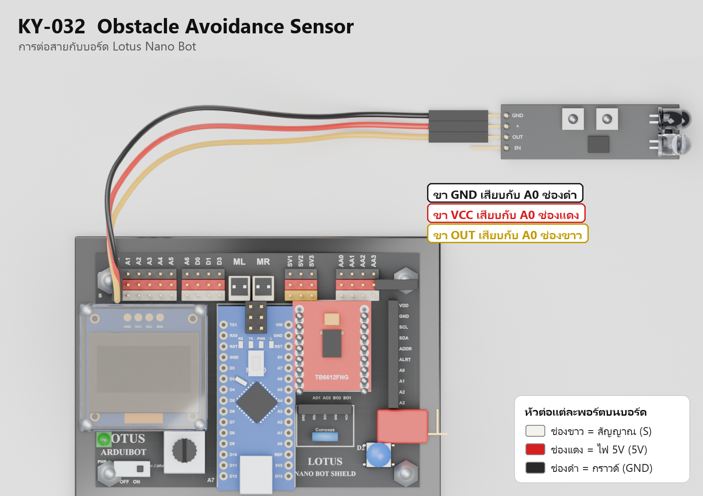
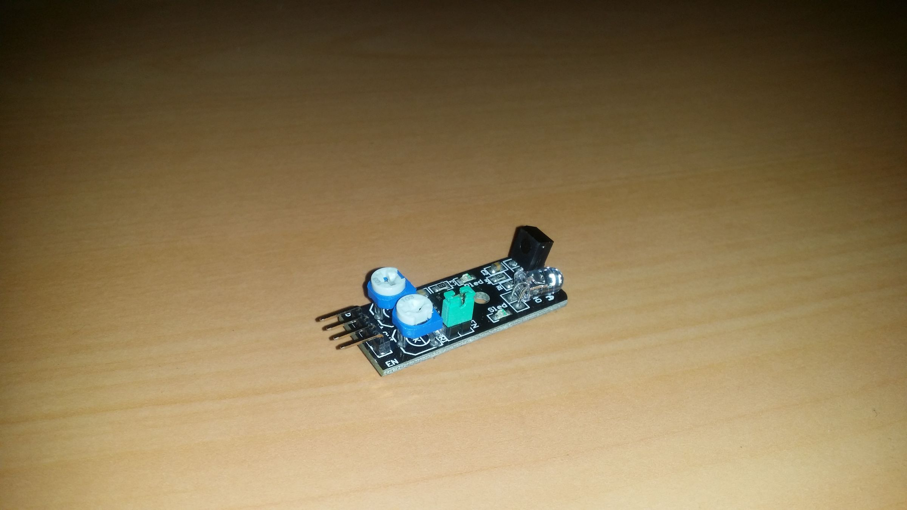
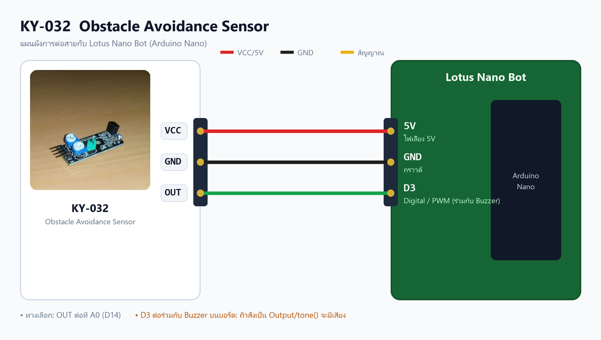

# KY-032 --- Obstacle Avoidance Sensor

## รายละเอียด

Avoidance Sensor หรือ Infrared Obstacle Avoidance Sensor เป็นเซนเซอร์ตรวจจับสิ่งกีดขวางโดยใช้คลื่นอินฟราเรด (IR) มีทั้ง IR LED และ IR Photodiode อยู่ในตัว สามารถปรับความไวในการตรวจจับได้ผ่านตัวต้านทานปรับค่าได้ (Potentiometer)

## คุณสมบัติ

- แรงดันไฟฟ้า: 3.3V - 5V DC
- ระยะตรวจจับ: 2 - 30 cm (ปรับได้)
- มุมตรวจจับ: 35°
- เอาต์พุต: Digital (High/Low)

## ขาของเซนเซอร์

| ขา (Sensor) | สีสาย | เชื่อมต่อกับ (Lotus Nano Bot) |
|-------------|-------|------------------------------|
| VCC         | แดง   | 5V                           |
| GND         | ดำ/น้ำตาล | GND                       |
| OUT         | เหลือง/ส้ม | A0 (D14)                |

> ต่อที่หัวต่อพอร์ต A0 บนบอร์ด: ช่องขาว = S, ช่องแดง = 5V, ช่องดำ = GND
>
> **หมายเหตุ:** ขา A0-A3 ใช้เป็น Digital ได้ (A0=Pin14, A1=Pin15, A2=Pin16, A3=Pin17)

## การต่อสายไฟ

```
Avoidance Sensor          Lotus Nano Bot
━━━━━━━━━━━━━━━━━━━━━━━━━━━━━━━━━━━━━━━━
VCC  ───────────────────► 5V
GND  ───────────────────► GND
OUT  ───────────────────► A0 (D14)
```

### ภาพการต่อสายกับบอร์ด



## โค้ดตัวอย่าง

```cpp
// Avoidance Sensor Example for Lotus Nano Bot
// ต่อ OUT เข้าที่ขา A0 (D14)

#define AVOIDANCE_PIN 14 // A0
#define LED_PIN 13

void setup() {
  Serial.begin(9600);
  pinMode(AVOIDANCE_PIN, INPUT);
  pinMode(LED_PIN, OUTPUT);
  Serial.println("Avoidance Sensor Test Started");
}

void loop() {
  int detected = digitalRead(AVOIDANCE_PIN);
  
  if (detected == LOW) {  // ส่วนใหญ่จะเป็น Active Low เมื่อตรวจพบ
    Serial.println("⚠️ Obstacle Detected!");
    digitalWrite(LED_PIN, HIGH);
  } else {
    Serial.println("✅ No Obstacle");
    digitalWrite(LED_PIN, LOW);
  }
  
  delay(200);
}
```

## หมายเหตุ

- บางรุ่นอาจให้ค่า HIGH เมื่อตรวจพบสิ่งกีดขวาง ให้ทดสอบก่อนใช้งานจริง
- สามารถหมุนตัวปรับค่า (Potentiometer) เพื่อกำหนดระยะตรวจจับ
- ผิวสีดำอาจดูดซับ IR ทำให้ตรวจจับได้ยากกว่าผิวสีอ่อน
- แสงอาทิตย์จัดอาจรบกวนการทำงานของ IR sensor
- KY-032 บางรุ่นมีขา EN เพิ่ม ให้คง Jumper บนโมดูลไว้ (EN เปิดตลอด) เพื่อใช้งานแบบ 3 ขาตามตารางด้านบน

## กิจกรรมการเรียนรู้

### จุดประสงค์การเรียนรู้
1. อธิบายหลักการตรวจจับสิ่งกีดขวางด้วยการสะท้อนของแสงอินฟราเรดได้
2. ต่อวงจร Avoidance Sensor เข้ากับ A0 และอ่านสถานะ Digital ผ่าน Serial Monitor ได้
3. ปรับ Potentiometer เพื่อกำหนดระยะตรวจจับ และวัดระยะตรวจจับสูงสุดได้

### ขั้นตอนการทดลอง
1. ต่อสาย VCC → 5V, GND → GND, OUT → A0 แล้วอัปโหลดโค้ดตัวอย่าง เปิด Serial Monitor (9600 baud)
2. ค่อยๆ เลื่อนกระดาษสีขาวเข้าหาเซนเซอร์ วัดระยะที่ข้อความเปลี่ยนเป็น "Obstacle Detected!" และ LED D13 ติด
3. ทำซ้ำด้วยกระดาษสีดำ แล้วเปรียบเทียบระยะที่ตรวจจับได้
4. หมุน Potentiometer แล้ววัดระยะตรวจจับสูงสุดใหม่อีกครั้ง

### ตารางบันทึกผล
| ครั้งที่ | สภาวะ/การกระทำ | ค่าที่อ่านได้ | ผลที่สังเกตได้ |
|---|---|---|---|
| 1 | ไม่มีวัตถุด้านหน้า | | |
| 2 | กระดาษสีขาว เลื่อนเข้าใกล้ (บันทึกระยะที่เริ่มตรวจพบ) | | |
| 3 | กระดาษสีดำ เลื่อนเข้าใกล้ (บันทึกระยะที่เริ่มตรวจพบ) | | |

### คำถามท้ายการทดลอง
1. เซนเซอร์ใช้ IR LED และ IR Photodiode ร่วมกันตรวจจับสิ่งกีดขวางได้อย่างไร
2. ระยะตรวจจับของกระดาษสีขาวและสีดำต่างกันอย่างไร เพราะเหตุใด
3. จะนำเซนเซอร์นี้ไปใช้ให้หุ่นยนต์หลบสิ่งกีดขวางได้อย่างไร

<details>
<summary>แนวคำตอบ (สำหรับครู)</summary>

1. IR LED ส่งแสงอินฟราเรดออกไป เมื่อมีวัตถุ แสงจะสะท้อนกลับมาที่ Photodiode วงจรเปรียบเทียบจะเปลี่ยนเอาต์พุตเมื่อแสงสะท้อนแรงกว่าเกณฑ์ที่ตั้งด้วย Potentiometer
2. สีขาวตรวจจับได้ไกลกว่า เพราะสะท้อนแสง IR ได้ดี ส่วนสีดำดูดกลืนแสง IR ทำให้แสงสะท้อนกลับน้อย
3. เมื่อเซนเซอร์ตรวจพบสิ่งกีดขวาง ให้หุ่นยนต์หยุด ถอยหลัง แล้วเลี้ยวไปทางอื่นก่อนเดินหน้าต่อ

</details>

### ภารกิจท้าทาย
- ติดเซนเซอร์ไว้หน้าหุ่นยนต์ เขียนโปรแกรมให้หุ่นเดินหน้าด้วยมอเตอร์ซ้าย/ขวา เมื่อพบสิ่งกีดขวางให้บัซเซอร์ D3 ดังสั้นๆ แล้วถอยหลังและเลี้ยวหลบ โดยเริ่มทำงานเมื่อกดปุ่ม D2

## รูปภาพ





