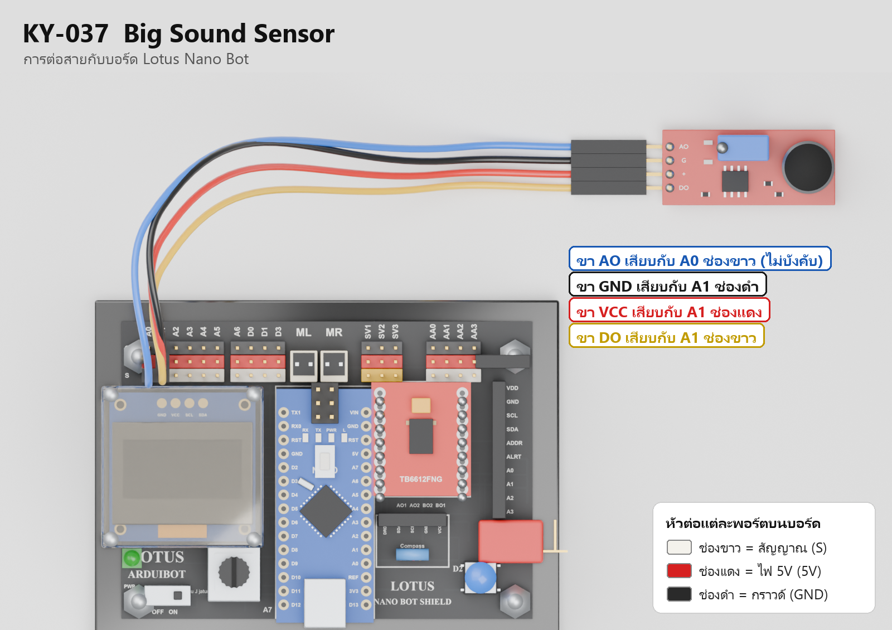
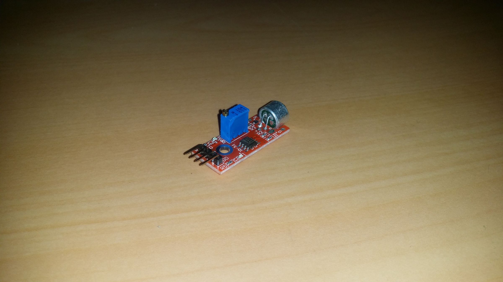
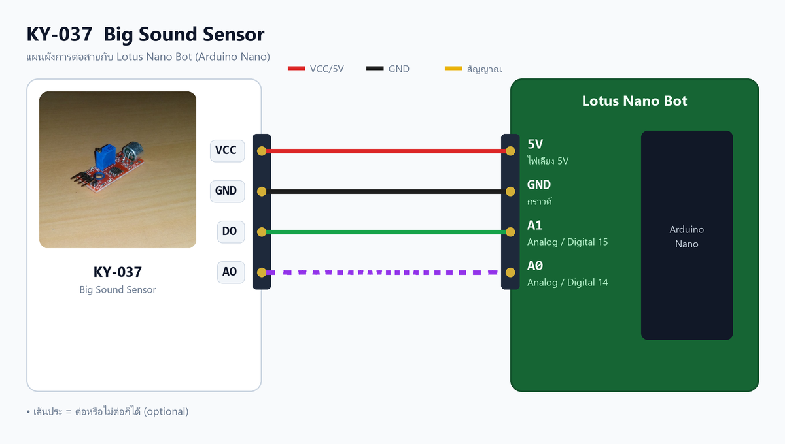

# KY-037 --- Big Sound Sensor

## รายละเอียด

Big Sound Sensor เป็นโมดูลตรวจจับเสียงขนาดใหญ่ ใช้ Microphone Electret พร้อมวงจรขยายสัญญาณ LM393 มีเอาต์พุต Digital และ Analog

## คุณสมบัติ

- แรงดันไฟฟ้า: 3.3V - 5V DC
- เอาต์พุต: Digital (DO) และ Analog (AO)
- มีตัวปรับความไว (Potentiometer)
- มี LED แสดงสถานะ

## ขาของโมดูล

| ขา (Module) | สีสาย | เชื่อมต่อกับ (Lotus Nano Bot) |
|-------------|-------|------------------------------|
| VCC         | แดง   | 5V                           |
| GND         | ดำ/น้ำตาล | GND                       |
| DO (Digital)| เหลือง | A1 (D15)                     |
| AO (Analog) | ขาว   | A0                           |

> ต่อที่หัวต่อพอร์ต A0 และ A1 บนบอร์ด: ช่องขาว = S (AO เข้า A0, DO เข้า A1), ช่องแดง = 5V, ช่องดำ = GND

## การต่อสายไฟ

```
Big Sound Sensor         Lotus Nano Bot
━━━━━━━━━━━━━━━━━━━━━━━━━━━━━━━━━━━━━━━━
VCC  ──────────────────► 5V
GND  ──────────────────► GND
DO   ──────────────────► A1
AO   ──────────────────► A0 (optional)
```

### ภาพการต่อสายกับบอร์ด



## โค้ดตัวอย่าง

```cpp
// Big Sound Sensor Example for Lotus Nano Bot
// DO -> A1 (D15), AO -> A0

#define SOUND_DIGITAL_PIN 15 // A1
#define SOUND_ANALOG_PIN A0

void setup() {
  Serial.begin(9600);
  pinMode(SOUND_DIGITAL_PIN, INPUT);
  Serial.println("Big Sound Sensor Test Started");
}

void loop() {
  int soundDetected = digitalRead(SOUND_DIGITAL_PIN);
  int soundLevel = analogRead(SOUND_ANALOG_PIN);
  
  Serial.print("Digital: ");
  Serial.print(soundDetected);
  Serial.print(" | Analog: ");
  Serial.println(soundLevel);
  
  if (soundDetected == LOW) {  // ตรวจพบเสียง (Active Low) - บางโมดูลเป็น Active High ให้ทดสอบก่อน
    Serial.println("🔊 Loud Sound Detected!");
    delay(300);
  }
  
  delay(50);
}
```

## โค้ดตัวอย่างตรวจจับเสียงรอบข้าง

```cpp
// ใช้เฉพาะ AO -> A0 และบัซเซอร์บนบอร์ด (D3)
#define SOUND_PIN A0
#define BUZZER_PIN 3  // บัซเซอร์บนบอร์ด

int threshold = 600;

void setup() {
  Serial.begin(9600);
}

void loop() {
  int level = analogRead(SOUND_PIN);
  
  Serial.print("Sound Level: ");
  Serial.println(level);
  
  if (level > threshold) {
    Serial.println("🔊 Noise Alert!");
    tone(BUZZER_PIN, 2000, 200);
    delay(300);  // รอให้เสียงบัซเซอร์เงียบก่อน ไม่ให้เซนเซอร์จับเสียงบัซเซอร์เอง
  }
  
  delay(100);
}
```

## หมายเหตุ

- หมุนตัวปรับค่าเพื่อกำหนดเกณฑ์เสียง
- Big Sound Sensor มีวงจรขยายสัญญาณมากกว่า Small Sound Sensor
- ใช้ได้กับการตรวจจับเสียงรอบข้าง, การตบมือ
- บน Lotus Nano Bot ขา A0-A3 ใช้เป็น Digital ได้ (A1 = Pin 15)

## กิจกรรมการเรียนรู้

### จุดประสงค์การเรียนรู้
1. อธิบายการทำงานของไมโครโฟน Electret ร่วมกับวงจรเปรียบเทียบ LM393 ได้
2. ต่อวงจร Big Sound Sensor และอ่านค่าทั้ง Digital (A1) และ Analog (A0) ได้
3. ปรับ Potentiometer เพื่อตั้งเกณฑ์ให้ตรวจจับเสียงตบมือได้

### ขั้นตอนการทดลอง
1. ต่อสาย VCC → 5V, GND → GND, DO → A1, AO → A0 แล้วอัปโหลดโค้ดตัวอย่างแรก
2. ในห้องเงียบ บันทึกค่า Analog ปกติ แล้วหมุน Potentiometer จน LED บนโมดูลเพิ่งดับ
3. ตบมือที่ระยะ 30 cm และ 1 m บันทึกค่า Analog สูงสุดและสถานะ Digital
4. เปิด Serial Plotter เพื่อดูรูปคลื่นของค่า Analog ขณะพูดและตบมือ

### ตารางบันทึกผล
| ครั้งที่ | สภาวะ/การกระทำ | ค่าที่อ่านได้ | ผลที่สังเกตได้ |
|---|---|---|---|
| 1 | ห้องเงียบ | | |
| 2 | ตบมือที่ระยะ 30 cm | | |
| 3 | ตบมือที่ระยะ 1 m | | |

### คำถามท้ายการทดลอง
1. เอาต์พุต DO และ AO ของโมดูลแตกต่างกันอย่างไร
2. ค่า Analog เมื่อตบมือใกล้และไกลต่างกันอย่างไร และทำไมบางครั้งเอาต์พุต Digital ไม่เปลี่ยน
3. จะนำเซนเซอร์นี้ไปทำสวิตช์เปิด-ปิดไฟด้วยการตบมือได้อย่างไร

<details>
<summary>แนวคำตอบ (สำหรับครู)</summary>

1. DO ให้ค่า HIGH/LOW จากการเปรียบเทียบกับเกณฑ์ที่ตั้งด้วย Potentiometer ส่วน AO ให้ระดับสัญญาณเสียงต่อเนื่อง 0-1023
2. ใกล้ค่าเปลี่ยนจากค่าปกติมากกว่า ไกลเปลี่ยนน้อย ถ้าสัญญาณไม่ข้ามเกณฑ์ของ LM393 หรือเสียงสั้นมากจนอ่านไม่ทัน (delay) DO จะดูไม่เปลี่ยน
3. ตรวจจับเสียงตบมือแล้วสลับสถานะ LED/รีเลย์ (toggle) และใส่ช่วงหน่วงเวลาเพื่อไม่ให้นับเสียงเดียวซ้ำ อาจใช้ตบ 2 ครั้งเพื่อลดการทำงานผิดพลาด

</details>

### ภารกิจท้าทาย
- ทำ "สวิตช์ตบมือ" ด้วย AO (A0) อย่างเดียว: ตบมือ 2 ครั้งภายใน 1 วินาทีเพื่อสลับ LED D13 แสดงจำนวนครั้งบนจอ OLED และใช้ Knob A7 ปรับค่า threshold แทนการแก้โค้ด

## รูปภาพ





