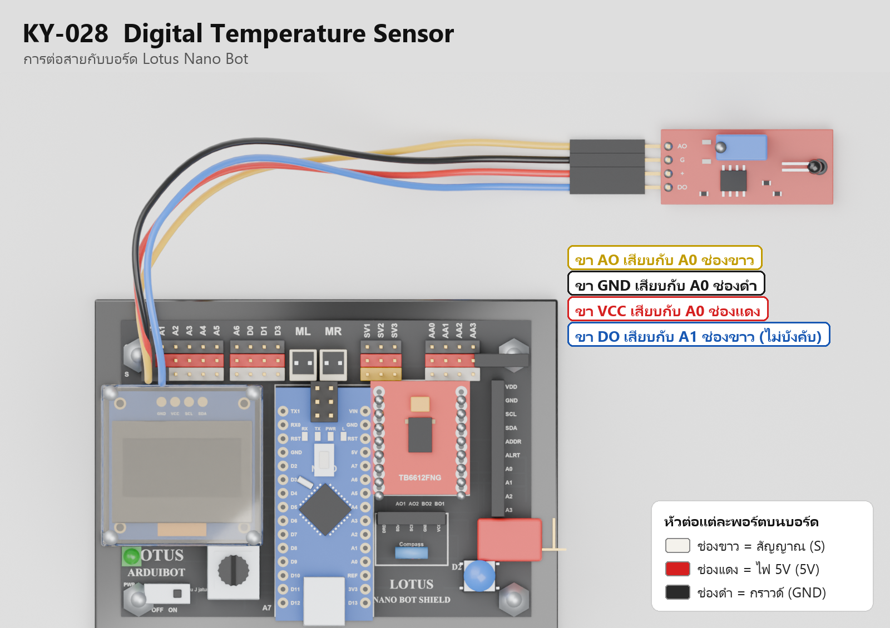
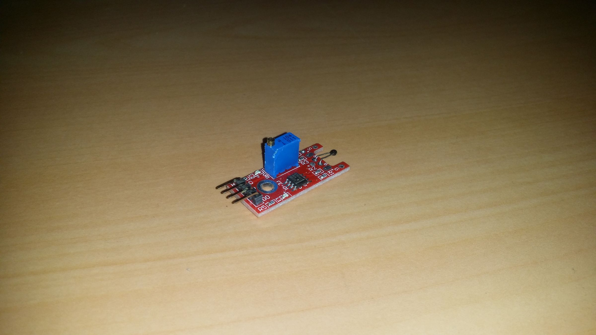
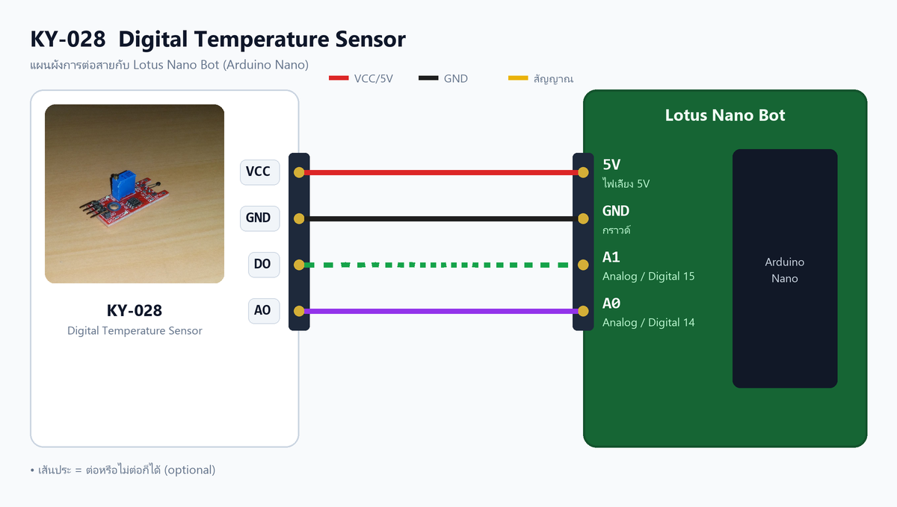

# KY-028 --- Digital Temperature Sensor

## รายละเอียด

Digital Temperature Sensor Module เป็นโมดูลที่ใช้ Thermistor แปลงค่าอุณหภูมิเป็นสัญญาณดิจิตอล มีวงจรเปรียบเทียบในตัว ให้เอาต์พุต Digital เมื่ออุณหภูมิเกินค่าที่ตั้งไว้ พร้อมเอาต์พุต Analog สำหรับอ่านค่าละเอียด

## คุณสมบัติ

- แรงดันไฟฟ้า: 3.3V - 5V DC
- เอาต์พุต: Digital (DO) และ Analog (AO)
- มีตัวปรับเกณฑ์ (Potentiometer)
- มี LED แสดงสถานะ

## ขาของโมดูล

| ขา (Module) | สีสาย | เชื่อมต่อกับ (Lotus Nano Bot) |
|-------------|-------|------------------------------|
| VCC         | แดง   | 5V                           |
| GND         | ดำ/น้ำตาล | GND                       |
| DO (Digital)| เหลือง | A1 (D15)                     |
| AO (Analog) | ขาว   | A0                           |

> ต่อที่หัวต่อพอร์ต A0 และ A1 บนบอร์ด: ช่องขาว = S (AO เข้า A0, DO เข้า A1), ช่องแดง = 5V, ช่องดำ = GND

## การต่อสายไฟ

```
Digital Temp Sensor      Lotus Nano Bot
━━━━━━━━━━━━━━━━━━━━━━━━━━━━━━━━━━━━━━━━
VCC  ──────────────────► 5V
GND  ──────────────────► GND
DO   ──────────────────► A1 (optional)
AO   ──────────────────► A0
```

### ภาพการต่อสายกับบอร์ด



## โค้ดตัวอย่าง

```cpp
// Digital Temperature Sensor Example for Lotus Nano Bot
// AO -> A0, DO -> A1 (D15) (optional)

#define TEMP_ANALOG_PIN A0
#define TEMP_DIGITAL_PIN 15 // A1

void setup() {
  Serial.begin(9600);
  pinMode(TEMP_DIGITAL_PIN, INPUT);
  Serial.println("Digital Temperature Sensor Test Started");
}

void loop() {
  int analogValue = analogRead(TEMP_ANALOG_PIN);
  int digitalValue = digitalRead(TEMP_DIGITAL_PIN);
  
  float voltage = analogValue * (5.0 / 1023.0);
  
  Serial.print("Analog: ");
  Serial.print(analogValue);
  Serial.print(" (");
  Serial.print(voltage);
  Serial.print(" V) | Digital: ");
  Serial.println(digitalValue);
  
  // Digital: 0 = อุณหภูมิเกินเกณฑ์, 1 = ปกติ (บางโมดูลกลับด้าน ให้ทดสอบก่อน)
  if (digitalValue == LOW) {
    Serial.println("🔥 Temperature Threshold Exceeded!");
  }
  
  delay(1000);
}
```

## โค้ดตัวอย่างสัญญาณเตือนอุณหภูมิ

```cpp
// DO -> A1 (D15), เสียงเตือนใช้บัซเซอร์บนบอร์ด (D3)
#define TEMP_DIGITAL_PIN 15  // A1
#define BUZZER_PIN 3         // บัซเซอร์บนบอร์ด Lotus Nano Bot

void setup() {
  Serial.begin(9600);
  pinMode(TEMP_DIGITAL_PIN, INPUT);
}

void loop() {
  if (digitalRead(TEMP_DIGITAL_PIN) == LOW) {
    Serial.println("🚨 Over Temperature!");
    tone(BUZZER_PIN, 2000, 500);
    delay(1000);
  } else {
    Serial.println("✅ Temperature Normal");
  }
  
  delay(500);
}
```

## หมายเหตุ

- หมุนตัวปรับค่าเพื่อตั้งเกณฑ์อุณหภูมิที่ต้องการ
- Digital Output จะเป็น LOW เมื่ออุณหภูมิเกินเกณฑ์ (บางโมดูลกลับด้าน ให้ทดสอบก่อน)
- ใช้ Analog Output เพื่ออ่านค่าอุณหภูมิโดยประมาณ
- บน Lotus Nano Bot ใช้ A0-A3, A6 สำหรับอ่านค่าอนาลอก

## กิจกรรมการเรียนรู้

### จุดประสงค์การเรียนรู้
1. อธิบายการทำงานของวงจรเปรียบเทียบ (Comparator) ที่ทำให้ได้เอาต์พุต Digital จาก Thermistor ได้
2. ต่อวงจร KY-028 และอ่านค่าทั้ง AO และ DO ผ่าน Serial Monitor ได้
3. ตั้งเกณฑ์อุณหภูมิด้วย Potentiometer ให้ DO เปลี่ยนสถานะที่อุณหภูมิที่ต้องการได้

### ขั้นตอนการทดลอง
1. ต่อสาย VCC → 5V, GND → GND, AO → A0, DO → A1 แล้วอัปโหลดโค้ดตัวอย่างแรก
2. บันทึกค่า Analog และ Digital ที่อุณหภูมิห้อง
3. หมุน Potentiometer จน LED บนโมดูลอยู่ในจุดที่เพิ่งเปลี่ยนสถานะ แล้วใช้นิ้วจับ Thermistor สังเกตค่า Analog ขณะ DO เปลี่ยน
4. อัปโหลดโค้ดสัญญาณเตือน (DO ยังต่อ A1 เหมือนเดิม) ทดสอบว่าบัซเซอร์ดังเมื่อเกินเกณฑ์

### ตารางบันทึกผล
| ครั้งที่ | สภาวะ/การกระทำ | ค่าที่อ่านได้ | ผลที่สังเกตได้ |
|---|---|---|---|
| 1 | อุณหภูมิห้อง | | |
| 2 | จับ Thermistor ด้วยนิ้ว (ค่า Analog ขณะ DO เปลี่ยน) | | |
| 3 | ปล่อยมือ ให้เย็นลง 1 นาที | | |

### คำถามท้ายการทดลอง
1. Potentiometer บนโมดูลทำหน้าที่อะไรในวงจรเปรียบเทียบ
2. ค่า Analog ขณะ DO เปลี่ยนสถานะตอนร้อนขึ้นและตอนเย็นลงเท่ากันหรือไม่
3. จะใช้โมดูลนี้ทำระบบเตือนอุณหภูมิตู้เย็นหรือเครื่องฟักไข่ได้อย่างไร

<details>
<summary>แนวคำตอบ (สำหรับครู)</summary>

1. ใช้กำหนดแรงดันอ้างอิงของวงจรเปรียบเทียบ LM393 ซึ่งเป็นเกณฑ์ที่ DO จะเปลี่ยนสถานะ
2. ขึ้นกับผลการทดลอง มักใกล้เคียงกันแต่อาจต่างกันเล็กน้อยจากสัญญาณรบกวนและความหน่วงทางความร้อนของ Thermistor
3. ตั้งเกณฑ์ด้วย Potentiometer หรือใช้ค่า AO เทียบในโปรแกรม เมื่อเกิน/ต่ำกว่าช่วงที่ต้องการให้ส่งเสียงเตือนหรือสั่งอุปกรณ์ทำความร้อน/เย็น

</details>

### ภารกิจท้าทาย
- แสดงค่า AO เป็นกราฟแท่งบนจอ OLED พร้อมสถานะ DO (DO ต่อ A1) และให้กดปุ่ม D2 เพื่อปิดเสียงเตือนจากบัซเซอร์ D3 ชั่วคราว 10 วินาที

## รูปภาพ





