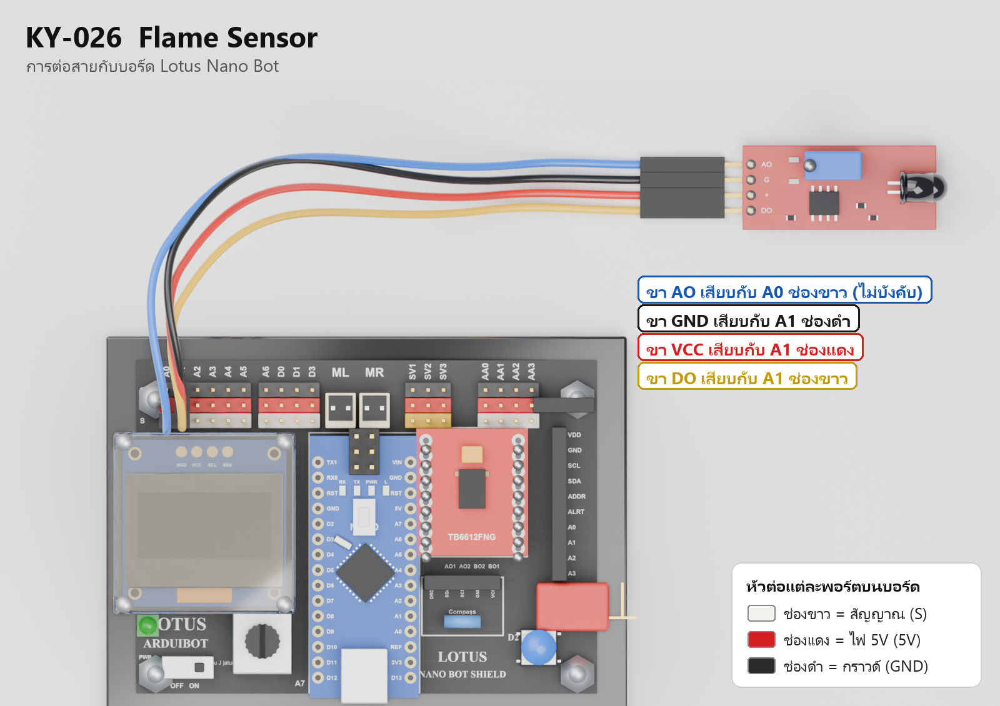
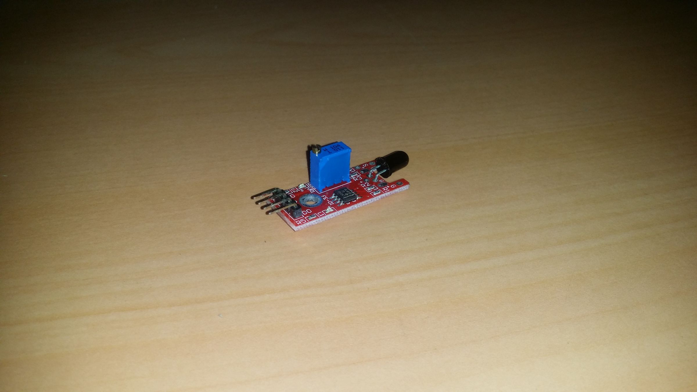
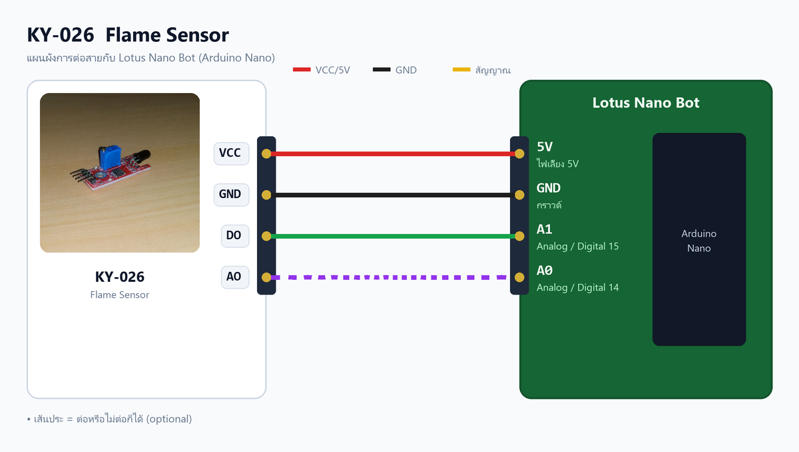

# KY-026 --- Flame Sensor

## รายละเอียด

Flame Sensor เป็นเซนเซอร์ตรวจจับเปลวไฟโดยใช้ Photodiode ที่ไวต่อแสงอินฟราเรด (IR) ความยาวคลื่น 760-1100 nm สามารถตรวจจับเปลวไฟจากระยะ 20-100 cm

## คุณสมบัติ

- แรงดันไฟฟ้า: 3.3V - 5V DC
- เอาต์พุต: Digital (DO) และ Analog (AO)
- ช่วงตรวจจับ: 760 - 1100 nm (แสง IR)
- ระยะตรวจจับ: 20 - 100 cm
- มีตัวปรับความไว (Potentiometer)

## ขาของเซนเซอร์

| ขา (Sensor) | สีสาย | เชื่อมต่อกับ (Lotus Nano Bot) |
|-------------|-------|------------------------------|
| VCC         | แดง   | 5V                           |
| GND         | ดำ/น้ำตาล | GND                       |
| DO (Digital)| เหลือง | A1 (D15)                  |
| AO (Analog) | ขาว   | A0                         |

> ต่อที่หัวต่อพอร์ต A0 และ A1 บนบอร์ด: ช่องขาว = S (AO เข้า A0, DO เข้า A1), ช่องแดง = 5V, ช่องดำ = GND
>
> **หมายเหตุ:** ตัวอย่างนี้ใช้บัซเซอร์บนบอร์ด (D3) ส่งเสียงเตือน

## การต่อสายไฟ

```
Flame Sensor             Lotus Nano Bot
━━━━━━━━━━━━━━━━━━━━━━━━━━━━━━━━━━━━━━━━
VCC  ──────────────────► 5V
GND  ──────────────────► GND
DO   ──────────────────► A1 (D15)
AO   ──────────────────► A0 (optional)
```

### ภาพการต่อสายกับบอร์ด



## โค้ดตัวอย่าง

```cpp
// Flame Sensor Example for Lotus Nano Bot
// DO -> A1 (D15), AO -> A0

#define FLAME_DIGITAL_PIN 15  // A1
#define FLAME_ANALOG_PIN A0
#define BUZZER_PIN 3          // บัซเซอร์บนบอร์ด Lotus Nano Bot

void setup() {
  Serial.begin(9600);
  pinMode(FLAME_DIGITAL_PIN, INPUT);
  Serial.println("Flame Sensor Test Started");
}

void loop() {
  int flameDigital = digitalRead(FLAME_DIGITAL_PIN);
  int flameAnalog = analogRead(FLAME_ANALOG_PIN);
  
  Serial.print("Digital: ");
  Serial.print(flameDigital);
  Serial.print(" | Analog: ");
  Serial.println(flameAnalog);
  
  // Digital: ปกติ HIGH, ตรวจพบไฟ = LOW (Active Low)
  if (flameDigital == LOW) {
    Serial.println("🔥 FLAME DETECTED!");
    tone(BUZZER_PIN, 2000, 200);
    delay(300);
  }
  
  delay(100);
}
```

## โค้ดตัวอย่างระบบป้องกันอัคคีภัย

```cpp
#define FLAME_ANALOG_PIN A0
#define FLAME_DIGITAL_PIN 15  // A1
#define BUZZER_PIN 3          // บัซเซอร์บนบอร์ด

void setup() {
  Serial.begin(9600);
  pinMode(FLAME_DIGITAL_PIN, INPUT);
}

void loop() {
  int flameLevel = analogRead(FLAME_ANALOG_PIN);
  
  Serial.print("Flame Level: ");
  Serial.println(flameLevel);
  
  // ค่ายิ่งต่ำ = ไฟยิ่งแรง (เพราะเป็น IR Photodiode)
  if (flameLevel < 500) {
    Serial.println("🔥 FIRE ALERT!");
    
    // สัญญาณเตือน
    for (int i = 0; i < 3; i++) {
      tone(BUZZER_PIN, 3000, 300);
      delay(400);
    }
  }
  
  delay(200);
}
```

## หมายเหตุ

- หมุนตัวปรับค่าเพื่อกำหนดความไวในการตรวจจับ
- ตรวจจับเฉพาะแสง IR จากเปลวไฟ ไม่ตอบสนองแสงปกติ
- แสงอาทิตย์มี IR อาจรบกวนการทำงาน
- **⚠️ คำเตือน:** เซนเซอร์นี้ใช้สำหรับตรวจจับเบื้องต้นเท่านั้น ไม่ใช่อุปกรณ์ป้องกันอัคคีภัยมาตรฐาน
- บน Lotus Nano Bot ขา A0-A3 ใช้ได้ทั้ง Digital และ Analog (A6 เป็น Analog อย่างเดียว)

## กิจกรรมการเรียนรู้

### จุดประสงค์การเรียนรู้
1. อธิบายหลักการตรวจจับเปลวไฟจากแสงอินฟราเรดช่วงคลื่น 760-1100 nm ได้
2. ต่อวงจร Flame Sensor (DO → A1, AO → A0) และอ่านค่าทั้งสองแบบได้
3. หาความสัมพันธ์ระหว่างระยะห่างของเปลวไฟกับค่า Analog ที่อ่านได้

### ขั้นตอนการทดลอง
1. ต่อสายตามตาราง แล้วอัปโหลดโค้ดตัวอย่างแรก บันทึกค่า Analog เมื่อไม่มีเปลวไฟ
2. (มีครูควบคุม) จุดไฟแช็กหรือเทียนที่ระยะ 80 cm, 40 cm และ 20 cm หน้าเซนเซอร์ บันทึกค่าในแต่ละระยะ
3. หมุน Potentiometer ให้ DO เปลี่ยนเป็น LOW ที่ระยะ 40 cm และฟังเสียงบัซเซอร์
4. ทดลองส่องไฟฉาย LED หรือแสงจากหน้าต่าง เปรียบเทียบผลกับเปลวไฟ

### ตารางบันทึกผล
| ครั้งที่ | สภาวะ/การกระทำ | ค่าที่อ่านได้ | ผลที่สังเกตได้ |
|---|---|---|---|
| 1 | ไม่มีเปลวไฟ | | |
| 2 | เปลวเทียนที่ระยะ 40 cm | | |
| 3 | เปลวเทียนที่ระยะ 20 cm | | |

### คำถามท้ายการทดลอง
1. เหตุใดเซนเซอร์จึงตอบสนองต่อเปลวไฟมากกว่าแสงไฟ LED ทั่วไป
2. ค่า Analog เปลี่ยนไปอย่างไรเมื่อเปลวไฟเข้าใกล้ขึ้น
3. จะนำเซนเซอร์นี้ไปใช้กับหุ่นยนต์ดับเพลิงได้อย่างไร

<details>
<summary>แนวคำตอบ (สำหรับครู)</summary>

1. เปลวไฟแผ่รังสีอินฟราเรดช่วง 760-1100 nm ซึ่งตรงกับช่วงที่ Photodiode ไวที่สุด ส่วนไฟ LED ขาวแผ่ IR น้อยมาก (แต่แสงแดดและหลอดไส้มี IR จึงรบกวนได้)
2. ค่าลดลงเมื่อเปลวไฟเข้าใกล้ (ยิ่งใกล้ยิ่งต่ำ) และ DO เปลี่ยนเป็น LOW เมื่อค่าผ่านเกณฑ์
3. หมุนหุ่นยนต์หรือเซอร์โวเพื่อหาทิศที่ค่าต่ำที่สุด แล้วขับเข้าหาเปลวไฟ เมื่อใกล้พอให้เปิดพัดลมเป่าดับ

</details>

### ภารกิจท้าทาย
- ติดเซนเซอร์บนเซอร์โว D10 ให้กวาดมุม 0-180° หาทิศที่ค่า Analog ต่ำที่สุด แสดงมุมของเปลวไฟบนจอ OLED และส่งเสียงเตือนด้วยบัซเซอร์ D3 (ครูต้องควบคุมการใช้ไฟทุกครั้ง)

## รูปภาพ





