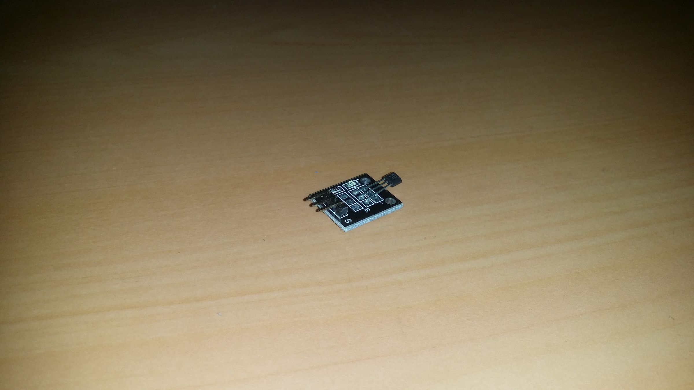
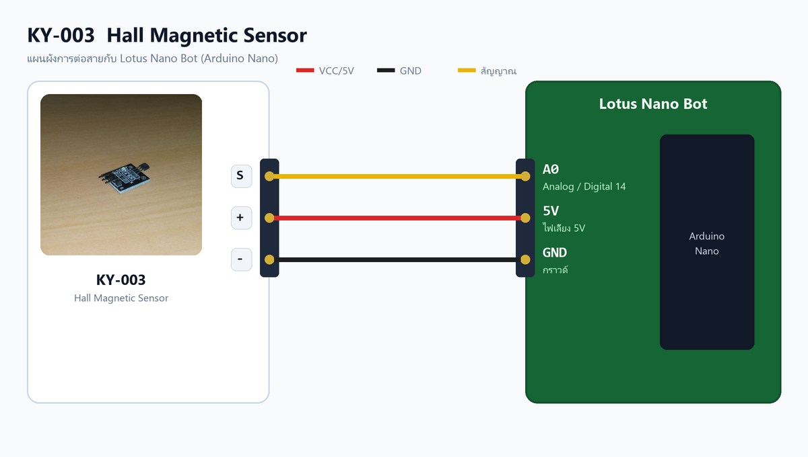

# KY-003 --- Hall Magnetic Sensor

## รายละเอียด

Hall Magnetic Sensor (Digital) เป็นเซนเซอร์ที่ใช้เอฟเฟกต์ฮอลล์ (Hall Effect) ตรวจจับสนามแม่เหล็ก ให้เอาต์พุตเป็นดิจิตอล HIGH/LOW เมื่อมีสนามแม่เหล็กเข้าใกล้เกินค่าที่กำหนด

## คุณสมบัติ

- แรงดันไฟฟ้า: 3.3V - 5V DC
- เอาต์พุต: Digital (KY-003 แท้มี 3 ขา: S, +, -)
- มี LED แสดงสถานะ
- ใช้ไอซี Hall แบบ Unipolar (เช่น A3144) ตอบสนองต่อขั้วแม่เหล็กเพียงด้านเดียว (ส่วนใหญ่เป็นขั้ว S)

> **หมายเหตุ:** ขา AO และตัวปรับค่ามีเฉพาะโมดูลแบบ 4 ขา (เช่น KY-024 Linear Hall) หากใช้ KY-003 แบบ 3 ขาให้ต่อเฉพาะขา S เข้ากับพอร์ต Digital

## ขาของเซนเซอร์

| ขา (Sensor) | สีสาย | เชื่อมต่อกับ (Lotus Nano Bot) |
|-------------|-------|------------------------------|
| VCC         | แดง   | 5V                           |
| GND         | ดำ/น้ำตาล | GND                       |
| DO (Digital)| เหลือง | D3 หรือ A1 (D15)          |
| AO (Analog) | ขาว   | A0, A2, A3 หรือ A6 (เฉพาะรุ่น 4 ขา) |

> **หมายเหตุ:** บน Lotus Nano Bot พอร์ต Digital ภายนอกมี D0, D1, D3 โดย D0/D1 ใช้กับ Bluetooth/Serial ส่วน D3 ใช้กับบัซเซอร์บนบอร์ด หากต้องการพอร์ต Digital เพิ่มสามารถใช้ A0-A3 เป็น Digital ได้ (A0=Pin14, A1=Pin15, A2=Pin16, A3=Pin17)

## การต่อสายไฟ

```
Hall Sensor              Lotus Nano Bot
━━━━━━━━━━━━━━━━━━━━━━━━━━━━━━━━━━━━━━━━
VCC  ──────────────────► 5V
GND  ──────────────────► GND
DO   ──────────────────► D3 หรือ A1 (D15)
AO   ──────────────────► A0 (optional)
```

### ภาพการต่อสาย (Text Diagram)

```
        +------------------+
        |  Hall Magnetic   |
        |  Sensor          |
        |                  |
   +----+----+   +----+----+   +----+----+   +----+----+
   |  VCC    |   |  GND    |   |  DO     |   |  AO     |
   |   (+)   |   |   (-)   |   | (Digi)  |   | (Anlg)  |
   +----+----+   +----+----+   +----+----+   +----+----+
        |             |             |             |
        |             |             |             |
   +----+----+   +----+----+   +----+----+   +----+----+
   |   5V    |   |  GND    |   |   D3    |   |   A0    |
   |         |   |         |   |         |   |         |
   |  Lotus  |   |  Nano   |   |  Bot    |   |         |
   +---------+   +---------+   +---------+   +---------+
```

## โค้ดตัวอย่าง

```cpp
// Hall Magnetic Sensor Example for Lotus Nano Bot
// DO -> D3

#define HALL_PIN 3  // หรือ 15 (A1)
#define LED_PIN 13

void setup() {
  Serial.begin(9600);
  pinMode(HALL_PIN, INPUT);
  pinMode(LED_PIN, OUTPUT);
  Serial.println("Hall Magnetic Sensor Test Started");
}

void loop() {
  int state = digitalRead(HALL_PIN);
  
  if (state == LOW) {  // แม่เหล็กเข้าใกล้ (Active Low)
    Serial.println("🧲 Magnet Detected!");
    digitalWrite(LED_PIN, HIGH);
  } else {
    Serial.println("❌ No Magnet");
    digitalWrite(LED_PIN, LOW);
  }
  
  delay(200);
}
```

## โค้ดตัวอย่างแบบ Analog

```cpp
// Hall Sensor Analog Reading
// AO -> A0 (เฉพาะโมดูลแบบ 4 ขา เช่น KY-024)

#define HALL_ANALOG_PIN A0
#define LED_PIN 13

void setup() {
  Serial.begin(9600);
  pinMode(LED_PIN, OUTPUT);
}

void loop() {
  int rawValue = analogRead(HALL_ANALOG_PIN);
  float voltage = rawValue * (5.0 / 1023.0);
  
  Serial.print("Raw Value: ");
  Serial.print(rawValue);
  Serial.print(" | Voltage: ");
  Serial.print(voltage);
  Serial.println(" V");
  
  // ค่าปกติประมาณ 2.5V, เมื่อมีแม่เหล็กจะเปลี่ยนไป
  if (rawValue > 600 || rawValue < 400) {
    digitalWrite(LED_PIN, HIGH);
  } else {
    digitalWrite(LED_PIN, LOW);
  }
  
  delay(200);
}
```

## หมายเหตุ

- ตรวจสอบว่าเซนเซอร์เป็น Active High หรือ Active Low ก่อนใช้งาน
- สามารถปรับความไวได้ที่ตัวปรับค่า (Potentiometer) บางรุ่น
- ใช้ได้กับการนับรอบของมอเตอร์ที่มีแม่เหล็กติดอยู่
- ระยะตรวจจับขึ้นอยู่กับความแรงของแม่เหล็ก

## กิจกรรมการเรียนรู้

### จุดประสงค์การเรียนรู้
1. อธิบายหลักการทำงานของ Hall Effect Switch แบบ Digital ได้
2. ต่อวงจร Hall Magnetic Sensor เข้ากับ D3 และอ่านสถานะการมีแม่เหล็กได้
3. ทดสอบและระบุได้ว่าเซนเซอร์ตอบสนองต่อขั้วแม่เหล็กด้านใด และระยะตรวจจับสูงสุดเท่าใด

### ขั้นตอนการทดลอง
1. ต่อสาย VCC → 5V, GND → GND, DO (S) → D3 แล้วอัปโหลดโค้ดตัวอย่างแรก
2. นำแม่เหล็กด้านที่ 1 เข้าหาหน้าไอซี สังเกตข้อความใน Serial Monitor และ LED D13
3. กลับด้านแม่เหล็กแล้วทดลองซ้ำ บันทึกว่าด้านใดทำให้เซนเซอร์ทำงาน
4. เลื่อนแม่เหล็กด้านที่ตรวจจับได้ออกห่างทีละ 0.5 cm บันทึกระยะสูงสุดที่ยังตรวจจับได้

### ตารางบันทึกผล
| ครั้งที่ | สภาวะ/การกระทำ | ค่าที่อ่านได้ | ผลที่สังเกตได้ |
|---|---|---|---|
| 1 | ไม่มีแม่เหล็ก | | |
| 2 | แม่เหล็กด้านที่ 1 ห่าง 1 cm | | |
| 3 | แม่เหล็กด้านที่ 2 ห่าง 1 cm | | |

### คำถามท้ายการทดลอง
1. Hall Sensor แบบ Digital ต่างจากแบบ Analog อย่างไร
2. เมื่อกลับด้านแม่เหล็ก ผลที่ได้ต่างกันหรือไม่ เพราะเหตุใด
3. จะนำเซนเซอร์นี้ไปใช้ตรวจจับการเปิด-ปิดประตูได้อย่างไร

<details>
<summary>แนวคำตอบ (สำหรับครู)</summary>

1. แบบ Digital ให้เพียง 2 สถานะ (มี/ไม่มีสนามแม่เหล็กเกินเกณฑ์) ส่วนแบบ Analog ให้ค่าต่อเนื่องตามความแรงและบอกขั้วได้
2. ต่างกัน ไอซี Unipolar (เช่น A3144) ทำงานกับขั้วเดียว อีกขั้วจะไม่ทำให้เอาต์พุตเปลี่ยน
3. ติดเซนเซอร์ที่วงกบ ติดแม่เหล็กที่บานประตู เมื่อประตูปิดแม่เหล็กอยู่ใกล้ (ตรวจพบ) เมื่อเปิดแม่เหล็กออกห่าง (ไม่พบ) ให้ส่งเสียงเตือน

</details>

### ภารกิจท้าทาย
- ทำ "สัญญาณกันขโมยประตู" ย้าย DO ไปที่ A1 (D15) แล้วให้บัซเซอร์ D3 ดังเมื่อแม่เหล็กออกห่าง แสดงจำนวนครั้งที่ประตูถูกเปิดบนจอ OLED และกดปุ่ม D2 เพื่อรีเซ็ตตัวนับ

## รูปภาพ





