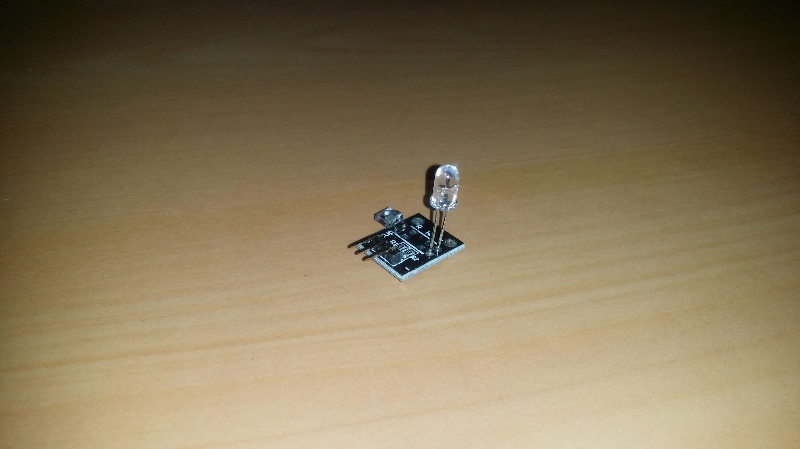
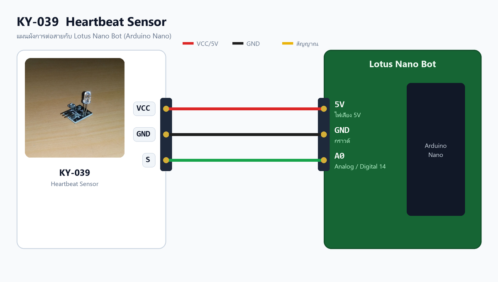

# KY-039 --- Heartbeat Sensor

## รายละเอียด

Heartbeat Sensor หรือ Pulse Sensor เป็นเซนเซอร์ที่ใช้ตรวจจับอัตราการเต้นของหัวใจผ่านการวัดการไหลเวียนของเลือด โดยใช้ IR LED ส่องผ่านนิ้วไปยัง Phototransistor ตรวจจับการเปลี่ยนแปลงของแสงที่ผ่านนิ้ว ซึ่งเปลี่ยนตามปริมาณเลือดในแต่ละจังหวะการเต้นของหัวใจ

## คุณสมบัติ

- แรงดันไฟฟ้า: 3.3V - 5V DC
- เอาต์พุต: Analog (S) อย่างเดียว - โมดูลมี 3 ขา (S, +, -)
- ใช้ IR LED และ Phototransistor (ไม่มีวงจรขยายในตัว สัญญาณที่ได้จึงมีขนาดเล็ก)
- ไม่มีตัวปรับความไวบนโมดูล

## ขาของเซนเซอร์

| ขา (Sensor) | สีสาย | เชื่อมต่อกับ (Lotus Nano Bot) |
|-------------|-------|------------------------------|
| VCC         | แดง   | 5V หรือ 3.3V                 |
| GND         | ดำ/น้ำตาล | GND                       |
| S (Analog)  | ม่วง  | A0, A1, A2, A3 หรือ A6    |

> **หมายเหตุ:** KY-039 ให้เอาต์พุต Analog อย่างเดียว ต่อได้ที่ A0-A3 หรือ A6 (ห้ามใช้ A4/A5 ที่ใช้กับ I2C และ A7 ที่ใช้กับ Knob บนบอร์ด)

## การต่อสายไฟ

```
Heartbeat Sensor         Lotus Nano Bot
━━━━━━━━━━━━━━━━━━━━━━━━━━━━━━━━━━━━━━━━
VCC  ──────────────────► 5V
GND  ──────────────────► GND
S    ──────────────────► A0
```

### ภาพการต่อสาย (Text Diagram)

```
        +------------------+
        |  Heartbeat       |
        |  Sensor          |
        |   (o o)          |
        |                  |
   +----+----+   +----+----+   +----+----+
   |  VCC    |   |  GND    |   |   S     |
   |   (+)   |   |   (-)   |   | (Anlg)  |
   +----+----+   +----+----+   +----+----+
        |             |             |
        |             |             |
   +----+----+   +----+----+   +----+----+
   |   5V    |   |  GND    |   |   A0    |
   |         |   |         |   |         |
   |  Lotus  |   |  Nano   |   |  Bot    |
   +---------+   +---------+   +---------+
```

## โค้ดตัวอย่าง (พื้นฐาน)

```cpp
// Heartbeat Sensor Basic Example for Lotus Nano Bot
// AO -> A0

#define HEARTBEAT_PIN A0
#define LED_PIN 13

void setup() {
  Serial.begin(9600);
  pinMode(LED_PIN, OUTPUT);
  Serial.println("Heartbeat Sensor Test Started");
}

void loop() {
  int rawValue = analogRead(HEARTBEAT_PIN);
  
  Serial.println(rawValue);
  
  // ค่าปกติอยู่ที่ประมาณ 500-600 (ขึ้นกับแสงรอบข้างและการวางนิ้ว)
  // เมื่อมี pulse ค่าจะแกว่งขึ้น-ลงเล็กน้อย ให้ดูค่าจริงใน Serial Plotter แล้วปรับเกณฑ์ 600 ให้เหมาะสม
  if (rawValue > 600) {
    digitalWrite(LED_PIN, HIGH);
  } else {
    digitalWrite(LED_PIN, LOW);
  }
  
  delay(20);  // อ่านค่าทุก 20 ms (50 Hz)
}
```

## โค้ดตัวอย่างคำนวณ BPM (Beats Per Minute)

```cpp
// Heartbeat BPM Calculation
// AO -> A0

#define HEARTBEAT_PIN A0
#define LED_PIN 13

unsigned long lastBeatTime = 0;
int bpm = 0;
bool pulseDetected = false;

void setup() {
  Serial.begin(9600);
  pinMode(LED_PIN, OUTPUT);
  Serial.println("Heartbeat BPM Monitor");
}

void loop() {
  int rawValue = analogRead(HEARTBEAT_PIN);
  
  // หาจุดสูงสุด (Peak detection)
  if (rawValue > 600 && !pulseDetected) {
    pulseDetected = true;
    
    unsigned long currentTime = millis();
    unsigned long beatInterval = currentTime - lastBeatTime;
    lastBeatTime = currentTime;
    
    // คำนวณ BPM
    if (beatInterval > 0) {
      bpm = 60000 / beatInterval;
      
      if (bpm > 40 && bpm < 200) {  // กรองค่าที่ไม่สมจริง
        Serial.print("❤️  BPM: ");
        Serial.println(bpm);
        digitalWrite(LED_PIN, HIGH);
      }
    }
  }
  
  if (rawValue < 550) {
    pulseDetected = false;
    digitalWrite(LED_PIN, LOW);
  }
  
  delay(20);
}
```

## วิธีใช้งาน

1. วางนิ้วชี้บนเซนเซอร์ให้เบาๆ
2. ไม่ควรกดแรงเกินไป (อาจทำให้เลือดไหลไม่สะดวก)
3. รอ 5-10 วินาทีเพื่อให้เซนเซอร์ stabilize
4. เปิด **Tools > Serial Plotter** ดูรูปคลื่น แล้วปรับเกณฑ์ (600/550) ในโค้ดให้อยู่ระหว่างยอดและท้องของคลื่น
5. ใช้มือหรือผ้าบังแสงรอบข้าง เพราะแสงภายนอกรบกวน Phototransistor ได้มาก

## หมายเหตุ

- ค่าที่วัดได้อาจไม่แม่นยำเท่าอุปกรณ์ทางการแพทย์
- การเคลื่อนไหวของนิ้วอาจทำให้ค่าผิดพลาด
- แนะนำให้ใช้ไลบรารี `PulseSensor Playground` สำหรับโครงการจริง

## กิจกรรมการเรียนรู้

### จุดประสงค์การเรียนรู้
1. อธิบายหลักการวัดชีพจรด้วยแสง (Photoplethysmography) ได้
2. ต่อวงจร Heartbeat Sensor เข้ากับ A0 และแสดงรูปคลื่นชีพจรบน Serial Plotter ได้
3. คำนวณอัตราการเต้นของหัวใจ (BPM) และเปรียบเทียบกับการนับชีพจรด้วยมือได้

### ขั้นตอนการทดลอง
1. ต่อสาย VCC → 5V, GND → GND, S → A0 แล้วอัปโหลดโค้ดพื้นฐาน
2. วางปลายนิ้วระหว่าง IR LED กับ Phototransistor เบาๆ บังแสงรอบข้าง แล้วเปิด Serial Plotter สังเกตรูปคลื่น
3. อ่านค่ายอดและท้องของคลื่น แล้วปรับเกณฑ์ 600/550 ในโค้ดคำนวณ BPM ให้อยู่ระหว่างสองค่านี้
4. อัปโหลดโค้ด BPM บันทึกค่า แล้วนับชีพจรที่ข้อมือด้วยตนเอง 15 วินาที คูณ 4 เพื่อเปรียบเทียบ

### ตารางบันทึกผล
| ครั้งที่ | สภาวะ/การกระทำ | ค่าที่อ่านได้ | ผลที่สังเกตได้ |
|---|---|---|---|
| 1 | ไม่วางนิ้ว | | |
| 2 | วางนิ้วขณะนั่งพัก | | |
| 3 | วางนิ้วหลังลุกนั่ง 10 ครั้ง | | |

### คำถามท้ายการทดลอง
1. เหตุใดแสงที่ผ่านนิ้วจึงเปลี่ยนไปตามจังหวะการเต้นของหัวใจ
2. ค่า BPM จากเซนเซอร์ต่างจากการนับด้วยมือเท่าใด และอะไรทำให้ค่าคลาดเคลื่อน
3. จะนำเซนเซอร์นี้ไปทำอุปกรณ์ติดตามสุขภาพขณะออกกำลังกายได้อย่างไร

<details>
<summary>แนวคำตอบ (สำหรับครู)</summary>

1. ทุกครั้งที่หัวใจบีบตัว ปริมาณเลือดในนิ้วเพิ่มขึ้นและดูดกลืนแสง IR มากขึ้น แสงที่ถึง Phototransistor จึงเปลี่ยนเป็นจังหวะ
2. ขึ้นกับผลการทดลอง สาเหตุเช่น การขยับนิ้ว, แสงรอบข้าง, เกณฑ์ไม่เหมาะสม, สัญญาณเล็กเพราะไม่มีวงจรขยาย
3. อ่าน BPM ต่อเนื่อง แสดงผลแบบเรียลไทม์ เตือนเมื่อเกินช่วงที่ปลอดภัย และบันทึกข้อมูลเพื่อดูแนวโน้ม (ใช้เพื่อการเรียนรู้ ไม่ใช่การวินิจฉัยทางการแพทย์)

</details>

### ภารกิจท้าทาย
- แสดงค่า BPM ตัวใหญ่บนจอ OLED พร้อมรูปหัวใจกะพริบตามจังหวะ ให้บัซเซอร์ D3 ดัง "ติ๊ก" สั้นๆ ทุกครั้งที่ตรวจพบชีพจร และใช้ Knob A7 ปรับค่าเกณฑ์การตรวจจับแทนการแก้โค้ด

## รูปภาพ





