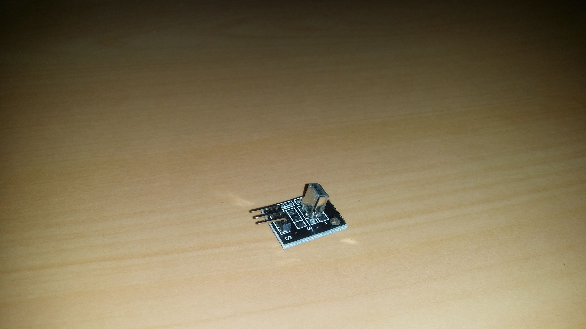
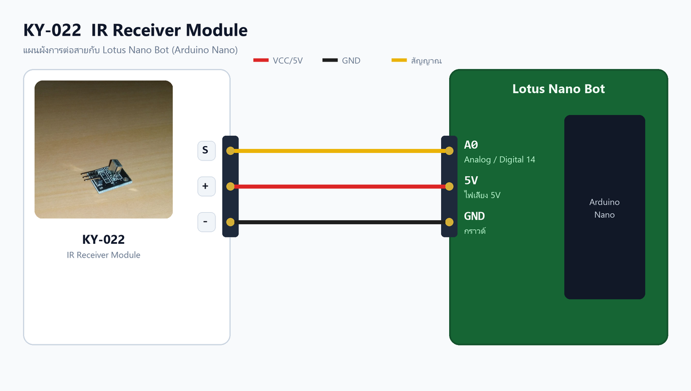

# KY-022 --- IR Receiver Module

## รายละเอียด

IR Receiver Module เป็นเซนเซอร์รับสัญญาณอินฟราเรด ใช้ตรวจจับสัญญาณจากรีโมทคอนโทรล IR โดยทั่วไป มี Demodulator ในตัวสำหรับความถี่ 38 kHz

## คุณสมบัติ

- แรงดันไฟฟ้า: 3.3V - 5V DC
- ความถี่รับ: 38 kHz (มาตรฐาน)
- เอาต์พุต: Digital (Active LOW)
- มีตัวกรองแสงรบกวน

## ขาของ IR Receiver

| ขา (Module) | สีสาย | เชื่อมต่อกับ (Lotus Nano Bot) |
|-------------|-------|------------------------------|
| VCC         | แดง   | 5V                           |
| GND         | ดำ/น้ำตาล | GND                       |
| OUT (DATA)  | เหลือง | D3 หรือ A0 (D14)            |

> **⚠️ หมายเหตุ:** D3 ใช้โดย Onboard Buzzer ของ Lotus Nano Bot หากต้องการหลีกเลี่ยงให้ใช้ A0 (D14)

## การต่อสายไฟ

```
IR Receiver              Lotus Nano Bot
━━━━━━━━━━━━━━━━━━━━━━━━━━━━━━━━━━━━━━━━
VCC  ──────────────────► 5V
GND  ──────────────────► GND
OUT  ──────────────────► D3
```

### ภาพการต่อสาย (Text Diagram)

```
        +------------------+
        |  IR Receiver     |
        |  Module          |
        |    [=]           |
        |                  |
   +----+----+   +----+----+   +----+----+
   |  VCC    |   |  GND    |   |  OUT    |
   |   (+)   |   |   (-)   |   | (Data)  |
   +----+----+   +----+----+   +----+----+
        |             |             |
        |             |             |
   +----+----+   +----+----+   +----+----+
   |   5V    |   |  GND    |   |   D3    |
   |         |   |         |   |         |
   |  Lotus  |   |  Nano   |   |  Bot    |
   +---------+   +---------+   +---------+
```

## โค้ดตัวอย่าง

```cpp
// IR Receiver Example for Lotus Nano Bot
// OUT -> D3
// ใช้ไลบรารี IRremote เวอร์ชัน 4.x

#include <IRremote.hpp>

#define IR_RECEIVE_PIN 3

void setup() {
  Serial.begin(9600);
  IrReceiver.begin(IR_RECEIVE_PIN, ENABLE_LED_FEEDBACK);  // LED D13 กะพริบเมื่อรับสัญญาณ
  Serial.println("IR Receiver Test Started");
  Serial.println("Point remote at sensor and press buttons...");
}

void loop() {
  if (IrReceiver.decode()) {
    Serial.print("📡 Protocol: ");
    Serial.print(getProtocolString(IrReceiver.decodedIRData.protocol));
    Serial.print(" | Command: 0x");
    Serial.print(IrReceiver.decodedIRData.command, HEX);
    Serial.print(" | Raw: 0x");
    Serial.println(IrReceiver.decodedIRData.decodedRawData, HEX);
    
    IrReceiver.resume();  // พร้อมรับสัญญาณถัดไป
  }
}
```

## โค้ดตัวอย่างควบคุม LED ด้วยรีโมท

```cpp
#include <IRremote.hpp>

#define IR_RECEIVE_PIN 3
#define LED_PIN 13

bool ledState = false;

void setup() {
  Serial.begin(9600);
  IrReceiver.begin(IR_RECEIVE_PIN, DISABLE_LED_FEEDBACK);  // ใช้ D13 เป็น LED ของเราเอง
  pinMode(LED_PIN, OUTPUT);
}

void loop() {
  if (IrReceiver.decode()) {
    // ข้ามสัญญาณกดค้าง (Repeat) เพื่อไม่ให้สลับสถานะซ้ำ
    if (IrReceiver.decodedIRData.flags & IRDATA_FLAGS_IS_REPEAT) {
      IrReceiver.resume();
      return;
    }
    uint16_t code = IrReceiver.decodedIRData.command;
    
    // ตัวอย่างรหัสรีโมท NEC แบบการ์ดเล็ก (รหัสจริงอาจแตกต่างกัน)
    switch (code) {
      case 0x45:  // ปุ่ม ON/OFF (ตัวอย่าง, เดิม Raw 0xFFA25D)
        ledState = !ledState;
        digitalWrite(LED_PIN, ledState);
        Serial.println(ledState ? "LED ON" : "LED OFF");
        break;
        
      case 0x46:  // ปุ่ม Vol+ (ตัวอย่าง, เดิม Raw 0xFF629D)
        Serial.println("Volume Up");
        break;
        
      case 0x47:  // ปุ่ม Vol- (ตัวอย่าง, เดิม Raw 0xFFE21D)
        Serial.println("Volume Down");
        break;
    }
    
    IrReceiver.resume();
  }
}
```

## วิธีติดตั้งไลบรารี

1. เปิด Arduino IDE
2. ไปที่ **Sketch > Include Library > Manage Libraries...**
3. ค้นหา "IRremote" โดย shirriff / z3t0 / ArminJo
4. คลิก **Install** (โค้ดในหน้านี้ใช้ API ของเวอร์ชัน 4.x)

## หมายเหตุ

- รหัสปุ่มรีโมทแต่ละยี่ห้อจะแตกต่างกัน ให้ใช้โค้ดตัวอย่างแรกเพื่ออ่านรหัสก่อน
- ต้องใช้รีโมทที่ส่งสัญญาณ 38 kHz (รีโมททีวี/แอร์ส่วนใหญ่)
- โค้ดนี้ใช้ IRremote v4.x (`#include <IRremote.hpp>`, `IrReceiver`) หากใช้เวอร์ชันเก่า (v2.x) ต้องใช้ API แบบ `IRrecv` / `decode_results`
- IRremote ใช้ Timer2 ซึ่งชนกับฟังก์ชัน `tone()` จึงไม่ควรใช้ `tone()` กับบัซเซอร์ D3 ร่วมกันในโปรแกรมเดียว (ใช้ `digitalWrite` เปิด-ปิดบัซเซอร์แทน และย้าย OUT ไปที่ A0)
- ระยะรับสัญญาณประมาณ 5-10 เมตร (ขึ้นอยู่กับรีโมท)

## กิจกรรมการเรียนรู้

### จุดประสงค์การเรียนรู้
1. อธิบายหลักการส่งข้อมูลด้วยแสงอินฟราเรดที่มอดูเลตความถี่ 38 kHz ได้
2. ติดตั้งไลบรารี IRremote ต่อวงจร IR Receiver และอ่านรหัสปุ่มรีโมทได้
3. เขียนโปรแกรมใช้รหัสปุ่มรีโมทควบคุมอุปกรณ์ได้

### ขั้นตอนการทดลอง
1. ติดตั้งไลบรารี IRremote ต่อสาย VCC → 5V, GND → GND, OUT → D3 แล้วอัปโหลดโค้ดตัวอย่างแรก
2. กดปุ่มรีโมท 3 ปุ่ม บันทึกค่า Protocol และ Command ของแต่ละปุ่ม
3. ทดสอบระยะรับสัญญาณ (1 m, 3 m, 5 m) และมุม (หันตรง, เอียง 45°)
4. แก้ค่า `case` ในโค้ดตัวอย่างที่สองให้ตรงกับรหัสปุ่มรีโมทของตน แล้วทดสอบเปิด-ปิด LED D13

### ตารางบันทึกผล
| ครั้งที่ | สภาวะ/การกระทำ | ค่าที่อ่านได้ | ผลที่สังเกตได้ |
|---|---|---|---|
| 1 | กดปุ่ม ON/OFF ที่ระยะ 1 m | | |
| 2 | กดปุ่มเดิมที่ระยะ 5 m | | |
| 3 | กดปุ่มเดิมโดยเอียงรีโมท 45° หรือมีมือบัง | | |

### คำถามท้ายการทดลอง
1. เหตุใดสัญญาณ IR ของรีโมทจึงต้องมอดูเลตที่ความถี่ 38 kHz
2. การกดปุ่มเดิมซ้ำได้รหัสเหมือนเดิมหรือไม่ และเมื่อกดค้างได้ผลอย่างไร
3. จะนำ IR Receiver ไปใช้ควบคุมหุ่นยนต์ด้วยรีโมททีวีได้อย่างไร

<details>
<summary>แนวคำตอบ (สำหรับครู)</summary>

1. เพื่อแยกสัญญาณรีโมทออกจากแสง IR รอบข้าง (แดด, หลอดไฟ) ตัวรับมีวงจรกรองและ Demodulator ที่ตอบสนองเฉพาะ 38 kHz
2. ได้ Command เดิมทุกครั้ง เมื่อกดค้างรีโมท NEC จะส่งสัญญาณ Repeat ซึ่งไลบรารีแจ้งด้วย flag IRDATA_FLAGS_IS_REPEAT
3. กำหนดปุ่มลูกศรของรีโมทให้สั่งมอเตอร์เดินหน้า ถอยหลัง เลี้ยวซ้าย-ขวา และปุ่ม OK ให้หยุด

</details>

### ภารกิจท้าทาย
- ย้าย OUT ไปที่ A0 (D14) แล้วเขียนโปรแกรมบังคับหุ่นยนต์ด้วยรีโมท: ปุ่มลูกศรควบคุมมอเตอร์ซ้าย/ขวา ปุ่ม OK หยุด และแสดงคำสั่งล่าสุดบนจอ OLED

## รูปภาพ





