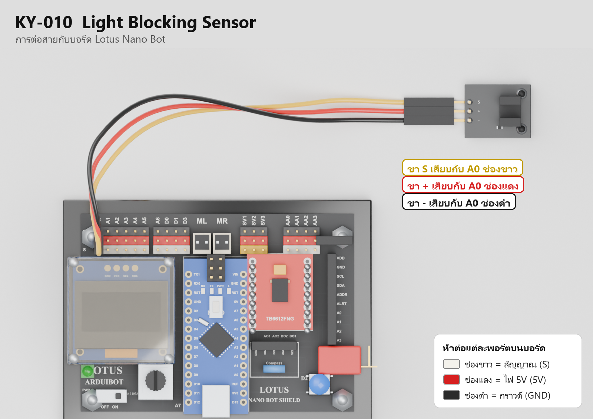
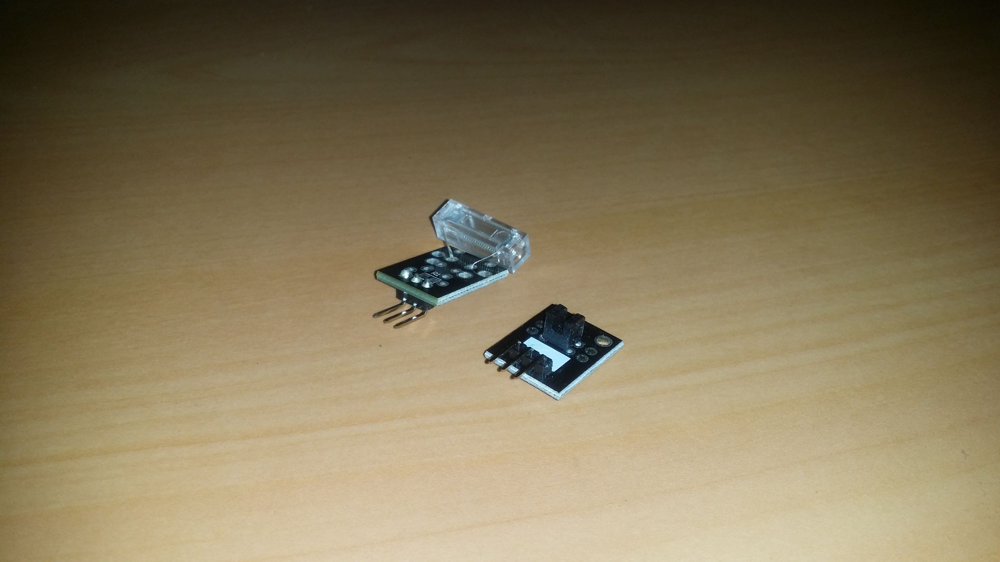
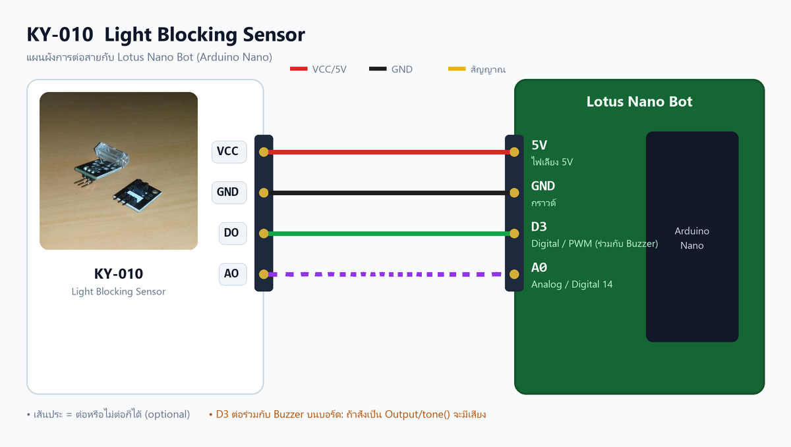

# KY-010 --- Light Blocking Sensor

## รายละเอียด

Light Blocking Sensor หรือ Slot-type IR Sensor เป็นเซนเซอร์ที่มีช่องว่างระหว่าง IR LED และ IR Receiver เมื่อมีวัตถุเข้ามาบดบังช่องว่าง เอาต์พุตจะเปลี่ยนสถานะ ใช้นับจำนวนวัตถุหรือตรวจจับการหมุน

## คุณสมบัติ

- แรงดันไฟฟ้า: 3.3V - 5V DC
- เอาต์พุต: Digital (DO) และ Analog (AO)
- มี LED แสดงสถานะ
- มีตัวปรับความไว (Potentiometer)

> **หมายเหตุ:** KY-010 รุ่นดั้งเดิมมี 3 ขา (S, +, -) ให้เฉพาะเอาต์พุต Digital ไม่มีตัวปรับค่า ส่วน AO และ Potentiometer มีเฉพาะโมดูลแบบ 4 ขาบางรุ่น หากใช้แบบ 3 ขาให้ต่อขา S เป็น DO

## ขาของเซนเซอร์

| ขา (Sensor) | สีสาย | เชื่อมต่อกับ (Lotus Nano Bot) |
|-------------|-------|------------------------------|
| S (Signal)  | ขาว   | A0 (D14)                     |
| + (VCC)     | แดง   | 5V                           |
| - (GND)     | ดำ    | GND                          |

> ต่อที่หัวต่อพอร์ต A0 บนบอร์ด: ช่องขาว = S, ช่องแดง = 5V, ช่องดำ = GND

## การต่อสายไฟ

```
Light Blocking Sensor    Lotus Nano Bot
━━━━━━━━━━━━━━━━━━━━━━━━━━━━━━━━━━━━━━━━
S    ──────────────────► A0 (D14)
+    ──────────────────► 5V
-    ──────────────────► GND
```

### ภาพการต่อสายกับบอร์ด



## โค้ดตัวอย่าง

```cpp
// Light Blocking Sensor Example for Lotus Nano Bot
// S -> A0 (D14)

#define BLOCKING_PIN 14  // A0

int count = 0;
int lastState = HIGH;

void setup() {
  Serial.begin(9600);
  pinMode(BLOCKING_PIN, INPUT);
  Serial.println("Light Blocking Sensor Test Started");
}

void loop() {
  int state = digitalRead(BLOCKING_PIN);
  
  // นับเมื่อสถานะเปลี่ยนเป็น LOW (บางโมดูลเป็น HIGH เมื่อถูกบัง ให้ทดสอบก่อน)
  if (state != lastState && state == LOW) {
    count++;
    Serial.print("🚫 Object Detected! Count: ");
    Serial.println(count);
  }
  
  lastState = state;
  delay(10);
}
```

## โค้ดตัวอย่างนับรอบมอเตอร์ (Encoder)

```cpp
// S -> A0 (D14) อ่านแบบ Polling ความเร็วสูง (ไม่มี delay ใน loop)
#define BLOCKING_PIN 14  // A0

unsigned int count = 0;
int lastState = HIGH;
unsigned long lastPrint = 0;

void setup() {
  Serial.begin(9600);
  pinMode(BLOCKING_PIN, INPUT);
}

void loop() {
  int state = digitalRead(BLOCKING_PIN);
  if (lastState == HIGH && state == LOW) {  // ขอบขาลง = รูผ่าน 1 ครั้ง
    count++;
  }
  lastState = state;
  
  // แสดงผลทุก 500 ms โดยไม่หยุดการอ่านเซนเซอร์
  if (millis() - lastPrint >= 500) {
    lastPrint = millis();
    Serial.print("Pulses: ");
    Serial.print(count);
    Serial.print(" | Rotations: ");
    Serial.println(count / 20);  // สมมติ 20 รูต่อรอบ
  }
}
```

## หมายเหตุ

- โค้ดนับรอบใช้ Polling โดยไม่มี `delay()` ใน loop และใช้ `millis()` จับเวลาแสดงผล จึงนับพัลส์ได้แม่นยำกว่าโค้ดแรก
- วางวงแหวนรูระหว่างช่องเซนเซอร์เพื่อนับรอบมอเตอร์
- หมุนตัวปรับค่าให้ LED เปลี่ยนสถานะตรงจุดที่ต้องการ
- A0-A3 ใช้ `attachInterrupt()` ไม่ได้ (External Interrupt ของ Nano มีเฉพาะ D2/D3 ซึ่งบนบอร์ดใช้กับปุ่มและบัซเซอร์) จึงใช้โค้ดแบบ Polling

## กิจกรรมการเรียนรู้

### จุดประสงค์การเรียนรู้
1. อธิบายหลักการทำงานของเซนเซอร์ตัดแสงแบบช่อง (Photo Interrupter) ได้
2. ต่อวงจร Light Blocking Sensor เข้ากับพอร์ต A0 และนับจำนวนครั้งที่วัตถุผ่านช่องได้
3. เปรียบเทียบความแม่นยำของการนับแบบ Polling ที่มี `delay()` และแบบไม่มี `delay()` ได้

### ขั้นตอนการทดลอง
1. ต่อสาย + → 5V, - → GND, S → A0 แล้วอัปโหลดโค้ดตัวอย่างแรก
2. สอดกระดาษแข็งผ่านช่องเซนเซอร์ช้าๆ 10 ครั้ง บันทึกค่า Count
3. สอดกระดาษผ่านเร็วๆ 10 ครั้ง บันทึกค่า Count เปรียบเทียบ
4. อัปโหลดโค้ดนับรอบมอเตอร์ หมุนจานที่มีรู (หรือพัดกระดาษ) ผ่านช่อง สังเกตจำนวนพัลส์และรอบที่คำนวณได้

### ตารางบันทึกผล
| ครั้งที่ | สภาวะ/การกระทำ | ค่าที่อ่านได้ | ผลที่สังเกตได้ |
|---|---|---|---|
| 1 | ช่องว่าง ไม่มีวัตถุ | | |
| 2 | สอดกระดาษผ่านช้าๆ 10 ครั้ง (Polling) | | |
| 3 | สอดกระดาษผ่านเร็วๆ 10 ครั้ง (โค้ดแรก / โค้ดนับรอบ) | | |

### คำถามท้ายการทดลอง
1. เอาต์พุตของเซนเซอร์เปลี่ยนไปอย่างไรเมื่อวัตถุบังแสงในช่อง
2. เมื่อสอดกระดาษเร็วๆ ค่าที่นับได้ตรงกับจำนวนจริงหรือไม่ เพราะเหตุใด
3. จะใช้เซนเซอร์นี้วัดระยะทางที่ล้อหุ่นยนต์เคลื่อนที่ได้อย่างไร

<details>
<summary>แนวคำตอบ (สำหรับครู)</summary>

1. เมื่อไม่มีวัตถุ แสง IR ส่องถึงตัวรับ เอาต์พุตอยู่สถานะหนึ่ง เมื่อวัตถุบัง เอาต์พุตจะสลับเป็นอีกสถานะ (ทิศทาง HIGH/LOW ขึ้นกับรุ่น)
2. แบบ Polling อาจนับขาดหรือนับซ้ำ (เด้ง) ถ้าวัตถุผ่านเร็วกว่ารอบการอ่าน ส่วนโค้ดนับรอบที่ไม่มี `delay()` อ่านขาบ่อยกว่ามากจึงแม่นยำกว่า (ถ้าต้องการแม่นยำสูงสุดต้องใช้ Interrupt ซึ่ง Nano มีเฉพาะ D2/D3)
3. ติดจาน Encoder ที่มีรูจำนวนแน่นอนบนแกนล้อ นับพัลส์ หารด้วยจำนวนรูต่อรอบได้จำนวนรอบ แล้วคูณด้วยเส้นรอบวงล้อ (πd) ได้ระยะทาง

</details>

### ภารกิจท้าทาย
- สร้างเครื่องนับวัตถุบนสายพาน: แสดงจำนวนบนจอ OLED, ให้บัซเซอร์ส่งเสียงเมื่อนับครบ 10 ชิ้น (ใช้ `tone(3, ...)` กับบัซเซอร์บนบอร์ด) และกดปุ่ม D2 เพื่อรีเซ็ตตัวนับ

## รูปภาพ





