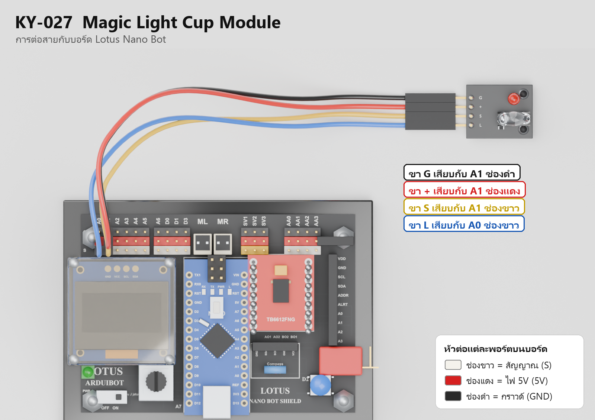
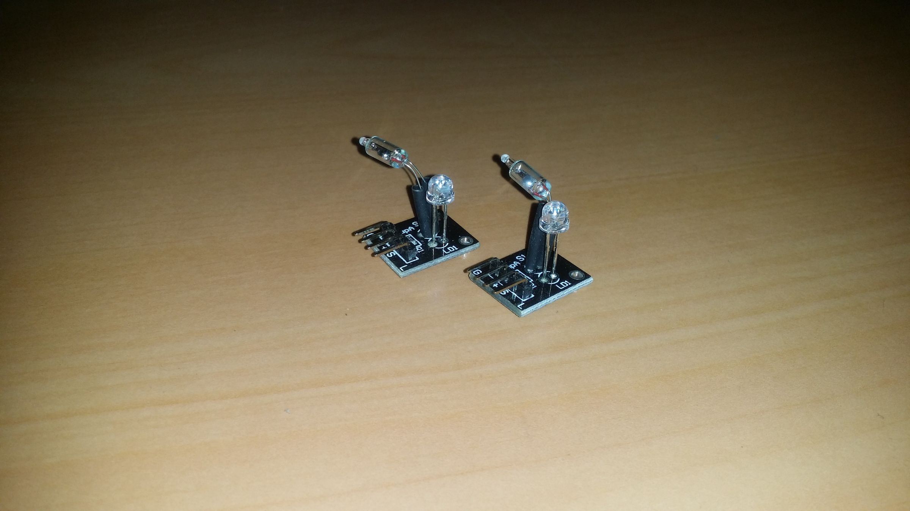
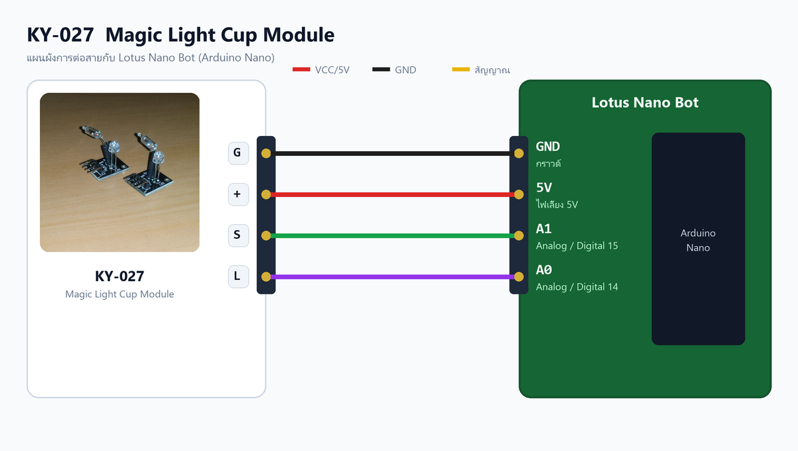

# KY-027 --- Magic Light Cup Module

## รายละเอียด

Magic Light Cup Module เป็นโมดูลที่ประกอบด้วย **สวิตช์เอียงแบบปรอท (Mercury Tilt Switch)** และ **LED** อยู่บนแผงเดียวกัน สวิตช์เอียงจะปิดวงจรหรือเปิดวงจรตามมุมเอียงของโมดูล ส่วน LED สามารถสั่งเปิด-ปิดได้จาก Arduino นิยมใช้ 2 โมดูลคู่กันเพื่อทำเอฟเฟกต์ "ถ่ายเทแสง" เหมือนเทน้ำจากถ้วยหนึ่งไปอีกถ้วยหนึ่ง

## คุณสมบัติ

- แรงดันไฟฟ้า: 3.3V - 5V DC
- อินพุต: สวิตช์เอียงแบบปรอท ให้สัญญาณ Digital (HIGH/LOW) ที่ขา S
- เอาต์พุต: LED ควบคุมผ่านขา L (Digital หรือ PWM)
- มี 4 ขา: G, +, S, L

> **⚠️ หมายเหตุ:** สวิตช์ปรอทมีสารปรอทอยู่ภายในหลอดแก้ว ห้ามทำหลอดแตก หากแตกให้แจ้งครูทันที

## ขาของโมดูล

| ขา (Module) | สีสาย | เชื่อมต่อกับ (Lotus Nano Bot) |
|-------------|-------|------------------------------|
| G (GND)     | ดำ/น้ำตาล | GND                       |
| + (VCC)     | แดง   | 5V                           |
| S (Tilt)    | เหลือง | A1 (D15)                    |
| L (LED)     | ขาว   | A0 (D14)                    |

> ต่อที่หัวต่อพอร์ต A0 และ A1 บนบอร์ด: ช่องขาว = สัญญาณ (L เข้า A0, S เข้า A1), ช่องแดง = 5V, ช่องดำ = GND
>
> **หมายเหตุ:** ขา A0-A3 ใช้เป็น Digital ได้ (A0=Pin14, A1=Pin15, A2=Pin16, A3=Pin17) แต่ไม่รองรับ PWM จึงสั่ง LED ได้แค่เปิด/ปิด

## การต่อสายไฟ

```
Light Cup Module         Lotus Nano Bot
━━━━━━━━━━━━━━━━━━━━━━━━━━━━━━━━━━━━━━━━
G    ──────────────────► GND
+    ──────────────────► 5V
S    ──────────────────► A1 (D15)
L    ──────────────────► A0 (D14)
```

### ภาพการต่อสายกับบอร์ด



## โค้ดตัวอย่าง

```cpp
// Magic Light Cup Example for Lotus Nano Bot
// S -> A1 (D15), L -> A0 (D14)

#define TILT_PIN 15     // A1
#define CUP_LED_PIN 14  // A0

void setup() {
  Serial.begin(9600);
  pinMode(TILT_PIN, INPUT_PULLUP);  // เปิด Pull-up ภายในกันขาลอย
  pinMode(CUP_LED_PIN, OUTPUT);
  Serial.println("Magic Light Cup Test Started");
}

void loop() {
  int tiltState = digitalRead(TILT_PIN);
  
  Serial.print("Tilt: ");
  Serial.println(tiltState);
  
  // ทิศทาง HIGH/LOW ขึ้นกับการวางโมดูล ให้ทดลองเอียงแล้วสังเกต
  if (tiltState == LOW) {
    Serial.println("🔽 Tilted (switch closed)");
    digitalWrite(CUP_LED_PIN, HIGH);
  } else {
    Serial.println("🔼 Upright (switch open)");
    digitalWrite(CUP_LED_PIN, LOW);
  }
  
  delay(200);
}
```

## โค้ดตัวอย่างนับจำนวนครั้งที่เอียง

```cpp
// นับจำนวนครั้งที่เอียงโมดูล พร้อมกันการเด้งของสวิตช์ (Debounce)
#define TILT_PIN 15     // A1
#define CUP_LED_PIN 14  // A0

int count = 0;
int lastState = HIGH;
unsigned long lastChange = 0;

void setup() {
  Serial.begin(9600);
  pinMode(TILT_PIN, INPUT_PULLUP);
  pinMode(CUP_LED_PIN, OUTPUT);
}

void loop() {
  int state = digitalRead(TILT_PIN);
  
  // ปรอทกระฉอกทำให้สัญญาณเด้ง จึงรับการเปลี่ยนสถานะห่างกันอย่างน้อย 100 ms
  if (state != lastState && millis() - lastChange > 100) {
    lastChange = millis();
    lastState = state;
    
    if (state == LOW) {
      count++;
      Serial.print("Tilt Count: ");
      Serial.println(count);
    }
    digitalWrite(CUP_LED_PIN, state == LOW ? HIGH : LOW);
  }
}
```

## หมายเหตุ

- สวิตช์ปรอทให้สัญญาณเพียง 2 สถานะ (เอียง/ไม่เอียง) ไม่ได้บอกมุมเอียงที่แน่นอน
- สัญญาณอาจเด้ง (Bounce) ขณะเอียง ควรใช้การหน่วงเวลาหรือ Debounce
- ใช้ 2 โมดูลคู่กัน (ต่อ S/L ของโมดูลที่สองที่ A2/A3) เพื่อทำเอฟเฟกต์ถ่ายเทแสงระหว่างถ้วย
- ขา L ต่อกับ LED ผ่านตัวต้านทานบนโมดูลแล้ว สั่งด้วย digitalWrite ได้โดยตรง

## กิจกรรมการเรียนรู้

### จุดประสงค์การเรียนรู้
1. อธิบายหลักการทำงานของสวิตช์เอียงแบบปรอทได้
2. ต่อวงจร Magic Light Cup (S → A1, L → A0) อ่านสถานะการเอียงและควบคุม LED บนโมดูลได้
3. อธิบายปัญหาการเด้งของสวิตช์และแก้ไขด้วยวิธี Debounce ได้

### ขั้นตอนการทดลอง
1. ต่อสาย G → GND, + → 5V, S → A1, L → A0 แล้วอัปโหลดโค้ดตัวอย่างแรก
2. วางโมดูลตั้งตรงแล้วค่อยๆ เอียงไปทางซ้าย/ขวา บันทึกค่า Tilt และสถานะ LED
3. อัปโหลดโค้ดนับจำนวนครั้ง เอียงโมดูล 10 ครั้ง บันทึกค่า Count
4. ลบเงื่อนไข `millis() - lastChange > 100` ออกชั่วคราว แล้วเอียง 10 ครั้งอีกรอบ เปรียบเทียบค่าที่นับได้

### ตารางบันทึกผล
| ครั้งที่ | สภาวะ/การกระทำ | ค่าที่อ่านได้ | ผลที่สังเกตได้ |
|---|---|---|---|
| 1 | วางโมดูลตั้งตรง | | |
| 2 | เอียงโมดูลประมาณ 90° | | |
| 3 | เอียง 10 ครั้ง (มี / ไม่มี Debounce) | | |

### คำถามท้ายการทดลอง
1. สวิตช์เอียงแบบปรอทเปิด-ปิดวงจรได้อย่างไร
2. เมื่อไม่มี Debounce ค่าที่นับได้ต่างจากจำนวนครั้งที่เอียงจริงอย่างไร เพราะเหตุใด
3. จะนำสวิตช์เอียงไปใช้ตรวจจับหุ่นยนต์ล้มได้อย่างไร

<details>
<summary>แนวคำตอบ (สำหรับครู)</summary>

1. ภายในหลอดแก้วมีหยดปรอทซึ่งนำไฟฟ้า เมื่อเอียงไปทางขั้วไฟฟ้า ปรอทจะไหลไปเชื่อมขั้วทั้งสองทำให้วงจรปิด เมื่อเอียงกลับปรอทไหลออกวงจรจึงเปิด
2. นับได้มากกว่าความจริง เพราะปรอทกระฉอกทำให้สัญญาณเปลี่ยนไปมาหลายครั้งในเสี้ยววินาที (Bounce)
3. ติดโมดูลบนตัวหุ่นยนต์ในแนวที่สวิตช์เปิดเมื่อตั้งตรง ถ้าหุ่นล้ม สถานะจะเปลี่ยน ให้โปรแกรมหยุดมอเตอร์และส่งเสียงเตือน

</details>

### ภารกิจท้าทาย
- ติดโมดูลบนหุ่นยนต์เป็น "เซนเซอร์ตรวจจับการล้ม" เมื่อเอียงให้หยุดมอเตอร์ทั้งสองข้างทันที บัซเซอร์ D3 ส่งเสียงเตือน แสดงข้อความ "FALL!" บนจอ OLED และต้องกดปุ่ม D2 เพื่อให้หุ่นเริ่มทำงานใหม่

## รูปภาพ




