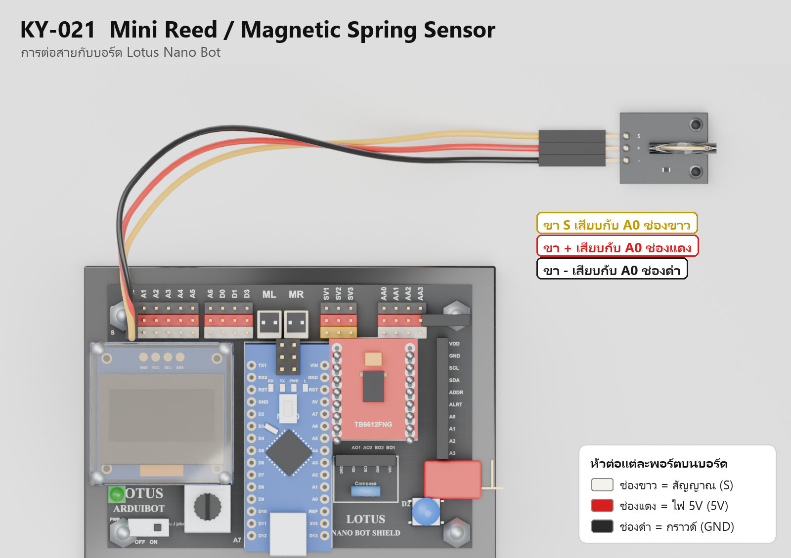
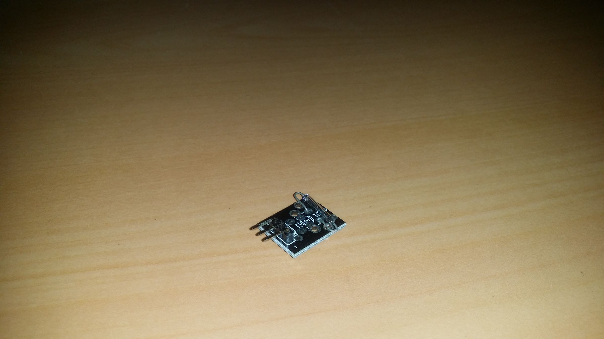
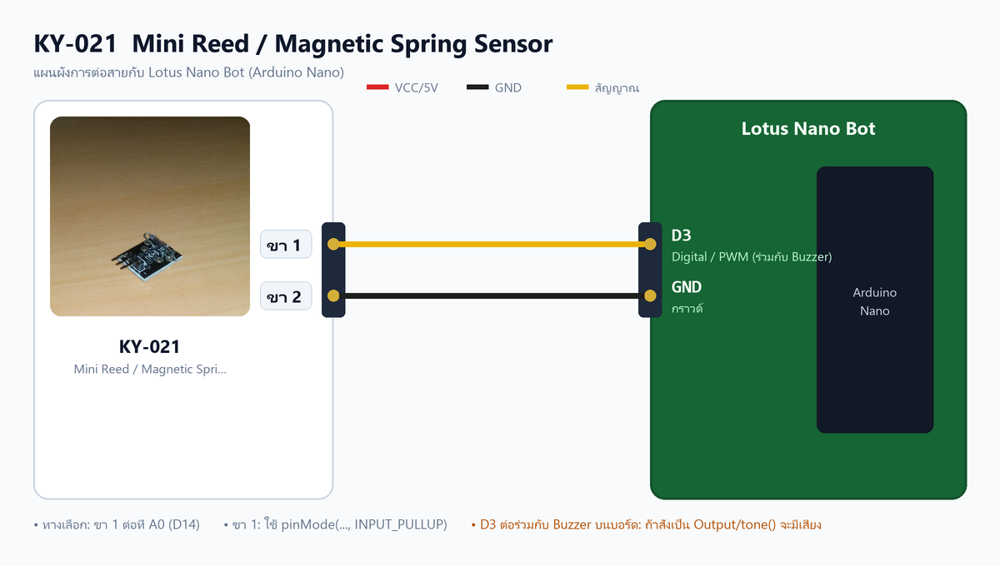

# KY-021 --- Mini Reed / Magnetic Spring Sensor

## รายละเอียด

Magnetic Spring Sensor เป็นเซนเซอร์ตรวจจับแม่เหล็กแบบ Mechanical Switch คล้าย Reed Switch แต่มี Spring ช่วยให้ตอบสนองเร็วขึ้น เหมาะสำหรับตรวจจับการเคลื่อนที่หรือการสั่นสะเทือนร่วมกับแม่เหล็ก

## คุณสมบัติ

- ไม่ใช้แรงดันไฟฟ้า (Switch แบบ Passive)
- ตรวจจับสนามแม่เหล็ก
- ตอบสนองเร็วกว่า Reed Switch ทั่วไป
- ทนทานต่อการสั่นสะเทือน

## ขาของเซนเซอร์

| ขา (Sensor) | สีสาย | เชื่อมต่อกับ (Lotus Nano Bot) |
|-------------|-------|------------------------------|
| S (Signal)  | ขาว   | A0 (D14) (ใช้ `INPUT_PULLUP`) |
| + (VCC)     | แดง   | 5V                           |
| - (GND)     | ดำ    | GND                          |

> ต่อที่หัวต่อพอร์ต A0 บนบอร์ด: ช่องขาว = S, ช่องแดง = 5V, ช่องดำ = GND

## การต่อสายไฟ

```
Magnetic Spring Sensor   Lotus Nano Bot
━━━━━━━━━━━━━━━━━━━━━━━━━━━━━━━━━━━━━━━━
S    ──────────────────► A0 (D14)
+    ──────────────────► 5V
-    ──────────────────► GND
```

### ภาพการต่อสายกับบอร์ด



## โค้ดตัวอย่าง

```cpp
// Magnetic Spring Sensor Example for Lotus Nano Bot
// S -> A0 (D14), + -> 5V, - -> GND

#define MAG_SPRING_PIN 14  // A0
#define LED_PIN 13

void setup() {
  Serial.begin(9600);
  pinMode(MAG_SPRING_PIN, INPUT_PULLUP);
  pinMode(LED_PIN, OUTPUT);
  Serial.println("Magnetic Spring Sensor Test Started");
}

void loop() {
  int state = digitalRead(MAG_SPRING_PIN);
  
  if (state == LOW) {  // แม่เหล็กเข้าใกล้
    Serial.println("🧲 Magnet Detected!");
    digitalWrite(LED_PIN, HIGH);
  } else {
    Serial.println("❌ No Magnet");
    digitalWrite(LED_PIN, LOW);
  }
  
  delay(200);
}
```

## หมายเหตุ

- ใช้ `INPUT_PULLUP` เพื่อไม่ต้องต่อตัวต้านทาน Pull-up ภายนอก
- ตอบสนองเร็วกว่า Reed Switch ทั่วไป
- เหมาะสำหรับใช้กับมอเตอร์ที่มีแม่เหล็กหมุนเร็ว
- บน Lotus Nano Bot ใช้ A0-A3 เป็น Digital Input ได้ (A0=Pin14, A1=Pin15, A2=Pin16, A3=Pin17)

## กิจกรรมการเรียนรู้

### จุดประสงค์การเรียนรู้
1. นักเรียนสามารถต่อสวิตช์แม่เหล็กกับ Arduino โดยใช้ `INPUT_PULLUP` ได้
2. นักเรียนสามารถอธิบายได้ว่าทำไมสถานะ LOW หมายถึง "ตรวจพบแม่เหล็ก"
3. นักเรียนสามารถวัดระยะการทำงานสูงสุดของสวิตช์แม่เหล็กได้

### ขั้นตอนการทดลอง
1. ต่อ S -> A0, + -> 5V และ - -> GND แล้วอัปโหลดโค้ดตัวอย่าง
2. เปิด Serial Monitor และสังเกตข้อความเมื่อไม่มีแม่เหล็ก
3. ค่อยๆ เลื่อนแม่เหล็กเข้าหาเซนเซอร์ บันทึกระยะที่ LED D13 เริ่มติด
4. ลองหันแม่เหล็กหลายทิศ (ขนาน/ตั้งฉากกับตัวสวิตช์) และบันทึกผล

### ตารางบันทึกผล
| ครั้งที่ | สภาวะ/การกระทำ | ค่าที่อ่านได้ | ผลที่สังเกตได้ |
|---|---|---|---|
| 1 | ไม่มีแม่เหล็ก | | |
| 2 | แม่เหล็กห่าง 1 cm (ขนานกับสวิตช์) | | |
| 3 | แม่เหล็กห่าง 1 cm (ตั้งฉากกับสวิตช์) | | |
| 4 | แม่เหล็กแนบชิด | | |

### คำถามท้ายการทดลอง
1. `INPUT_PULLUP` ทำหน้าที่อะไรในวงจรนี้
2. ทิศทางการวางแม่เหล็กมีผลต่อระยะการทำงานของสวิตช์อย่างไร
3. ยกตัวอย่างการนำสวิตช์แม่เหล็กไปใช้ในชีวิตประจำวัน 1 ตัวอย่าง

<details>
<summary>แนวคำตอบ (สำหรับครู)</summary>

1. ต่อตัวต้านทาน Pull-up ภายในไปยัง 5V ทำให้ขาอ่านได้ HIGH เมื่อสวิตช์เปิด และ LOW เมื่อสวิตช์ปิดต่อลง GND
2. สวิตช์ทำงานได้ไกลกว่าเมื่อแนวสนามแม่เหล็กขนานกับแผ่นหน้าสัมผัสภายใน ระยะจึงขึ้นกับทิศทางและความแรงของแม่เหล็ก
3. เช่น เซนเซอร์ประตู/หน้าต่าง, มาตรวัดความเร็วจักรยาน, ตรวจจับฝาปิดเครื่องใช้ไฟฟ้า

</details>

### ภารกิจท้าทาย
- ใช้สวิตช์แม่เหล็กนับรอบล้อ: ติดแม่เหล็กที่ล้อหุ่นยนต์ ให้มอเตอร์หมุนจนครบ 10 รอบแล้วหยุด พร้อมแสดงจำนวนรอบบนจอ OLED

## รูปภาพ





