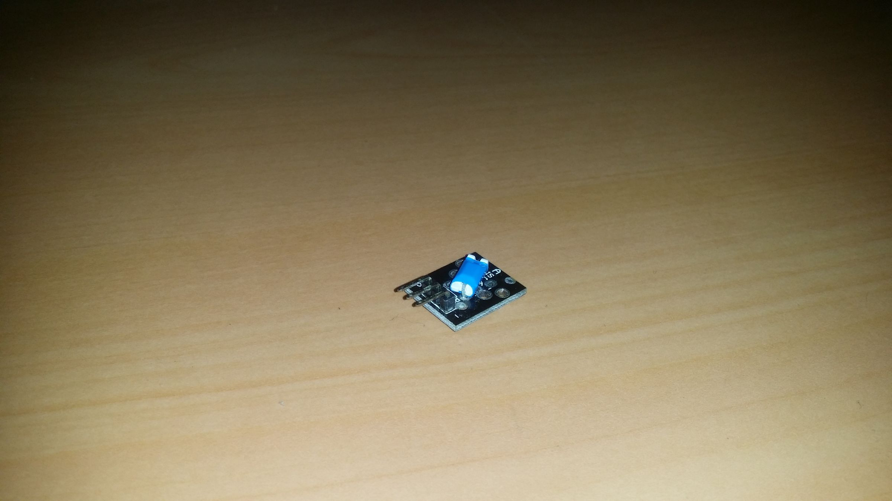
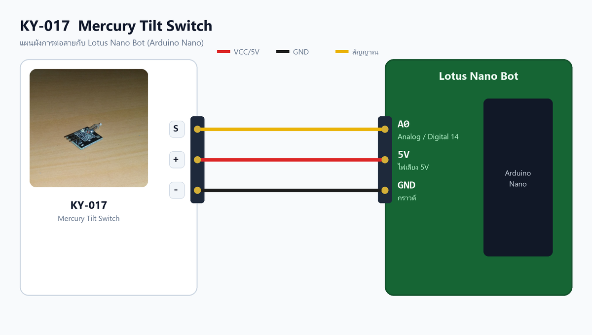

# KY-017 --- Mercury Tilt Switch

## รายละเอียด

Mercury Switch หรือ Tilt Switch แบบปรอท เป็นอุปกรณ์ตรวจจับการเอียง/การสั่นสะเทือน ภายในหลอดแก้วมีหยดปรอท (Mercury) เมื่อเอียงหลอด ปรอทจะไหลไปสัมผัสขาทั้งสองทำให้เป็นตัวนำไฟฟ้า (Switch Closed)

## คุณสมบัติ

- ไม่ใช้แรงดันไฟฟ้า (Switch แบบ Passive)
- ทำงานเหมือน Switch ธรรมดา
- ตรวจจับการเอียงหรือการสั่นสะเทือน
- อายุการใช้งานยาวนาน

## ขาของ Mercury Switch

| ขา (Switch) | สีสาย | เชื่อมต่อกับ (Lotus Nano Bot) |
|-------------|-------|------------------------------|
| ขา 1        | สีใดก็ได้ | D3 หรือ A0 (D14) (ผ่าน Pull-up) |
| ขา 2        | สีใดก็ได้ | GND                             |

> **หมายเหตุ:** บน Lotus Nano Bot พอร์ต Digital ภายนอกมี D0, D1, D3 โดย D0/D1 ใช้กับ Bluetooth/Serial ส่วน D3 ใช้กับบัซเซอร์บนบอร์ด หากต้องการพอร์ต Digital เพิ่มสามารถใช้ A0-A3 เป็น Digital ได้ (A0=Pin14, A1=Pin15, A2=Pin16, A3=Pin17)

> **สำคัญ:** ต้องต่อตัวต้านทาน Pull-up 10KΩ ระหว่างขา 1 และ 5V หรือใช้ `INPUT_PULLUP`

## การต่อสายไฟ

```
Mercury Switch           Lotus Nano Bot
━━━━━━━━━━━━━━━━━━━━━━━━━━━━━━━━━━━━━━━━
ขา 1 ──────────────────► D3 (ใช้ INPUT_PULLUP)
ขา 2 ──────────────────► GND
```

### ภาพการต่อสาย (Text Diagram)

```
        +------------------+
        |  Mercury Switch  |
        |   (Tilt Switch)  |
        |    o ~~~ o       |
        |   [ Hg  ]        |
        +----+------+------+
             |      |
             |      |
        +----+----+  +----+----+
        |   D3    |  |  GND    |
        | (Input) |  |         |
        |  Lotus  |  |  Nano   |
        |  Nano   |  |  Bot    |
        +---------+  +---------+
```

## โค้ดตัวอย่าง

```cpp
// Mercury Switch / Tilt Switch Example
// สำหรับ Lotus Nano Bot
// ต่อขา 1 -> D3, ขา 2 -> GND

#define MERCURY_PIN 3  // หรือ 14 (A0)
#define LED_PIN 13

void setup() {
  Serial.begin(9600);
  pinMode(MERCURY_PIN, INPUT_PULLUP);  // ใช้ Pull-up ภายใน
  pinMode(LED_PIN, OUTPUT);
  Serial.println("Mercury Switch Test Started");
}

void loop() {
  int state = digitalRead(MERCURY_PIN);
  
  // เมื่อหลอดตรง (ปรอทไม่สัมผัส): HIGH (Pull-up)
  // เมื่อหลอดเอียง (ปรอทสัมผัส): LOW
  if (state == LOW) {
    Serial.println("⚡ Mercury Switch CLOSED (Tilted!)");
    digitalWrite(LED_PIN, HIGH);
  } else {
    Serial.println("🔌 Mercury Switch OPEN (Normal)");
    digitalWrite(LED_PIN, LOW);
  }
  
  delay(200);
}
```

## โค้ดตัวอย่างตรวจจับการสั่น (Vibration Detection)

```cpp
// Detect vibration/shake using Mercury Switch
// ต่อขา 1 -> A0 (D14) เพื่อให้ D3 ว่างสำหรับบัซเซอร์บนบอร์ด
#define MERCURY_PIN 14  // A0
#define BUZZER_PIN 3    // บัซเซอร์บนบอร์ด Lotus Nano Bot

int shakeCount = 0;
unsigned long lastShakeTime = 0;

void setup() {
  Serial.begin(9600);
  pinMode(MERCURY_PIN, INPUT_PULLUP);
  pinMode(BUZZER_PIN, OUTPUT);
}

void loop() {
  int state = digitalRead(MERCURY_PIN);
  
  if (state == LOW) {
    if (millis() - lastShakeTime > 500) {  // นับแค่ครั้งละ 500ms
      shakeCount++;
      lastShakeTime = millis();
      Serial.print("Shake detected! Count: ");
      Serial.println(shakeCount);
      
      // สัญญาณเตือน
      tone(BUZZER_PIN, 2000, 100);
    }
  }
}
```

## หมายเหตุสำคัญ

- **⚠️ คำเตือน:** Mercury (ปรอท) เป็นสารพิษ! หากหลอดแตกให้ระมัดระวังและทำความสะอาดอย่างถูกวิธี
- ปัจจุบันมี Tilt Switch แบบไม่ใช้ปรอท (Ball Switch) ที่ปลอดภัยกว่า
- ใช้ `INPUT_PULLUP` เพื่อไม่ต้องต่อตัวต้านทาน Pull-up ภายนอก
- อาจมีการสั่นสะเทือน (Bouncing) ควรใช้ Debounce หากต้องการความแม่นยำ

## กิจกรรมการเรียนรู้

### จุดประสงค์การเรียนรู้
1. นักเรียนสามารถอ่านสถานะของสวิตช์เอียงด้วย `digitalRead()` และแสดงผลผ่าน LED ได้
2. นักเรียนสามารถหามุมเอียงโดยประมาณที่ทำให้สวิตช์เปลี่ยนสถานะได้
3. นักเรียนสามารถอธิบายการใช้ `millis()` เพื่อกันการนับซ้ำ (Debounce) ได้

### ขั้นตอนการทดลอง
1. ต่อขา 1 -> D3 ขา 2 -> GND แล้วอัปโหลดโค้ดตัวอย่างแรก
2. วางโมดูลตั้งตรง แล้วค่อยๆ เอียงไปทีละประมาณ 15° บันทึกมุมที่ LED D13 เปลี่ยนสถานะ
3. ย้ายขา 1 ไปที่ A0 แล้วอัปโหลดโค้ดตรวจจับการสั่น เขย่าโมดูล 5 ครั้งแล้วดูจำนวนที่นับได้
4. ลองแก้ค่า 500 ms ในโค้ดเป็น 100 ms แล้วเปรียบเทียบผลการนับ

### ตารางบันทึกผล
| ครั้งที่ | สภาวะ/การกระทำ | ค่าที่อ่านได้ | ผลที่สังเกตได้ |
|---|---|---|---|
| 1 | โมดูลตั้งตรง | | |
| 2 | เอียงประมาณ 45° | | |
| 3 | เอียงประมาณ 90° | | |
| 4 | เขย่า 5 ครั้ง (หน่วง 500 ms) | | |

### คำถามท้ายการทดลอง
1. ทำไมสวิตช์ปรอท/สวิตช์ลูกบอลจึงเปลี่ยนสถานะเมื่อเอียง
2. เมื่อเปลี่ยนเวลาหน่วงจาก 500 ms เป็น 100 ms จำนวนครั้งที่นับได้เปลี่ยนไปอย่างไร เพราะเหตุใด
3. ถ้าต้องการสร้างอุปกรณ์แจ้งเตือนเมื่อหุ่นยนต์ล้มคว่ำ จะใช้สวิตช์นี้อย่างไร

<details>
<summary>แนวคำตอบ (สำหรับครู)</summary>

1. แรงโน้มถ่วงทำให้ปรอท (หรือลูกบอลโลหะ) ไหลไปแตะขาทั้งสอง วงจรจึงปิด ขาอ่านได้ LOW
2. นับได้มากขึ้น เพราะหน้าสัมผัสเด้ง (Bouncing) หลายครั้งในการเขย่าหนึ่งครั้ง เวลาหน่วงที่สั้นจึงนับซ้ำ
3. ติดสวิตช์กับตัวหุ่น เมื่อหุ่นเอียงเกินมุมที่กำหนดให้หยุดมอเตอร์และส่งเสียงเตือนจากบัซเซอร์

</details>

### ภารกิจท้าทาย
- สร้างระบบ "หุ่นยนต์ล้ม": เมื่อสวิตช์ตรวจพบการเอียง ให้หยุดมอเตอร์ทั้งสองข้าง ส่งเสียงเตือนจากบัซเซอร์ D3 และรอจนกดปุ่ม D2 จึงกลับมาทำงานอีกครั้ง

## รูปภาพ





