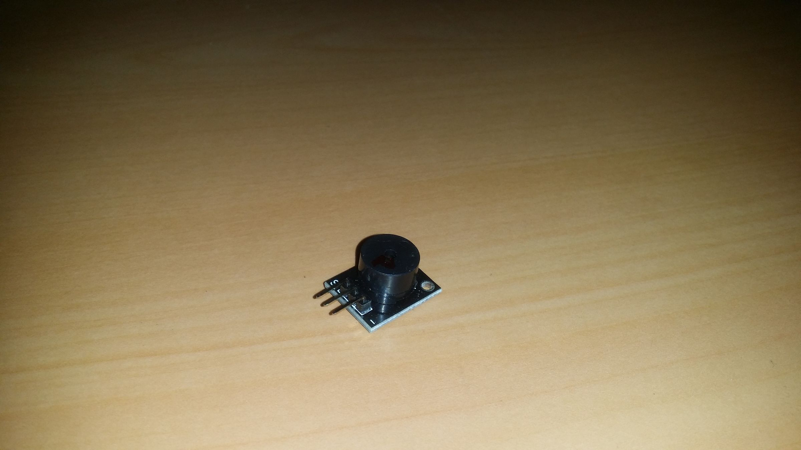
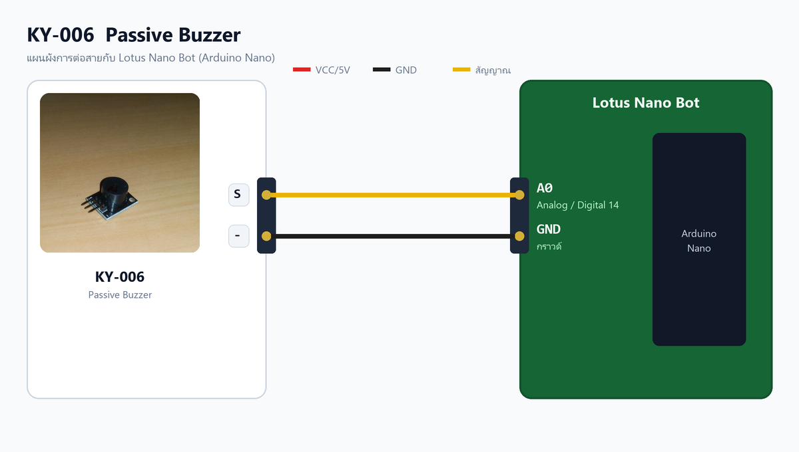

# KY-006 --- Passive Buzzer

## รายละเอียด

Passive Buzzer เป็นบัซเซอร์แบบไม่มีวงจรสั่นในตัว ต้องใส่สัญญาณ PWM (ความถี่) เพื่อให้เกิดเสียง สามารถควบคุมความถี่และโน้ตเพลงได้

> **สำคัญ:** Lotus Nano Bot มีบัซเซอร์ในตัวเชื่อมต่อที่ D3 แล้ว (ใช้ `tone(3, ...)` ได้ทันทีโดยไม่ต้องต่อสาย) หากต้องการใช้บัซเซอร์ภายนอกให้ต่อที่ A0-A3 (D14-D17) เพราะ D4-D12 ถูกใช้กับมอเตอร์และเซอร์โวแล้ว

## คุณสมบัติ

- แรงดันไฟฟ้า: 3.3V - 5V DC
- ความถี่ทำงาน: 2 kHz - 5 kHz
- ต้องใช้สัญญาณ PWM / tone()
- สามารถเล่นโน้ตเพลงได้

## ขาของ Passive Buzzer

| ขา (Buzzer) | สีสาย | เชื่อมต่อกับ (Lotus Nano Bot) |
|-------------|-------|------------------------------|
| Signal (S หรือ +) | แดง/เหลือง | A0 (D14) หรือ A1-A3 (D15-D17) |
| GND (-)     | ดำ   | GND                           |

> **หมายเหตุ:** โมดูล KY-006 มีขา S (Signal), ขากลาง และ - (GND) ให้ต่อ S เข้าขาสัญญาณและ - เข้า GND (ขากลางไม่จำเป็นต้องต่อ) ห้ามต่อขาสัญญาณเข้า 5V ตรงๆ เพราะ Passive Buzzer ต้องการสัญญาณความถี่จาก `tone()` ซึ่งใช้ได้กับทุกขาดิจิทัล ไม่จำเป็นต้องเป็นขา PWM

## การต่อสายไฟ

```
Passive Buzzer           Lotus Nano Bot
━━━━━━━━━━━━━━━━━━━━━━━━━━━━━━━━━━━━━━━━
S   (+) ───────────────► A0 (D14)
GND (-) ───────────────► GND
```

### ภาพการต่อสาย (Text Diagram)

```
        +------------------+
        |  Passive Buzzer  |
        |    (+)  (-)      |
        +----+----+---------+
             |      |
             |      |
        +----+----+  +----+----+
        |   A0    |  |  GND    |
        | (D14)   |  |         |
        |  Lotus  |  |  Nano   |
        |  Nano   |  |  Bot    |
        +---------+  +---------+
```

## โค้ดตัวอย่าง

```cpp
// Passive Buzzer Example for Lotus Nano Bot
// Signal -> A0 (D14), GND -> GND
// หากต้องการใช้บัซเซอร์บนบอร์ดแทน ให้เปลี่ยนเป็น 3 (D3)

#define BUZZER_PIN 14  // A0 หรือ 15-17 (A1-A3), 3 = บัซเซอร์บนบอร์ด

void setup() {
  Serial.begin(9600);
  pinMode(BUZZER_PIN, OUTPUT);
  Serial.println("Passive Buzzer Test Started");
}

void loop() {
  // ส่งสัญญาณความถี่ต่างๆ
  tone(BUZZER_PIN, 1000, 500);  // 1000 Hz, 500 ms
  delay(1000);
  
  tone(BUZZER_PIN, 2000, 500);  // 2000 Hz, 500 ms
  delay(1000);
  
  tone(BUZZER_PIN, 3000, 500);  // 3000 Hz, 500 ms
  delay(1000);
}
```

## โค้ดตัวอย่างเล่นเพลง

```cpp
#define BUZZER_PIN 14  // A0 (บัซเซอร์ภายนอก) หรือ 3 = บัซเซอร์บนบอร์ด

// ความถี่โน้ต (Hz)
#define NOTE_C4  262
#define NOTE_D4  294
#define NOTE_E4  330
#define NOTE_F4  349
#define NOTE_G4  392
#define NOTE_A4  440
#define NOTE_B4  494
#define NOTE_C5  523

int melody[] = {
  NOTE_C4, NOTE_D4, NOTE_E4, NOTE_F4, 
  NOTE_G4, NOTE_A4, NOTE_B4, NOTE_C5
};

int noteDurations[] = {
  4, 4, 4, 4, 4, 4, 4, 4
};

void setup() {
  pinMode(BUZZER_PIN, OUTPUT);
}

void loop() {
  for (int i = 0; i < 8; i++) {
    int noteDuration = 1000 / noteDurations[i];
    tone(BUZZER_PIN, melody[i], noteDuration);
    delay(noteDuration * 1.30);
    noTone(BUZZER_PIN);
  }
  
  delay(2000);
}
```

## หมายเหตุ

- **Lotus Nano Bot มีบัซเซอร์ในตัวที่ D3** สามารถใช้ `tone(3, freq, duration)` ได้เลย
- Passive Buzzer ต่างจาก Active Buzzer: ต้องใส่สัญญาณ PWM เอง
- หากต้องการใช้บัซเซอร์ภายนอกเพิ่ม ใช้ A0-A3 (D14-D17) ห้ามใช้ D5/D6/D9/D10/D11 เพราะชนกับมอเตอร์และเซอร์โวบนบอร์ด
- `tone()` เล่นได้ทีละ 1 ขาเท่านั้น และใช้ Timer2 ทำให้ `analogWrite()` บน D3/D11 ใช้ไม่ได้ระหว่างเล่นเสียง
- ใช้ `noTone(pin)` เพื่อหยุดเสียง

## กิจกรรมการเรียนรู้

### จุดประสงค์การเรียนรู้
1. นักเรียนสามารถใช้คำสั่ง `tone()` และ `noTone()` สร้างเสียงตามความถี่ที่กำหนดได้
2. นักเรียนสามารถอธิบายความสัมพันธ์ระหว่างความถี่ (Hz) กับระดับเสียงสูง-ต่ำได้
3. นักเรียนสามารถเขียนโปรแกรมเล่นทำนองเพลงสั้นๆ โดยใช้อาร์เรย์ได้

### ขั้นตอนการทดลอง
1. ต่อขา S -> A0 และ - -> GND แล้วอัปโหลดโค้ดตัวอย่างแรก ฟังเสียง 1000, 2000, 3000 Hz
2. แก้ค่าความถี่เป็น 200, 500, 5000 Hz แล้วบันทึกความรู้สึกของระดับเสียงและความดัง
3. อัปโหลดโค้ดเล่นเพลง ฟังโน้ต C4-C5 แล้วลองเปลี่ยนค่าใน `noteDurations[]` เป็น 8
4. เปลี่ยน `BUZZER_PIN` เป็น 3 แล้วเปรียบเทียบเสียงจากบัซเซอร์บนบอร์ดกับบัซเซอร์ภายนอก

### ตารางบันทึกผล
| ครั้งที่ | สภาวะ/การกระทำ | ค่าที่อ่านได้ | ผลที่สังเกตได้ |
|---|---|---|---|
| 1 | `tone()` 200 Hz | | |
| 2 | `tone()` 1000 Hz | | |
| 3 | `tone()` 3000 Hz | | |
| 4 | `noteDurations` = 8 แทน 4 | | |

### คำถามท้ายการทดลอง
1. Passive Buzzer ต่างจาก Active Buzzer อย่างไร
2. ความถี่ใดที่ได้ยินเสียงดังที่สุด และเมื่อเพิ่มความถี่ระดับเสียงเปลี่ยนไปอย่างไร
3. จะนำบัซเซอร์ไปใช้ในหุ่นยนต์เพื่อแจ้งสถานะต่างๆ ได้อย่างไร

<details>
<summary>แนวคำตอบ (สำหรับครู)</summary>

1. Passive Buzzer ไม่มีวงจรกำเนิดความถี่ในตัว ต้องป้อนสัญญาณความถี่เอง จึงเปลี่ยนโน้ตได้ ส่วน Active Buzzer ป้อนไฟ DC ก็ดังแต่ได้เสียงเดียว
2. มักดังที่สุดช่วงประมาณ 2-4 kHz (ใกล้ความถี่เรโซแนนซ์) ความถี่สูงขึ้นเสียงจะแหลมขึ้น
3. เช่น เสียงเริ่มทำงาน, เสียงเตือนเมื่อเจอสิ่งกีดขวาง, เสียงต่างกันสำหรับแต่ละโหมดการทำงาน

</details>

### ภารกิจท้าทาย
- ทำ "เปียโนปุ่มหมุน": อ่านค่า Knob A7 (0-1023) แล้ว `map()` เป็นความถี่ 200-2000 Hz เล่นผ่านบัซเซอร์ เมื่อกดปุ่ม D2 จึงมีเสียง และแสดงความถี่บนจอ OLED

## รูปภาพ





