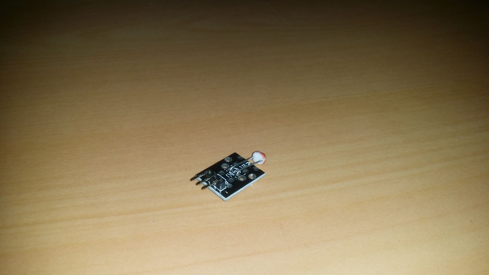
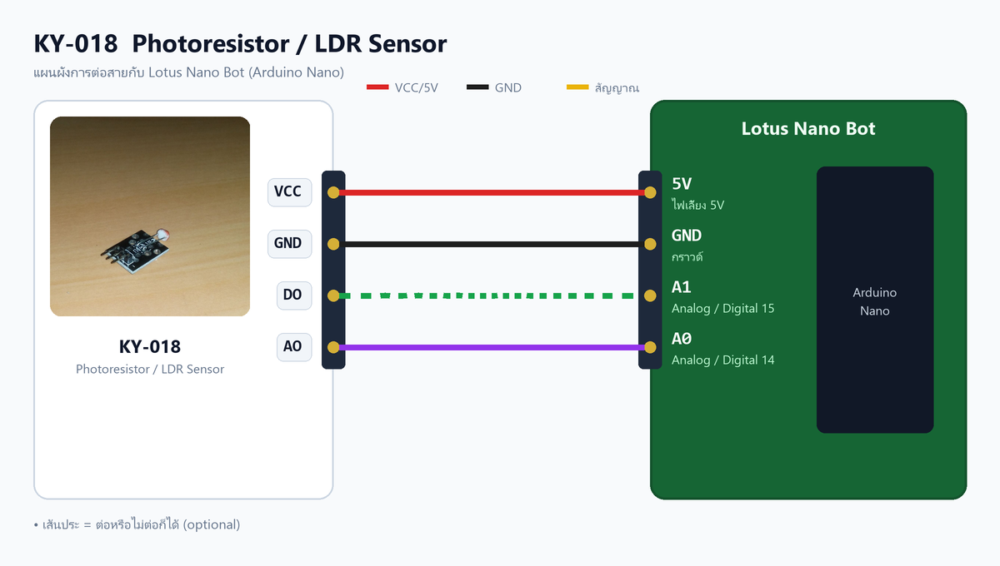

# KY-018 --- Photoresistor / LDR Sensor

## รายละเอียด

Photoresistor หรือ Light Dependent Resistor (LDR) เป็นตัวต้านทานที่มีค่าเปลี่ยนไปตามความเข้มของแสง ยิ่งแสงสว่างมาก ค่าต้านทานยิ่งต่ำ โมดูลนี้มีวงจรเปรียบเทียบในตัวเพื่อให้เอาต์พุตดิจิตอลและอนาลอก

## คุณสมบัติ

- แรงดันไฟฟ้า: 3.3V - 5V DC
- เอาต์พุต: Digital (DO) และ Analog (AO)
- มีตัวปรับความไว (Potentiometer)
- มี LED แสดงสถานะ

## ขาของโมดูล

| ขา (Module) | สีสาย | เชื่อมต่อกับ (Lotus Nano Bot) |
|-------------|-------|------------------------------|
| VCC         | แดง   | 5V                           |
| GND         | ดำ/น้ำตาล | GND                       |
| DO (Digital)| เหลือง | D3 หรือ A1 (D15)            |
| AO (Analog) | ขาว   | A0 (หรือ A2, A3, A6)        |

> **⚠️ หมายเหตุ:** D3 ใช้โดย Onboard Buzzer ของ Lotus Nano Bot หากต้องการหลีกเลี่ยงให้ใช้ A1 (D15) สำหรับ DO (ห้ามใช้ขาเดียวกับ AO)
>
> **หมายเหตุ:** โมดูล KY-018 แบบ 3 ขา (S, +, -) ให้เอาต์พุต Analog อย่างเดียว ไม่มี DO และ Potentiometer ให้ต่อ S -> A0 แล้วใช้เฉพาะ `analogRead()` (ทิศทางค่ามาก/น้อยอาจกลับกันขึ้นกับการต่อวงจรแบ่งแรงดันของโมดูล)

## การต่อสายไฟ

```
Photoresistor Module     Lotus Nano Bot
━━━━━━━━━━━━━━━━━━━━━━━━━━━━━━━━━━━━━━━━
VCC  ──────────────────► 5V
GND  ──────────────────► GND
DO   ──────────────────► D3 (optional)
AO   ──────────────────► A0
```

### ภาพการต่อสาย (Text Diagram)

```
        +------------------+
        |  Photoresistor   |
        |  / Light Sensor  |
        |     ____         |
        |    /    \        |
   +----+----+   +----+----+   +----+----+   +----+----+
   |  VCC    |   |  GND    |   |  DO     |   |  AO     |
   |   (+)   |   |   (-)   |   | (Digi)  |   | (Anlg)  |
   +----+----+   +----+----+   +----+----+   +----+----+
        |             |             |             |
        |             |             |             |
   +----+----+   +----+----+   +----+----+   +----+----+
   |   5V    |   |  GND    |   |   D3    |   |   A0    |
   |         |   |         |   |         |   |         |
   |  Lotus  |   |  Nano   |   |  Bot    |   |         |
   +---------+   +---------+   +---------+   +---------+
```

## โค้ดตัวอย่าง

```cpp
// Photoresistor / Light Sensor Example
// สำหรับ Lotus Nano Bot
// AO -> A0, DO -> D3

#define LIGHT_ANALOG_PIN A0
#define LIGHT_DIGITAL_PIN 3
#define LED_PIN 13

void setup() {
  Serial.begin(9600);
  pinMode(LIGHT_DIGITAL_PIN, INPUT);
  pinMode(LED_PIN, OUTPUT);
  Serial.println("Photoresistor Test Started");
}

void loop() {
  int analogValue = analogRead(LIGHT_ANALOG_PIN);
  int digitalValue = digitalRead(LIGHT_DIGITAL_PIN);
  
  Serial.print("Analog: ");
  Serial.print(analogValue);
  Serial.print(" | Digital: ");
  Serial.println(digitalValue);
  
  // ค่า Analog: แสงมาก = ค่าน้อย (ใกล้ 0), แสงน้อย = ค่ามาก (ใกล้ 1023)
  if (analogValue > 800) {  // มืด
    Serial.println("🌑 Dark Detected!");
    digitalWrite(LED_PIN, HIGH);
  } else {
    Serial.println("💡 Light Present");
    digitalWrite(LED_PIN, LOW);
  }
  
  delay(500);
}
```

## โค้ดตัวอย่างตรวจจับแสงอาทิตย์ (Sunlight Detection)

```cpp
#define LIGHT_PIN A0

void setup() {
  Serial.begin(9600);
}

void loop() {
  int lightLevel = analogRead(LIGHT_PIN);
  
  // แปลงเป็นความสว่างเปอร์เซ็นต์ (สมมติ)
  // ค่า 1023 = มืดสนิท, 0 = สว่างมาก
  int brightness = map(lightLevel, 0, 1023, 100, 0);
  
  Serial.print("Light Level: ");
  Serial.print(brightness);
  Serial.println("%");
  
  if (brightness > 80) {
    Serial.println("☀️  Bright Sunlight");
  } else if (brightness > 40) {
    Serial.println("⛅ Cloudy / Indoor");
  } else {
    Serial.println("🌑 Dark");
  }
  
  delay(500);
}
```

## หมายเหตุ

- ค่า Analog: แสงสว่าง = ค่าน้อย, แสงน้อย = ค่ามาก (เพราะเป็น Voltage Divider)
- หมุนตัวปรับค่าให้ LED เปลี่ยนสถานะตรงจุดที่ต้องการ
- ใช้ได้กับการตรวจจับความมืด/สว่าง, สวิตช์แสงอัตโนมัติ
- ตอบสนองช้ากว่า Photodiode แต่ใช้งานง่ายกว่า

## กิจกรรมการเรียนรู้

### จุดประสงค์การเรียนรู้
1. นักเรียนสามารถอ่านค่าความเข้มแสงจาก LDR ด้วย `analogRead()` ได้
2. นักเรียนสามารถใช้ `map()` แปลงค่า 0-1023 เป็นเปอร์เซ็นต์ความสว่างได้
3. นักเรียนสามารถกำหนดค่า Threshold เพื่อเปิด LED อัตโนมัติเมื่อมืดได้

### ขั้นตอนการทดลอง
1. ต่อ AO -> A0 (และ DO -> D3 ถ้ามี) แล้วอัปโหลดโค้ดตัวอย่างแรก
2. เปิด Serial Monitor บันทึกค่า Analog ในห้องปกติ, ใต้ไฟฉายมือถือ และเมื่อใช้มือปิดเซนเซอร์
3. ปรับค่า 800 ในโค้ดให้เหมาะกับห้องเรียน แล้วทดสอบว่า LED D13 ติดเมื่อมืดจริง
4. อัปโหลดโค้ด Sunlight Detection แล้วบันทึกค่าเปอร์เซ็นต์ในแต่ละสภาวะ

### ตารางบันทึกผล
| ครั้งที่ | สภาวะ/การกระทำ | ค่าที่อ่านได้ | ผลที่สังเกตได้ |
|---|---|---|---|
| 1 | แสงในห้องปกติ | | |
| 2 | ส่องไฟฉายมือถือใกล้เซนเซอร์ | | |
| 3 | ใช้มือปิดเซนเซอร์จนมืด | | |
| 4 | วางใกล้หน้าต่าง/แสงธรรมชาติ | | |

### คำถามท้ายการทดลอง
1. ค่าความต้านทานของ LDR เปลี่ยนแปลงอย่างไรเมื่อแสงมากขึ้น
2. จากตาราง ค่า Analog เพิ่มหรือลดเมื่อแสงมากขึ้น และสอดคล้องกับวงจรแบ่งแรงดันอย่างไร
3. จะนำ LDR ไปใช้ทำไฟถนนอัตโนมัติหรือหุ่นยนต์วิ่งตามแสงได้อย่างไร

<details>
<summary>แนวคำตอบ (สำหรับครู)</summary>

1. แสงมากขึ้น ความต้านทานของ LDR ลดลง
2. ในโมดูลนี้แสงมากค่าจะลดลง (ใกล้ 0) เพราะ LDR อยู่ในวงจรแบ่งแรงดัน เมื่อความต้านทานลด แรงดันที่จุดวัดจึงเปลี่ยน (บางโมดูลต่อกลับด้านค่าจะเพิ่มขึ้นแทน)
3. ไฟถนน: เปิดไฟเมื่อค่าเกิน Threshold ความมืด หุ่นวิ่งตามแสง: ใช้ LDR 2 ตัวซ้าย-ขวา แล้วเลี้ยวไปทางที่สว่างกว่า

</details>

### ภารกิจท้าทาย
- แสดงเปอร์เซ็นต์ความสว่างบนจอ OLED และใช้ Knob A7 ปรับค่า Threshold ความมืด เมื่อมืดกว่าค่าที่ตั้งไว้ให้บัซเซอร์ D3 ส่งเสียงเตือนสั้นๆ

## รูปภาพ





