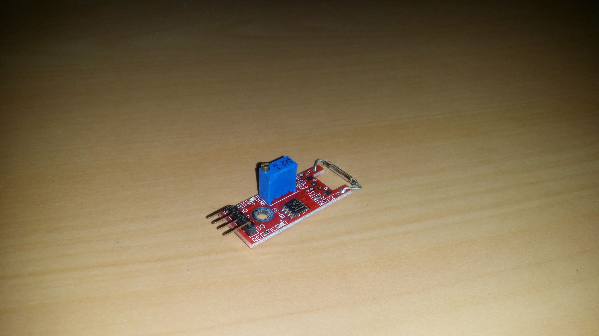
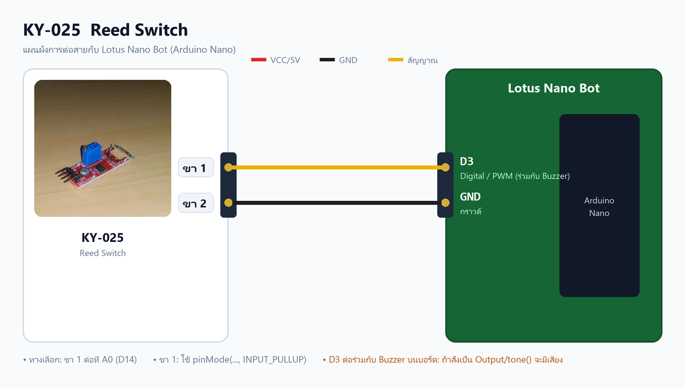

# KY-025 --- Reed Switch

## รายละเอียด

Reed Switch เป็น Switch แม่เหล็กแบบ Passive ทำงานโดยใช้แผ่นโลหะยืดหยุ่นสองแผ่นภายในหลอดแก้ว เมื่อมีสนามแม่เหล็กเข้าใกล้ แผ่นโลหะจะสัมผัสกันทำให้ไฟฟ้าไหลผ่าน

## คุณสมบัติ

- ไม่ใช้แรงดันไฟฟ้า (Switch แบบ Passive)
- ทำงานเหมือน Switch ธรรมดา
- ตรวจจับสนามแม่เหล็ก
- อายุการใช้งานยาวนาน

## ขาของ Reed Switch

| ขา (Switch) | สีสาย | เชื่อมต่อกับ (Lotus Nano Bot) |
|-------------|-------|------------------------------|
| ขา 1        | สีใดก็ได้ | D3 หรือ A0 (D14) (ผ่าน Pull-up) |
| ขา 2        | สีใดก็ได้ | GND                         |

> **หมายเหตุ:** ใช้ `INPUT_PULLUP` หรือต่อตัวต้านทาน Pull-up 10KΩ ระหว่างขา 1 และ 5V
>
> **หมายเหตุ:** หากใช้โมดูล KY-025 แบบ 4 ขา (AO, G, +, DO) ที่มีวงจรเปรียบเทียบ ให้ต่อ + -> 5V, G -> GND, DO -> D3 หรือ A0 (ไม่ต้องใช้ Pull-up) ระดับลอจิกของ DO อาจกลับกับตัวอย่างนี้ ให้ตรวจสอบด้วย Serial Monitor

## การต่อสายไฟ

```
Reed Switch              Lotus Nano Bot
━━━━━━━━━━━━━━━━━━━━━━━━━━━━━━━━━━━━━━━━
ขา 1 ──────────────────► D3 หรือ A0 (D14) (INPUT_PULLUP)
ขา 2 ──────────────────► GND
```

### ภาพการต่อสาย (Text Diagram)

```
        +------------------+
        |   Reed Switch    |
        |  (Magnetic)      |
        |    ====          |
        +----+------+------+
             |      |
             |      |
        +----+----+  +----+----+
        |   D3    |  |  GND    |
        | (Input) |  |         |
        |  Lotus  |  |  Nano   |
        |  Nano   |  |  Bot    |
        +---------+  +---------+
```

## โค้ดตัวอย่าง

```cpp
// Reed Switch Example for Lotus Nano Bot
// ต่อขา 1 -> D3, ขา 2 -> GND

#define REED_PIN 3
#define LED_PIN 13  // ใช้ built-in LED ของ Nano

void setup() {
  Serial.begin(9600);
  pinMode(REED_PIN, INPUT_PULLUP);
  pinMode(LED_PIN, OUTPUT);
  Serial.println("Reed Switch Test Started");
}

void loop() {
  int state = digitalRead(REED_PIN);
  
  // INPUT_PULLUP: ไม่มีแม่เหล็ก = HIGH, มีแม่เหล็ก = LOW (สัมผัส)
  if (state == LOW) {
    Serial.println("🧲 Magnet Detected! Switch CLOSED");
    digitalWrite(LED_PIN, HIGH);
  } else {
    Serial.println("❌ No Magnet - Switch OPEN");
    digitalWrite(LED_PIN, LOW);
  }
  
  delay(200);
}
```

## โค้ดตัวอย่างประตูอัจฉริยะ

```cpp
// ต่อขา 1 -> A0 (D14) เพราะ D3 ใช้กับบัซเซอร์บนบอร์ด
#define REED_PIN 14   // A0
#define BUZZER_PIN 3  // บัซเซอร์บนบอร์ด

bool doorOpen = false;

void setup() {
  Serial.begin(9600);
  pinMode(REED_PIN, INPUT_PULLUP);
}

void loop() {
  int state = digitalRead(REED_PIN);
  
  if (state == HIGH && !doorOpen) {
    doorOpen = true;
    Serial.println("🚪 Door OPENED!");
    tone(BUZZER_PIN, 1000, 200);
  }
  
  if (state == LOW && doorOpen) {
    doorOpen = false;
    Serial.println("🚪 Door CLOSED");
    tone(BUZZER_PIN, 500, 100);
  }
  
  delay(100);
}
```

## หมายเหตุ

- ใช้ `INPUT_PULLUP` เพื่อไม่ต้องต่อตัวต้านทาน Pull-up ภายนอก
- สนามแม่เหล็กที่ตรวจจับได้ขึ้นอยู่กับความแรงและระยะห่าง
- เหมาะสำหรับตรวจจับประตู/หน้าต่างเปิด-ปิด
- บน Lotus Nano Bot ใช้ D3 หรือ A0-A3 เป็น Digital Input ได้
- D3 ต่อร่วมกับบัซเซอร์บนบอร์ด อาจได้ยินเสียงคลิกเบาๆ เมื่อสัญญาณเปลี่ยน หากไม่ต้องการให้ย้ายไป A0-A3 (D14-D17)

## กิจกรรมการเรียนรู้

### จุดประสงค์การเรียนรู้
1. นักเรียนสามารถต่อ Reed Switch และอ่านสถานะด้วย `INPUT_PULLUP` ได้
2. นักเรียนสามารถวัดระยะการทำงานของ Reed Switch กับแม่เหล็กได้
3. นักเรียนสามารถเขียนโปรแกรมตรวจจับการเปลี่ยนสถานะ (เปิด/ปิดประตู) ได้

### ขั้นตอนการทดลอง
1. ต่อขา 1 -> D3 ขา 2 -> GND แล้วอัปโหลดโค้ดตัวอย่างแรก
2. เลื่อนแม่เหล็กเข้าหา Reed Switch ทีละ 0.5 cm บันทึกระยะที่สถานะเปลี่ยนเป็น CLOSED
3. ดึงแม่เหล็กออกช้าๆ บันทึกระยะที่สถานะกลับเป็น OPEN
4. ย้ายขา 1 ไป A0 แล้วอัปโหลดโค้ดประตูอัจฉริยะ จำลองการเปิด-ปิดประตู 3 ครั้ง

### ตารางบันทึกผล
| ครั้งที่ | สภาวะ/การกระทำ | ค่าที่อ่านได้ | ผลที่สังเกตได้ |
|---|---|---|---|
| 1 | ไม่มีแม่เหล็ก | | |
| 2 | แม่เหล็กเข้าใกล้ (ระยะที่สวิตช์ปิด) | | |
| 3 | ดึงแม่เหล็กออก (ระยะที่สวิตช์เปิด) | | |
| 4 | จำลองเปิดประตู (โค้ดประตูอัจฉริยะ) | | |

### คำถามท้ายการทดลอง
1. Reed Switch ทำงานได้อย่างไรโดยไม่ต้องใช้ไฟเลี้ยง
2. ระยะที่สวิตช์ปิดกับระยะที่สวิตช์เปิดเท่ากันหรือไม่ เพราะเหตุใด
3. ในโค้ดประตูอัจฉริยะ ทำไมต้องใช้ตัวแปร `doorOpen` แทนการเช็คเพียง `state`

<details>
<summary>แนวคำตอบ (สำหรับครู)</summary>

1. สนามแม่เหล็กเหนี่ยวนำให้แผ่นโลหะสองแผ่นในหลอดแก้วดูดเข้าหากันและสัมผัสกัน เป็นสวิตช์เชิงกล
2. มักไม่เท่ากัน ระยะปล่อยมักน้อยกว่าระยะดูด (Hysteresis) เพราะต้องใช้สนามน้อยกว่าในการคงสภาพการสัมผัส
3. เพื่อให้ส่งเสียงเพียงครั้งเดียวตอนที่สถานะเปลี่ยน (Edge Detection) ไม่ดังซ้ำทุกรอบของ `loop()`

</details>

### ภารกิจท้าทาย
- สร้างสัญญาณกันขโมย: กดปุ่ม D2 เพื่อ "ติดตั้งระบบ" (แสดง ARMED บน OLED) เมื่อประตูถูกเปิดขณะติดตั้งระบบให้บัซเซอร์ D3 ดังจนกว่าจะกด D2 อีกครั้ง

## รูปภาพ





