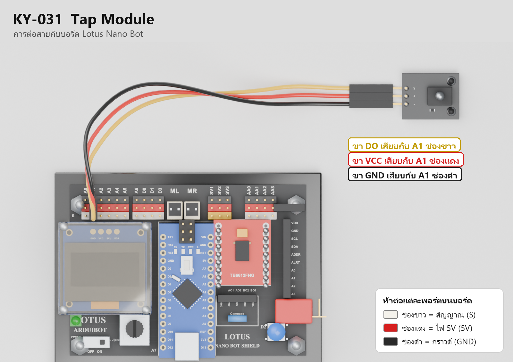
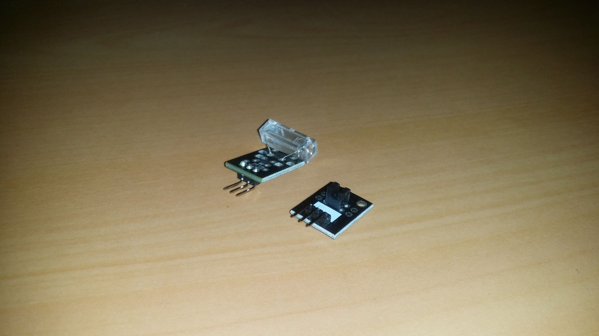
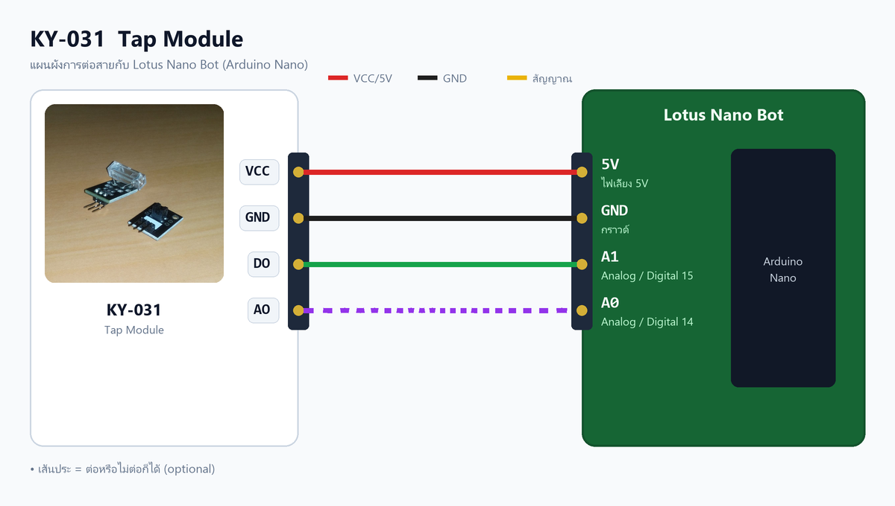

# KY-031 --- Tap Module

## รายละเอียด

Tap Module หรือ Knock Sensor เป็นเซนเซอร์ตรวจจับการเคาะ/การกระแทก ใช้สปริงโลหะภายในทำหน้าที่เป็นสวิตช์เมื่อถูกเคาะ (บางรุ่นใช้ Piezo Element) บางรุ่นมีวงจรเปรียบเทียบในตัว

> **หมายเหตุ:** โมดูล KY-031 ส่วนใหญ่มี 3 ขา (S, +, -) ให้เอาต์พุต Digital อย่างเดียว หากโมดูลไม่มี AO ให้ต่อขา S เข้า A1 แทน DO และตัดส่วน `analogRead()` ออกจากโค้ด

## คุณสมบัติ

- แรงดันไฟฟ้า: 3.3V - 5V DC
- เอาต์พุต: Digital (DO) และ Analog (AO)
- มี LED แสดงสถานะ
- มีตัวปรับความไว (Potentiometer)

## ขาของโมดูล

| ขา (Module) | สีสาย | เชื่อมต่อกับ (Lotus Nano Bot) |
|-------------|-------|------------------------------|
| VCC         | แดง   | 5V                           |
| GND         | ดำ/น้ำตาล | GND                       |
| DO (Digital)| เหลือง | A1 (D15)                     |
| AO (Analog) | ขาว   | A0                           |

> ต่อที่หัวต่อพอร์ต A0 และ A1 บนบอร์ด: ช่องขาว = S (AO เข้า A0, DO เข้า A1), ช่องแดง = 5V, ช่องดำ = GND

## การต่อสายไฟ

```
Tap Module               Lotus Nano Bot
━━━━━━━━━━━━━━━━━━━━━━━━━━━━━━━━━━━━━━━━
VCC  ──────────────────► 5V
GND  ──────────────────► GND
DO   ──────────────────► A1 (D15)
AO   ──────────────────► A0 (optional)
```

### ภาพการต่อสายกับบอร์ด



## โค้ดตัวอย่าง

```cpp
// Tap / Knock Sensor Example for Lotus Nano Bot
// DO -> A1 (D15), AO -> A0

#define TAP_DIGITAL_PIN 15  // A1
#define TAP_ANALOG_PIN A0
#define BUZZER_PIN 3  // บัซเซอร์บนบอร์ด Lotus Nano Bot

void setup() {
  Serial.begin(9600);
  pinMode(TAP_DIGITAL_PIN, INPUT);
  Serial.println("Tap Sensor Test Started");
}

void loop() {
  int tap = digitalRead(TAP_DIGITAL_PIN);
  int knockValue = analogRead(TAP_ANALOG_PIN);
  
  if (tap == HIGH) {  // ตรวจพบการเคาะ
    Serial.print("🔔 Knock Detected! Analog: ");
    Serial.println(knockValue);
    tone(BUZZER_PIN, 1000, 100);
    delay(300);  // Debounce
  }
  
  delay(10);
}
```

## โค้ดตัวอย่าง Knock Lock (รหัสเคาะ)

```cpp
// DO -> A1 (D15)
#define TAP_PIN 15  // A1

unsigned long knockTimes[5];
int knockIndex = 0;
unsigned long lastKnock = 0;

void setup() {
  Serial.begin(9600);
  pinMode(TAP_PIN, INPUT);
  Serial.println("Knock Lock - Tap 3 times to unlock");
}

void loop() {
  if (digitalRead(TAP_PIN) == HIGH) {
    unsigned long now = millis();
    
    if (now - lastKnock > 100) {  // Debounce
      knockTimes[knockIndex] = now;
      knockIndex++;
      lastKnock = now;
      
      Serial.print("Knock #");
      Serial.println(knockIndex);
      
      if (knockIndex >= 3) {
        Serial.println("🔓 UNLOCKED!");
        tone(3, 2000, 500);  // บัซเซอร์บนบอร์ด
        knockIndex = 0;
      }
    }
    delay(300);
  }
}
```

## หมายเหตุ

- หมุนตัวปรับค่าเพื่อกำหนดความไวในการตรวจจับ
- ควรใช้ Debounce ในโค้ดเพื่อป้องกันการอ่านค่าซ้ำ
- วางโมดูลบนพื้นผิวที่ต้องการตรวจจับการเคาะ
- บน Lotus Nano Bot ใช้ A0-A3 เป็น Digital Input ได้ (A0=Pin14, A1=Pin15, A2=Pin16, A3=Pin17)

## กิจกรรมการเรียนรู้

### จุดประสงค์การเรียนรู้
1. นักเรียนสามารถอ่านสัญญาณการเคาะจาก Tap Module และตอบสนองด้วยเสียงบัซเซอร์ได้
2. นักเรียนสามารถอธิบายความจำเป็นของ Debounce ในการนับการเคาะได้
3. นักเรียนสามารถเขียนโปรแกรมนับจำนวนการเคาะเพื่อปลดล็อกได้

### ขั้นตอนการทดลอง
1. ต่อ DO -> A1 (และ AO -> A0 ถ้ามี) แล้วอัปโหลดโค้ดตัวอย่างแรก
2. เคาะโมดูลเบาๆ ปานกลาง และแรง อย่างละ 3 ครั้ง บันทึกว่าบัซเซอร์ดังกี่ครั้ง
3. วางโมดูลบนโต๊ะแล้วเคาะที่โต๊ะห่างออกไป 10 cm สังเกตว่าตรวจจับได้หรือไม่
4. อัปโหลดโค้ด Knock Lock แล้วเคาะ 3 ครั้งเพื่อปลดล็อก

### ตารางบันทึกผล
| ครั้งที่ | สภาวะ/การกระทำ | ค่าที่อ่านได้ | ผลที่สังเกตได้ |
|---|---|---|---|
| 1 | เคาะเบาๆ ที่โมดูล | | |
| 2 | เคาะแรงที่โมดูล | | |
| 3 | เคาะที่โต๊ะห่าง 10 cm | | |
| 4 | เคาะ 3 ครั้ง (Knock Lock) | | |

### คำถามท้ายการทดลอง
1. Tap Module ตรวจจับการเคาะได้อย่างไร
2. ถ้าเอา `delay(300)` ออก จำนวนครั้งที่นับได้ต่อการเคาะ 1 ครั้งจะเปลี่ยนไปอย่างไร
3. จะนำ Tap Module ไปใช้กับหุ่นยนต์ได้อย่างไร

<details>
<summary>แนวคำตอบ (สำหรับครู)</summary>

1. แรงกระแทกทำให้สปริงภายในสั่นไปแตะหน้าสัมผัส (หรือ Piezo สร้างแรงดัน) สัญญาณเอาต์พุตจึงเปลี่ยนสถานะชั่วขณะ
2. จะนับได้หลายครั้งต่อการเคาะ 1 ครั้ง เพราะสปริงสั่นและเด้งหลายรอบ (Bouncing)
3. เช่น เคาะเพื่อสั่งให้หุ่นเริ่มทำงาน หรือติดที่กันชนเพื่อตรวจจับการชนแล้วหยุดมอเตอร์

</details>

### ภารกิจท้าทาย
- ทำรหัสเคาะ: ต้องเคาะ 3 ครั้งภายใน 2 วินาทีจึงจะหมุนเซอร์โว D10 ไปที่ 90° (เปิดกลอน) พร้อมแสดง "UNLOCKED" บน OLED และกดปุ่ม D2 เพื่อล็อกกลับที่ 0°

## รูปภาพ





