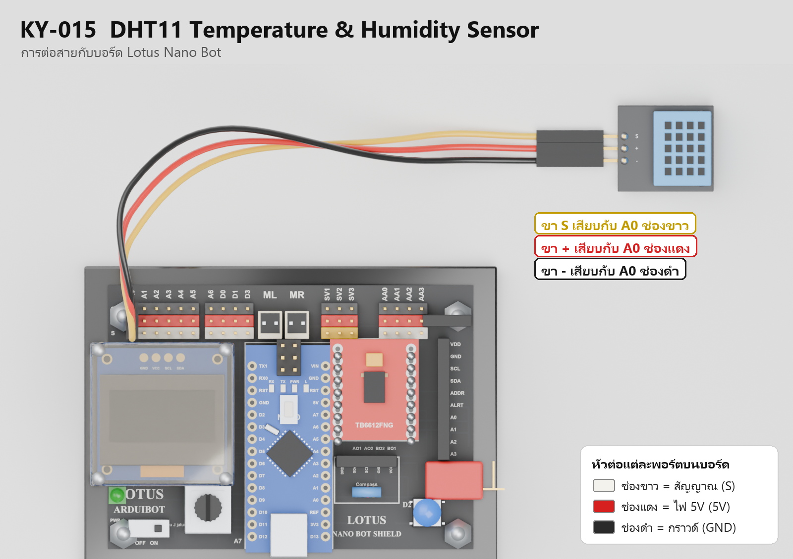
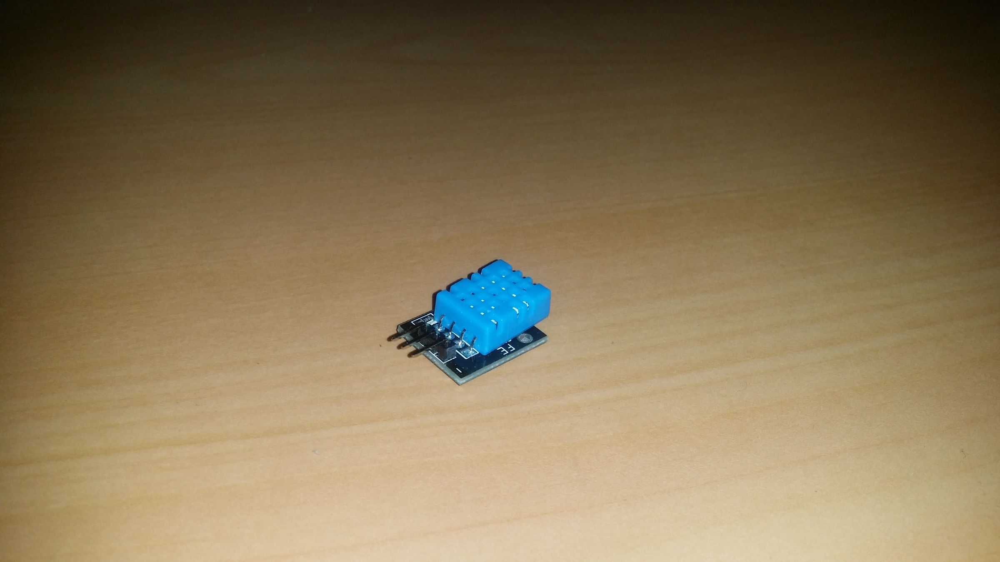
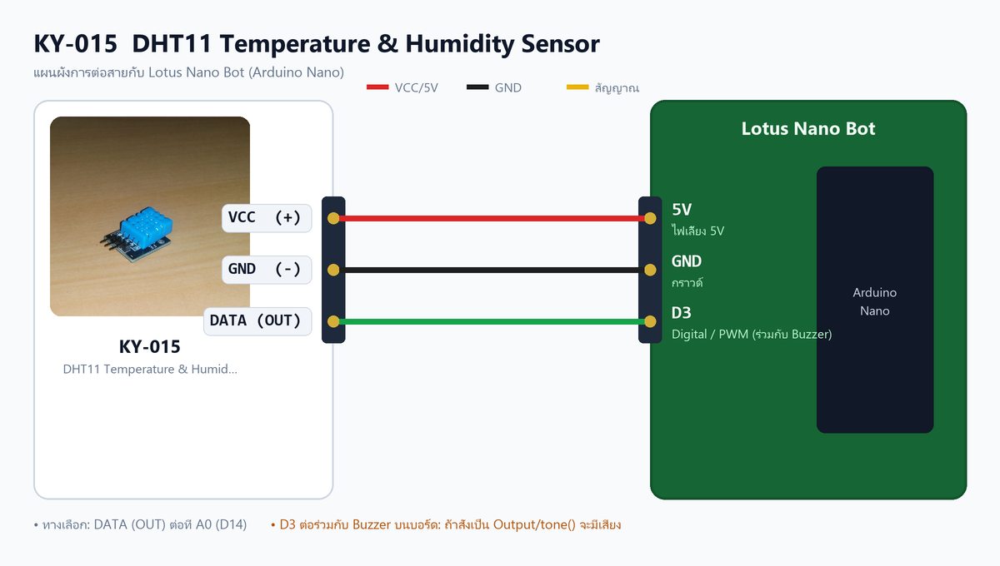

# KY-015 --- DHT11 Temperature & Humidity Sensor

## รายละเอียด

เซนเซอร์อุณหภูมิและความชื้น DHT11/DHT22 เป็นเซนเซอร์ดิจิตอลที่ใช้วัดอุณหภูมิและความชื้นสัมพัทธ์ในอากาศ DHT22 มีความแม่นยำสูงกว่า DHT11

## คุณสมบัติ

- แรงดันไฟฟ้า: 3.3V - 5V DC
- DHT11: อุณหภูมิ 0-50°C (±2°C), ความชื้น 20-90% RH (±5%)
- DHT22: อุณหภูมิ -40-80°C (±0.5°C), ความชื้น 0-100% RH (±2%)
- สื่อสารแบบ Single-Wire Digital (โปรโตคอลเฉพาะของ DHT ไม่ใช่ 1-Wire ของ Dallas)

## ขาของเซนเซอร์

| ขา (Sensor) | สีสาย | เชื่อมต่อกับ (Lotus Nano Bot) |
|-------------|-------|------------------------------|
| S (DATA)    | ขาว   | A0 (D14)                     |
| + (VCC)     | แดง   | 5V                           |
| - (GND)     | ดำ    | GND                          |

> ต่อที่หัวต่อพอร์ต A0 บนบอร์ด: ช่องขาว = S, ช่องแดง = 5V, ช่องดำ = GND
>
> **หมายเหตุ:** โมดูล KY-015 มี 3 ขา (S, +, -) ขา S คือ DATA หากใช้ตัว DHT11/DHT22 เปล่าแบบ 4 ขา ขาที่ 3 (NC) ไม่ต้องต่อ

## การต่อสายไฟ

```
DHT11/DHT22              Lotus Nano Bot
━━━━━━━━━━━━━━━━━━━━━━━━━━━━━━━━━━━━━━━━
S    ──────────────────► A0 (D14)
+    ──────────────────► 5V
-    ──────────────────► GND
```

> **สำคัญ:** ต้องต่อตัวต้านทาน Pull-up 10KΩ ระหว่าง DATA และ VCC (บางโมดูลมีมาให้แล้ว)

### ภาพการต่อสายกับบอร์ด



## โค้ดตัวอย่าง

```cpp
// DHT Temperature & Humidity Sensor Example
// สำหรับ Lotus Nano Bot
// S (DATA) -> A0 (D14)

#include "DHT.h"

#define DHT_PIN 14  // A0
#define DHT_TYPE DHT11  // เปลี่ยนเป็น DHT22 ถ้าใช้ DHT22

DHT dht(DHT_PIN, DHT_TYPE);

void setup() {
  Serial.begin(9600);
  dht.begin();
  Serial.println("DHT Sensor Test Started");
}

void loop() {
  // รอ 2 วินาทีระหว่างการอ่าน (DHT11 ต้องการเวลาอย่างน้อย 2 วินาที)
  delay(2000);
  
  float humidity = dht.readHumidity();
  float temperature = dht.readTemperature();
  
  if (isnan(humidity) || isnan(temperature)) {
    Serial.println("❌ Failed to read from DHT sensor!");
    return;
  }
  
  Serial.print("💧 Humidity: ");
  Serial.print(humidity);
  Serial.print(" % | ");
  Serial.print("🌡️  Temperature: ");
  Serial.print(temperature);
  Serial.println(" °C");
}
```

## วิธีติดตั้งไลบรารี

1. เปิด Arduino IDE
2. ไปที่ **Sketch > Include Library > Manage Libraries...**
3. ค้นหา "DHT sensor library" โดย Adafruit
4. คลิก **Install**
5. ติดตั้ง "Adafruit Unified Sensor" ด้วยหากยังไม่มี

## หมายเหตุ

- DHT11 อ่านค่าได้สูงสุดประมาณ 1 ครั้ง/วินาที (แนะนำเว้น 2 วินาที)
- DHT22 อ่านค่าได้ช้ากว่า ต้องเว้นอย่างน้อย 2 วินาทีระหว่างการอ่าน
- หากอ่านค่าไม่ได้ ตรวจสอบการต่อสายและตัวต้านทาน Pull-up
- หลีกเลี่ยงการวางเซนเซอร์ใกล้แหล่งความร้อน

## กิจกรรมการเรียนรู้

### จุดประสงค์การเรียนรู้
1. นักเรียนสามารถติดตั้งไลบรารี DHT และอ่านค่าอุณหภูมิ (°C) และความชื้นสัมพัทธ์ (%RH) ได้
2. นักเรียนสามารถตรวจสอบความผิดพลาดของการอ่านค่าด้วย `isnan()` ได้
3. นักเรียนสามารถเปรียบเทียบการเปลี่ยนแปลงของอุณหภูมิและความชื้นในสภาวะต่างๆ ได้

### ขั้นตอนการทดลอง
1. ติดตั้งไลบรารีตามหัวข้อด้านบน ต่อ S -> A0, + -> 5V, - -> GND แล้วอัปโหลดโค้ดตัวอย่าง
2. เปิด Serial Monitor บันทึกค่าในห้องปกติ 3 ครั้ง (ทุก 2 วินาที)
3. ใช้นิ้วจับเซนเซอร์ 30 วินาที แล้วบันทึกค่าอุณหภูมิ
4. เป่าลมหายใจใส่เซนเซอร์ใกล้ๆ แล้วบันทึกค่าความชื้น และจับเวลาจนค่ากลับสู่ปกติ
5. ถอดสาย S (DATA) ออกชั่วคราว สังเกตข้อความที่แสดง

### ตารางบันทึกผล
| ครั้งที่ | สภาวะ/การกระทำ | ค่าที่อ่านได้ | ผลที่สังเกตได้ |
|---|---|---|---|
| 1 | อากาศในห้องปกติ | | |
| 2 | ใช้นิ้วจับเซนเซอร์ 30 วินาที | | |
| 3 | เป่าลมหายใจใส่เซนเซอร์ | | |
| 4 | ถอดสาย DATA | | |

### คำถามท้ายการทดลอง
1. ความชื้นสัมพัทธ์ (%RH) หมายถึงอะไร
2. เมื่อเป่าลมหายใจ ค่าความชื้นและอุณหภูมิเปลี่ยนอย่างไร และใช้เวลานานเท่าใดในการกลับสู่ปกติ
3. จะนำเซนเซอร์ DHT ไปใช้ทำระบบควบคุมอัตโนมัติ เช่น พัดลมหรือโรงเรือนอย่างไร

<details>
<summary>แนวคำตอบ (สำหรับครู)</summary>

1. อัตราส่วนของไอน้ำที่มีอยู่ในอากาศเทียบกับปริมาณไอน้ำสูงสุดที่อากาศรับได้ที่อุณหภูมินั้น คิดเป็นเปอร์เซ็นต์
2. ความชื้นเพิ่มขึ้นชัดเจน อุณหภูมิเพิ่มเล็กน้อย และใช้เวลาหลายวินาทีถึงนาทีกว่าจะกลับ เพราะเซนเซอร์ตอบสนองช้าและอ่านได้ทุก 1-2 วินาที
3. ตั้งค่าเป้าหมาย เมื่ออุณหภูมิเกินค่าที่ตั้งให้เปิดพัดลม เมื่อความชื้นต่ำให้เปิดระบบพ่นหมอก

</details>

### ภารกิจท้าทาย
- แสดงอุณหภูมิและความชื้นบนจอ OLED ใช้ Knob A7 ตั้งค่าอุณหภูมิเตือน (25-40°C) เมื่ออุณหภูมิเกินค่าที่ตั้ง ให้เซอร์โว D10 หมุนไปมาเหมือนพัดลม

## รูปภาพ





