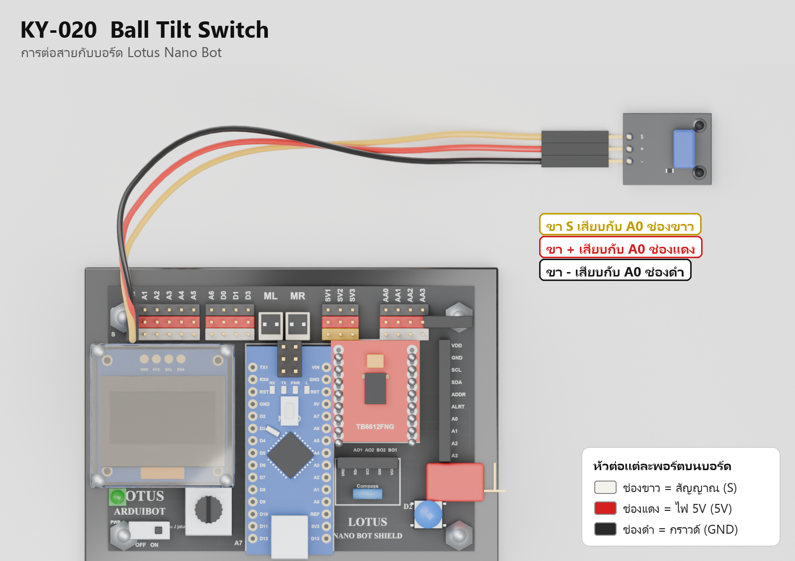
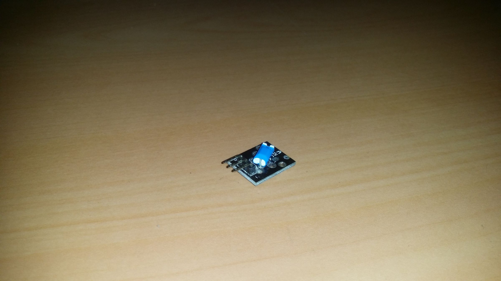
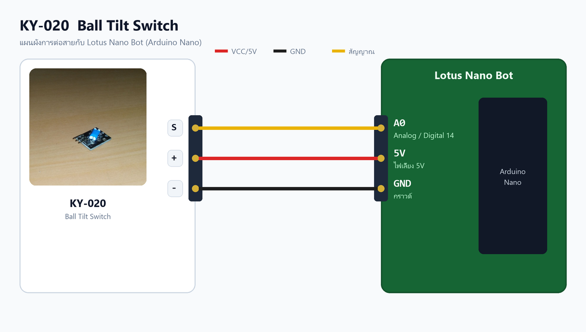

# KY-020 --- Ball Tilt Switch

## รายละเอียด

Tilt Switch แบบ Ball เป็นอุปกรณ์ตรวจจับการเอียงโดยใช้ลูกบอลโลหะภายในหลอด มีความปลอดภัยกว่า Mercury Switch เพราะไม่มีสารพิษ เมื่อเอียงหลอด ลูกบอลจะม้วนไปสัมผัสขาทั้งสองทำให้เป็นตัวนำไฟฟ้า

## คุณสมบัติ

- ไม่ใช้แรงดันไฟฟ้า (Switch แบบ Passive)
- ทำงานเหมือน Switch ธรรมดา
- ปลอดภัย (ไม่มีปรอท)
- ตรวจจับการเอียงหรือการสั่นสะเทือน

## ขาของ Tilt Switch

| ขา (Switch) | สีสาย | เชื่อมต่อกับ (Lotus Nano Bot) |
|-------------|-------|------------------------------|
| S (Signal)  | ขาว   | A0 (D14) (ใช้ `INPUT_PULLUP`) |
| + (VCC)     | แดง   | 5V                           |
| - (GND)     | ดำ    | GND                          |

> ต่อที่หัวต่อพอร์ต A0 บนบอร์ด: ช่องขาว = S, ช่องแดง = 5V, ช่องดำ = GND
>
> **สำคัญ:** โค้ดใช้ `INPUT_PULLUP` ที่ขา S เพื่อให้อ่านค่าได้แน่นอนเมื่อสวิตช์เปิด

## การต่อสายไฟ

```
Tilt Switch              Lotus Nano Bot
━━━━━━━━━━━━━━━━━━━━━━━━━━━━━━━━━━━━━━━━
S    ──────────────────► A0 (D14)
+    ──────────────────► 5V
-    ──────────────────► GND
```

### ภาพการต่อสายกับบอร์ด



## โค้ดตัวอย่าง

```cpp
// Tilt Switch Example for Lotus Nano Bot
// S -> A0 (D14), + -> 5V, - -> GND

#define TILT_PIN 14  // A0
#define LED_PIN 13

void setup() {
  Serial.begin(9600);
  pinMode(TILT_PIN, INPUT_PULLUP);  // ใช้ Pull-up ภายใน
  pinMode(LED_PIN, OUTPUT);
  Serial.println("Tilt Switch Test Started");
}

void loop() {
  int state = digitalRead(TILT_PIN);
  
  // เมื่อหลอดตรง (ลูกบอลไม่สัมผัส): HIGH (Pull-up)
  // เมื่อหลอดเอียง (ลูกบอลสัมผัส): LOW
  if (state == LOW) {
    Serial.println("⚡ Tilt Switch CLOSED (Tilted!)");
    digitalWrite(LED_PIN, HIGH);
  } else {
    Serial.println("🔌 Tilt Switch OPEN (Normal)");
    digitalWrite(LED_PIN, LOW);
  }
  
  delay(200);
}
```

## โค้ดตัวอย่าง Alarm ปลุก

```cpp
// Tilt Alarm Example
// S -> A0 (D14), เสียงเตือนใช้บัซเซอร์บนบอร์ด
#define TILT_PIN 14   // A0
#define BUZZER_PIN 3  // บัซเซอร์บนบอร์ด Lotus Nano Bot

bool alarmActive = false;

void setup() {
  Serial.begin(9600);
  pinMode(TILT_PIN, INPUT_PULLUP);
  pinMode(BUZZER_PIN, OUTPUT);
}

void loop() {
  int state = digitalRead(TILT_PIN);
  
  if (state == LOW && !alarmActive) {
    alarmActive = true;
    Serial.println("🚨 Tilt detected! Alarm ON");
  }
  
  if (alarmActive) {
    // สัญญาณเตือน
    tone(BUZZER_PIN, 2000, 200);
    delay(400);
  }
}
```

## หมายเหตุ

- ปลอดภัยกว่า Mercury Switch เพราะไม่มีสารพิษ
- ใช้ `INPUT_PULLUP` เพื่อไม่ต้องต่อตัวต้านทาน Pull-up ภายนอก
- มุมเอียงที่ตรวจจับได้ขึ้นอยู่กับรุ่นของ Tilt Switch
- อาจมีการสั่นสะเทือน (Bouncing) ควรใช้ Debounce หากต้องการความแม่นยำ

## กิจกรรมการเรียนรู้

### จุดประสงค์การเรียนรู้
1. นักเรียนสามารถอ่านสถานะของ Tilt Switch แบบลูกบอลด้วย `INPUT_PULLUP` ได้
2. นักเรียนสามารถหามุมเอียงโดยประมาณที่ทำให้สวิตช์ทำงานได้
3. นักเรียนสามารถเขียนโปรแกรมสัญญาณเตือนที่คงสถานะ (Latch) หลังตรวจพบการเอียงได้

### ขั้นตอนการทดลอง
1. ต่อ S -> A0, + -> 5V, - -> GND แล้วอัปโหลดโค้ดตัวอย่างแรก
2. เอียงโมดูลไปทีละประมาณ 15° ทั้งซ้ายและขวา บันทึกมุมที่ LED D13 เปลี่ยนสถานะ
3. อัปโหลดโค้ด Alarm (ใช้การต่อสายเดิม) เอียงโมดูลแล้ววางกลับตรง สังเกตว่าเสียงเตือนหยุดหรือไม่
4. เคาะโต๊ะเบาๆ ขณะโมดูลตั้งตรง สังเกตว่าเกิดการเตือนผิดพลาดหรือไม่

### ตารางบันทึกผล
| ครั้งที่ | สภาวะ/การกระทำ | ค่าที่อ่านได้ | ผลที่สังเกตได้ |
|---|---|---|---|
| 1 | โมดูลตั้งตรง | | |
| 2 | เอียงประมาณ 45° | | |
| 3 | เอียงแล้ววางกลับตรง (โค้ด Alarm) | | |
| 4 | เคาะโต๊ะขณะตั้งตรง | | |

### คำถามท้ายการทดลอง
1. Tilt Switch แบบลูกบอลปลอดภัยกว่า Mercury Switch อย่างไร
2. ทำไมในโค้ด Alarm เสียงเตือนจึงไม่หยุดเมื่อวางโมดูลกลับตรง
3. จะใช้ Tilt Switch ป้องกันหุ่นยนต์ตกโต๊ะหรือล้มได้อย่างไร

<details>
<summary>แนวคำตอบ (สำหรับครู)</summary>

1. ไม่มีปรอทซึ่งเป็นสารพิษ หากหลอดแตกก็ไม่เป็นอันตราย
2. ตัวแปร `alarmActive` ถูกตั้งเป็น `true` แล้วไม่มีคำสั่งตั้งกลับเป็น `false` สัญญาณเตือนจึงคงสถานะไว้ (Latch)
3. ติดสวิตช์กับตัวหุ่น เมื่อหุ่นเอียงผิดปกติให้หยุดมอเตอร์ทันทีและส่งเสียงเตือน

</details>

### ภารกิจท้าทาย
- ปรับโค้ด Alarm ให้กดปุ่ม D2 เพื่อปิดเสียงเตือน (รีเซ็ต `alarmActive`) และแสดงสถานะ "SAFE" / "TILT!" บนจอ OLED

## รูปภาพ





