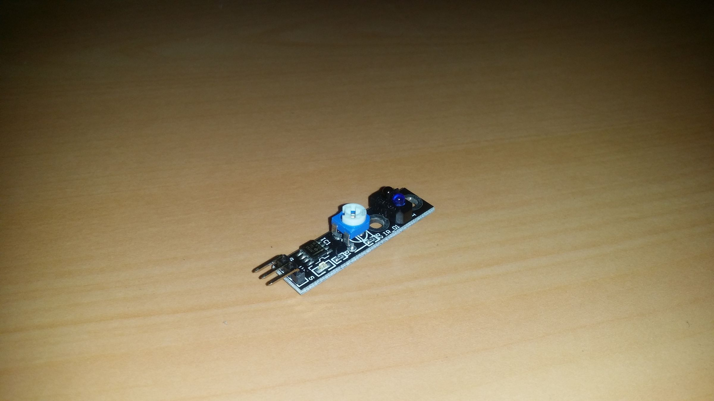
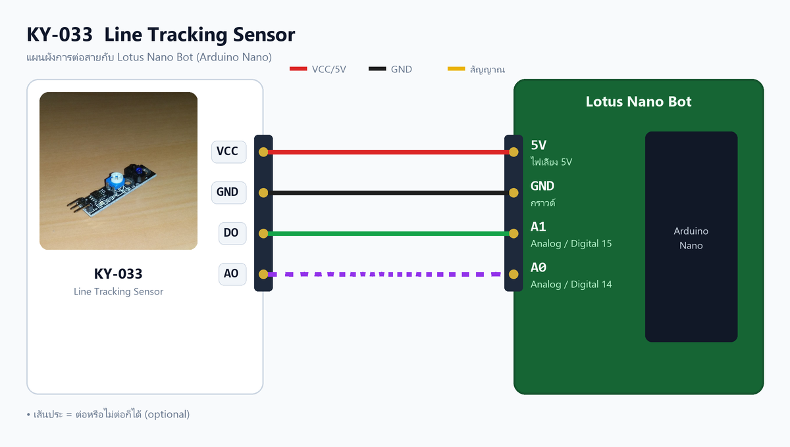

# KY-033 --- Line Tracking Sensor

## รายละเอียด

Tracking Sensor หรือ Line Tracking Sensor เป็นเซนเซอร์ตรวจจับเส้นสีดำ/ขาวบนพื้นผิว โดยใช้คลื่นอินฟราเรด (IR) ทำงานโดยส่ง IR ออกมาและวัดแสงที่สะท้อนกลับ เส้นสีดำจะดูดซับแสงทำให้ค่าต่ำ ส่วนพื้นสีขาวจะสะท้อนแสงทำให้ค่าสูง

## คุณสมบัติ

- แรงดันไฟฟ้า: 3.3V - 5V DC
- ระยะตรวจจับ: 1 - 25 mm (ปรับได้)
- เอาต์พุต: Digital (Low = พื้นขาว/สะท้อนแสง, High = เส้นดำ) และ Analog (AO, บางรุ่น)
- มี LED แสดงสถานะ

## ขาของเซนเซอร์

| ขา (Sensor) | สีสาย | เชื่อมต่อกับ (Lotus Nano Bot) |
|-------------|-------|------------------------------|
| VCC         | แดง   | 5V                           |
| GND         | ดำ/น้ำตาล | GND                       |
| DO (Digital)| เหลือง | D3 หรือ A1 (D15)          |
| AO (Analog) | ขาว/เขียว | A0, A2, A3 หรือ A6 (ห้ามใช้ขาเดียวกับ DO) |

> **หมายเหตุ:** บน Lotus Nano Bot พอร์ต Digital ภายนอกมี D0, D1, D3 โดย D0/D1 ใช้กับ Bluetooth/Serial ส่วน D3 ใช้กับบัซเซอร์บนบอร์ด หากต้องการพอร์ต Digital เพิ่มสามารถใช้ A0-A3 เป็น Digital ได้ (A0=Pin14, A1=Pin15, A2=Pin16, A3=Pin17)

## การต่อสายไฟ

```
Tracking Sensor          Lotus Nano Bot
━━━━━━━━━━━━━━━━━━━━━━━━━━━━━━━━━━━━━━━━
VCC  ──────────────────► 5V
GND  ──────────────────► GND
DO   ──────────────────► D3 หรือ A1 (D15)
AO   ──────────────────► A0 (optional)
```

### ภาพการต่อสาย (Text Diagram)

```
        +------------------+
        |  Tracking Sensor |
        |  (TCRT5000)      |
        |                  |
   +----+----+   +----+----+   +----+----+   +----+----+
   |  VCC    |   |  GND    |   |  DO     |   |  AO     |
   |   (+)   |   |   (-)   |   | (Digi)  |   | (Anlg)  |
   +----+----+   +----+----+   +----+----+   +----+----+
        |             |             |             |
        |             |             |             |
   +----+----+   +----+----+   +----+----+   +----+----+
   |   5V    |   |  GND    |   |   D3    |   |   A0    |
   |         |   |         |   |         |   |         |
   |  Lotus  |   |  Nano   |   |  Bot    |   |         |
   +---------+   +---------+   +---------+   +---------+
```

## โค้ดตัวอย่าง

```cpp
// Tracking Sensor Example for Lotus Nano Bot
// DO -> D3, AO -> A0

#define TRACKING_DIGITAL_PIN 3  // หรือ 15 (A1)
#define TRACKING_ANALOG_PIN A0
#define LED_PIN 13

void setup() {
  Serial.begin(9600);
  pinMode(TRACKING_DIGITAL_PIN, INPUT);
  pinMode(LED_PIN, OUTPUT);
  Serial.println("Line Tracking Sensor Test Started");
}

void loop() {
  int digitalValue = digitalRead(TRACKING_DIGITAL_PIN);
  int analogValue = analogRead(TRACKING_ANALOG_PIN);
  
  Serial.print("Digital: ");
  Serial.print(digitalValue);
  Serial.print(" | Analog: ");
  Serial.println(analogValue);
  
  if (digitalValue == HIGH) {  // ตรวจพบเส้นสีดำ (ไม่มีแสงสะท้อน)
    Serial.println("⚫ Black Line Detected!");
    digitalWrite(LED_PIN, HIGH);
  } else {
    Serial.println("⚪ White Surface");
    digitalWrite(LED_PIN, LOW);
  }
  
  delay(200);
}
```

## โค้ดตัวอย่างสำหรับหุ่นยนต์ติดตามเส้น (Line Follower)

```cpp
// Line Follower Robot using Lotus Nano Bot
// ใช้ 3 Tracking Sensors (DO): ซ้าย -> A0, ขวา -> A1, กลาง -> A2
// DO = HIGH เมื่ออยู่บนเส้นดำ

#define LEFT_TRACKER   14  // A0
#define RIGHT_TRACKER  15  // A1
#define CENTER_TRACKER 16  // A2

// Motor pins ของ Lotus Nano Bot
#define DL1  9   // มอเตอร์ซ้าย In1
#define DL2  4   // มอเตอร์ซ้าย In2
#define PWML 5   // มอเตอร์ซ้าย PWM
#define DR1  7   // มอเตอร์ขวา In1
#define DR2  8   // มอเตอร์ขวา In2
#define PWMR 6   // มอเตอร์ขวา PWM

void setup() {
  Serial.begin(9600);
  pinMode(LEFT_TRACKER, INPUT);
  pinMode(RIGHT_TRACKER, INPUT);
  pinMode(CENTER_TRACKER, INPUT);

  pinMode(DL1, OUTPUT);
  pinMode(DL2, OUTPUT);
  pinMode(PWML, OUTPUT);
  pinMode(DR1, OUTPUT);
  pinMode(DR2, OUTPUT);
  pinMode(PWMR, OUTPUT);
}

void loop() {
  int left = digitalRead(LEFT_TRACKER);
  int right = digitalRead(RIGHT_TRACKER);
  int center = digitalRead(CENTER_TRACKER);

  if (center == HIGH) {        // ตรงกลางอยู่บนเส้น
    moveForward();
  } else if (left == HIGH) {   // เส้นอยู่ทางซ้าย
    turnLeft();
  } else if (right == HIGH) {  // เส้นอยู่ทางขวา
    turnRight();
  } else {
    stopMotors();
  }
}

// ความเร็ว -255 ถึง 255 (ค่าลบ = ถอยหลัง)
// หากล้อหมุนกลับทาง ให้สลับค่า HIGH/LOW ของ In1/In2 ด้านนั้น
void drive(int speedL, int speedR) {
  digitalWrite(DL1, speedL >= 0 ? HIGH : LOW);
  digitalWrite(DL2, speedL >= 0 ? LOW : HIGH);
  analogWrite(PWML, abs(speedL));
  digitalWrite(DR1, speedR >= 0 ? HIGH : LOW);
  digitalWrite(DR2, speedR >= 0 ? LOW : HIGH);
  analogWrite(PWMR, abs(speedR));
}

void moveForward() { drive(150, 150); }
void turnLeft()    { drive(-100, 150); }
void turnRight()   { drive(150, -100); }
void stopMotors()  { drive(0, 0); }
```

## หมายเหตุ

- หมุนตัวปรับค่า (Potentiometer) ให้ LED เปลี่ยนสถานะตรงจุดที่ต้องการ
- ความสูงจากพื้นควรอยู่ที่ 5-15 mm
- ใช้เทปกาวสีดำบนพื้นสีขาว หรือใช้กระดาษขาววางบนเส้นดำ
- หลีกเลี่ยงแสงแดดจัดโดยตรง เพราะจะรบกวน IR sensor
- บางรุ่นให้ลอจิกกลับกัน (ดำ = LOW) ให้ตรวจสอบด้วย Serial Monitor ก่อนเขียนเงื่อนไข
- โมดูล KY-033 แบบ 3 ขา (G, V+, S) มีเฉพาะเอาต์พุต Digital ให้ต่อ S แทน DO
- D3 ต่อร่วมกับบัซเซอร์บนบอร์ด อาจได้ยินเสียงคลิกเบาๆ เมื่อสัญญาณเปลี่ยน หากไม่ต้องการให้ย้ายไป A0-A3 (D14-D17)

## กิจกรรมการเรียนรู้

### จุดประสงค์การเรียนรู้
1. นักเรียนสามารถอ่านค่าจาก Tracking Sensor และแยกพื้นสีขาวกับเส้นสีดำได้
2. นักเรียนสามารถหาความสูงจากพื้นที่เหมาะสมที่สุดของเซนเซอร์ได้
3. นักเรียนสามารถอธิบายหลักการตัดสินใจของหุ่นยนต์เดินตามเส้นจากค่าเซนเซอร์ได้

### ขั้นตอนการทดลอง
1. ต่อ DO -> D3 และ AO -> A0 แล้วอัปโหลดโค้ดตัวอย่างแรก
2. วางเซนเซอร์เหนือกระดาษขาวและเทปดำที่ความสูง 5 mm บันทึกค่า Digital และ Analog
3. ยกเซนเซอร์สูงขึ้นเป็น 15 mm และ 30 mm แล้วทำซ้ำ
4. ปรับ Potentiometer จนเซนเซอร์แยกขาว/ดำได้ชัดเจนที่ความสูงที่เหมาะสม
5. (ถ้ามีเซนเซอร์ 3 ตัว) ต่อที่ A0, A1, A2 แล้วทดลองโค้ด Line Follower บนสนามเส้นดำ

### ตารางบันทึกผล
| ครั้งที่ | สภาวะ/การกระทำ | ค่าที่อ่านได้ | ผลที่สังเกตได้ |
|---|---|---|---|
| 1 | พื้นสีขาว สูง 5 mm | | |
| 2 | เส้นสีดำ สูง 5 mm | | |
| 3 | เส้นสีดำ สูง 15 mm | | |
| 4 | ยกเซนเซอร์สูง 30 mm (ไม่มีพื้น) | | |

### คำถามท้ายการทดลอง
1. ทำไมเซนเซอร์จึงแยกพื้นสีขาวกับเส้นสีดำได้
2. เมื่อยกเซนเซอร์สูงขึ้น ค่า Analog ของพื้นขาวและเส้นดำต่างกันมากขึ้นหรือน้อยลง
3. หุ่นยนต์เดินตามเส้นที่ใช้เซนเซอร์ 3 ตัวตัดสินใจเลี้ยวซ้าย/ขวาอย่างไร

<details>
<summary>แนวคำตอบ (สำหรับครู)</summary>

1. พื้นสีขาวสะท้อนแสง IR กลับมามาก ส่วนสีดำดูดกลืนแสง IR ตัวรับจึงได้รับแสงสะท้อนต่างกัน
2. ต่างกันน้อยลง เพราะแสงสะท้อนกลับมาน้อยลงทั้งสองพื้นผิว จนแยกไม่ออกเมื่อสูงเกินไป
3. ถ้าเซนเซอร์กลางเจอเส้นให้เดินตรง ถ้าเส้นไปอยู่ใต้เซนเซอร์ซ้ายให้เลี้ยวซ้าย ถ้าอยู่ใต้เซนเซอร์ขวาให้เลี้ยวขวา

</details>

### ภารกิจท้าทาย
- ใช้ Knob A7 ปรับความเร็วฐานของหุ่นยนต์เดินตามเส้น (`map()` เป็น 80-200) แสดงค่าความเร็วและสถานะเซนเซอร์บน OLED และกดปุ่ม D2 เพื่อเริ่มวิ่ง

## รูปภาพ





