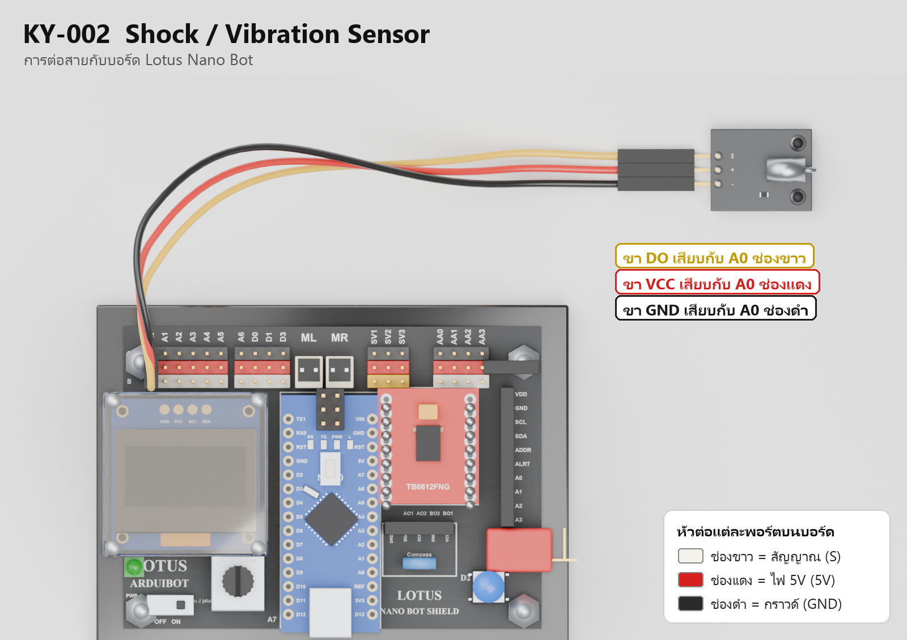
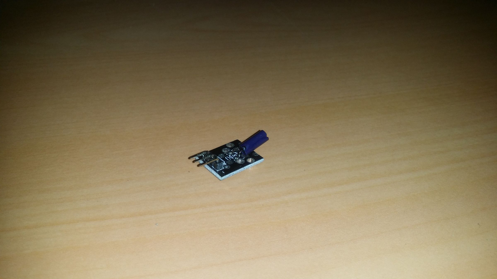
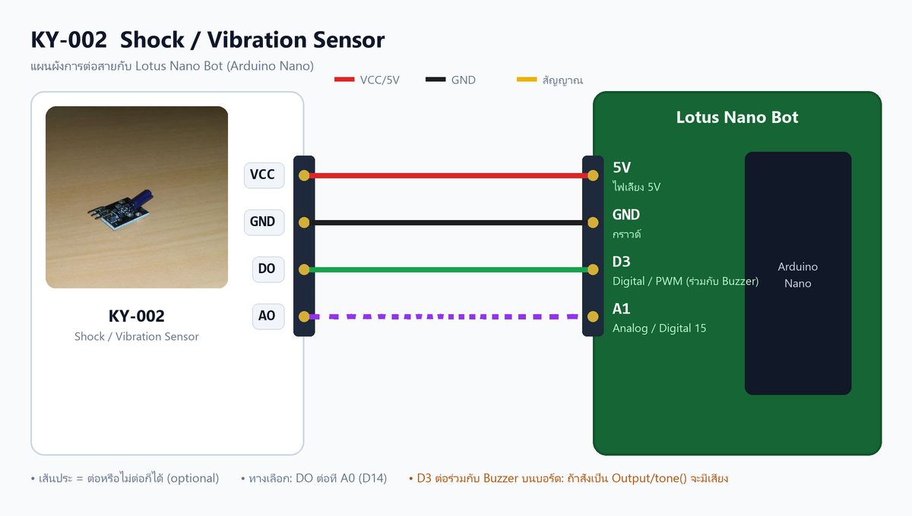

# KY-002 --- Shock / Vibration Sensor

## รายละเอียด

Vibration Sensor โมดูล SW-420 ใช้ตรวจจับการสั่นสะเทือนโดยใช้ Spring Switch ภายใน มีวงจรเปรียบเทียบในตัวเพื่อให้เอาต์พุตเป็นดิจิตอล Digital (High/Low)

> **หมายเหตุ:** โมดูล KY-002 ในชุด 37 in 1 เป็น Shock Sensor แบบสปริง 3 ขา (S, +, -) ให้เอาต์พุต Digital อย่างเดียว ให้ต่อ S เข้า A0 แทน DO (+ -> 5V, - -> GND)

## คุณสมบัติ

- แรงดันไฟฟ้า: 3.3V - 5V DC
- เอาต์พุต: Digital (DO)
- มี LED แสดงสถานะ
- มีตัวปรับความไว (Potentiometer)

## ขาของโมดูล

| ขา (Module) | สีสาย | เชื่อมต่อกับ (Lotus Nano Bot) |
|-------------|-------|------------------------------|
| VCC         | แดง   | 5V                           |
| GND         | ดำ/น้ำตาล | GND                       |
| DO (Digital)| ขาว   | A0 (D14)                     |

> ต่อที่หัวต่อพอร์ต A0 บนบอร์ด: ช่องขาว = S (DO), ช่องแดง = 5V, ช่องดำ = GND
>
> **หมายเหตุ:** ขา A0-A3 ใช้เป็น Digital ได้ (A0=Pin14, A1=Pin15, A2=Pin16, A3=Pin17)

## การต่อสายไฟ

```
Vibration Sensor         Lotus Nano Bot
━━━━━━━━━━━━━━━━━━━━━━━━━━━━━━━━━━━━━━━━
VCC  ──────────────────► 5V
GND  ──────────────────► GND
DO   ──────────────────► A0 (D14)
```

### ภาพการต่อสายกับบอร์ด



## โค้ดตัวอย่าง

```cpp
// Vibration Sensor Example for Lotus Nano Bot
// DO -> A0 (D14)

#define VIBRATION_PIN 14  // A0
#define LED_PIN 13  // LED บนบอร์ด Nano

void setup() {
  Serial.begin(9600);
  pinMode(VIBRATION_PIN, INPUT);
  pinMode(LED_PIN, OUTPUT);
  Serial.println("Vibration Sensor Test Started");
}

void loop() {
  int vibration = digitalRead(VIBRATION_PIN);
  
  if (vibration == HIGH) {  // ตรวจพบการสั่นสะเทือน
    Serial.println("📳 Vibration Detected!");
    digitalWrite(LED_PIN, HIGH);
    delay(500);  // Debounce
    digitalWrite(LED_PIN, LOW);
  }
  
  delay(10);
}
```

## โค้ดตัวอย่าง Alarm กันขโมย

```cpp
// DO -> A0 (D14), เสียงเตือนใช้บัซเซอร์บนบอร์ด
#define VIBRATION_PIN 14  // A0

int vibrationCount = 0;
unsigned long lastVibrationTime = 0;

void setup() {
  Serial.begin(9600);
  pinMode(VIBRATION_PIN, INPUT);
}

void loop() {
  if (digitalRead(VIBRATION_PIN) == HIGH) {
    unsigned long currentTime = millis();
    
    if (currentTime - lastVibrationTime > 1000) {
      vibrationCount++;
      lastVibrationTime = currentTime;
      
      Serial.print("Vibration #");
      Serial.println(vibrationCount);
      
      if (vibrationCount >= 3) {
        Serial.println("🚨 ALARM! ALARM!");
        // tone(3, ...) = บัซเซอร์บนบอร์ด Lotus Nano Bot
        tone(3, 1000, 500);
        vibrationCount = 0;
      }
    }
  }
}
```

## หมายเหตุ

- หมุนตัวปรับค่าเพื่อกำหนดความไวในการตรวจจับ
- ควรใช้ Debounce ในโค้ดเพื่อป้องกันการอ่านค่าซ้ำ
- Lotus Nano Bot มีบัซเซอร์ในตัว ใช้ `tone(3, frequency, duration)` ได้ทันทีโดยไม่ต้องต่อสาย
- สามารถใช้ A0-A3 เป็น Digital Input ได้ (A0=Pin14, A1=Pin15, A2=Pin16, A3=Pin17)

## กิจกรรมการเรียนรู้

### จุดประสงค์การเรียนรู้
1. นักเรียนสามารถอ่านสัญญาณการสั่นสะเทือนด้วย `digitalRead()` และแสดงผลผ่าน LED ได้
2. นักเรียนสามารถปรับความไวของเซนเซอร์และบันทึกระดับการสั่นที่ตรวจจับได้
3. นักเรียนสามารถเขียนโปรแกรมนับการสั่นด้วย `millis()` เพื่อทำสัญญาณกันขโมยได้

### ขั้นตอนการทดลอง
1. ต่อ DO -> A0, VCC -> 5V, GND -> GND แล้วอัปโหลดโค้ดตัวอย่างแรก
2. วางโมดูลบนโต๊ะ แล้วเคาะโต๊ะเบาๆ เคาะแรง และเขย่าโมดูล บันทึกผลทุกกรณี
3. ปรับ Potentiometer (ถ้ามี) แล้วทำข้อ 2 ซ้ำ เปรียบเทียบความไว
4. อัปโหลดโค้ด Alarm (ใช้การต่อสายเดิม) เขย่าโมดูล 3 ครั้งห่างกันมากกว่า 1 วินาที

### ตารางบันทึกผล
| ครั้งที่ | สภาวะ/การกระทำ | ค่าที่อ่านได้ | ผลที่สังเกตได้ |
|---|---|---|---|
| 1 | วางนิ่งบนโต๊ะ | | |
| 2 | เคาะโต๊ะเบาๆ | | |
| 3 | เขย่าโมดูลแรงๆ | | |
| 4 | เขย่า 3 ครั้ง (โค้ด Alarm) | | |

### คำถามท้ายการทดลอง
1. Vibration Sensor แบบสปริงตรวจจับการสั่นได้อย่างไร
2. ในโค้ด Alarm ทำไมต้องเว้นเวลา 1000 ms ระหว่างการนับแต่ละครั้ง
3. จะนำเซนเซอร์สั่นไปใช้ในหุ่นยนต์หรือในชีวิตประจำวันได้อย่างไร

<details>
<summary>แนวคำตอบ (สำหรับครู)</summary>

1. เมื่อเกิดการสั่น สปริงหรือหน้าสัมผัสภายในจะแตะกัน/แยกจากกันชั่วขณะ วงจรจึงให้สัญญาณเปลี่ยนสถานะ
2. เพื่อไม่ให้การสั่นครั้งเดียวซึ่งทำให้สปริงเด้งหลายรอบถูกนับเป็นหลายครั้ง (Debounce)
3. เช่น ตรวจจับการชนของหุ่นยนต์, สัญญาณกันขโมยรถ/ประตู, ตรวจจับแผ่นดินไหวอย่างง่าย

</details>

### ภารกิจท้าทาย
- ทำเซนเซอร์ตรวจการชน: ติดโมดูลที่หน้าหุ่นยนต์ ให้มอเตอร์เดินหน้า เมื่อตรวจพบการสั่นสะเทือน (ชน) ให้ถอยหลัง 0.5 วินาที แล้วหยุด พร้อมส่งเสียงจากบัซเซอร์บนบอร์ด (`tone(3, ...)`)

## รูปภาพ





